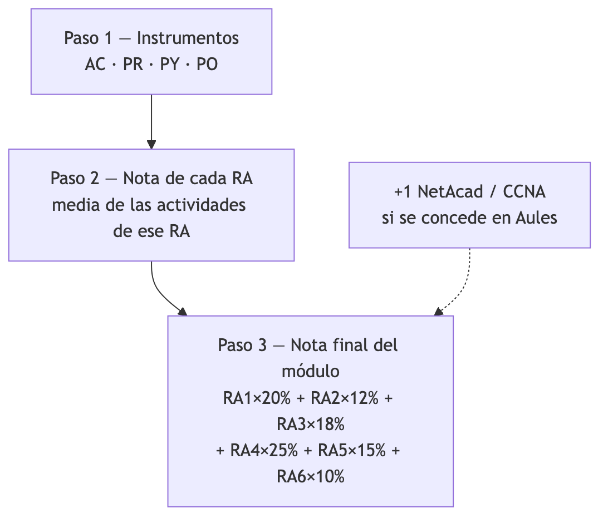
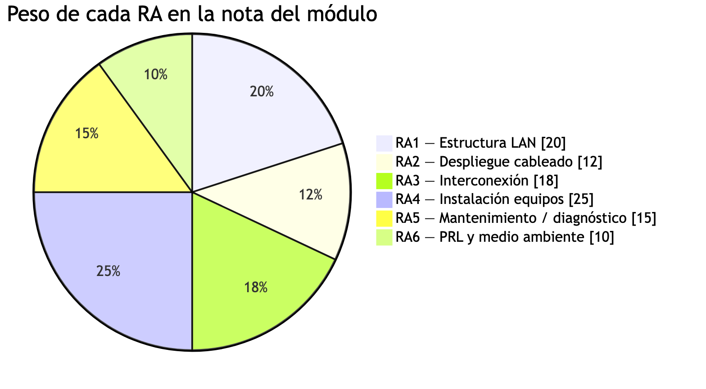

# PROGRAMACIÓN DIDÁCTICA

## REDES DE ÁREA LOCAL

**Código:** 0225  
**Duración del módulo:** 233 horas (**133** en centro + **100** de formación en empresa)  
**Sesiones semanales en centro:** 7  

**CICLO FORMATIVO DE GRADO MEDIO**  
**SISTEMAS MICROINFORMÁTICOS Y REDES**  
**Primer curso (1SMR)**  

**Profesor:** Javier Hernández Illán  

**CURSO:** 2026/2027  

**Centro:** IES Macià Abela (Crevillent)  
**Departamento de Informática**

---

::: {.manual-index}

## Índice

El documento Word lleva un índice de hipervínculos, escrito por `Planificación/docx_format.lua` al ejecutar `Planificación/build_docx.sh`. Esta lista sirve para leer el archivo Markdown y no se copia al Word.

1. [Introducción](#introducción)
2. [Aportaciones del módulo al desarrollo de competencias](#aportaciones-del-módulo-al-desarrollo-de-competencias)
3. [Objetivos](#objetivos)
4. [Contenidos y organización en unidades de programación](#contenidos-y-organización-en-unidades-de-programación)
5. [Metodología](#metodología)
6. [Fomento a la lectura](#fomento-a-la-lectura)
7. [Uso didáctico y profesional de las tecnologías](#uso-didáctico-y-profesional-de-las-tecnologías)
8. [Evaluación](#evaluación)
9. [Desarrollo de las UUPP](#desarrollo-de-las-uupp)
    - [UP 1 (T1). Introducción. Arquitectura de redes](#up-1-t1.-introducción.-arquitectura-de-redes)
    - [UP 2 (T2). Medios de transmisión y capa física](#up-2-t2.-medios-de-transmisión-y-capa-física)
    - [UP 3 (T3). Cableado estructurado y componentes](#up-3-t3.-cableado-estructurado-y-componentes)
    - [UP 4 (T4). Capa de enlace](#up-4-t4.-capa-de-enlace)
    - [UP 5 (T5). Capa de red](#up-5-t5.-capa-de-red)
    - [UP 6 (T6). Enrutamiento, subnetting y redes locales virtuales](#up-6-t6.-enrutamiento-subnetting-y-redes-locales-virtuales)
    - [UP 7 (T7). Capa de transporte](#up-7-t7.-capa-de-transporte)
    - [UP 8 (T8). Traducción de direcciones e IPv6](#up-8-t8.-traducción-de-direcciones-e-ipv6)
    - [UP 9 (T9). Servicios, diagnóstico y protección](#up-9-t9.-servicios-diagnóstico-y-protección)
10. [Medidas de atención a la diversidad](#medidas-de-atención-a-la-diversidad)
11. [Actividades complementarias y extraescolares](#actividades-complementarias-y-extraescolares)
12. [Formación en la empresa](#formación-en-la-empresa)
13. [Evaluación de la programación y de la práctica docente](#evaluación-de-la-programación-y-de-la-práctica-docente) (remisión al apartado 8.15)
- [Anexo A. Matriz de cobertura de criterios de evaluación](#anexo-a.-matriz-de-cobertura-de-criterios-de-evaluación)
- [Anexo B. Programación de aula](#anexo-b.-programación-de-aula)
- [Anexo C. Sitio web de apuntes](#anexo-c.-sitio-web-de-apuntes)

:::

---

# 1. Introducción

La presente programación didáctica concreta la planificación del módulo profesional **0225 Redes de área local** (1.er curso del CFGM **Sistemas Microinformáticos y Redes**), impartido en el **IES Macià Abela** (Crevillent) en el curso **2026/2027**.

El módulo dura **233 horas**: **133** en el centro y **100** de formación en empresa. El grupo es de primer curso. La formación en empresa empieza el **17 de mayo de 2027**. El bloque de centro va de septiembre a mediados de mayo: la unidad T9 cierra hacia el **5 de mayo de 2027**, y las sesiones que quedan hasta el 17 de mayo se usan para la recuperación y el cierre. Hay **7 sesiones semanales**. El detalle está en el apartado 4.4 y en el anexo B.

Los referentes de la evaluación son los resultados de aprendizaje (RA). Los criterios de evaluación (CE) sirven para verificar la cobertura: se trabajan y se comprueban todos, pero no son sumandos con porcentaje en la nota del boletín. La nota de cada RA es la media ponderada de los instrumentos de evaluación (IE) que lo evalúan, y la nota final del módulo es la media ponderada de los RA, con los pesos del apartado 8.4. El peso de cada IE dentro de su RA depende de los CE más importantes que ese instrumento evidencia. Los RA no son compensables entre sí. Este criterio se adoptó el 16 de septiembre de 2026 y se desarrolla en el apartado 8. El módulo se vincula a la unidad de competencia **UC0220_2** («Instalar, configurar y verificar los elementos de la red local según procedimientos establecidos») y capacita para caracterizar, desplegar, interconectar, instalar, configurar y mantener redes locales, diagnosticar incidencias y aplicar la prevención de riesgos laborales (PRL) y la protección ambiental.

## 1.1. Características del módulo y concepto de programación didáctica

El módulo es central en el perfil del Técnico en SMR: instalación, configuración y mantenimiento de redes locales en pequeños entornos, con calidad, seguridad y respeto ambiental.

La PD es el nivel de concreción curricular del departamento: qué RA alcanzar, cómo organizar el aprendizaje, con qué recursos, cómo atender la diversidad y cómo evaluar. Datos identificativos:

| Campo | Valor |
| --- | --- |
| Denominación | Redes de área local |
| Código | 0225 |
| Familia profesional | Informática y Comunicaciones |
| Ciclo formativo | Sistemas Microinformáticos y Redes |
| Nivel | Ciclo formativo de grado medio |
| Curso | Primero (1SMR) |
| Duración | 233 h (133 centro + 100 FE) |
| Sesiones semanales (centro) | 7 |
| Curso académico | 2026/2027 |
| Profesor | Javier Hernández Illán |

Documento abierto: podrá ajustarse por evaluación inicial, evolución del grupo, FE u organización, respetando currículo y transparencia de calificación, con registro en el departamento.

## 1.2. Entorno

Conforme al RD 659/2023, el currículo debe atender al entorno socioproductivo. El **IES Macià Abela** (Crevillent, Baix Vinalopó) está próximo a Elche y Alicante, con tejido industrial y de servicios (pymes) que demanda digitalización y mantenimiento de redes locales.

Ello justifica prácticas profesionales (cableado estructurado, racks, switches/AP, VLANs, diagnóstico, documentación) y, cuando sea posible, FE y visitas. La oferta de SMR en el centro permite coordinar taller y módulos del ciclo.

## 1.3. Características del alumnado

El alumnado de **1SMR** es heterogéneo (edad, acceso, experiencia, competencia digital, disponibilidad; a veces estudios + trabajo). Las decisiones se basan en **evaluación inicial**, observación y orientación.

Respuesta: actividades graduadas, práctica guiada/autónoma, trabajo cooperativo, refuerzo/ampliación y adaptaciones de acceso, **sin modificar los RA**. Parte del alumnado elige el ciclo de forma voluntaria, lo que favorece la motivación profesional.

## 1.4. Marco legal

La programación se ajusta a la normativa estatal y autonómica aplicable al módulo.

En el ámbito estatal se tienen en cuenta la Ley Orgánica 2/2006, de Educación, en la redacción dada por la Ley Orgánica 3/2020, y la Ley Orgánica 3/2022, de ordenación e integración de la Formación Profesional. El título de Técnico en Sistemas Microinformáticos y Redes, y con él el módulo **0225 Redes de área local**, se citan por el **Real Decreto 1691/2007, de 14 de diciembre**, por el que se establece ese título y se fijan sus enseñanzas mínimas. La ordenación de la Formación Profesional se toma del Real Decreto 659/2023, de 18 de julio, y de su calendario de implantación. Las actualizaciones posteriores de títulos de grado medio, por ejemplo el Real Decreto 499/2024, se aplican solo en lo que afecte a este ciclo.

En el ámbito autonómico se tienen en cuenta la Orden 8/2025, de evaluación en Formación Profesional; el Decreto 114/2025, de currículos; la Resolución de 16 de julio de 2026, de instrucciones para los grados D y E en el curso 2026-2027 (documento 2026_24495_es, DOGV); la resolución del calendario escolar 2026-2027; el Decreto 104/2018 y la Orden 20/2019, de inclusión; el Decreto 252/2019, de centros; y el currículo autonómico de Sistemas Microinformáticos y Redes que esté vigente.

La temporalización se alinea con el calendario del centro y con la programación de aula del anexo B.

## 1.5. Propuestas de mejora derivadas del curso anterior

A partir de la experiencia del curso 2025-2026 y de las reflexiones de departamento, se adoptan las siguientes mejoras para 2026-2027:

| Mejora | Aplicación en 2026-2027 | Seguimiento |
| --- | --- | --- |
| Reorganización del temario | **Nueve UP** (T1–T9; tradicionalmente UT), con núcleo enlace/IP/VLAN antes del margen FE | Programación de aula |
| Evaluación | Los referentes son los RA. Los CE verifican la cobertura y no porcentúan la nota del boletín. La nota de cada RA es la media ponderada de sus IE, y la del módulo es la media ponderada de los RA. | Sección 8 y Anexo A |
| Itinerario Cisco | Las prácticas de Packet Tracer son trabajo de casa del apartado de certificación. No puntúan en los resultados de aprendizaje. El punto adicional puede llegar a 1 y la nota final, a 11. | Apartado 8.5 |
| Materiales | Publicación progresiva en sitio **MkDocs** de apuntes | Anexo C |
| Entregas | Obligatoriedad de entregas en **Markdown (`.md`)** vía Aules | Secciones 6 y 7 |
| Corrección de vinculación UC | Uso de **UC0220_2** (red local), no UC de montaje de equipos ajenas al módulo | Sección 2 |

---

# 2. Aportaciones del módulo al desarrollo de competencias

## 2.1. Relación con el desarrollo de la competencia general

Según el Real Decreto 1691/2007, la **competencia general** del título consiste en:

> Instalar, configurar y mantener sistemas microinformáticos, aislados o en red, así como redes locales en pequeños entornos, asegurando su funcionalidad y aplicando los protocolos de calidad, seguridad y respeto al medio ambiente establecidos.

El módulo 0225 contribuye de forma directa a dicha competencia general al capacitar al alumnado para caracterizar, desplegar, interconectar, instalar, configurar y mantener redes locales cableadas, inalámbricas o mixtas en pequeños entornos, diagnosticar disfunciones y operar con criterios de calidad, seguridad y protección ambiental.

## 2.2. Relación con las competencias profesionales, personales y sociales

El módulo contribuye especialmente a las siguientes competencias profesionales, personales y sociales del título (letras del RD 1691/2007):

| Código | Competencia |
| --- | --- |
| **d** | Replantear el cableado y la electrónica de redes locales en pequeños entornos y su conexión con redes de área extensa canalizando a un nivel superior los supuestos que así lo requieran. |
| **e** | Instalar y configurar redes locales cableadas, inalámbricas o mixtas y su conexión a redes públicas, asegurando su funcionamiento en condiciones de calidad y seguridad. |
| **f** | Instalar, configurar y mantener servicios multiusuario, aplicaciones y dispositivos compartidos en un entorno de red local, atendiendo a las necesidades y requerimientos especificados. |
| **g** | Realizar las pruebas funcionales en sistemas microinformáticos y redes locales, localizando y diagnosticando disfunciones, para comprobar y ajustar su funcionamiento. |
| **h** | Mantener sistemas microinformáticos y redes locales, sustituyendo, actualizando y ajustando sus componentes, para asegurar el rendimiento del sistema en condiciones de calidad y seguridad. |

Además, el módulo refuerza competencias transversales de trabajo en equipo, documentación técnica, uso seguro de herramientas y responsabilidad profesional en el taller.

## 2.3. Contribución a las competencias para la empleabilidad

### Unidad de competencia asociada

Conforme al BOE del título, el módulo **0225 Redes locales** se asocia a:

> **UC0220_2:** Instalar, configurar y verificar los elementos de la red local según procedimientos establecidos.

Se corrige expresamente la vinculación errónea a **UC0953_2** (montaje de equipos microinformáticos) que pudiera figurar en programaciones anteriores: esa UC no es la referencia de este módulo.

La UC0220_2 se concreta en realizaciones profesionales orientadas a instalar y configurar nodos y elementos de la red local, verificar el funcionamiento según procedimientos y documentar el proceso, en coherencia con los RA1–RA6 del módulo.

### Empleabilidad

Las competencias para la empleabilidad tienen carácter transversal. Se integran en las actividades y en los instrumentos vinculados a los resultados de aprendizaje, y no reciben una calificación separada. El Proyecto Curricular del ciclo asigna a este módulo las competencias E2, E3, E5 y E6.

| Referencia | Competencia para la empleabilidad | Concreción en Redes de área local |
| --- | --- | --- |
| E2 | Trabajo en equipo y colaboración. | Montaje en equipo del rack y del cableado. |
| E3 | Comunicación e interacción profesional, también técnica y en lengua extranjera. | Documentación técnica en Markdown y consulta de documentación en inglés. |
| E5 | Resolución de problemas y pensamiento crítico. | Diagnóstico de fallos de red. |
| E6 | Competencia digital profesional y uso ético y seguro de la tecnología. | Uso seguro de los equipos y de las herramientas digitales, incluida la inteligencia artificial. |

Las situaciones de aprendizaje del módulo, en el taller, en la documentación y en el diagnóstico, acercan al alumnado a ocupaciones de soporte técnico, instalación de redes locales y mantenimiento de infraestructuras en pequeñas y medianas empresas.

## 2.4. Contribución de los resultados de aprendizaje a las competencias

| RA | Contribución principal a CP | Observación breve |
| :---: | --- | --- |
| RA1 | d, e | Fundamentos, mapa físico/lógico y topologías |
| RA2 | d, e | Despliegue de cableado y espacios |
| RA3 | d, e, f | Interconexión, conectores y verificación |
| RA4 | e, f | Instalación y configuración (red inalámbrica, protocolos, redes locales virtuales) |
| RA5 | g, h | Diagnóstico, mantenimiento e informes |
| RA6 | e, h (calidad, seguridad y ambiente) | Prevención de riesgos laborales y protección ambiental en el taller |

El peso de cada RA es el del apartado 8.4 y no se modifica aquí. Las horas de referencia reparten las **133 horas de centro** en la misma proporción que ese peso. Son una distribución de referencia, no una temporalización nueva: no cambian las sesiones de las unidades ni las **100 horas** de formación en empresa, que esta programación no asigna todavía a un RA concreto. El apartado 8.7.4 considera necesarios todos los RA del módulo, con umbral de 5 y sin compensación entre ellos; por eso todos figuran como esenciales.

| RA | Peso en el módulo | Horas de referencia (133 h de centro × peso) | Carácter |
| :---: | ---: | ---: | --- |
| RA1 | 20 % | 26,60 h | Esencial |
| RA2 | 12 % | 15,96 h | Esencial |
| RA3 | 18 % | 23,94 h | Esencial |
| RA4 | 25 % | 33,25 h | Esencial |
| RA5 | 15 % | 19,95 h | Esencial |
| RA6 | 10 % | 13,30 h | Esencial |
| **Total** | **100 %** | **133,00 h** | — |

---

# 3. Objetivos

## 3.1. Objetivos generales del ciclo vinculados al módulo

La formación del módulo contribuye a alcanzar, entre otros, los siguientes **objetivos generales** del ciclo (letras del RD 1691/2007):

| Código | Objetivo general |
| --- | --- |
| **d** | Representar la posición de los equipos, líneas de transmisión y demás elementos de una red local, analizando la morfología, condiciones y características del despliegue, para replantear el cableado y la electrónica de la red. |
| **e** | Ubicar y fijar equipos, líneas, canalizaciones y demás elementos de una red local cableada, inalámbrica o mixta, aplicando procedimientos de montaje y protocolos de calidad y seguridad, para instalar y configurar redes locales. |
| **f** | Interconectar equipos informáticos, dispositivos de red local y de conexión con redes de área extensa, ejecutando los procedimientos para instalar y configurar redes locales. |
| **g** | Localizar y reparar averías y disfunciones en los componentes físicos y lógicos para mantener sistemas microinformáticos y redes locales. |
| **h** | Sustituir y ajustar componentes físicos y lógicos para mantener sistemas microinformáticos y redes locales. |

## 3.2. Relación entre objetivos, competencias y resultados de aprendizaje

| OG | CP | RA principales |
| :---: | :---: | :---: |
| d | d | RA1, RA2 |
| e | e | RA2, RA3, RA4 |
| f | e, f | RA3, RA4 |
| g | g | RA5 |
| h | h | RA5, RA6 |

## 3.3. Resultados de aprendizaje

Los RA del módulo (enunciados del RD 1691/2007) y sus **pesos en la calificación** del curso 2026-2027 son:

| Código | Descripción | Peso |
| --- | --- | ---: |
| **RA1** | Reconoce la estructura de redes locales cableadas analizando las características de entornos de aplicación y describiendo la funcionalidad de sus componentes. | **20 %** |
| **RA2** | Despliega el cableado de una red local interpretando especificaciones y aplicando técnicas de montaje. | **12 %** |
| **RA3** | Interconecta equipos en redes locales cableadas describiendo estándares de cableado y aplicando técnicas de montaje de conectores. | **18 %** |
| **RA4** | Instala equipos en red, describiendo sus prestaciones y aplicando técnicas de montaje. | **25 %** |
| **RA5** | Mantiene una red local interpretando recomendaciones de los fabricantes de hardware o software y estableciendo la relación entre disfunciones y sus causas. | **15 %** |
| **RA6** | Cumple las normas de prevención de riesgos laborales y de protección ambiental, identificando los riesgos asociados, las medidas y equipos para prevenirlos. | **10 %** |
| | **Total** | **100 %** |

**Nota metodológica de evaluación**, alineada con la referencia de Solbes que se cita a continuación y con la normativa de Formación Profesional.

Los referentes de la calificación son los RA, no los instrumentos aislados ni los trimestres. La nota de cada RA es la media ponderada de los IE (actividades de clase, prácticas, proyectos y pruebas objetivas) que evalúan ese RA. La nota final del módulo es la media ponderada de los seis RA, con pesos **20 / 12 / 18 / 25 / 15 / 10**. Los CE sirven para verificar que el alumnado ha alcanzado el RA: hay que trabajarlos y comprobarlos todos (anexo A), pero no son sumandos con porcentaje en la nota del boletín. El peso de cada IE dentro del RA depende de los CE más importantes que evidencia. Ese diseño procedimental de los instrumentos no reparte la nota en una parte conceptual, otra procedimental y otra actitudinal.

Referencias:
- [Los referentes para evaluar en FP](https://raulsolbes.com/2025/01/22/los-referentes-para-evaluar-en-fp/) (RA como referentes; CE para identificar el logro; RD 659/2023 art. 18; LO 3/2022 art. 26).
- [Programaciones didácticas para FP: evaluación](https://raulsolbes.com/2025/04/04/programaciones-didacticas-para-fp-evaluacion/).
- Matiz: [Evaluación por competencias en FP](https://raulsolbes.com/2020/05/27/evaluacion-por-competencias-en-fp/) (no dividir la nota en % conceptual/procedimental/actitudinal al evaluar CE).

### Cómo se calcula la nota (figura para Word)



| Paso | Contenido |
| --- | --- |
| **1** | Instrumentos **AC · PR · PY · PO** |
| **2** | Nota de cada **RA** = media (ponderada) de los IE de ese RA |
| **3** | Nota final = **RA1×20 % + RA2×12 % + RA3×18 % + RA4×25 % + RA5×15 % + RA6×10 %** |
| Extra | Hasta **+1** del apartado de certificación: 0,5 por las prácticas de Packet Tracer entregadas y defendidas, y 0,5 más por aprobar el examen de certificación. La nota final puede llegar a 11. Ese punto no sustituye ningún RA. |

### Peso de cada RA (figura para Word)



| RA | Descripción breve | Peso |
| --- | --- | ---: |
| RA1 | Estructura LAN | **20 %** |
| RA2 | Despliegue cableado | **12 %** |
| RA3 | Interconexión | **18 %** |
| RA4 | Instalación equipos | **25 %** |
| RA5 | Mantenimiento / diagnóstico | **15 %** |
| RA6 | PRL y medio ambiente | **10 %** |
| | **Total** | **100 %** |

Representación ASCII de respaldo:

```
RA1 ████████████████████ 20 %
RA2 ████████████ 12 %
RA3 ██████████████████ 18 %
RA4 █████████████████████████ 25 %
RA5 ███████████████ 15 %
RA6 ██████████ 10 %
```

## 3.4. Objetivos transversales y concreción didáctica

Además de los objetivos del título, se trabajan de forma transversal:

- Comunicación técnica escrita (informes, entregas Markdown, documentación de red).
- Trabajo colaborativo y responsabilidad en el uso del taller.
- Uso ético y seguro de las TIC (Aules, NetAcad, herramientas de diagrama y simulación).
- Prevención de riesgos y respeto ambiental en el manipulado de materiales y residuos.
- Autonomía progresiva hacia situaciones próximas a la formación en empresa.

---

# 4. Contenidos y organización en unidades de programación

Conforme al **Decreto 114/2025** (art. 9), el módulo se organiza en unidades de programación (**UP**, tradicionalmente UT). En esta PD las UP coinciden con los **nueve temas** T1–T9.

## 4.1. Contenidos curriculares de soporte

Los contenidos del módulo, según el currículo del título, se agrupan en bloques de soporte que esta programación desarrolla a través de nueve UP (temas):

1. **Caracterización de redes locales:** características, tipos, elementos, topologías, mapa físico.
2. **Despliegue del cableado:** identificación de espacios, armarios, paneles, canalizaciones, medios, conectores, herramientas, pruebas y etiquetado.
3. **Interconexión de equipos:** adaptadores, dispositivos de interconexión cableada e inalámbrica, redes mixtas.
4. **Instalación y configuración de equipos de red:** procedimientos, TCP/IP, direccionamiento IPv4/IPv6, configuración básica, seguridad básica, VLANs.
5. **Resolución de incidencias:** estrategias, monitorización, herramientas de diagnóstico, incidencias físicas y lógicas, informes.
6. **PRL y protección ambiental:** riesgos, EPI, medidas preventivas, residuos y orden/limpieza.

La duración mínima del módulo en el RD es de 130 h; en el cómputo del centro para 2026-27 se trabaja con **233 h** (133 centro + 100 FE), conforme a la organización del ciclo y a la programación de aula.

## 4.2. Criterios de organización y secuenciación

La secuenciación responde a los siguientes criterios:

1. **Progresión de lo general a lo específico:** fundamentos (T1) → medios y cableado (T2–T3) → capas de enlace y red (T4–T5) → enrutamiento/VLAN (T6) → transporte, NAT/IPv6 y cierre diagnóstico/PRL (T7–T9).
2. **Núcleo de enlace, direccionamiento y redes locales virtuales:** T4, T5 y T6, con la práctica de taller PR604, se imparten antes del bloque de transporte, traducción y diagnóstico (T7 a T9). Todo el bloque de centro termina antes de la formación en empresa, que empieza el 17 de mayo de 2027. PR603 pertenece al apartado de certificación y no puntúa en el resultado de aprendizaje.
3. **Integración teoría–práctica** en cada tema (AC + PR; PY/PO en hitos).
4. **Siete sesiones semanales.** Esta programación no detalla el reparto por días.
5. **Criterio horas y sesiones:** una hora del cómputo de 133 horas de centro equivale a una sesión lectiva (decisión de planificación 2026-27).

## 4.3. Bloques de contenido

Las **UP** son los **nueve temas** del curso:

| UP | Título | RA principales |
| ---: | --- | --- |
| T1 | Introducción. Arquitectura de redes | RA1 |
| T2 | Medios de transmisión y capa física | RA2, RA3 |
| T3 | Cableado estructurado y componentes | RA2, RA3, RA4 |
| T4 | Capa de enlace | RA1, RA4 |
| T5 | Capa de red | RA1, RA4 |
| T6 | Enrutamiento, subnetting y VLANs | RA3, RA4 |
| T7 | Capa de transporte | RA4, RA5 |
| T8 | NAT e IPv6 | RA4, RA5 |
| T9 | Servicios, diagnóstico y protección | RA5, RA6 |

### Mapa UP (tema) × RA

| UP | RA1 | RA2 | RA3 | RA4 | RA5 | RA6 |
| --- | :---: | :---: | :---: | :---: | :---: | :---: |
| T1 | X | | | | | |
| T2 | | X | X | | | |
| T3 | | X | X | X | | |
| T4 | X | | | X | | |
| T5 | X | | | X | | |
| T6 | | | X | X | | |
| T7 | | | | X | X | |
| T8 | | | | X | X | |
| T9 | | | | | X | X |
| **Peso** | 20 % | 12 % | 18 % | 25 % | 15 % | 10 % |

## 4.4. Distribución temporal y unidades de programación

Fuente: programación de aula (anexo B). La temporalización de centro llega hasta mediados de mayo de 2027.

| Concepto | Valor |
| --- | --- |
| Horas de centro | El cómputo de centro es de 133 horas. |
| Formación en empresa | Son 100 horas y empiezan el 17 de mayo de 2027. Las renuncias se presentan hasta el 17 de abril de 2027 y la aplicación SAÓ permanece abierta hasta el 7 de mayo de 2027. |
| Total del módulo | El módulo suma 233 horas. |
| Sesiones semanales | Hay 7 sesiones semanales en el centro. |
| Equivalencia | Una hora del cómputo equivale a una sesión lectiva. |
| Primera sesión | La primera sesión es el 11 de septiembre de 2026. |
| Cierre de T9 | T9 cierra hacia el 5 de mayo de 2027. |
| Margen posterior | Las sesiones que quedan entre ese cierre y el 17 de mayo de 2027 se usan para la recuperación y el cierre. La estancia en la empresa no desplaza T7, T8 ni T9. |

### Tabla T1–T9 (sesiones y fechas orientativas)

| Bloque | Sesiones (plan) | Nº sesión | Fechas lectivas (aprox.) | IE clave |
| --- | ---: | --- | --- | --- |
| **T1** | 18 | S001–S018 | 2026-09-11 → 2026-09-28 | Introducción. Arquitectura · PR101, AC102–104, PR102 |
| **T2** | 13 | S019–S031 | 2026-09-30 → 2026-10-16 | Medios / capa física · **PR201** (crimpado taller), PR202 |
| **T3** | 21 | S035–S055 | 2026-10-21 → 2026-11-09 | Cableado estructurado · **PR301** (taller), **PR304** (fusionadoras), **PR303 NetAcad WLAN**, PR302 |
| **PO1** | 2 | S056–S057 | 2026-11-11 → 2026-11-11 | Prueba objetiva 1.ª evaluación (T1–T3) + devolución |
| **T4** | 14 | S058–S071 | 2026-11-13 → 2026-11-25 | Capa de enlace · PR401, PR402 |
| **T5** | 14 | S072–S085 | 2026-11-27 → 2026-12-14 | Capa de red · PR501 |
| **T6** | 21 | S086–S106 | 2026-12-14 → 2027-01-18 | Enrutamiento / VLAN · PR601, PR602, **PR604** (VLAN taller), **PR603 NetAcad** |
| **PO2** | 2 | S107–S108 | 2027-01-20 → 2027-01-20 | Prueba objetiva 2.ª evaluación (núcleo T4–T6) + devolución |
| **T7** | 18 | S109–S126 | 2027-01-22 → 2027-02-08 | Capa de transporte · PR701, PR702 |
| **T8** | 16 | S127–S142 | 2027-02-08 → 2027-02-24 | NAT e IPv6 · PR801 |
| **T9** | 55 | S143–S197 | 2027-02-24 → 2027-05-05 | Servicios, diagnóstico, PRL · PR901, PR902, PY901, **PO901** + prep./cierre NetAcad-CCNA |

El 19 de octubre de 2026 (sesiones S032–S034) fue la prueba de T1 y T2. El contenido de T2 ya estaba impartido, así que esas tres sesiones no cuentan como T2. T3 empieza el 21 de octubre de 2026. El 2 de noviembre de 2026 es lectivo, según confirmó el centro. No son lectivos el 9 y el 12 de octubre, el 7 de diciembre de 2026 (festivo local), las vacaciones de Navidad (del 22 de diciembre de 2026 al 6 de enero de 2027), el 2 y el 3 de marzo (días no lectivos del centro), el 19 de marzo y la Semana Santa (del 25 de marzo al 5 de abril de 2027).

T1 ocupa las sesiones S001 a S018, de modo que el recuento y el rango coinciden. Los bloques siguientes se numeran a continuación, sin huecos. Las sesiones de T1 a T9, más las pruebas objetivas PO1 y PO2, suman **194**. A esas se añaden las **3** del 19 de octubre (S032 a S034). El último identificador es S197. El cómputo de centro sigue siendo de **133 horas**. T9 cierra hacia el 5 de mayo de 2027. Las sesiones posteriores, hasta el inicio de la formación en empresa el 17 de mayo de 2027, se dedican a la recuperación y al cierre.

Los CE de cada unidad se toman del anexo A. Se trabajan y se comprueban, y no llevan porcentaje de nota. Cuando un CE aparece en varias unidades, la tabla lo repite: la cobertura es compartida y no se parte en tantos por ciento. El peso informativo de cada unidad, calculado en el apartado 9 a partir de los pesos de los RA del apartado 8.4, no cambia ni las horas ni esos pesos.

| UP | CE que se trabajan (anexo A) | Evaluación parcial en la que cae la unidad |
| --- | --- | --- |
| T1 | CE1a, CE1b, CE1c, CE1d, CE1e, CE1f, CE1g, CE1h | 1.ª (hasta PO1, 11 de noviembre de 2026) |
| T2 | CE2a, CE2b, CE2c, CE2d, CE2h, CE2j, CE3c, CE3f, CE3g, CE6b, CE6e | 1.ª |
| T3 | CE2c, CE2d, CE2e, CE2f, CE2g, CE2i, CE2j, CE3a, CE3b, CE3c, CE3d, CE3e, CE3f, CE3g, CE4a, CE4b, CE4c, CE4d, CE4e, CE4f, CE4i, CE6b, CE6e | 1.ª |
| T4 | CE1a, CE1c, CE4g, CE4h | 2.ª (hasta PO2, 20 de enero de 2027) |
| T5 | CE1a, CE1c, CE4g, CE4h | 2.ª |
| T6 | CE3a, CE3f, CE4g, CE4h, CE4j | 2.ª |
| T7 | CE1a, CE1c, CE4g, CE4h, CE5a, CE5b, CE5d, CE5e, CE5h | 3.ª (desde el 22 de enero de 2027) |
| T8 | CE1a, CE1c, CE4g, CE4h, CE5b, CE5d, CE5h | 3.ª |
| T9 | CE5a, CE5b, CE5c, CE5d, CE5e, CE5f, CE5g, CE5h, CE6a, CE6b, CE6c, CE6d, CE6e, CE6f, CE6g, CE6h | 3.ª (cierre orientativo hacia el 5 de mayo de 2027) |

La 1.ª y la 2.ª evaluación parcial se deducen de los rótulos de PO1 y PO2 en esta misma tabla. La 3.ª es el tramo posterior, coherente con las tres evaluaciones parciales del apartado 8.7.5. El mapa del apartado 4.3 no marca RA6 en T2 y T3, ni RA1 en T7 y T8; el anexo A sí recoge ahí CE6b, CE6e, CE1a y CE1c. Esos CE se listan porque se evidencian, sin trasladar el peso del RA fuera de las unidades que el mapa marca.


---

# 5. Metodología

## 5.1. Principios metodológicos aplicables a la enseñanza en la formación profesional

Aprendizaje significativo, simulación profesional, práctica supervisada en taller y evaluación continua. Prioridades: aprender haciendo; progresión guiado→autónomo; documentación técnica; seguridad y calidad.

## 5.2. Metodologías activas

Prácticas de laboratorio/simulación (PT/NetAcad); proyectos (PY901); trabajo colaborativo; apoyo MkDocs (clase invertida parcial); resolución de problemas de diagnóstico (RA5).

## 5.3. Estrategias de enseñanza-aprendizaje y secuencia didáctica

Secuencia tipo por UP: activación → modelado → práctica guiada (AC/PR) → práctica autónoma → feedback en Aules → síntesis / enlace al hito PO o PY.

## 5.4. Tipo de actividades

| Tipo | Código | Descripción | Escala habitual |
| --- | :---: | --- | --- |
| Actividad de clase | **AC** | Microevidencia de aula | 0–1 |
| Práctica | **PR** | Laboratorio, simulación, NetAcad | 0–10 |
| Proyecto | **PY** | Entregable mayor con rúbrica | 0–30 |
| Prueba objetiva | **PO** | Examen escrito o en ordenador | 0–100 |

Opcionalmente pueden usarse actividades de refuerzo o profundización sin sustituir los IE anteriores. La codificación sigue el patrón *tipo + tema + orden* (p. ej. `PR303` = práctica 03 del Tema 3).

## 5.5. Organización del aula, agrupamientos y roles

- Sesiones en **aula-taller** de redes / informática del ciclo, con puestos individuales o compartidos según la actividad.
- Agrupamientos variables: individual (PO, algunas AC), parejas (cableado, PT), grupo pequeño (montaje de rack / casos).
- Roles rotativos en prácticas de taller (montaje, verificación, documentación, seguridad).
- Cumplimiento de las **normas del taller** del centro (documento canónico del IES y resumen publicado en el sitio de apuntes).

## 5.6. Coordinación intermodular, Proyecto Intermodular y formación en empresa

Coordinación con el equipo de 1SMR (SO, aplicaciones, seguridad). Si el centro desarrolla proyecto intermodular, se alinearán evidencias de red sin duplicar carga. La FE (sección 12) se insertará al fijarse la fecha.

## 5.7. Materiales y recursos didácticos

- Sitio web de apuntes MkDocs: <https://fjavier-hernandez.github.io/ral/>
- Aules (entregas, calificaciones, anuncios).
- Visual Studio Code + Markdown.
- Cisco Packet Tracer y plataforma **NetAcad** (class del curso; el profesor actúa como instructor).
- Herramientas de diagrama: Excalidraw, draw.io / diagrams.net, Dia.
- Material de taller: cableado, conectores, paneles, electrónica de red, herramientas de **crimpado** y comprobación, **fusionadoras** de fibra (y cleaver/protectores), switches gestionables didácticos, EPI según normas del taller.
- Documentación técnica, normas IEEE/ISO de referencia pedagógica y RFCs resumidos cuando proceda.

## 5.8. Planificación del uso de espacios y equipamientos

| Espacio / recurso | Uso principal |
| --- | --- |
| Aula-taller SMR | Docencia ordinaria T1–T9, prácticas de cableado e interconexión |
| Equipos de alumno | Simulación PT, configuración, entregas `.md` |
| Armarios / paneles didácticos | T3 (PR301), T6 (PR604), T9 |
| Fusionadoras / fibra | T3 (**PR304**) |
| NetAcad (en línea) | Preparación del apartado de certificación. El punto adicional no sustituye ningún resultado de aprendizaje. |
| Aules | Entrega y feedback |

---

# 6. Fomento a la lectura

## 6.1. Actividades de lectura y comunicación técnica

Se fomenta la lectura comprensiva de:

- Apuntes y guiones técnicos del sitio MkDocs.
- Hojas de datos y manuales breves de fabricantes (switches, AP, cableado).
- Resúmenes de **RFC** y estándares (selección adaptada al nivel de grado medio).
- Normas de taller y procedimientos de seguridad.

La producción escrita se canaliza mediante **entregas en Markdown (`.md`)** en Aules: informes de práctica, mapas de red, bitácoras de diagnóstico y el proyecto PY901. No se aceptan entregas en PDF como formato ordinario.

## 6.2. Seguimiento, evaluación e inclusión

El seguimiento se realiza a través de las AC/PR/PY que exigen lectura y redacción técnica. Se ofrecen modelos, plantillas y rúbricas claras. Cuando sea preciso, se adaptará el formato de acceso (tamaño de letra, tiempo, apoyos) sin reducir el nivel de exigencia competencial del RA evaluado.

---

# 7. Uso didáctico y profesional de las tecnologías

## 7.1. Finalidad y criterios generales de utilización

Las TIC se usan como medio profesional real (documentación, simulación, entrega, colaboración), no como fin ornamental. Se priorizan herramientas alineadas con el desempeño del técnico en redes locales.

## 7.2. Búsqueda, selección y gestión de información técnica

El alumnado busca, contrasta y cita fuentes técnicas (documentación de fabricante, apuntes del módulo, RFCs). Se trabaja la distinción entre fuentes fiables y contenido no verificado.

## 7.3. Comunicación, entrega y colaboración mediante canales digitales

- **Aules:** canal oficial de entregas y calificaciones.
- Comunicación respetuosa y trazable.
- Trabajo colaborativo cuando la actividad lo requiera, manteniendo la autoría individual exigible.

## 7.4. Software y entornos digitales del módulo

| Recurso | Uso |
| --- | --- |
| Aules | LMS del centro |
| VS Code + Markdown | Redacción de entregas |
| Excalidraw / draw.io / Dia | Diagramas de red |
| Packet Tracer | Simulación LAN |
| NetAcad | Itinerario WLAN/VLAN/CCNA |
| MkDocs (sitio público) | Apuntes y planificación visible |

## 7.5. Uso responsable, seguro, ético y accesible

Se exige:

- Respeto a la privacidad y a los datos personales.
- Uso legítimo de licencias y cuentas NetAcad.
- Integridad académica (sección 8.8).
- Cuidado del equipamiento compartido.
- Preferencia por formatos accesibles (Markdown, contraste, estructura clara).

---

# 8. Evaluación

## 8.1. Principios y organización de la evaluación

La evaluación es continua, formativa y sumativa. Comprueba el grado de consecución de los resultados de aprendizaje. Los referentes de la evaluación son los RA. Los instrumentos —actividad de clase (AC), práctica (PR), proyecto (PY) y prueba objetiva (PO)— aportan las evidencias con las que se califica cada RA. No se califica el trimestre ni el instrumento suelto como referente del módulo.

El criterio adoptado el 16 de septiembre de 2026, alineado con la referencia de Solbes que se cita debajo, es el siguiente. Los CE sirven para verificar la cobertura: se trabajan y se comprueban todos (anexo A), pero no son sumandos con porcentaje en la nota del boletín. La nota de cada RA es la media ponderada de los IE que lo evalúan. La nota final del módulo es la media ponderada de los RA, con los pesos 20, 12, 18, 25, 15 y 10 por ciento. El peso de cada IE dentro del RA depende de los CE más importantes que evidencia. Los RA no son compensables entre sí. Las escalas son AC de 0 a 1, PR de 0 a 10, PY de 0 a 30 y PO de 0 a 100. El apartado de certificación suma hasta 1 punto sobre la nota final, que puede llegar a 11, y no sustituye ningún resultado de aprendizaje (apartado 8.5).

Si se describe el carácter procedimental de los instrumentos, el matiz es el de Solbes: el RA es el referente y el CE es verificación, no un porcentaje del boletín. Diseñar más instrumentos, o darles más peso, sobre los CE más relevantes del perfil profesional no equivale a dividir la nota en una parte conceptual, otra procedimental y otra actitudinal.

Referencias: [Los referentes para evaluar en FP](https://raulsolbes.com/2025/01/22/los-referentes-para-evaluar-en-fp/); [Programaciones didácticas para FP: evaluación](https://raulsolbes.com/2025/04/04/programaciones-didacticas-para-fp-evaluacion/); matiz en [Evaluación por competencias en FP](https://raulsolbes.com/2020/05/27/evaluacion-por-competencias-en-fp/).

## 8.2. Características de la evaluación

La evaluación inicial detecta el punto de partida al comienzo del curso y de los bloques. La evaluación procesual da retroalimentación frecuente en Aules y en el taller. La evaluación final consolida cada RA y la calificación del módulo. Los criterios y los instrumentos se publican con una antelación razonable. Cuando hace falta, se aplican adaptaciones de acceso, descritas en el apartado 10, sin modificar los RA.

## 8.3. Referentes, ponderación y trazabilidad curricular

Los referentes de calificación son los seis RA, con pesos del 20, el 12, el 18, el 25, el 15 y el 10 por ciento. Esos pesos están en el apartado 8.4 y no se sustituyen por los instrumentos ni por los trimestres.

Cada IE declara el RA que evalúa y los CE que permite comprobar. La matriz completa de CE por actividad está en el anexo A de esta programación. La cobertura verificada es de **51 de 51** CE. Esa matriz comprueba la cobertura. No calcula la nota.

## 8.4. Ponderación de los RRAA y CCEE

El título de este apartado se mantiene porque así figura en la plantilla del departamento. El orden interno es el acordado para esta programación: primero se explica cómo se verifican los CE y después se ponderan los RA. Los CE no reciben porcentaje de calificación.

### Verificación de los criterios de evaluación

Los CE del módulo son los del Real Decreto 1691/2007. Sirven para verificar que el RA se ha alcanzado. Se trabajan y se comprueban todos, según el anexo A. No son sumandos con porcentaje en la nota del boletín, ni entre sí ni dentro del RA. Un mismo CE puede aparecer en varias actividades. Eso no multiplica su valor en la nota, porque el CE no tiene un valor de nota propio.

El peso de cada instrumento dentro del resultado de aprendizaje depende de los criterios de evaluación más importantes que evidencia. El peso de cada actividad se publica en Aules al plantearla.

### Ponderación de los resultados de aprendizaje

| RA | Peso |
| :---: | ---: |
| RA1 | 20 % |
| RA2 | 12 % |
| RA3 | 18 % |
| RA4 | 25 % |
| RA5 | 15 % |
| RA6 | 10 % |
| **Total** | **100 %** |

## 8.5. Procedimientos e instrumentos de evaluación

Los instrumentos y sus escalas se definen en este apartado. El peso de cada actividad dentro del resultado de aprendizaje que evalúa se publica en Aules al plantear la actividad, según los criterios de evaluación que evidencia.

| Instrumento | Escala | Procedimiento |
| --- | --- | --- |
| Actividad de clase (AC) | De 0 a 1. | Observación o microtarea de aula. |
| Práctica (PR) | De 0 a 10. | Práctica de taller o de laboratorio. La rúbrica o la lista de comprobación se publica en Aules. |
| Proyecto (PY) | De 0 a 30. | Proyecto con rúbrica. |
| Prueba objetiva (PO) | De 0 a 100. | Prueba escrita o en el ordenador. En este módulo se prevén PO1, PO2 y PO901, sin perjuicio de otras que se convoquen. |
| Certificación | Hasta +1 en la nota final, que puede llegar a 11. | 0,5 por entregar las prácticas de Packet Tracer y defenderlas en la auditoría. Otros 0,5 si, además, se aprueba un examen de certificación. |

Todas las prácticas de Packet Tracer del módulo son trabajo para casa del apartado de certificación. Entran PR102, PR103, PR202, PR303 y las de los temas posteriores: PR402, PR501, PR601, PR602, PR603, PR702, PR801 y PR901. No puntúan en la nota de los resultados de aprendizaje. Entregarlas y defenderlas en la auditoría, con una exposición oral breve o una demostración, aporta 0,5 del punto adicional. El punto entero exige además aprobar un examen de certificación. La forma de acreditar ese examen se concreta en Aules. Ese punto no sustituye ningún resultado de aprendizaje y no compensa un resultado no alcanzado.

Las prácticas que sí puntúan en el resultado de aprendizaje son las de taller y de laboratorio: PR101, PR201, PR301, PR302, PR304, PR305, PR401, PR604, PR701 y PR902, junto con las actividades de clase, el proyecto PY901 y las pruebas objetivas. PR604, en el conmutador del taller, es la práctica que evalúa la configuración real de las redes locales virtuales. PR303 y PR603 no entran en esa calificación: son trabajo del apartado de certificación.

## 8.6. Plazo de realización de las convocatorias

Las convocatorias de evaluación se ajustarán al calendario oficial del centro y a las instrucciones de inicio de curso 2026-2027. Los hitos PO1 / PO2 / PO901 se sitúan según la programación de aula (Anexo B). Cualquier cambio se comunicará por Aules y se reflejará en el seguimiento de departamento.

## 8.7. Cálculo de las calificaciones y condiciones de superación

### 8.7.1. Calificación de un criterio de evaluación

El apartado conserva el título de la plantilla. El CE no se califica aparte ni entra en la nota como un porcentaje. Se comprueba que cada CE tiene al menos una evidencia en el anexo A. Si un CE se trabaja en varias actividades, esa repetición no le da un peso en el boletín, porque el CE no es un sumando de la nota.

### 8.7.2. Calificación de un resultado de aprendizaje

Para cada RA se hace lo siguiente.

1. Se toman los IE que lo evalúan: AC (escala de 0 a 1), PR (de 0 a 10), PY (de 0 a 30) y PO (de 0 a 100).
2. Cuando hay que promediarlos, se normalizan a una escala común de 0 a 10.
3. La nota del resultado de aprendizaje es la media ponderada de esos instrumentos. El peso de cada actividad dentro del resultado de aprendizaje se publica en Aules al plantearla, según los criterios de evaluación que evidencia. Las prácticas de Packet Tracer no entran en esta media: pertenecen al apartado de certificación (apartado 8.5).
4. La nota del RA se expresa de 0 a 10, o en la escala numérica equivalente del centro.

Cada RA debe alcanzarse con una nota igual o superior a 5. Los RA no son compensables entre sí.

### 8.7.3. Calificación final del módulo

\[
N_{final} = 0{,}20\,N_{RA1} + 0{,}12\,N_{RA2} + 0{,}18\,N_{RA3} + 0{,}25\,N_{RA4} + 0{,}15\,N_{RA5} + 0{,}10\,N_{RA6}
\]

Si se concede el apartado de certificación, se suma C, que vale 0,5 cuando se entregan y se defienden las prácticas de Packet Tracer, y 1 cuando además se aprueba el examen de certificación:

\[
N_{módulo} = \min(11,\ N_{final} + C)
\]

La nota final puede llegar a 11. Ese punto no sustituye ningún resultado de aprendizaje y no compensa un resultado inferior a 5.

Condición de superación ordinaria: todos los resultados de aprendizaje con nota igual o superior a 5, y cumplimiento de los requisitos de evaluación continua y de asistencia que establezcan la Orden 8/2025 y las instrucciones del curso.

### 8.7.4. RRAA esenciales, umbrales y compensación

- Todos los RA del módulo se consideran **necesarios** para la superación.
- **No hay compensación** entre RA.
- Umbral por RA: **≥ 5**.

### 8.7.5. Calificaciones parciales y nota informativa de las UUPP

Las evaluaciones parciales (1.ª / 2.ª / 3.ª) tienen carácter **informativo** del progreso, calculado a partir de los IE disponibles hasta la fecha y de los RA trabajados. La calificación final del módulo se determina conforme a 8.7.3 cuando existan evidencias suficientes de todos los RA (incluidas, en su caso, las desarrolladas en FE).

## 8.8. Autoría, integridad académica y uso de inteligencia artificial

El alumnado debe entregar trabajo propio. Se permite el uso de IA como apoyo a la redacción o depuración **si se declara** y no sustituye la comprensión ni la ejecución práctica exigida. El plagio, la copia entre compañeros en pruebas individuales o la entrega de evidencias no realizadas por el alumno/a podrán conllevar la calificación de insuficiente en el IE afectado y, en su caso, las medidas disciplinarias previstas en el centro.

## 8.9. Refuerzo y recuperación durante el proceso ordinario

Durante el curso se ofrecerán oportunidades de refuerzo y recuperación de IE/RA pendientes, priorizando la recuperación temprana tras PO1/PO2 y antes del cierre del bloque de centro. Las condiciones concretas (plazos, instrumentos alternativos equivalentes) se publicarán en Aules, alineadas con la Orden 8/2025 y las instrucciones 2026-27, **sin inventar porcentajes** no establecidos en normativa.

## 8.10. Evaluación final ordinaria y plan de recuperación para evaluación extraordinaria

Quien no supere el módulo en la evaluación final ordinaria podrá acogerse al plan de recuperación / convocatoria extraordinaria conforme a la normativa autonómica y a los acuerdos de centro. El plan especificará RA pendientes e instrumentos equivalentes. Se informará con antelación suficiente.

## 8.11. Alumnado con el módulo pendiente de cursos anteriores

El alumnado con el módulo pendiente seguirá el plan que establezca el departamento: calendario de entregas y pruebas, docente responsable y condiciones de superación por RA. Se mantienen los referentes en los RA, la verificación de los CE sin porcentaje de boletín y los pesos de RA del curso vigente, salvo decisión documentada en contrario.

## 8.12. Pérdida del derecho a la evaluación continua

La pérdida del derecho a la evaluación continua se regirá por lo establecido en la **Orden 8/2025**, las instrucciones de inicio de curso **2026-2027** y las normas de organización y funcionamiento del centro. En tal caso, el alumnado será evaluado mediante las pruebas / instrumentos extraordinarios que se determinen, manteniendo como referentes los RA del módulo. No se fijan en esta PD porcentajes de falta de asistencia distintos de los que establezca la normativa o el centro.

## 8.13. Evaluación de los RRAA desarrollados en la empresa

El reparto del 80 % en el centro y el 20 % en la empresa, aplicado a cada RA, es un **acuerdo del departamento** recogido en el acta del 14 de julio de 2026. No es un porcentaje fijado por el Real Decreto del título ni por otra norma que esta programación cite como origen de ese 80/20. El profesorado del módulo sigue calificando el 100 % de la nota.

**Acta de acuerdo (actualización de las programaciones didácticas en el marco de la formación en empresa)**

**Asunto:** Actualización de las programaciones didácticas en el marco de la formación en empresa.  
**Fecha:** 14/07/2026  
**Participantes:** jefatura y profesorado del módulo. Los nombres propios no se reproducen en esta programación.

**Temas tratados**

Se aborda la necesidad de actualizar las Programaciones Didácticas (PD) para adaptarlas a los requisitos derivados de la Formación Profesional con formación en empresa.

Tras el análisis realizado, se acuerda que:

La evaluación y calificación del alumnado corresponde íntegramente al profesorado del módulo, quien deberá emitir la calificación final del 100 % de la nota. Para ello, el profesorado evaluará hasta un 80 % de cada Resultado de Aprendizaje (RA) mediante los instrumentos definidos en la programación didáctica, impartiendo y evaluando los contenidos más significativos que considere necesarios para garantizar la adquisición de los aprendizajes. La valoración de la empresa, mediante el informe de APTO o NO APTO, servirá para validar el desarrollo de la formación en empresa y completar la evaluación del RA hasta el 100 %.

Todos los Resultados de Aprendizaje (RA) de los módulos profesionales deberán estructurarse de manera que el 80 % de su desarrollo y evaluación se realice en el centro educativo, mediante actividades, prácticas, pruebas y otros instrumentos de evaluación establecidos en la programación didáctica.

El 20 % restante estará vinculado a la formación en empresa, conforme a los planes formativos individualizados de cada alumno y empresa colaboradora.

Los planes formativos de las empresas deberán especificar los Resultados de Aprendizaje que realmente se trabajarán en cada entorno productivo, ya que estos pueden variar en función de la actividad desarrollada y de las características de cada empresa.

En aquellos casos en los que determinados Resultados de Aprendizaje, o parte de los mismos, no puedan desarrollarse o evidenciarse durante la estancia en la empresa, el profesorado deberá disponer de un catálogo de actividades de refuerzo o complementarias que permita completar la evaluación de dicho porcentaje.

Estas actividades de refuerzo deberán estar previamente definidas y alineadas con los Resultados de Aprendizaje afectados, garantizando que todo el alumnado pueda alcanzar y demostrar la adquisición de las competencias previstas en el currículo, independientemente de las particularidades de la empresa asignada.

**Conclusiones**

Se considera necesario que los departamentos didácticos revisen y actualicen sus Programaciones Didácticas para reflejar este modelo de evaluación, en el que el profesorado del módulo califica el 100 % de la nota, estructura cada RA con un 80 % en el centro y un 20 % vinculado a la empresa (APTO/NO APTO + planes formativos + catálogo de refuerzo cuando la empresa no cubra evidencias).

En este módulo la formación en empresa empieza el 17 de mayo de 2027. El bloque de centro no se interrumpe para insertarla: T9 cierra hacia el 5 de mayo y el margen hasta el 17 de mayo se dedica a la recuperación y al cierre. El catálogo de refuerzo está en el apartado 12. Esas actividades completan la evidencia cuando la empresa no permite trabajar el 20 % previsto, y no cambian el peso del resultado de aprendizaje. La calificación íntegra corresponde al profesorado del módulo.

## 8.14. Información, comunicación, revisión y reclamación

Las calificaciones y criterios se comunicarán por los canales oficiales (Aules / procedimientos del centro). El alumnado podrá solicitar aclaraciones al profesor. Las reclamaciones se tramitarán según el procedimiento establecido por la normativa y el IES Macià Abela.

## 8.15. Evaluación de la programación y de la práctica docente

La programación y la práctica docente se revisarán a lo largo del curso. Se analizarán los resultados por resultado de aprendizaje después de cada evaluación parcial, el grado de cumplimiento de la temporalización (133 horas de centro, cierre de T9 hacia el 5 de mayo de 2027 e inicio de la formación en empresa el 17 de mayo de 2027), la adecuación de los instrumentos y la carga de trabajo del alumnado, el uso del apartado de certificación y del sitio de apuntes, y la claridad de la calificación por resultados de aprendizaje frente a la cobertura de los criterios de evaluación. Las propuestas de mejora para el curso siguiente se recogerán en la memoria del departamento.

Los indicadores orientativos son el porcentaje de alumnado que supera cada RA, el cumplimiento de la matriz de 51 de 51 CE, una desviación temporal de alrededor de una semana y las incidencias de taller que se registren.

La plantilla del departamento cierra este contenido en el apartado 8.15. El apartado 13 solo remite aquí, para no repetirlo.

---

# 9. Desarrollo de las UUPP

Las nueve unidades de programación de este apartado coinciden con los temas T1 a T9. La tabla siguiente resume sesiones, fechas, resultados de aprendizaje e instrumentos, tal como figuran en los apartados 4.4 y B.2. Después, cada unidad tiene su ficha. Las siglas se explican aquí la primera vez que aparecen en el apartado: unidad de programación (UP), resultado de aprendizaje (RA), criterio de evaluación (CE), instrumento de evaluación (IE), actividad de clase (AC), práctica (PR), proyecto (PY) y prueba objetiva (PO). Packet Tracer es el simulador de redes de Cisco. NetAcad es la plataforma Networking Academy. CCNA son las siglas en inglés de Cisco Certified Network Associate. PRL es la prevención de riesgos laborales. Una red de área local se cita también como LAN (*Local Area Network*). Una hora del cómputo de centro equivale a una sesión lectiva (apartado 4.2).

| UP | Sesiones / ventana (orient.) | RA | IE clave |
| --- | --- | --- | --- |
| **T1** Introducción / arquitectura | 18 · S001–S018 · 2026-09-11→2026-09-28 | RA1 | AC102–104, PR101, PR102 |
| **T2** Medios y capa física | 13 · S019–S031 · 2026-09-30→2026-10-16 | RA2, RA3 | AC201–204, **PR201**, PR202 |
| **T3** Cableado estructurado | 21 · S035–S055 · 2026-10-21→2026-11-09 | RA2–RA4 | **PR301**, **PR304**, PR302, **PR303** · + **PO1** |
| **T4** Capa de enlace | 14 · S058–S071 · 2026-11-13→2026-11-25 | RA1, RA4 | PR401, PR402 |
| **T5** Capa de red | 14 · S072–S085 · 2026-11-27→2026-12-14 | RA1, RA4 | PR501 |
| **T6** Enrutamiento / VLAN | 21 · S086–S106 · 2026-12-14→2027-01-18 | RA3, RA4 | **PR604**, **PR603** · + **PO2** |
| **T7** Capa de transporte | 18 · S109–S126 · 2027-01-22→2027-02-08 | RA4, RA5 | PR701, PR702 |
| **T8** NAT e IPv6 | 16 · S127–S142 · 2027-02-08→2027-02-24 | RA4, RA5 | PR801 |
| **T9** Servicios / diagnóstico / PRL | 55 · S143–S197 · 2027-02-24→2027-05-05 | RA5, RA6 | PR901–902, PY901, **PO901** + CCNA |

### Peso informativo de las unidades

La nota del boletín no se calcula por unidades. Se calcula por RA, con los pesos del apartado 8.4. La nota de la unidad es informativa, como indica el apartado 8.7.5.

El peso informativo de cada unidad suma las fracciones de RA que le corresponden. Cada RA se reparte a partes iguales entre las unidades que el mapa del apartado 4.3 marca. Los CE no tienen porcentaje, así que no se usan como sumandos. Los CE6b y CE6e también se evidencian en T2 y T3, y los CE1a y CE1c en T7 y T8, pero el mapa no asigna el RA6 a T2 y T3 ni el RA1 a T7 y T8. Por eso el 10 % del RA6 queda entero en T9 y el 20 % del RA1 se reparte solo entre T1, T4 y T5.

| UP | RA del mapa 4.3 | Reparto de partida | Peso informativo |
| --- | --- | --- | ---: |
| T1 | RA1 | Tercera parte del RA1 | 7 % |
| T2 | RA2 y RA3 | Mitad del RA2 y tercera parte del RA3 | 12 % |
| T3 | RA2, RA3 y RA4 | Mitad del RA2, tercera parte del RA3 y sexta parte del RA4 | 16 % |
| T4 | RA1 y RA4 | Tercera parte del RA1 y sexta parte del RA4 | 11 % |
| T5 | RA1 y RA4 | Tercera parte del RA1 y sexta parte del RA4 | 11 % |
| T6 | RA3 y RA4 | Tercera parte del RA3 y sexta parte del RA4 | 10 % |
| T7 | RA4 y RA5 | Sexta parte del RA4 y tercera parte del RA5 | 9 % |
| T8 | RA4 y RA5 | Sexta parte del RA4 y tercera parte del RA5 | 9 % |
| T9 | RA5 y RA6 | Tercera parte del RA5 y el RA6 completo | 15 % |
| **Total** | | | **100 %** |

Esos porcentajes redondean a enteros el reparto de cada resultado de aprendizaje entre las unidades del mapa del apartado 4.3, del mismo modo que la web del módulo, y suman 100. La nota del boletín se calcula por resultados de aprendizaje, con los pesos del apartado 8.4.

### Criterios comunes de las fichas

El reparto de sesiones por fase de cada ficha suma el total de la unidad. El peso que se indica es el entero de la tabla anterior. El peso de cada actividad dentro de su resultado de aprendizaje se publica en Aules al plantearla. Cada tema incorpora su autocheck cuando se publican sus apuntes. Las prácticas de Packet Tracer se hacen en casa, dentro del apartado de certificación, y no puntúan en el resultado de aprendizaje.

Los supuestos de las fichas son casos didácticos situados en Crevillent y Elche. No describen la red real de una empresa ni identifican a personas. La unidad de competencia del módulo es la UC0220_2 (apartado 2.3). La programación no la reparte por unidades. Las pruebas PO1 (dos sesiones, el 11 de noviembre de 2026) y PO2 (dos sesiones, el 20 de enero de 2027) no se suman a las sesiones de una sola unidad: cubren varios temas.

## 9.1. UP 1 (T1). Introducción. Arquitectura de redes

| Campo | Contenido |
| ---------------------- | ---------------------------------------------------------------- |
| Carga horaria | Dieciocho sesiones, equivalentes a dieciocho horas del cómputo de centro. La ventana es S001–S018, del 11 de septiembre de 2026 al 28 de septiembre de 2026 (apartados 4.4 y B.2). |
| Peso evaluativo | 7 % del módulo. Redondea a un entero la tercera parte del RA1, único resultado de aprendizaje que el mapa del apartado 4.3 asigna a T1. T4 y T5 reciben las otras dos partes. El peso es informativo: la nota se calcula por resultados de aprendizaje (apartado 8.7.3). |
| Temporalización | Primera evaluación, antes de la prueba objetiva PO1 del 11 de noviembre de 2026. |
| Resultado de aprendizaje | RA1. Reconoce la estructura de redes locales cableadas analizando las características de entornos de aplicación y describiendo la funcionalidad de sus componentes. Peso del RA en el módulo: 20 % (apartado 8.4). |
| Criterios de evaluación | Se trabajan los ocho CE del RA1, según el anexo A: CE1a (principios de funcionamiento), CE1b (tipos de redes), CE1c (elementos y su función), CE1d (medios de transmisión), CE1e (mapa físico), CE1f (aplicaciones para representar el mapa), CE1g (topologías) y CE1h (estructuras alternativas). CE1a y CE1c se vuelven a comprobar en temas posteriores. No tienen porcentaje de nota. |
| Competencia profesional | Competencias d y e del título (apartados 2.2 y 2.4). La d consiste en replantear el cableado y la electrónica de la red local en pequeños entornos. La e consiste en instalar y configurar redes locales cableadas, inalámbricas o mixtas. |
| Competencias para la empleabilidad | Se trabajan sin calificación separada las competencias del apartado 2.3. En esta unidad corresponden E2, E3 y E6. El mapa de PR101 se elabora en equipo. La entrega se redacta en Markdown, con el vocabulario técnico en inglés de los modelos de red. Los diagramas se usan con las normas de autoría del apartado 8.8. |
| Objetivos | Objetivo general d (apartados 3.1 y 3.2): representar la posición de los equipos, las líneas y los demás elementos de una red local para replantear el cableado y la electrónica. |
| Descripción | La unidad construye el mapa que el resto del módulo da por sabido. El alumnado distingue qué es una red de área local, qué dispositivos intervienen, cómo se clasifican las redes por extensión y por ámbito, y cómo se organizan las comunicaciones en capas. Compara el modelo OSI (*Open Systems Interconnection*) con el modelo TCP/IP (*Transmission Control Protocol / Internet Protocol*), describe la unidad de datos de protocolo y la encapsulación, y cuenta dominios de colisión y de difusión. |
| Justificación | Sin ese vocabulario no se puede interpretar un plano, elegir un medio ni diagnosticar una avería. El RA1 aporta el lenguaje profesional de las unidades posteriores. El bloque de soporte es el de caracterización de redes locales (apartado 4.1). |
| Contexto | El supuesto es la empresa ficticia TechSolutions, ya enunciada en la práctica PR101, situada a efectos didácticos en el polígono industrial de Crevillent. Tiene tres departamentos (administración, ventas y soporte), un servidor y salida a Internet. El alumnado actúa como equipo técnico inicial: elige la topología, dibuja el mapa físico y lógico y justifica medios y dispositivos antes de cablear nada. |
| Contenidos curriculares | Sistemas en red, componentes y topologías. Clasificación por extensión (red de área personal, local, metropolitana y extensa) y por ámbito (pública o privada). Medios de transmisión en visión general y perturbaciones habituales. Normalización y organismos. Arquitecturas por capas, modelos OSI y TCP/IP, encapsulación. Dominios de colisión y de difusión. Coinciden con los apuntes del tema 1 y con el bloque 1 del apartado 4.1. |
| Recursos | Aula-taller del ciclo, puestos informáticos y proyector. Apuntes del sitio MkDocs, entrega en Aules en Markdown con Visual Studio Code. Diagramas con Excalidraw, draw.io o Dia. Packet Tracer para PR102 y PR103. Normas del taller, de lectura obligatoria en el sitio de apuntes. |
| Metodología | Se sigue la secuencia del apartado 5.3: activación, modelado, práctica guiada, práctica más autónoma, retroalimentación en Aules y síntesis. El caso TechSolutions da sentido al mapa. El trabajo de PR101 es en grupo, con exposición breve y responsabilidad individual en la entrega. El Diseño Universal para el Aprendizaje del apartado 10 es transversal. |
| Secuencia y actividades | El reparto por fase suma las dieciocho sesiones de la unidad. Las actividades son las de los apuntes del tema 1: cuestionario inicial, PR101, AC102, AC103, AC104, PR102, PR103, apartado «Para el examen» y autocheck. |
| Evaluación | Peso informativo: 7 %. Redondea a un entero la parte de T1 dentro del RA1. La nota del boletín se calcula por resultados de aprendizaje. Instrumentos con código en la programación y en los apuntes: AC102, AC103 y AC104 (escala de 0 a 1) y PR101 (de 0 a 10). PR102 y PR103 son prácticas de Packet Tracer. Se hacen en casa, dentro del apartado de certificación, y no puntúan en la nota del resultado de aprendizaje. Entregarlas y defenderlas en la auditoría aporta a los 0,5 puntos de ese apartado. El punto entero exige, además, aprobar un examen de certificación (apartado 8.5). El cuestionario inicial y el autocheck no tienen código de IE: sirven de diagnóstico y de autorregulación. Los instrumentos no tienen un porcentaje propio en el boletín: su valor es el peso que tengan dentro del RA, según los CE más importantes que evidencien (apartado 8.7.2). El peso de cada actividad dentro de su resultado de aprendizaje se publica en Aules al plantear la actividad, según los criterios de evaluación que evidencia. La recuperación se dirige a los IE y a los RA no alcanzados, con una actividad equivalente, una corrección o una prueba, según se publique en Aules (apartado 8.9). No se fijan porcentajes de recuperación que la programación no establece. Cada RA se supera con nota igual o superior a 5 y no se compensa con otro (apartado 8.7.4). |
| Adaptaciones e inclusión | Se aplican las medidas del apartado 10. Hay varias formas de representación (apuntes, diagramas, taller y simulador), de acción (práctica, diagrama, entrega en Markdown y prueba) y de implicación (caso, trabajo cooperativo y reto graduado). Las instrucciones se secuencian, se anticipa el vocabulario y se ofrecen plantillas para que el formato Markdown no sea una barrera. Si está justificado, se amplía el tiempo o se cambia el formato de la evidencia, sin rebajar el RA. Los apoyos especializados siguen el dictamen o el plan individualizado, con orientación. Quien avanza antes recibe una ampliación sobre el mismo caso, sin contenidos ajenos al RA. En esta unidad, el mapa puede entregarse con el editor de diagramas que cada persona maneje mejor, y el glosario se anticipa antes del autocheck. |
| Revisión y mejora | Al cerrar la unidad se registran el cumplimiento de la temporalización, las incidencias de taller y el grado de logro de los RA, y se anotan propuestas para la aplicación siguiente. El procedimiento de revisión es el del apartado 8.15. |
#### Secuencia orientativa de la UP 1 (18 sesiones).

| Fase | Sesiones | Actividades |
| -------------------------------- | ---: | ------------------------------------------------------------ |
| 1. Contextualización y diagnóstico | 2 | Cuestionario inicial de los apuntes, presentación del módulo y lectura de las normas del taller. |
| 2. Componentes, tipos y topologías | 4 | Contenidos del tema y PR101: mapa físico y lógico de TechSolutions en Excalidraw, draw.io o Dia, con justificación y exposición breve. |
| 3. Transmisión, normalización y modelos | 5 | AC102 (transmisión y perturbaciones), AC103 (organismos de normalización) y AC104 (OSI frente a TCP/IP). |
| 4. Dominios y primera red | 4 | Ejercicios de dominios de colisión y de difusión, y puesta en común. PR102 y PR103 se hacen en casa, dentro del apartado de certificación, y se defienden en la auditoría. |
| 5. Síntesis | 3 | Autocheck del tema, repaso del apartado «Para el examen» y devolución en Aules. |
## 9.2. UP 2 (T2). Medios de transmisión y capa física

| Campo | Contenido |
| ---------------------- | ---------------------------------------------------------------- |
| Carga horaria | Trece sesiones, equivalentes a trece horas del cómputo de centro. Ventana S019–S031, del 30 de septiembre de 2026 al 16 de octubre de 2026. En esa ventana no son lectivos el 9 y el 12 de octubre. |
| Peso evaluativo | 12 % del módulo. Redondea a un entero la mitad del RA2 más la tercera parte del RA3. T3 comparte esos dos resultados de aprendizaje y T6 comparte el RA3. El peso es informativo: la nota se calcula por resultados de aprendizaje. |
| Temporalización | Primera evaluación, antes de PO1. |
| Resultado de aprendizaje | RA2. Despliega el cableado de una red local interpretando especificaciones y aplicando técnicas de montaje (12 %). RA3. Interconecta equipos en redes locales cableadas describiendo estándares de cableado y aplicando técnicas de montaje de conectores (18 %). |
| Criterios de evaluación | Según el anexo A: CE2a, CE2b, CE2c, CE2d, CE2h y CE2j; CE3c, CE3f y CE3g. También se evidencian CE6b y CE6e en PR201 (operar con seguridad y relacionar la manipulación con la protección). El mapa del apartado 4.3 no asigna el RA6 a T2, así que el peso del RA6 no se traslada a esta unidad. |
| Competencia profesional | Competencias d, e y f (apartados 2.2 y 2.4): replantear cableado y electrónica, instalar y configurar la red local, e interconectar equipos y dispositivos. |
| Competencias para la empleabilidad | Se trabajan sin calificación separada las competencias del apartado 2.3. En esta unidad corresponden E2, E5 y E6. El latiguillo de PR201 se fabrica en pareja. El comprobador sirve para diagnosticar el fallo del cable. Las herramientas del taller se usan con los equipos de protección. |
| Objetivos | Objetivos generales d, e y f (apartados 3.1 y 3.2): representar el despliegue, ubicar y fijar elementos de la red, e interconectar equipos y dispositivos. |
| Descripción | La unidad baja a la capa física. El alumnado diferencia medios guiados y no guiados, categorías y blindaje del par trenzado, cable coaxial y fibra óptica, y el Wi-Fi básico del IEEE 802.11. Termina conectores RJ-45 en T568A y T568B, distingue cable directo y cruzado, y comprueba el latiguillo. |
| Justificación | El despliegue y la interconexión del RA2 y del RA3 empiezan por elegir el medio y montar el conector con calidad y seguridad. El crimpado de PR201 es la primera práctica de taller del curso y prepara el cableado estructurado de T3. |
| Contexto | TechSolutions, la pyme del polígono de Crevillent, necesita latiguillos etiquetados entre los puestos y el switch del departamento de soporte. El alumnado fabrica el latiguillo en el taller, lo prueba con el comprobador y, en Packet Tracer, identifica puertos, módulos y tipos de cable de una topología ya dada (PR202). |
| Contenidos curriculares | Par trenzado, categorías, blindaje y perturbaciones en cobre. Conector RJ-45, normas T568A y T568B, cable directo y cruzado. Cable coaxial. Fibra multimodo y monomodo y conectores. Medios no guiados y Wi-Fi 802.11. Crimpado y prueba de continuidad. Corresponden al bloque de despliegue del cableado del apartado 4.1, en la parte de medios, conectores, herramientas y pruebas. |
| Recursos | Aula-taller, cable de par trenzado sin apantallar, conectores RJ-45, pelacables, crimpadora, comprobador y etiquetas. Equipos de protección individual según las normas del taller. Apuntes, Aules, Visual Studio Code y Packet Tracer. Vídeo de procedimiento citado en los apuntes de PR201, como apoyo, no como sustituto de la práctica. |
| Metodología | Explicación breve y práctica guiada, y después práctica de taller por parejas con roles de montaje, verificación y documentación. Se documentan los errores de crimpado y se rehace el conector. La entrega es un informe Markdown con evidencias. |
| Secuencia y actividades | El reparto por fase suma las trece sesiones. Actividades de los apuntes: cuestionario inicial, AC201, AC202, AC203, AC204, PR201, PR202, «Para el examen» y autocheck. |
| Evaluación | Peso informativo: 12 %. Instrumentos: AC201 a AC204 (0 a 1) y PR201 (0 a 10, rúbrica de taller). PR202 es una práctica de Packet Tracer. Se hace en casa, dentro del apartado de certificación, y no puntúa en la nota del resultado de aprendizaje. Entregarla y defenderla en la auditoría aporta a los 0,5 puntos de ese apartado (apartado 8.5). Los instrumentos no tienen un porcentaje propio en el boletín: su valor es el peso que tengan dentro del RA, según los CE más importantes que evidencien (apartado 8.7.2). El peso de cada actividad dentro de su resultado de aprendizaje se publica en Aules al plantear la actividad, según los criterios de evaluación que evidencia. La recuperación se dirige a los IE y a los RA no alcanzados, con una actividad equivalente, una corrección o una prueba, según se publique en Aules (apartado 8.9). No se fijan porcentajes de recuperación que la programación no establece. Cada RA se supera con nota igual o superior a 5 y no se compensa con otro (apartado 8.7.4). |
| Adaptaciones e inclusión | Se aplican las medidas del apartado 10. Hay varias formas de representación (apuntes, diagramas, taller y simulador), de acción (práctica, diagrama, entrega en Markdown y prueba) y de implicación (caso, trabajo cooperativo y reto graduado). Las instrucciones se secuencian, se anticipa el vocabulario y se ofrecen plantillas para que el formato Markdown no sea una barrera. Si está justificado, se amplía el tiempo o se cambia el formato de la evidencia, sin rebajar el RA. Los apoyos especializados siguen el dictamen o el plan individualizado, con orientación. Quien avanza antes recibe una ampliación sobre el mismo caso, sin contenidos ajenos al RA. En el crimpado se ofrece un modelo ya montado, más tiempo de taller y la posibilidad de repetir el conector. La foto de evidencia no sustituye la prueba con el comprobador. |
| Revisión y mejora | Al cerrar la unidad se registran el cumplimiento de la temporalización, las incidencias de taller y el grado de logro de los RA, y se anotan propuestas para la aplicación siguiente. El procedimiento de revisión es el del apartado 8.15. |
#### Secuencia orientativa de la UP 2 (13 sesiones).

| Fase | Sesiones | Actividades |
| -------------------------------- | ---: | ------------------------------------------------------------ |
| 1. Contextualización | 1 | Cuestionario inicial del tema. |
| 2. Medios guiados | 4 | AC201 (categorías de par trenzado), AC202 (coaxial) y AC203 (fibra óptica). |
| 3. Medios no guiados | 2 | AC204: comparación de medios no guiados y estándares 802.11. |
| 4. Taller de crimpado | 3 | PR201: latiguillo T568B, comprobador, etiquetado, normas de seguridad y entrega PR201.md. Los apuntes estiman de dos a tres sesiones. |
| 5. Simulación y cierre | 3 | Puesta en común de la capa física, autocheck y apartado «Para el examen». PR202 se hace en casa, dentro del apartado de certificación. |
## 9.3. UP 3 (T3). Cableado estructurado y componentes

| Campo | Contenido |
| ---------------------- | ---------------------------------------------------------------- |
| Carga horaria | Veintiuna sesiones, equivalentes a veintiuna horas del cómputo de centro. Ventana S035–S055, del 21 de octubre de 2026 al 9 de noviembre de 2026. El 2 de noviembre de 2026 es lectivo. PO1 ocupa dos sesiones más, el 11 de noviembre, y no entra en estas veintiuna. |
| Peso evaluativo | 16 % del módulo. Redondea a un entero la mitad del RA2, la tercera parte del RA3 y la sexta parte del RA4. El peso es informativo: la nota se calcula por resultados de aprendizaje. |
| Temporalización | Primera evaluación. La prueba PO1, del 11 de noviembre de 2026, cierra T1, T2 y T3 y ocupa las sesiones S056 y S057, fuera del recuento de esta unidad. |
| Resultado de aprendizaje | RA2, despliegue del cableado (12 %). RA3, interconexión de equipos (18 %). RA4, instalación de equipos en red (25 %), en la parte de red inalámbrica: características, modos, puntos de acceso, parámetros, conectividad, software y seguridad básica. |
| Criterios de evaluación | Anexo A: CE2c, CE2d, CE2e, CE2f, CE2g, CE2i y CE2j; CE3a, CE3b, CE3c, CE3d, CE3e, CE3f y CE3g; CE4a, CE4b, CE4c, CE4d, CE4e, CE4f y CE4i. CE6b y CE6e se evidencian en PR304. El peso del RA6 permanece en T9. Las VLAN (CE4j) se dejan para T6, como indican los apuntes. |
| Competencia profesional | Competencias d, e y f del título: replantear, instalar y configurar, e interconectar la red local, incluida la parte inalámbrica de esta unidad. |
| Competencias para la empleabilidad | Se trabajan sin calificación separada las competencias del apartado 2.3. En esta unidad corresponden E2, E3, E5 y E6. El rack y el cableado se montan en equipo. El proyecto del aulario se documenta en Markdown. La prueba de conectividad exige localizar el fallo. La fusionadora y el resto del equipamiento se usan con las medidas de seguridad. |
| Objetivos | Objetivos generales d, e y f: representar el despliegue, ubicar y fijar canalizaciones y equipos, e interconectar equipos y dispositivos de red. |
| Descripción | La unidad organiza el cableado del edificio: armario de 19 pulgadas y unidades de altura, panel de parcheo, tomas de usuario, latiguillos, canalizaciones y etiquetado. El alumnado monta la electrónica (conmutador, encaminador y punto de acceso), instala un adaptador de red y su controlador, configura una red inalámbrica de aula y realiza un empalme de fibra por fusión con las medidas de seguridad del taller. |
| Justificación | Aquí se completa el despliegue físico que T2 inició en el latiguillo. Las prácticas de taller PR301, PR304 y PR305, y el diseño PR302, son el núcleo profesional del primer trimestre. La red inalámbrica del RA4 se instala antes de dejar el direccionamiento y las VLAN para el bloque central del curso. |
| Contexto | El supuesto es el aulario de un centro educativo de Crevillent, coherente con el IES Macià Abela y con el enunciado de PR302 (dos plantas, aulas, Wi-Fi y enlace al edificio principal). El grupo diseña el cableado, monta un tramo didáctico de panel, toma, armario y conmutador, funde fibra y deja operativa una red inalámbrica de aula. No se describe la red real del centro ni se identifican personas. |
| Contenidos curriculares | Montaje del adaptador de red y del controlador. Armario, panel, toma y guiado. Canalizaciones y etiquetado. Electrónica de red y alimentación a través del par trenzado. Red inalámbrica: modo del punto de acceso, identificador de red, canal y seguridad WPA2 o WPA3. Distancias orientativas del cableado horizontal y visión de tierra. Empalme por fusión. Son los bloques de despliegue, interconexión e instalación del apartado 4.1, en la parte que los apuntes del tema 3 desarrollan. |
| Recursos | Aula-taller, armarios y paneles didácticos, conmutadores, puntos de acceso, adaptadores, fusionadoras, cortadora de fibra y protectores, y equipos de protección individual. Apuntes, Aules, Markdown, Excalidraw, draw.io o Dia. Packet Tracer y NetAcad para PR303, que los apuntes sitúan como trabajo de casa. |
| Metodología | Reto de instalación sobre el aulario. Práctica de taller con roles de montaje, verificación, documentación y seguridad. El diseño PR302 se hace en grupo y se contrasta con lo montado. La simulación no sustituye a PR301, PR304 ni PR305. |
| Secuencia y actividades | El reparto por fase suma las veintiuna sesiones. Actividades de los apuntes: cuestionario inicial, AC301, AC302, AC303, AC304, AC305, PR301, PR304, PR305, PR302, PR303 (casa), «Para el examen» y autocheck. PR305 figura en los apuntes y no en la columna de instrumentos clave del apartado 4.4; se incluye porque es la práctica real de red inalámbrica del tema. |
| Evaluación | Peso informativo: 16 %. La nota del boletín se calcula por resultados de aprendizaje. Instrumentos de aula y taller: AC301 a AC305 (0 a 1); PR301, PR304, PR305 y PR302 (0 a 10). PO1 (0 a 100) evalúa T1 a T3 y no consume las 21 sesiones. PR303 es una práctica de Packet Tracer. Se hace en casa, dentro del apartado de certificación, y no puntúa en la nota del resultado de aprendizaje. No sustituye a PR305 (apartado 8.5). El autocheck del tema no publica soluciones en los apuntes hasta que cierre el cuestionario. Los instrumentos no tienen un porcentaje propio: pesan dentro del RA según los CE más importantes que evidencien (apartado 8.7.2). El peso de cada actividad dentro de su resultado de aprendizaje se publica en Aules al plantear la actividad, según los criterios de evaluación que evidencia. La recuperación afecta solo a los IE y RA no alcanzados, con una actividad equivalente publicada en Aules (apartado 8.9), sin porcentajes que la programación no fija. Cada RA se supera con 5 o más y no se compensa con otro (apartado 8.7.4). |
| Adaptaciones e inclusión | Rigen las medidas del apartado 10: varias formas de acceder al contenido, plantillas de Markdown, ampliación de tiempo justificada y evidencias prácticas equivalentes, sin rebajar el RA. Los apoyos especializados dependen del plan individualizado y de orientación. En fusión y en el montaje del armario se refuerza la demostración previa, el trabajo por parejas y la lista de comprobación de riesgos. Quien no pueda manipular la fusionadora un día documenta la secuencia con el material que el profesorado indique, sin eliminar el objetivo de la práctica. |
| Revisión y mejora | Al cerrar la unidad se anotan temporalización, incidencias y logro de los RA, conforme al apartado 8.15. |
#### Secuencia orientativa de la UP 3 (21 sesiones).

| Fase | Sesiones | Actividades |
| -------------------------------- | ---: | ------------------------------------------------------------ |
| 1. Diagnóstico | 1 | Cuestionario inicial del tema. |
| 2. Adaptadores, armarios y tomas | 4 | AC301 (comparativa de adaptadores), AC302 (armario) y AC304 (tomas, latiguillos y guiado). |
| 3. Electrónica, normas y propuesta | 4 | AC303 (electrónica y capas), normas y distancias del tema, y AC305 (propuesta de electrónica para un centro con dos edificios). |
| 4. Taller de cableado | 4 | PR301: panel, tomas, armario, conmutador, etiquetado y prueba de conectividad. |
| 5. Taller de fusión | 3 | PR304: empalme por fusión, protector, comprobación y prevención de riesgos. Los apuntes estiman dos sesiones; aquí se reservan tres dentro del total de la unidad. |
| 6. Red inalámbrica y diseño | 4 | PR305, red inalámbrica real de aula, y PR302, proyecto de cableado del aulario. PR303 queda como trabajo de casa en Packet Tracer y no consume estas sesiones, según los apuntes. |
| 7. Síntesis | 1 | Autocheck y preparación de PO1. PO1 se realiza el 11 de noviembre, fuera de estas 21 sesiones. |
PO1 no es una unidad. Son dos sesiones (S056 y S057), el 11 de noviembre de 2026, de prueba objetiva de la primera evaluación (T1 a T3) y de devolución.

## 9.4. UP 4 (T4). Capa de enlace

| Campo | Contenido |
| ---------------------- | ---------------------------------------------------------------- |
| Carga horaria | Catorce sesiones, equivalentes a catorce horas del cómputo de centro. Ventana S058–S071, del 13 de noviembre de 2026 al 25 de noviembre de 2026. |
| Peso evaluativo | 11 % del módulo. Redondea a un entero la tercera parte del RA1 más la sexta parte del RA4. El peso es informativo: la nota se calcula por resultados de aprendizaje. |
| Temporalización | Segunda evaluación, antes de PO2 (20 de enero de 2027). |
| Resultado de aprendizaje | RA1, estructura de la red local (20 %), en los principios de funcionamiento y en la función de los elementos de enlace. RA4, instalación de equipos (25 %), en la identificación de protocolos y en la configuración de parámetros básicos. |
| Criterios de evaluación | Anexo A: CE1a, CE1c, CE4g y CE4h. La propuesta didáctica de los apuntes menciona también CE4a, pero el anexo A sitúa CE4a en T3 y las actividades del tema 4 no lo etiquetan. Se sigue el anexo A. |
| Competencia profesional | Competencias d, e y f: replantear la electrónica de la red, instalar y configurar, e interconectar, ahora en la capa de enlace y en el conmutador. |
| Competencias para la empleabilidad | Se trabajan sin calificación separada las competencias del apartado 2.3. En esta unidad corresponden E3, E5 y E6. El conteo de dominios se argumenta por escrito. El bucle del caso se resuelve razonando qué puerto queda bloqueado. La simulación se usa como herramienta digital dentro del apartado de certificación. |
| Objetivos | Objetivos generales d, e y f, asociados en el apartado 3.2 al RA1 y al RA4. |
| Descripción | La unidad estudia la capa de enlace: subcapas de control de enlace lógico y de acceso al medio, trama Ethernet IEEE 802.3, detección de errores, acceso al medio y aprendizaje de direcciones en el conmutador. Se vuelven a contar los dominios de colisión y de difusión, y se introduce de forma breve el protocolo de árbol de expansión y la agregación de enlaces. |
| Justificación | El mapa de T1 y el cableado de T3 necesitan la lógica del conmutador antes del direccionamiento IP. El RA1 se concreta en cómo circulan las tramas, y el RA4 en los parámetros básicos que luego se configurarán en VLAN y enrutamiento. |
| Contexto | TechSolutions añade un segundo y un tercer conmutador entre administración y soporte, y cierra un bucle sin darse cuenta. El alumnado cuenta dominios sobre el esquema (PR401) y, en Packet Tracer, observa qué puerto bloquea el árbol de expansión y qué ocurre si se corta un enlace (PR402). |
| Contenidos curriculares | Subcapas de enlace, trama Ethernet y secuencia de comprobación. Acceso al medio. Conmutador y aprendizaje de direcciones. Dominios de colisión y de difusión. Árbol de expansión y agregación de enlaces, en visión breve. Protocolos 802.3 y mención de 802.11. Coinciden con los apuntes del tema 4. |
| Recursos | Aula-taller, apuntes, Aules, Markdown y Packet Tracer. Esquemas de dominios del propio tema. No se requiere material nuevo de crimpado. |
| Metodología | Modelado de la trama y de los dominios, práctica guiada sobre esquemas y simulación. La puesta en común corrige los conteos antes de la síntesis. |
| Secuencia y actividades | El reparto por fase suma las catorce sesiones. Actividades: cuestionario inicial, AC401, AC402, AC403, AC404, PR401 y PR402. El autocheck se incorpora cuando se publican los apuntes del tema. |
| Evaluación | Peso informativo: 11 %. La nota del boletín se calcula por resultados de aprendizaje. Instrumentos que puntúan en el resultado de aprendizaje: AC401 a AC404 (de 0 a 1) y PR401 (de 0 a 10). PR402 es Packet Tracer: se hace en casa, dentro del apartado de certificación, y no puntúa en el resultado de aprendizaje. El guion se facilita en Aules. Los instrumentos no tienen un porcentaje propio: pesan dentro del RA según los CE más importantes que evidencien (apartado 8.7.2). El peso de cada actividad dentro de su resultado de aprendizaje se publica en Aules al plantear la actividad, según los criterios de evaluación que evidencia. La recuperación afecta solo a los IE y RA no alcanzados, con una actividad equivalente publicada en Aules (apartado 8.9), sin porcentajes que la programación no fija. Cada RA se supera con 5 o más y no se compensa con otro (apartado 8.7.4). |
| Adaptaciones e inclusión | Rigen las medidas del apartado 10: varias formas de acceder al contenido, plantillas de Markdown, ampliación de tiempo justificada y evidencias prácticas equivalentes, sin rebajar el RA. Los apoyos especializados dependen del plan individualizado y de orientación. Los esquemas de dominios se entregan también descritos por escrito, para quien tenga dificultad con la figura. |
| Revisión y mejora | Al cerrar la unidad se anotan temporalización, incidencias y logro de los RA, conforme al apartado 8.15. |
#### Secuencia orientativa de la UP 4 (14 sesiones).

| Fase | Sesiones | Actividades |
| -------------------------------- | ---: | ------------------------------------------------------------ |
| 1. Contextualización | 1 | Cuestionario inicial. |
| 2. Trama Ethernet | 3 | AC401 (campos de la trama) y AC402 (segmentar frente a agrupar). |
| 3. Conmutador y dominios | 4 | AC403 y PR401, identificación de dominios de colisión y de difusión en esquemas. |
| 4. Árbol de expansión | 3 | AC404 en el aula: bucle de tres conmutadores, puertos bloqueados y reconvergencia. PR402 se hace en casa, en Packet Tracer, dentro del apartado de certificación. |
| 5. Síntesis | 3 | Repaso y devolución. El autocheck se incorpora cuando se publican los apuntes del tema. |
## 9.5. UP 5 (T5). Capa de red

| Campo | Contenido |
| ---------------------- | ---------------------------------------------------------------- |
| Carga horaria | Catorce sesiones, equivalentes a catorce horas del cómputo de centro. Ventana S072–S085, del 27 de noviembre de 2026 al 14 de diciembre de 2026. El 7 de diciembre de 2026 es festivo local. La ventana de T5 termina el 14 de diciembre de 2026 y T6 empieza ese mismo día, como recoge la programación de aula. |
| Peso evaluativo | 11 % del módulo, igual que T4. Redondea a un entero la tercera parte del RA1 y la sexta parte del RA4. El peso es informativo: la nota se calcula por resultados de aprendizaje. |
| Temporalización | Segunda evaluación, antes de PO2. |
| Resultado de aprendizaje | RA1, en los principios de funcionamiento y en la función de los elementos de la capa de red. RA4, en la identificación de protocolos y en la configuración de parámetros básicos de direccionamiento. |
| Criterios de evaluación | Anexo A: CE1a, CE1c, CE4g y CE4h. El diseño de subredes y las VLAN se reservan para T6, como advierten los apuntes. |
| Competencia profesional | Competencias d, e y f, en la parte lógica de la interconexión: direcciones, máscaras y paso entre redes. |
| Competencias para la empleabilidad | Se trabajan sin calificación separada las competencias del apartado 2.3. En esta unidad corresponden E3, E5 y E6. El cálculo de red y de difusión se justifica paso a paso. El informe se entrega en Markdown y se consulta documentación técnica en inglés para el nombre de los protocolos. |
| Objetivos | Objetivos generales d, e y f, por su relación con el RA1 y el RA4 en el apartado 3.2. |
| Descripción | La unidad trabaja el direccionamiento IPv4: direcciones públicas y privadas, máscara, notación CIDR, cálculo de dirección de red, difusión y equipos útiles, datagrama en visión breve, protocolo de resolución de direcciones, mensajes de control y comprobaciones con ping y traceroute. Se distingue la configuración estática de la automática en el cliente y el papel del encaminador. |
| Justificación | Sin el cálculo de red y de difusión no se puede planear el enrutamiento de T6 ni interpretar una avería de T9. El RA4 se trabaja en las actividades de clase de direccionamiento. PR501 sirve para el apartado de certificación y no entra en la nota del resultado de aprendizaje. |
| Contexto | TechSolutions separa administración y taller en dos redes locales unidas por un encaminador, que es el escenario de PR501. El alumnado asigna direcciones estáticas, comprueba la conectividad dentro de cada red y entre redes, y observa las tablas de resolución de direcciones. |
| Contenidos curriculares | Funciones de la capa de red. IPv4, clases como contexto histórico y rangos privados. Máscara y CIDR. Cálculo de red, difusión y equipos. Datagrama, resolución de direcciones y comprobaciones. Encaminador y configuración del cliente. Coinciden con los apuntes del tema 5 y con la parte de TCP/IP y direccionamiento del apartado 4.1. |
| Recursos | Aula-taller, apuntes, Aules, Markdown y Packet Tracer. Calculadora solo como comprobación, no como sustituto del procedimiento. |
| Metodología | Práctica guiada de cálculo con ejemplos resueltos y después ejercicios individuales. La simulación cierra el tema cuando el cálculo ya está hecho en papel o en el informe. |
| Secuencia y actividades | El reparto por fase suma las catorce sesiones. Actividades: cuestionario inicial, AC501, AC502, AC503, AC504, AC505, AC506 y PR501. El autocheck se incorpora cuando se publican los apuntes del tema. |
| Evaluación | Peso informativo: 11 %. La nota del boletín se calcula por resultados de aprendizaje. Instrumentos que puntúan en el resultado de aprendizaje: AC501 a AC506 (de 0 a 1). PR501 es Packet Tracer: se hace en casa, dentro del apartado de certificación, y no puntúa en el resultado de aprendizaje. Los instrumentos no tienen un porcentaje propio: pesan dentro del RA según los CE más importantes que evidencien (apartado 8.7.2). El peso de cada actividad dentro de su resultado de aprendizaje se publica en Aules al plantear la actividad, según los criterios de evaluación que evidencia. La recuperación afecta solo a los IE y RA no alcanzados, con una actividad equivalente publicada en Aules (apartado 8.9), sin porcentajes que la programación no fija. Cada RA se supera con 5 o más y no se compensa con otro (apartado 8.7.4). |
| Adaptaciones e inclusión | Rigen las medidas del apartado 10: varias formas de acceder al contenido, plantillas de Markdown, ampliación de tiempo justificada y evidencias prácticas equivalentes, sin rebajar el RA. Los apoyos especializados dependen del plan individualizado y de orientación. Se deja una plantilla de cálculo (dirección, máscara, red, difusión y rango) para quien necesite ordenar los pasos, sin reducir el número de ejercicios. |
| Revisión y mejora | Al cerrar la unidad se anotan temporalización, incidencias y logro de los RA, conforme al apartado 8.15. |
#### Secuencia orientativa de la UP 5 (14 sesiones).

| Fase | Sesiones | Actividades |
| -------------------------------- | ---: | ------------------------------------------------------------ |
| 1. Contextualización | 1 | Cuestionario inicial. |
| 2. Direcciones IPv4 | 4 | AC503 (validar direcciones), AC504 (direcciones especiales) y AC505 (privadas y direcciones de enlace local automáticas). |
| 3. Máscara y cálculo | 4 | AC501 (cálculo en prefijo 24) y AC502 (bloques CIDR). |
| 4. Resolución de direcciones y simulación | 4 | AC506 en el aula: dos redes locales, encaminador y tablas de resolución de direcciones. PR501 se hace en casa, en Packet Tracer, dentro del apartado de certificación. |
| 5. Síntesis | 1 | Repaso y devolución. El autocheck se incorpora cuando se publican los apuntes del tema. |
## 9.6. UP 6 (T6). Enrutamiento, subnetting y redes locales virtuales

| Campo | Contenido |
| ---------------------- | ---------------------------------------------------------------- |
| Carga horaria | Veintiuna sesiones, equivalentes a veintiuna horas del cómputo de centro. Ventana S086–S106, del 14 de diciembre de 2026 al 18 de enero de 2027. La ventana se interrumpe en las vacaciones de Navidad, del 22 de diciembre de 2026 al 6 de enero de 2027. PO2 ocupa dos sesiones el 20 de enero de 2027 y no entra en estas veintiuna. |
| Peso evaluativo | 10 % del módulo. Redondea a un entero la tercera parte del RA3 más la sexta parte del RA4. El peso es informativo: la nota se calcula por resultados de aprendizaje. |
| Temporalización | Segunda evaluación. PO2, el 20 de enero de 2027, cubre el núcleo T4 a T6 (sesiones S107 y S108). El apartado 4.2 sitúa este bloque antes del transporte, la traducción y el diagnóstico. La formación en empresa empieza el 17 de mayo de 2027 y no desplaza esta unidad. |
| Resultado de aprendizaje | RA3, interconexión, en la interpretación del plan lógico y en la verificación de la conectividad (18 %). RA4, instalación y configuración, incluidos los protocolos, los parámetros básicos y la creación de redes locales virtuales (25 %). |
| Criterios de evaluación | Anexo A: CE3a, CE3f, CE4g, CE4h y CE4j. CE4j (crear y configurar redes locales virtuales) se concentra en este tema. |
| Competencia profesional | Competencias d, e y f. En esta unidad pesan sobre todo la e y la f: instalar, configurar e interconectar, con segmentación lógica. |
| Competencias para la empleabilidad | Se trabajan sin calificación separada las competencias del apartado 2.3. En esta unidad corresponden E2, E3, E5 y E6. La configuración del conmutador de PR604 se reparte en pareja. El diseño de subredes se razona. El informe se redacta en Markdown y el equipo del taller se usa con las normas de seguridad. |
| Objetivos | Objetivos generales e y f (apartado 3.2), vinculados al RA3 y al RA4. El objetivo d no se asigna a estos RA en esa tabla. |
| Descripción | La unidad enseña a dividir y a agregar redes (subnetting y supernetting), a leer una tabla de rutas y a configurar rutas estáticas y una ruta por defecto. Después crea redes locales virtuales, distingue puertos de acceso y enlaces troncales, y usa el etiquetado IEEE 802.1Q. La práctica de taller PR604 configura un conmutador real, y PR603 recorre el itinerario NetAcad de conmutación, redes locales virtuales y enrutamiento básico. |
| Justificación | Es el núcleo que el apartado 4.2 coloca antes de la formación en empresa. El RA4 tiene aquí su evidencia más característica de configuración (CE4j), y el RA3 se comprueba al verificar que el plan lógico tiene conectividad. |
| Contexto | El supuesto es una sede comercial de calzado en Elche, con almacén, administración y una red de invitados por Wi-Fi. Hay que separar el tráfico, asignar subredes y comprobar que dos equipos de la misma red local virtual se alcanzan y que dos de redes distintas no se alcanzan en la capa de enlace. El caso paralelo de clínica dental de AC608 se mantiene tal como está en los apuntes, como segundo enunciado del mismo procedimiento. |
| Contenidos curriculares | Subnetting y supernetting. Enrutamiento estático y visión del dinámico, tabla de rutas y ruta por defecto. Redes locales virtuales, acceso, troncal y 802.1Q, e idea de comunicación entre ellas. Coinciden con los apuntes del tema 6 y con la parte de direccionamiento, configuración y redes locales virtuales del apartado 4.1. |
| Recursos | Aula-taller, conmutadores gestionables didácticos para PR604, apuntes, Aules, Markdown, Packet Tracer y NetAcad. Diagramas con Excalidraw, draw.io o Dia. |
| Metodología | Ejercicios graduados de cálculo, simulación y, al final, configuración real. PR603 complementa y no sustituye a PR604. Si un día falta el conmutador, los apuntes permiten una evidencia mixta sin eliminar el objetivo de configuración real. |
| Secuencia y actividades | El reparto por fase suma las veintiuna sesiones. Actividades: cuestionario inicial, AC601 a AC609, PR601, PR602, PR604 y PR603. El autocheck se incorpora cuando se publican los apuntes del tema. |
| Evaluación | Peso informativo: 10 %. La nota del boletín se calcula por resultados de aprendizaje. Instrumentos que puntúan en el resultado de aprendizaje: AC601 a AC609 (de 0 a 1) y PR604 (de 0 a 10). PO2 (de 0 a 100) evalúa el núcleo de T4 a T6 fuera de estas 21 sesiones. PR601, PR602 y PR603 son trabajo del apartado de certificación y no puntúan en el resultado de aprendizaje. Los instrumentos no tienen un porcentaje propio: pesan dentro del RA según los CE más importantes que evidencien (apartado 8.7.2). El peso de cada actividad dentro de su resultado de aprendizaje se publica en Aules al plantear la actividad, según los criterios de evaluación que evidencia. La recuperación afecta solo a los IE y RA no alcanzados, con una actividad equivalente publicada en Aules (apartado 8.9), sin porcentajes que la programación no fija. Cada RA se supera con 5 o más y no se compensa con otro (apartado 8.7.4). |
| Adaptaciones e inclusión | Rigen las medidas del apartado 10: varias formas de acceder al contenido, plantillas de Markdown, ampliación de tiempo justificada y evidencias prácticas equivalentes, sin rebajar el RA. Los apoyos especializados dependen del plan individualizado y de orientación. Las tablas de subredes se ofrecen en una plantilla vacía. En el conmutador real, la pareja reparte configuración y verificación, y cada persona entrega su informe. |
| Revisión y mejora | Al cerrar la unidad se anotan temporalización, incidencias y logro de los RA, conforme al apartado 8.15. |
#### Secuencia orientativa de la UP 6 (21 sesiones).

| Fase | Sesiones | Actividades |
| -------------------------------- | ---: | ------------------------------------------------------------ |
| 1. Contextualización | 1 | Cuestionario inicial. |
| 2. Subnetting | 5 | AC601, AC602, AC603 y AC604. |
| 3. Supernetting | 2 | AC605 y AC606. |
| 4. Rutas estáticas | 4 | AC607 en el aula. PR601 se hace en casa, en Packet Tracer, dentro del apartado de certificación. |
| 5. Redes locales virtuales | 4 | AC608 (diseño, con el caso de la clínica de los apuntes) y AC609 (troncal) en el aula. PR602 se hace en casa, en Packet Tracer, dentro del apartado de certificación. |
| 6. Taller y certificación | 4 | PR604 en el conmutador del taller, que sí puntúa en el resultado de aprendizaje. PR603 se hace en casa, dentro del apartado de certificación. |
| 7. Síntesis | 1 | Repaso previo a PO2. PO2 es el 20 de enero de 2027 y no cuenta dentro de las 21 sesiones. |
PO2 no es una unidad. Son dos sesiones (S107 y S108), el 20 de enero de 2027, de prueba objetiva de la segunda evaluación (núcleo T4 a T6) y de devolución.

## 9.7. UP 7 (T7). Capa de transporte

| Campo | Contenido |
| ---------------------- | ---------------------------------------------------------------- |
| Carga horaria | Dieciocho sesiones, equivalentes a dieciocho horas del cómputo de centro. Ventana S109–S126, del 22 de enero de 2027 al 8 de febrero de 2027. T8 puede empezar el mismo 8 de febrero, en otra sesión de ese día. |
| Peso evaluativo | 9 % del módulo. Redondea a un entero la sexta parte del RA4 más la tercera parte del RA5. El peso es informativo: la nota se calcula por resultados de aprendizaje. |
| Temporalización | Tercera evaluación, después de PO2. La unidad se imparte en el centro. La formación en empresa empieza el 17 de mayo de 2027 y no desplaza T7. |
| Resultado de aprendizaje | RA4, instalación y configuración, en la identificación de protocolos de transporte y en parámetros básicos (25 %). RA5, mantenimiento: identificar incidencias, distinguir si la disfunción es de hardware o de software, verificar protocolos, localizar la causa y elaborar un informe (15 %). |
| Criterios de evaluación | Anexo A para este tema: CE4g, CE4h, CE5a, CE5b, CE5d, CE5e y CE5h. También constan CE1a y CE1c, porque varias actividades del tema los etiquetan. El mapa del apartado 4.3 no asigna el RA1 a T7, así que el peso del RA1 no se traslada aquí. Los apuntes citan además CE5a y el anexo sí incluye T7 en CE5a. |
| Competencia profesional | Competencias e, f, g y h (apartado 2.4): instalar y configurar, mantener servicios de red en lo que afecta al transporte, probar y diagnosticar, y mantener el sistema. |
| Competencias para la empleabilidad | Se trabajan sin calificación separada las competencias del apartado 2.3. En esta unidad corresponden E3, E5 y E6. El informe de puertos se redacta en Markdown. El fallo se distingue entre hardware y software. La herramienta de exploración solo se usa en un equipo autorizado. |
| Objetivos | Objetivos generales e, f, g y h (apartado 3.2), asociados al RA4 y al RA5. |
| Descripción | La unidad explica puertos y sockets, los tipos de puerto, TCP y UDP, y la comparación de ambos. En el laboratorio autorizado se usan netstat y nmap. Se propone una política de cortafuegos y se sitúan, en visión breve, el proxy, el balanceo y la red privada virtual. La traducción de direcciones se deja apuntada para T8. |
| Justificación | El diagnóstico del RA5 empieza cuando el alumnado sabe qué protocolo y qué puerto están fallando. El RA4 se comprueba al identificar esos protocolos y al proponer parámetros de filtrado. |
| Contexto | El supuesto es el aula-taller del IES Macià Abela. Hay que saber qué puertos escuchan los equipos de práctica, escanear solo un equipo autorizado y proponer qué tráfico saliente e entrante tendría sentido permitir en un instituto. No se escanea ninguna red ajena al permiso del profesorado. |
| Contenidos curriculares | Capa de transporte, puertos y sockets. UDP y TCP. netstat y nmap en red autorizada. Cortafuegos, proxy, balanceo y red privada virtual en visión breve. Coinciden con los apuntes del tema 7 y con la parte de protocolos y de resolución de incidencias lógicas del apartado 4.1. |
| Recursos | Aula-taller, equipos con los comandos indicados en los apuntes, apuntes, Aules, Markdown y Packet Tracer para PR702 cuando corresponda. El escaneo solo se hace con permiso. |
| Metodología | Explicación breve, laboratorio guiado y informe individual o por parejas. El caso del cortafuegos del centro se resuelve por escrito antes de simular el intercambio TCP y UDP. |
| Secuencia y actividades | El reparto por fase suma las dieciocho sesiones. Actividades: cuestionario inicial, AC701 a AC707, PR701 y PR702. El autocheck se incorpora cuando se publican los apuntes del tema. |
| Evaluación | Peso informativo: 9 %. La nota del boletín se calcula por resultados de aprendizaje. Instrumentos que puntúan en el resultado de aprendizaje: AC701 a AC707 (de 0 a 1) y PR701 (de 0 a 10). PR702 es Packet Tracer: se hace en casa, dentro del apartado de certificación, y no puntúa en el resultado de aprendizaje. Los instrumentos no tienen un porcentaje propio: pesan dentro del RA según los CE más importantes que evidencien (apartado 8.7.2). El peso de cada actividad dentro de su resultado de aprendizaje se publica en Aules al plantear la actividad, según los criterios de evaluación que evidencia. La recuperación afecta solo a los IE y RA no alcanzados, con una actividad equivalente publicada en Aules (apartado 8.9), sin porcentajes que la programación no fija. Cada RA se supera con 5 o más y no se compensa con otro (apartado 8.7.4). |
| Adaptaciones e inclusión | Rigen las medidas del apartado 10: varias formas de acceder al contenido, plantillas de Markdown, ampliación de tiempo justificada y evidencias prácticas equivalentes, sin rebajar el RA. Los apoyos especializados dependen del plan individualizado y de orientación. Los comandos se entregan también en una ficha con el significado de cada columna de la salida, para quien necesite apoyo de lectura técnica. |
| Revisión y mejora | Al cerrar la unidad se anotan temporalización, incidencias y logro de los RA, conforme al apartado 8.15. |
#### Secuencia orientativa de la UP 7 (18 sesiones).

| Fase | Sesiones | Actividades |
| -------------------------------- | ---: | ------------------------------------------------------------ |
| 1. Contextualización | 2 | Cuestionario inicial y situación del transporte respecto de las capas ya vistas. |
| 2. Puertos, TCP y UDP | 5 | AC701 (sockets), AC702 (tipos de puerto) y AC703 (casos TCP o UDP). |
| 3. Laboratorio de puertos | 5 | AC704 (netstat), AC705 (nmap autorizado) y PR701, con informe de incidencias. |
| 4. Filtrado y servicios de borde | 3 | AC706 (política de cortafuegos del centro) y AC707 (proxy, balanceo o red privada virtual). |
| 5. Simulación y síntesis | 3 | Repaso del intercambio TCP y UDP, y defensa en el aula de PR702. La práctica se hace en casa, en Packet Tracer, dentro del apartado de certificación. El autocheck se incorpora cuando se publican los apuntes del tema. |
## 9.8. UP 8 (T8). Traducción de direcciones e IPv6

| Campo | Contenido |
| ---------------------- | ---------------------------------------------------------------- |
| Carga horaria | Dieciséis sesiones, equivalentes a dieciséis horas del cómputo de centro. Ventana S127–S142, del 8 de febrero de 2027 al 24 de febrero de 2027. |
| Peso evaluativo | 9 % del módulo, igual que T7. Redondea a un entero la sexta parte del RA4 y la tercera parte del RA5. El peso es informativo: la nota se calcula por resultados de aprendizaje. |
| Temporalización | Tercera evaluación. La unidad se imparte en el centro. La formación en empresa empieza el 17 de mayo de 2027 y no desplaza T8. |
| Resultado de aprendizaje | RA4, en protocolos y parámetros de traducción de direcciones y de IPv6 (25 %). RA5, en la distinción hardware o software, la verificación de protocolos y el informe (15 %). |
| Criterios de evaluación | Anexo A: CE4g, CE4h, CE5b, CE5d y CE5h. También CE1a y CE1c, etiquetados en actividades del tema. El peso del RA1 no se imputa a T8 porque el mapa 4.3 no lo marca. Los apuntes citan CE5a y CE5e en la propuesta, pero el anexo A no lista T8 en esos dos CE; se sigue el anexo. |
| Competencia profesional | Competencias e, f, g y h: configurar la salida a la red pública, comprobar la traducción y documentar la disfunción. |
| Competencias para la empleabilidad | Se trabajan sin calificación separada las competencias del apartado 2.3. En esta unidad corresponden E3, E5 y E6. Se argumenta qué modo de traducción corresponde al servidor y cuál al aula. El informe se entrega en Markdown. La simulación se consulta como documentación técnica del procedimiento. |
| Objetivos | Objetivos generales e, f, g y h, por el RA4 y el RA5. |
| Descripción | La unidad explica por qué las direcciones privadas no salen a Internet tal cual, y cómo funcionan la traducción estática, la dinámica y la traducción con puertos (PAT). Después presenta IPv6: formato, abreviatura, prefijos, unicast, anycast y multicast, y la coexistencia con IPv4 mediante pila dual, túnel o traducción. |
| Justificación | La pyme del caso no dispone de una dirección pública por equipo. Configurar y verificar la traducción es una instalación del RA4, y explicar un fallo de salida es mantenimiento del RA5. |
| Contexto | TechSolutions sale a Internet con una sola dirección pública y necesita publicar un servidor interno. En el laboratorio de Packet Tracer (PR801) el alumnado configura los tres modos de traducción, comprueba las tablas y razona cuál usaría para el servidor y cuál para el aula. |
| Contenidos curriculares | Direcciones privadas y necesidad de la traducción. Terminología local y global, interna y externa. Traducción estática, dinámica y con sobrecarga de puertos. Límites de la traducción. IPv6, prefijos y tipos de dirección. Coexistencia. Coinciden con los apuntes del tema 8 y con el direccionamiento IPv4 e IPv6 del apartado 4.1. |
| Recursos | Aula-taller, apuntes, Aules, Markdown y Packet Tracer. El guion detallado y los archivos de simulación se facilitan en Aules, como indican los apuntes. |
| Metodología | Estudio del caso de la única dirección pública, práctica guiada de los tres modos y comparación final. IPv6 se trabaja con ejercicios cortos de abreviatura y prefijo antes de la coexistencia. |
| Secuencia y actividades | El reparto por fase suma las dieciséis sesiones. Actividades: cuestionario inicial, AC801 a AC808 y PR801. El autocheck se incorpora cuando se publican los apuntes del tema. |
| Evaluación | Peso informativo: 9 %. La nota del boletín se calcula por resultados de aprendizaje. Instrumentos que puntúan en el resultado de aprendizaje: AC801 a AC808 (de 0 a 1). PR801 es Packet Tracer: se hace en casa, dentro del apartado de certificación, y no puntúa en el resultado de aprendizaje. Los instrumentos no tienen un porcentaje propio: pesan dentro del RA según los CE más importantes que evidencien (apartado 8.7.2). El peso de cada actividad dentro de su resultado de aprendizaje se publica en Aules al plantear la actividad, según los criterios de evaluación que evidencia. La recuperación afecta solo a los IE y RA no alcanzados, con una actividad equivalente publicada en Aules (apartado 8.9), sin porcentajes que la programación no fija. Cada RA se supera con 5 o más y no se compensa con otro (apartado 8.7.4). |
| Adaptaciones e inclusión | Rigen las medidas del apartado 10: varias formas de acceder al contenido, plantillas de Markdown, ampliación de tiempo justificada y evidencias prácticas equivalentes, sin rebajar el RA. Los apoyos especializados dependen del plan individualizado y de orientación. La tabla de terminología de la traducción se entrega vacía, con un ejemplo resuelto, para ordenar local y global sin bajar el nivel del ejercicio. |
| Revisión y mejora | Al cerrar la unidad se anotan temporalización, incidencias y logro de los RA, conforme al apartado 8.15. |
#### Secuencia orientativa de la UP 8 (16 sesiones).

| Fase | Sesiones | Actividades |
| -------------------------------- | ---: | ------------------------------------------------------------ |
| 1. Contextualización | 1 | Cuestionario inicial. |
| 2. Concepto y tipos de traducción | 4 | AC801 (privada frente a pública), AC802 (terminología), AC803 (tipos) y AC804 (puertos y PAT). |
| 3. Laboratorio | 5 | Caso de la dirección pública, comparación de los tres modos de traducción y defensa en el aula de PR801. La práctica se hace en casa, en Packet Tracer, y no puntúa en el resultado de aprendizaje. |
| 4. IPv6 | 4 | AC805 (abreviatura), AC806 (prefijo 64) y AC807 (unicast, anycast y multicast). |
| 5. Coexistencia y cierre | 2 | AC808, pila dual frente a túnel, y repaso. El autocheck se incorpora cuando se publican los apuntes del tema. |
## 9.9. UP 9 (T9). Servicios, diagnóstico y protección

| Campo | Contenido |
| ---------------------- | ---------------------------------------------------------------- |
| Carga horaria | Cincuenta y cinco sesiones, equivalentes a cincuenta y cinco horas del cómputo de centro. La ventana va del 24 de febrero de 2027 al 5 de mayo de 2027. En esa ventana no son lectivos el 2 y el 3 de marzo, el 19 de marzo y la Semana Santa, del 25 de marzo al 5 de abril de 2027. La formación en empresa empieza el 17 de mayo de 2027 y no desplaza este tramo. El margen entre el cierre de T9 y esa fecha se usa para recuperación y cierre. |
| Peso evaluativo | 15 % del módulo. Es la tercera parte del RA5 más el RA6 completo, único resultado de aprendizaje que el mapa asigna en exclusiva a T9. El peso es informativo: la nota se calcula por resultados de aprendizaje. |
| Temporalización | Tercera evaluación, hasta el cierre orientativo de hacia el 5 de mayo de 2027. PO901 forma parte de los instrumentos de esta unidad y no tiene una fila propia en el apartado 4.4, a diferencia de PO1 y PO2. |
| Resultado de aprendizaje | RA5. Mantiene una red local interpretando recomendaciones de los fabricantes y estableciendo la relación entre disfunciones y sus causas (15 %). RA6. Cumple las normas de prevención de riesgos laborales y de protección ambiental, identificando los riesgos, las medidas y los equipos para prevenirlos (10 %). |
| Criterios de evaluación | Anexo A: los ocho CE del RA5 (CE5a a CE5h) y los ocho del RA6 (CE6a a CE6h). CE6b y CE6e ya se habían evidenciado en el taller de T2 y T3; aquí se completan con el resto del RA6. |
| Competencia profesional | Competencias e, g y h (apartado 2.4). La e entra por la calidad, la seguridad y el medio ambiente del RA6. La g y la h entran por el diagnóstico y el mantenimiento del RA5. |
| Competencias para la empleabilidad | Se trabajan sin calificación separada las competencias del apartado 2.3. En esta unidad corresponden E2, E3, E5 y E6. El proyecto de incidencia se hace en equipo. El informe técnico se redacta en Markdown. El diagnóstico localiza la causa del fallo. Los equipos y las herramientas digitales, incluida la inteligencia artificial cuando se declare, se usan con las normas de seguridad y de autoría. |
| Objetivos | Objetivos generales g y h (apartado 3.2): localizar y reparar averías, y sustituir o ajustar componentes. El RA6 queda asociado al objetivo h en esa tabla. |
| Descripción | La unidad cierra el módulo con los servicios de aplicación (asignación dinámica de direcciones, nombres, web y transferencia de ficheros), el método de diagnóstico y las herramientas de comprobación. Incluye filtrado, documentación de la red y la prevención de riesgos y de residuos en el taller. El proyecto PY901 reúne un incidente completo, y PO901 comprueba servicios, diagnóstico y prevención. |
| Justificación | El RA5 y el RA6 son el cierre profesional: no basta con montar la red, hay que dejarla en servicio, documentar la avería y trabajar con orden, equipos de protección y residuos separados. El apartado 4.4 añade a esta unidad la preparación y el cierre del itinerario NetAcad-CCNA. |
| Contexto | El supuesto es una incidencia en la red del aulario del centro, en Crevillent: unos equipos no obtienen dirección, otros no resuelven nombres o pierden el enlace. El grupo identifica el síntoma, distingue hardware y software, restituye el servicio y redacta el informe, incluyendo los riesgos del procedimiento. El escenario puede trasladarse a la pyme de los temas anteriores si el profesorado lo indica en Aules, sin cambiar los RA. |
| Contenidos curriculares | Servicios de aplicación: DHCP, DNS, HTTP, HTTPS y FTP. Incidencias habituales y método identificar, aislar, resolver, verificar y documentar. Herramientas de diagnóstico. Filtrado, registros, copias y documentación. Prevención de riesgos, equipos de protección, fuentes de contaminación y residuos de aparatos eléctricos y electrónicos. Coinciden con los apuntes del tema 9 y con los bloques de resolución de incidencias y de PRL del apartado 4.1. |
| Recursos | Aula-taller, armarios didácticos si el incidente es físico, apuntes, normas del taller, Aules, Markdown, Packet Tracer y herramientas de diagrama. NetAcad para la preparación y el cierre del CCNA que el apartado 4.4 incluye en la ventana. |
| Metodología | Estudio de casos de incidencia, laboratorio con fallos introducidos por el profesorado y proyecto en grupo pequeño con defensa individual de la parte que cada persona documenta. La prevención de riesgos se trabaja sobre las normas del taller, no como un tema aparte desconectado del incidente. |
| Secuencia y actividades | El reparto por fase suma las cincuenta y cinco sesiones de la unidad. Dieciséis corresponden al núcleo de los apuntes: cuestionario inicial, AC901 a AC908, PR901, PR902, PY901 y PO901. Las otras treinta y nueve se dedican a la práctica integrada de diagnóstico, a la preparación y a las auditorías del apartado de certificación, a la prueba objetiva final y a la recuperación. El autocheck se incorpora cuando se publican los apuntes del tema. |
| Evaluación | Peso informativo: 15 %. Instrumentos que puntúan en el resultado de aprendizaje: AC901 a AC908 (de 0 a 1), PR902 (de 0 a 10), PY901 (de 0 a 30) y PO901 (de 0 a 100). PR901 es Packet Tracer: se hace en casa, dentro del apartado de certificación, y no puntúa en el resultado de aprendizaje. El punto adicional no sustituye al RA5 ni al RA6. Los instrumentos no tienen un porcentaje propio: pesan dentro del RA según los CE más importantes que evidencien (apartado 8.7.2). El peso de cada actividad dentro de su resultado de aprendizaje se publica en Aules al plantear la actividad, según los criterios de evaluación que evidencia. La recuperación afecta solo a los IE y RA no alcanzados, con una actividad equivalente publicada en Aules (apartado 8.9), sin porcentajes que la programación no fija. Cada RA se supera con 5 o más y no se compensa con otro (apartado 8.7.4). |
| Adaptaciones e inclusión | Rigen las medidas del apartado 10: varias formas de acceder al contenido, plantillas de Markdown, ampliación de tiempo justificada y evidencias prácticas equivalentes, sin rebajar el RA. Los apoyos especializados dependen del plan individualizado y de orientación. El informe de incidencia tiene plantilla. En el proyecto, el rol de documentación y el de prueba pueden separarse, y cada persona responde de su parte en la defensa. La lectura de las normas del taller puede hacerse con el texto ampliado. |
| Revisión y mejora | Al cerrar la unidad se anotan temporalización, incidencias y logro de los RA, conforme al apartado 8.15. En esta unidad se revisa además si la ventana hasta el 5 de mayo se ha usado para el núcleo, el diagnóstico integrado, la certificación y la recuperación, y si el margen hasta el 17 de mayo ha servido para el cierre. |
#### Reparto de la UP 9 (55 sesiones).

El núcleo de contenidos de los apuntes ocupa dieciséis sesiones. Comprende el cuestionario inicial, las actividades AC901 a AC908, la práctica de servicios PR901, el laboratorio de diagnóstico PR902 y el proyecto PY901. Las otras treinta y nueve sesiones se reparten entre la práctica integrada de diagnóstico, la preparación y las auditorías del apartado de certificación, la prueba objetiva PO901 y la recuperación. La suma es de cincuenta y cinco sesiones y la unidad cierra hacia el 5 de mayo de 2027. Las sesiones que quedan después, hasta el inicio de la formación en empresa el 17 de mayo de 2027, se usan para recuperación y cierre, y no forman parte de estas cincuenta y cinco.

| Fase | Sesiones | Actividades |
| -------------------------------- | ---: | ------------------------------------------------------------ |
| 1. Núcleo de contenidos | 16 | Cuestionario inicial. AC901 (DHCP), AC902 (DNS) y AC903 (HTTP, HTTPS y FTP). AC904 a AC908, sobre incidencias, herramientas, filtrado, documentación y prevención de riesgos. PR902, laboratorio con fallos e informe. PY901, incidente completo. PR901, servicios en Packet Tracer, se hace en casa y no entra en la nota del resultado de aprendizaje. El autocheck se incorpora cuando se publican los apuntes. |
| 2. Práctica integrada de diagnóstico | 15 | Laboratorio ampliado sobre el aulario: identificar la incidencia, aislar la causa, restituir el servicio y documentar el informe, con la prevención de riesgos del procedimiento. |
| 3. Preparación y auditorías de certificación | 14 | Preparación del apartado de certificación y auditorías de las prácticas de Packet Tracer. Esas prácticas no puntúan en el resultado de aprendizaje. |
| 4. Prueba final y recuperación | 10 | Convocatoria de PO901 y recuperación de los resultados de aprendizaje no alcanzados, con una actividad equivalente publicada en Aules. |


# 10. Medidas de atención a la diversidad

## 10.1. Niveles de respuesta educativa

Marco de inclusión valenciano (Decreto 104/2018 y Orden 20/2019): medidas universales, apoyos ordinarios y, si procede, especializados, con el departamento de orientación.

## 10.2. Medidas universales y Diseño Universal para el Aprendizaje (DUA)

Múltiples formas de representación (MkDocs, diagramas, taller, simulador), de acción/expresión (práctica, diagrama, `.md`, PO) y de implicación (casos, NetAcad, cooperativo, retos graduados). Instrucciones claras, checklists/rúbricas y pasos pequeños.

## 10.3. Tercer nivel de respuesta: apoyos ordinarios adicionales

Ampliación de tiempo si procede; refuerzo y materiales extra; ajuste de agrupamientos; evidencias prácticas equivalentes ante barreras de formato escrito (**sin** rebajar el RA).

## 10.4. Cuarto nivel de respuesta: apoyos especializados adicionales

Según dictámenes / planes individualizados del equipo educativo y orientación, manteniendo los RA como referentes.

## 10.5. Evaluación inclusiva y accesibilidad en el entorno digital

Claridad en Aules y apuntes; guía VS Code + Markdown y plantillas para que el formato `.md` no sea barrera de acceso.

## 10.6. Coordinación, registro y revisión de las medidas

Coordinación con tutor/a y orientación; registro según protocolos del centro; revisión tras evaluación inicial y en sesiones de evaluación.

---

# 11. Actividades complementarias y extraescolares

## 11.1. Objetivos

Acercar al alumnado al entorno profesional de redes locales y a la certificación de base (NetAcad/CCNA).

## 11.2. Actividades previstas

| Actividad | Estado | Observación |
| --- | --- | --- |
| Itinerario **Cisco NetAcad** | Previsto | Integrado en PR303 / PR603 |
| Visitas a empresas / instalaciones | **Provisional** | Según disponibilidad del centro |
| Charlas técnicas / demos | Provisional | Agenda del departamento |

## 11.3. Integración curricular de las actividades

Las actividades complementarias se vinculan de forma preferente a los RA2, RA3, RA4 y RA5. Si una visita o una charla se usa como evidencia, el instrumento y el RA se anuncian antes en Aules. No se duplica la carga de las prácticas ordinarias del módulo.

## 11.4. Evaluación de las actividades

Una actividad complementaria solo entra en la calificación si se ha anunciado como IE de un RA. En ese caso se valora con la escala del instrumento que corresponda y dentro del RA que se haya declarado. Si no se anuncia así, la actividad es formativa y no añade un porcentaje propio a la nota.

## 11.5. Organización, responsables y seguimiento

El responsable de la organización es el profesorado del módulo. Los permisos y la salida del centro, cuando hagan falta, siguen el protocolo del IES Macià Abela. El seguimiento se comunica al departamento de Informática.

---

# 12. Formación en la empresa

El módulo suma 233 horas. De ellas, 133 horas se imparten en el centro y 100 horas corresponden a la formación en empresa. En el centro hay siete sesiones semanales. El bloque de centro ocupa desde el 11 de septiembre de 2026 hasta mediados de mayo de 2027. La unidad T9 cierra hacia el 5 de mayo de 2027. Las sesiones que quedan entre ese cierre y el 17 de mayo de 2027 se dedican a la recuperación y al cierre del módulo en el centro.

La formación en empresa del grupo de primer curso empieza el 17 de mayo de 2027. El plazo de renuncia es el 17 de abril de 2027. La aplicación SAÓ permanece abierta hasta el 7 de mayo de 2027. La secuencia de T1 a T9 se mantiene en el calendario del centro. La estancia en la empresa no desplaza T7, T8 ni T9, porque comienza cuando el bloque de centro ya ha terminado.

La evaluación en la empresa sigue el acta del departamento del 14 de julio de 2026, resumida en el apartado 8.13. El profesorado califica el 100 % de la nota. El 80 % de cada resultado de aprendizaje se evidencia en el centro y el 20 % se vincula a la empresa, mediante el informe de apto o no apto y el plan formativo. Si la empresa no permite evidenciar ese 20 %, se usa el catálogo de este apartado. Ese reparto es un acuerdo del departamento. No es un porcentaje fijado por el Real Decreto del título. Los pesos de los resultados de aprendizaje del apartado 8.4 no cambian, y los criterios de evaluación siguen sirviendo para verificar la cobertura.

| Concepto | Detalle |
| --- | --- |
| Horas de formación en empresa | El módulo dedica 100 horas a la formación en empresa. |
| Horas de centro | El cómputo de centro es de 133 horas, organizadas en siete sesiones semanales. |
| Inicio de la estancia | La formación en empresa empieza el 17 de mayo de 2027. |
| Plazos previos | Las renuncias se presentan hasta el 17 de abril de 2027. La aplicación SAÓ permanece abierta hasta el 7 de mayo de 2027. |
| Cierre del centro | T9 cierra hacia el 5 de mayo de 2027. El margen posterior, hasta el 17 de mayo, se usa para la recuperación y el cierre. |

### Catálogo de refuerzo

El acta del 14 de julio de 2026 pide un catálogo de actividades de refuerzo, alineado con los resultados de aprendizaje, para el alumnado cuya empresa no permita evidenciar el 20 % previsto. Las actividades de este catálogo son prácticas y proyectos que ya existen en los apuntes. Se realizan en el centro, completan la evidencia que falta y no cambian el peso del resultado de aprendizaje. Tampoco convierten los criterios de evaluación en porcentajes de la nota.

| Resultado de aprendizaje | Actividades de centro equivalentes |
| --- | --- |
| RA1 | Se vuelve a realizar PR101, el mapa físico y lógico de la red, o PR401, la identificación de dominios sobre el esquema. |
| RA2 | Se vuelve a realizar PR201, la fabricación y la comprobación del latiguillo, o PR301, el montaje de panel, tomas y armario. |
| RA3 | Se vuelve a realizar PR301, la interconexión del tramo didáctico, o PR304, el empalme de fibra por fusión. |
| RA4 | Se vuelve a realizar PR305, la red inalámbrica real de aula, o PR604, las redes locales virtuales en el conmutador del taller. |
| RA5 | Se vuelve a realizar PR902, el laboratorio de diagnóstico con informe, o PY901, el incidente completo. |
| RA6 | Se vuelve a realizar AC908, a partir de las normas del taller, o el apartado de prevención de riesgos de PY901. |


---

# 13. Evaluación de la programación y de la práctica docente

La plantilla del departamento sitúa este contenido en el apartado 8.15 y no numera un apartado 13. El desarrollo está en el apartado 8.15. Este apartado solo remite allí, para no repetir el mismo texto.

---

# Anexos

## Anexo A. Matriz de cobertura de criterios de evaluación

La cobertura curricular es de 51 de 51 criterios de evaluación. Esos criterios verifican el logro del resultado de aprendizaje. No son sumandos con porcentaje en la nota del boletín. Las prácticas de Packet Tracer pueden aparecer en la matriz porque permiten comprobar un criterio, pero no entran en la nota del resultado de aprendizaje (apartado 8.5).

### A.1. Resumen por RA

| RA | Nº CE BOE | Cobertura | IE principales (muestra) |
| :---: | :---: | :---: | --- |
| RA1 | 8 | **8/8** | AC102–104, PR101 |
| RA2 | 10 | **10/10** | PR201, PR301, PR302, PR304 |
| RA3 | 7 | **7/7** | PR201, PR301, PR304, PR604 |
| RA4 | 10 | **10/10** | PR305, PR604, AC y PO. PR303 y PR603 son de certificación. |
| RA5 | 8 | **8/8** | PR701, PR801, PR902, PY901 |
| RA6 | 8 | **8/8** | AC908, PR201, PR304, PY901 |

**Total:** 51/51 CE cubiertos.

### A.2. Matriz CE × IE (para Word)

| Código CE | Enunciado (BOE) | RA | Tema(s) | Actividades / IE |
| --- | --- | :---: | --- | --- |
| **CE1a** | Se han descrito los principios de funcionamiento de las redes locales. | RA1 | T1, T4, T5, T7, T8 | AC102, AC103, AC104, AC401, AC402, AC403, AC404, AC501, AC502, AC503, AC504, AC505, AC5… |
| **CE1b** | Se han identificado los distintos tipos de redes. | RA1 | T1 | PR101 |
| **CE1c** | Se han descrito los elementos de la red local y su función. | RA1 | T1, T4, T5, T7, T8 | AC102, AC103, AC401, AC403, AC501, AC701, AC707, AC801, PR101, PR102, PR401, PR402, PR5… |
| **CE1d** | Se han identificado y clasificado los medios de transmisión. | RA1 | T1 | AC102 |
| **CE1e** | Se ha reconocido el mapa físico de la red local. | RA1 | T1 | PR101 |
| **CE1f** | Se han utilizado aplicaciones para representar el mapa físico de la red local. | RA1 | T1 | PR101 |
| **CE1g** | Se han reconocido las distintas topologías de red. | RA1 | T1 | AC104, PR101 |
| **CE1h** | Se han identificado estructuras alternativas. | RA1 | T1 | PR101 |
| **CE2a** | Se han reconocido los principios funcionales de las redes locales. | RA2 | T2 | AC204 |
| **CE2b** | Se han identificado los distintos tipos de redes. | RA2 | T2 | AC204 |
| **CE2c** | Se han diferenciado los medios de transmisión. | RA2 | T2, T3 | AC201, AC202, AC203, AC204, PR202, PR304 |
| **CE2d** | Se han reconocido los detalles del cableado de la instalación y su despliegue (categoría, espacios, soportes…). | RA2 | T2, T3 | AC201, AC304, PR202, PR301, PR302 |
| **CE2e** | Se han seleccionado y montado las canalizaciones y tubos. | RA2 | T3 | AC304, PR302 |
| **CE2f** | Se han montado los armarios de comunicaciones y sus accesorios. | RA2 | T3 | AC302, PR301, PR302 |
| **CE2g** | Se han montado y conexionado las tomas de usuario y paneles de parcheo. | RA2 | T3 | AC304, PR301, PR302 |
| **CE2h** | Se han probado las líneas de comunicación entre las tomas de usuario y paneles de parcheo. | RA2 | T2 | PR201 |
| **CE2i** | Se han etiquetado los cables y tomas de usuario. | RA2 | T3 | AC304, PR302 |
| **CE2j** | Se ha trabajado con la calidad y seguridad requeridas. | RA2 | T2, T3 | PR201, PR301, PR302, PR304 |
| **CE3a** | Se ha interpretado el plan de montaje lógico de la red. | RA3 | T3, T6 | AC305, AC601, AC602, AC603, AC604, AC605, AC606, AC607, AC608, PR301, PR302, PR601, PR6… |
| **CE3b** | Se han montado los adaptadores de red en los equipos. | RA3 | T3 | AC301 |
| **CE3c** | Se han montado conectores sobre cables (cobre y fibra) de red. | RA3 | T2, T3 | PR201, PR304 |
| **CE3d** | Se han montado los equipos de conmutación en los armarios de comunicaciones. | RA3 | T3 | AC303, AC305, PR301 |
| **CE3e** | Se han conectado los equipos de conmutación a los paneles de parcheo. | RA3 | T3 | PR301 |
| **CE3f** | Se ha verificado la conectividad de la instalación. | RA3 | T2, T3, T6 | PR201, PR202, PR301, PR304, PR601, PR602, PR603, PR604 |
| **CE3g** | Se ha trabajado con la calidad requerida. | RA3 | T2, T3 | PR201, PR304 |
| **CE4a** | Se han identificado las características funcionales de las redes inalámbricas. | RA4 | T3 | AC301, AC303, PR303 |
| **CE4b** | Se han identificado los modos de funcionamiento de las redes inalámbricas. | RA4 | T3 | AC303, PR303 |
| **CE4c** | Se han instalado adaptadores y puntos de acceso inalámbrico. | RA4 | T3 | AC305, PR303 |
| **CE4d** | Se han configurado los modos de funcionamiento y los parámetros básicos. | RA4 | T3 | PR303 |
| **CE4e** | Se ha comprobado la conectividad entre diversos dispositivos y adaptadores inalámbricos. | RA4 | T3 | PR303 |
| **CE4f** | Se ha instalado el software correspondiente. | RA4 | T3 | PR303 |
| **CE4g** | Se han identificado los protocolos. | RA4 | T4, T5, T6, T7, T8 | AC404, AC506, AC607, AC609, AC701, AC702, AC703, AC707, AC802, AC803, AC804, AC805, AC8… |
| **CE4h** | Se han configurado los parámetros básicos. | RA4 | T4, T5, T6, T7, T8 | AC607, AC706, AC803, AC806, PR402, PR501, PR601, PR602, PR603, PR604, PR801 |
| **CE4i** | Se han aplicado mecanismos básicos de seguridad. | RA4 | T3 | PR303 |
| **CE4j** | Se han creado y configurado VLANS. | RA4 | T6 | AC608, AC609, PR602, PR603, PR604 |
| **CE5a** | Se han identificado incidencias y comportamientos anómalos. | RA5 | T7, T9 | AC705, AC706, AC904, AC906, PR902, PY901 |
| **CE5b** | Se ha identificado si la disfunción es debida al hardware o al software. | RA5 | T7, T8, T9 | AC704, AC808, AC904, PR701, PR801, PR902, PY901 |
| **CE5c** | Se han monitorizado las señales visuales de los dispositivos de interconexión. | RA5 | T9 | AC905, PR902, PY901 |
| **CE5d** | Se han verificado los protocolos de comunicaciones. | RA5 | T7, T8, T9 | AC704, AC705, AC804, AC901, AC902, AC903, AC905, AC906, PR701, PR702, PR801, PR901, PR9… |
| **CE5e** | Se ha localizado la causa de la disfunción. | RA5 | T7, T9 | AC904, AC905, PR701, PR901, PR902, PY901 |
| **CE5f** | Se ha restituido el funcionamiento sustituyendo equipos o elementos. | RA5 | T9 | PR902, PY901 |
| **CE5g** | Se han solucionado las disfunciones software (configurando o reinstalando). | RA5 | T9 | PR902, PY901 |
| **CE5h** | Se ha elaborado un informe de incidencias. | RA5 | T7, T8, T9 | AC907, PR701, PR801, PR901, PR902, PY901 |
| **CE6a** | Se han identificado los riesgos y el nivel de peligrosidad que supone la manipulación de materiales, herramientas, útiles, máquinas y medios de transporte. | RA6 | T9 | AC908, PY901 |
| **CE6b** | Se han operado las máquinas respetando las normas de seguridad. | RA6 | T2, T3, T9 | AC908, PR201, PR304 |
| **CE6c** | Se han identificado las causas más frecuentes de accidentes en la manipulación de materiales, herramientas, máquinas… | RA6 | T9 | AC908 |
| **CE6d** | Se han descrito los elementos de seguridad de las máquinas y los EPI que se deben emplear. | RA6 | T9 | AC908, PY901 |
| **CE6e** | Se ha relacionado la manipulación de materiales, herramientas y máquinas con las medidas de seguridad y protección personal requeridos. | RA6 | T2, T3, T9 | AC908, PR201, PR304, PY901 |
| **CE6f** | Se han identificado las posibles fuentes de contaminación del entorno ambiental. | RA6 | T9 | AC908 |
| **CE6g** | Se han clasificado los residuos generados para su retirada selectiva. | RA6 | T9 | AC908 |
| **CE6h** | Se ha valorado el orden y la limpieza de instalaciones y equipos como primer factor de prevención de riesgos. | RA6 | T9 | AC908, PY901 |

## Anexo B. Programación de aula

### B.1. Sesiones semanales

El módulo se imparte en **7 sesiones semanales**. Esta programación no detalla el reparto por días.

### B.2. Temporalización T1–T9 (resumen)

| Bloque | Sesiones (plan) | Nº sesión | Fechas lectivas (aprox.) | IE clave |
| --- | ---: | --- | --- | --- |
| **T1** | 18 | S001–S018 | 2026-09-11 → 2026-09-28 | Introducción. Arquitectura · PR101, AC102–104, PR102 |
| **T2** | 13 | S019–S031 | 2026-09-30 → 2026-10-16 | Medios / capa física · **PR201** (crimpado taller), PR202 |
| **T3** | 21 | S035–S055 | 2026-10-21 → 2026-11-09 | Cableado estructurado · **PR301** (taller), **PR304** (fusionadoras), **PR303 NetAcad WLAN**, PR302 |
| **PO1** | 2 | S056–S057 | 2026-11-11 → 2026-11-11 | Prueba objetiva 1.ª evaluación (T1–T3) + devolución |
| **T4** | 14 | S058–S071 | 2026-11-13 → 2026-11-25 | Capa de enlace · PR401, PR402 |
| **T5** | 14 | S072–S085 | 2026-11-27 → 2026-12-14 | Capa de red · PR501 |
| **T6** | 21 | S086–S106 | 2026-12-14 → 2027-01-18 | Enrutamiento / VLAN · PR601, PR602, **PR604** (VLAN taller), **PR603 NetAcad** |
| **PO2** | 2 | S107–S108 | 2027-01-20 → 2027-01-20 | Prueba objetiva 2.ª evaluación (núcleo T4–T6) + devolución |
| **T7** | 18 | S109–S126 | 2027-01-22 → 2027-02-08 | Capa de transporte · PR701, PR702 |
| **T8** | 16 | S127–S142 | 2027-02-08 → 2027-02-24 | NAT e IPv6 · PR801 |
| **T9** | 55 | S143–S197 | 2027-02-24 → 2027-05-05 | Servicios, diagnóstico, PRL · PR901, PR902, PY901, **PO901** + prep./cierre NetAcad-CCNA |

El 19 de octubre de 2026 (sesiones S032 a S034) fue la prueba de T1 y T2, y esas tres sesiones no cuentan como T2. T3 empieza el 21 de octubre de 2026. El 2 de noviembre de 2026 es lectivo, según confirmó el centro. El 7 de diciembre de 2026 es festivo local.

Las 133 horas de centro no terminan en febrero. T9 cierra hacia el 5 de mayo de 2027. La formación en empresa empieza el 17 de mayo de 2027. Las renuncias se presentan hasta el 17 de abril de 2027 y la aplicación SAÓ permanece abierta hasta el 7 de mayo de 2027. El margen entre el cierre de T9 y el 17 de mayo se usa para la recuperación y el cierre.

## Anexo C. Sitio web de apuntes

**https://fjavier-hernandez.github.io/ral/**

Banco de IE: temas T1–T9 en el repositorio MkDocs `ral` (`docs/`).

---

*Documento elaborado para el curso 2026/2027 — Departamento de Informática, IES Macià Abela (Crevillent).*  
*Última actualización: 2026-10-28 (fecha de la formación en empresa, pesos enteros de las unidades, certificación y catálogo de refuerzo). Actualización anterior: 2026-09-16.*
