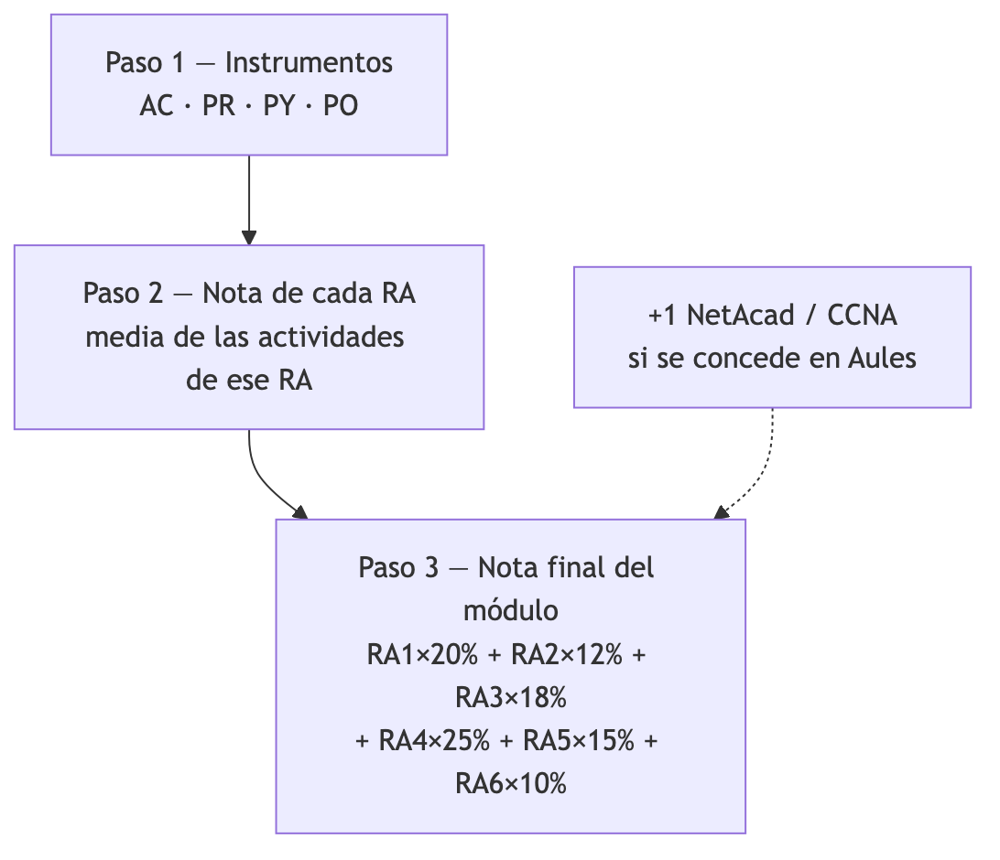
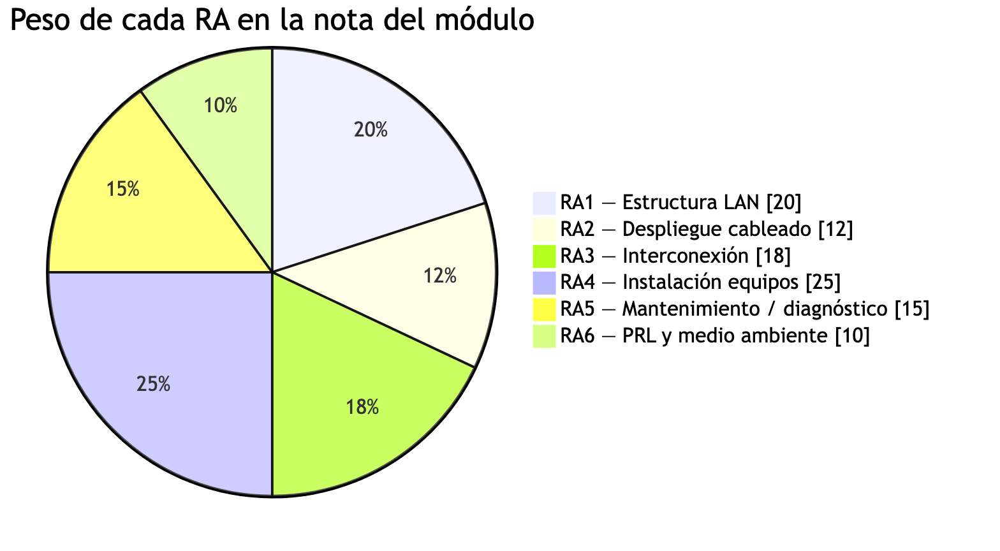

# PROGRAMACIÓN DIDÁCTICA

## REDES DE ÁREA LOCAL

**Código:** 0225  
**Duración del módulo:** 233 horas (**186** en centro + **47** de formación en empresa)  
**Sesiones semanales en centro:** 7  

**CICLO FORMATIVO DE GRADO MEDIO**  
**SISTEMAS MICROINFORMÁTICOS Y REDES**  
**Primer curso (1SMR)**  

**Profesor:** Javier Hernández Illán  

**CURSO:** 2026/2027  

**Centro:** IES Macià Abela (Crevillent)  
**Departamento de Informática**

---

::: {.manual-index}

## Índice

El documento Word lleva un índice de hipervínculos, escrito por `Planificación/docx_format.lua` al ejecutar `Planificación/build_docx.sh`. Esta lista sirve para leer el archivo Markdown y no se copia al Word.

1. [Introducción](#introducción)
2. [Aportaciones del módulo al desarrollo de competencias](#aportaciones-del-módulo-al-desarrollo-de-competencias)
3. [Objetivos](#objetivos)
4. [Contenidos y organización en unidades de programación](#contenidos-y-organización-en-unidades-de-programación)
5. [Metodología](#metodología)
6. [Fomento a la lectura](#fomento-a-la-lectura)
7. [Uso didáctico y profesional de las tecnologías](#uso-didáctico-y-profesional-de-las-tecnologías)
8. [Evaluación](#evaluación)
9. [Desarrollo de las UUPP](#desarrollo-de-las-uupp)
    - [UP 1 (T1). Introducción. Arquitectura de redes](#up-1-t1.-introducción.-arquitectura-de-redes)
    - [UP 2 (T2). Medios de transmisión y capa física](#up-2-t2.-medios-de-transmisión-y-capa-física)
    - [UP 3 (T3). Cableado estructurado y componentes](#up-3-t3.-cableado-estructurado-y-componentes)
    - [UP 4 (T4). Capa de enlace](#up-4-t4.-capa-de-enlace)
    - [UP 5 (T5). Capa de red](#up-5-t5.-capa-de-red)
    - [UP 6 (T6). Enrutamiento, subnetting y redes locales virtuales](#up-6-t6.-enrutamiento-subnetting-y-redes-locales-virtuales)
    - [UP 7 (T7). Capa de transporte](#up-7-t7.-capa-de-transporte)
    - [UP 8 (T8). Traducción de direcciones e IPv6](#up-8-t8.-traducción-de-direcciones-e-ipv6)
    - [UP 9 (T9). Servicios, diagnóstico y protección](#up-9-t9.-servicios-diagnóstico-y-protección)
10. [Medidas de atención a la diversidad](#medidas-de-atención-a-la-diversidad)
11. [Actividades complementarias y extraescolares](#actividades-complementarias-y-extraescolares)
12. [Formación en la empresa](#formación-en-la-empresa)
13. [Evaluación de la programación y de la práctica docente](#evaluación-de-la-programación-y-de-la-práctica-docente) (remisión al apartado 8.15)
- [Anexo A. Matriz de cobertura de criterios de evaluación](#anexo-a.-matriz-de-cobertura-de-criterios-de-evaluación)
- [Anexo B. Programación de aula](#anexo-b.-programación-de-aula)
- [Anexo C. Sitio web de apuntes](#anexo-c.-sitio-web-de-apuntes)

:::

---

# 1. Introducción

La presente programación didáctica concreta la planificación del módulo profesional **0225 Redes de área local** (1.er curso del CFGM **Sistemas Microinformáticos y Redes**), impartido en el **IES Macià Abela** (Crevillent) en el curso **2026/2027**.

El módulo dura **233 horas**: **186** en el centro y **47** de formación en empresa, el reparto 80/20 cerrado el 17 de octubre de 2026. El grupo es de primer curso. La formación en empresa empieza el **17 de mayo de 2027**. El bloque de centro va de septiembre a mediados de mayo: la unidad T9 cierra hacia el **5 de mayo de 2027**, y las sesiones que quedan hasta el 17 de mayo se usan para la recuperación y el cierre. Hay **7 sesiones semanales**. El detalle está en el apartado 4.4 y en el anexo B.

Los referentes de la evaluación son los resultados de aprendizaje (RA). Los criterios de evaluación (CE) se vinculan a los instrumentos de evaluación (IE, apartado 8.3.1) con los que se trabajan en el aula, y cada uno recibe una ponderación según su importancia. Una vez verificado que todos se han trabajado y evaluado, esa ponderación se expresa en porcentaje en la matriz del anexo A.3, calculada a partir de lo impartido en clase, y el peso de cada RA es la suma de las ponderaciones de sus CE. Así, la calificación del boletín refleja lo que se imparte y se evalúa en el aula. La nota de centro de cada RA es la media ponderada de los IE que lo evalúan. La nota del RA es el 80 % de esa nota de centro más el 20 % de la formación en empresa, y la nota final del módulo es la media ponderada de los RA, con los pesos del apartado 8.4. El peso de cada IE dentro de su RA depende de los CE más importantes que ese instrumento evidencia. Los RA no son compensables entre sí. Este criterio se adoptó el 16 de septiembre de 2026 y se desarrolla en el apartado 8. El módulo se vincula a la unidad de competencia **UC0220_2** («Instalar, configurar y verificar los elementos de la red local según procedimientos establecidos») y capacita para caracterizar, desplegar, interconectar, instalar, configurar y mantener redes locales, diagnosticar incidencias y aplicar la prevención de riesgos laborales (PRL) y la protección ambiental.

## 1.1. Características del módulo y concepto de programación didáctica

El módulo es central en el perfil del Técnico en SMR: instalación, configuración y mantenimiento de redes locales en pequeños entornos, con calidad, seguridad y respeto ambiental.

La PD es el nivel de concreción curricular del departamento: qué RA alcanzar, cómo organizar el aprendizaje, con qué recursos, cómo atender la diversidad y cómo evaluar. Datos identificativos:

| Campo | Valor |
| --- | --- |
| Denominación | Redes de área local |
| Código | 0225 |
| Familia profesional | Informática y Comunicaciones |
| Ciclo formativo | Sistemas Microinformáticos y Redes |
| Nivel | Ciclo formativo de grado medio |
| Curso | Primero (1SMR) |
| Duración | 233 h (186 centro + 47 FE) |
| Sesiones semanales (centro) | 7 |
| Curso académico | 2026/2027 |
| Profesor | Javier Hernández Illán |

Documento abierto: podrá ajustarse por evaluación inicial, evolución del grupo, FE u organización, respetando currículo y transparencia de calificación, con registro en el departamento.

## 1.2. Entorno

Conforme al RD 659/2023, el currículo debe atender al entorno socioproductivo. El **IES Macià Abela** (Crevillent, Baix Vinalopó) está próximo a Elche y Alicante, con tejido industrial y de servicios (pymes) que demanda digitalización y mantenimiento de redes locales.

Ello justifica prácticas profesionales (cableado estructurado, racks, switches/AP, VLANs, diagnóstico, documentación) y, cuando sea posible, FE y visitas. La oferta de SMR en el centro permite coordinar taller y módulos del ciclo.

## 1.3. Características del alumnado

El alumnado de **1SMR** es heterogéneo (edad, acceso, experiencia, competencia digital, disponibilidad; a veces estudios + trabajo). Las decisiones se basan en **evaluación inicial**, observación y orientación.

Respuesta: actividades graduadas, práctica guiada/autónoma, trabajo cooperativo, refuerzo/ampliación y adaptaciones de acceso, **sin modificar los RA**. Parte del alumnado elige el ciclo de forma voluntaria, lo que favorece la motivación profesional.

## 1.4. Marco legal

La programación se ajusta a la normativa estatal y autonómica aplicable al módulo.

En el ámbito estatal se tienen en cuenta la Ley Orgánica 2/2006, de Educación, en la redacción dada por la Ley Orgánica 3/2020, y la Ley Orgánica 3/2022, de ordenación e integración de la Formación Profesional. El título de Técnico en Sistemas Microinformáticos y Redes, y con él el módulo **0225 Redes de área local**, se citan por el **Real Decreto 1691/2007, de 14 de diciembre**, por el que se establece ese título y se fijan sus enseñanzas mínimas. La ordenación de la Formación Profesional se toma del Real Decreto 659/2023, de 18 de julio, y de su calendario de implantación. Las actualizaciones posteriores de títulos de grado medio, por ejemplo el Real Decreto 499/2024, se aplican solo en lo que afecte a este ciclo.

En el ámbito autonómico se tienen en cuenta la Orden 8/2025, de evaluación en Formación Profesional; el Decreto 114/2025, de currículos; la Resolución de 16 de julio de 2026, de instrucciones para los grados D y E en el curso 2026-2027 (DOGV núm. 10408); la resolución del calendario escolar 2026-2027; el Decreto 104/2018 y la Orden 20/2019, de inclusión; el Decreto 252/2019, de centros; y el currículo autonómico de Sistemas Microinformáticos y Redes que esté vigente.

La temporalización se alinea con el calendario del centro y con la programación de aula del anexo B.

## 1.5. Propuestas de mejora derivadas del curso anterior

A partir de la experiencia del curso 2025-2026 y de las reflexiones de departamento, se adoptan las siguientes mejoras para 2026-2027:

| Mejora | Aplicación en 2026-2027 | Seguimiento |
| --- | --- | --- |
| Reorganización del temario | **Nueve UP** (T1–T9; tradicionalmente UT), con el bloque de enlace, direccionamiento IP y VLAN antes de la formación en empresa | Programación de aula |
| Evaluación | Los referentes son los RA. Cada CE se vincula a los IE del aula y recibe una ponderación según su importancia; el peso de cada RA es la suma de las ponderaciones de sus CE (anexo A.3). La nota de cada RA es la media ponderada de sus IE, y la del módulo es la media ponderada de los RA. | Sección 8 y Anexo A |
| Itinerario Cisco | Las prácticas de Packet Tracer son trabajo de casa del apartado de certificación. No puntúan en los resultados de aprendizaje. El punto adicional puede llegar a 1 y la nota final, a 11. | Apartado 8.5 |
| Materiales | Publicación progresiva en sitio **MkDocs** de apuntes | Anexo C |
| Entregas | Obligatoriedad de entregas en **Markdown (`.md`)** vía Aules | Secciones 6 y 7 |
| Corrección de vinculación UC | Uso de **UC0220_2** (red local), no UC de montaje de equipos ajenas al módulo | Sección 2 |

---

# 2. Aportaciones del módulo al desarrollo de competencias

## 2.1. Relación con el desarrollo de la competencia general

Según el Real Decreto 1691/2007, la **competencia general** del título consiste en:

> Instalar, configurar y mantener sistemas microinformáticos, aislados o en red, así como redes locales en pequeños entornos, asegurando su funcionalidad y aplicando los protocolos de calidad, seguridad y respeto al medio ambiente establecidos.

El módulo 0225 contribuye de forma directa a dicha competencia general al capacitar al alumnado para caracterizar, desplegar, interconectar, instalar, configurar y mantener redes locales cableadas, inalámbricas o mixtas en pequeños entornos, diagnosticar disfunciones y operar con criterios de calidad, seguridad y protección ambiental.

## 2.2. Relación con las competencias profesionales, personales y sociales

El módulo contribuye especialmente a las siguientes competencias profesionales, personales y sociales del título (letras del RD 1691/2007):

| Código | Competencia |
| --- | --- |
| **d** | Replantear el cableado y la electrónica de redes locales en pequeños entornos y su conexión con redes de área extensa canalizando a un nivel superior los supuestos que así lo requieran. |
| **e** | Instalar y configurar redes locales cableadas, inalámbricas o mixtas y su conexión a redes públicas, asegurando su funcionamiento en condiciones de calidad y seguridad. |
| **f** | Instalar, configurar y mantener servicios multiusuario, aplicaciones y dispositivos compartidos en un entorno de red local, atendiendo a las necesidades y requerimientos especificados. |
| **g** | Realizar las pruebas funcionales en sistemas microinformáticos y redes locales, localizando y diagnosticando disfunciones, para comprobar y ajustar su funcionamiento. |
| **h** | Mantener sistemas microinformáticos y redes locales, sustituyendo, actualizando y ajustando sus componentes, para asegurar el rendimiento del sistema en condiciones de calidad y seguridad. |

Además, el módulo refuerza competencias transversales de trabajo en equipo, documentación técnica, uso seguro de herramientas y responsabilidad profesional en el taller.

## 2.3. Contribución a las competencias para la empleabilidad

### Unidad de competencia asociada

Conforme al BOE del título, el módulo **0225 Redes de área local** se asocia a:

> **UC0220_2:** Instalar, configurar y verificar los elementos de la red local según procedimientos establecidos.

Se corrige expresamente la vinculación errónea a **UC0953_2** (montaje de equipos microinformáticos) que pudiera figurar en programaciones anteriores: esa UC no es la referencia de este módulo.

La UC0220_2 se concreta en realizaciones profesionales orientadas a instalar y configurar nodos y elementos de la red local, verificar el funcionamiento según procedimientos y documentar el proceso, en coherencia con los RA1–RA6 del módulo.

### Empleabilidad

Las competencias para la empleabilidad tienen carácter transversal. Se integran en las actividades y en los instrumentos vinculados a los resultados de aprendizaje, y no reciben una calificación separada. El Proyecto Curricular del ciclo asigna a este módulo las competencias E2, E3, E5 y E6.

| Referencia | Competencia para la empleabilidad | Concreción en Redes de área local |
| --- | --- | --- |
| E2 | Trabajo en equipo y colaboración. | Montaje en equipo del rack y del cableado. |
| E3 | Comunicación e interacción profesional, también técnica y en lengua extranjera. | Documentación técnica en Markdown y consulta de documentación en inglés. |
| E5 | Resolución de problemas y pensamiento crítico. | Diagnóstico de fallos de red. |
| E6 | Competencia digital profesional y uso ético y seguro de la tecnología. | Uso seguro de los equipos y de las herramientas digitales, incluida la inteligencia artificial. |

Las situaciones de aprendizaje del módulo, en el taller, en la documentación y en el diagnóstico, acercan al alumnado a ocupaciones de soporte técnico, instalación de redes locales y mantenimiento de infraestructuras en pequeñas y medianas empresas.

## 2.4. Contribución de los resultados de aprendizaje a las competencias

| RA | Contribución principal a CP | Observación breve |
| :---: | --- | --- |
| RA1 | d, e | Fundamentos, mapa físico/lógico y topologías |
| RA2 | d, e | Despliegue de cableado y espacios |
| RA3 | d, e, f | Interconexión, conectores y verificación |
| RA4 | e, f | Instalación y configuración (red inalámbrica, protocolos, redes locales virtuales) |
| RA5 | g, h | Diagnóstico, mantenimiento e informes |
| RA6 | e, h (calidad, seguridad y ambiente) | Prevención de riesgos laborales y protección ambiental en el taller |

El peso de cada RA es el del apartado 8.4. Dentro de ese peso, el 80 % corresponde al centro y el 20 % a la formación en empresa. Las horas de centro reparten las **186 horas** en la misma proporción que el peso del RA, y las horas de empresa reparten las **47 horas**. Son una distribución de referencia, no una temporalización nueva: no cambian las sesiones de las unidades. El 80 % exacto de 233 horas es 186,4 y el 20 % exacto es 46,6. El cierre del 17 de octubre de 2026 fija 186 y 47, que suman 233. La nota usa el 80/20 exacto del acuerdo. El apartado 8.7.4 considera necesarios todos los RA del módulo, con umbral de 5 y sin compensación entre ellos; por eso todos figuran como esenciales.

| RA | Peso en el módulo | Centro (80 %) | FE (20 %) | Horas de centro (186 h × peso) | Horas de FE (47 h × peso) | Carácter |
| :---: | ---: | ---: | ---: | ---: | ---: | --- |
| RA1 | 20 % | 16,00 % | 4,00 % | 37,20 h | 9,40 h | Esencial |
| RA2 | 12 % | 9,60 % | 2,40 % | 22,32 h | 5,64 h | Esencial |
| RA3 | 18 % | 14,40 % | 3,60 % | 33,48 h | 8,46 h | Esencial |
| RA4 | 25 % | 20,00 % | 5,00 % | 46,50 h | 11,75 h | Esencial |
| RA5 | 15 % | 12,00 % | 3,00 % | 27,90 h | 7,05 h | Esencial |
| RA6 | 10 % | 8,00 % | 2,00 % | 18,60 h | 4,70 h | Esencial |
| **Total** | **100 %** | **80,00 %** | **20,00 %** | **186,00 h** | **47,00 h** | — |

---

# 3. Objetivos

## 3.1. Objetivos generales del ciclo vinculados al módulo

La formación del módulo contribuye a alcanzar, entre otros, los siguientes **objetivos generales** del ciclo (letras del RD 1691/2007):

| Código | Objetivo general |
| --- | --- |
| **d** | Representar la posición de los equipos, líneas de transmisión y demás elementos de una red local, analizando la morfología, condiciones y características del despliegue, para replantear el cableado y la electrónica de la red. |
| **e** | Ubicar y fijar equipos, líneas, canalizaciones y demás elementos de una red local cableada, inalámbrica o mixta, aplicando procedimientos de montaje y protocolos de calidad y seguridad, para instalar y configurar redes locales. |
| **f** | Interconectar equipos informáticos, dispositivos de red local y de conexión con redes de área extensa, ejecutando los procedimientos para instalar y configurar redes locales. |
| **g** | Localizar y reparar averías y disfunciones en los componentes físicos y lógicos para mantener sistemas microinformáticos y redes locales. |
| **h** | Sustituir y ajustar componentes físicos y lógicos para mantener sistemas microinformáticos y redes locales. |

## 3.2. Relación entre objetivos, competencias y resultados de aprendizaje

| OG | CP | RA principales |
| :---: | :---: | :---: |
| d | d | RA1, RA2 |
| e | e | RA2, RA3, RA4 |
| f | e, f | RA3, RA4 |
| g | g | RA5 |
| h | h | RA5, RA6 |

## 3.3. Resultados de aprendizaje

Los RA del módulo (enunciados del RD 1691/2007) y sus **pesos en la calificación** del curso 2026-2027 son:

| Código | Descripción | Peso |
| --- | --- | ---: |
| **RA1** | Reconoce la estructura de redes locales cableadas analizando las características de entornos de aplicación y describiendo la funcionalidad de sus componentes. | **20 %** |
| **RA2** | Despliega el cableado de una red local interpretando especificaciones y aplicando técnicas de montaje. | **12 %** |
| **RA3** | Interconecta equipos en redes locales cableadas describiendo estándares de cableado y aplicando técnicas de montaje de conectores. | **18 %** |
| **RA4** | Instala equipos en red, describiendo sus prestaciones y aplicando técnicas de montaje. | **25 %** |
| **RA5** | Mantiene una red local interpretando recomendaciones de los fabricantes de hardware o software y estableciendo la relación entre disfunciones y sus causas. | **15 %** |
| **RA6** | Cumple las normas de prevención de riesgos laborales y de protección ambiental, identificando los riesgos asociados, las medidas y equipos para prevenirlos. | **10 %** |
| | **Total** | **100 %** |

**Nota metodológica de evaluación**, alineada con la referencia de Solbes que se cita a continuación y con la normativa de Formación Profesional.

Los referentes de la calificación son los RA, no los instrumentos aislados ni los trimestres. La nota de cada RA es la media ponderada de los IE (actividades de clase, prácticas, proyectos y pruebas objetivas) que evalúan ese RA. La nota final del módulo es la media ponderada de los seis RA, con pesos **20 / 12 / 18 / 25 / 15 / 10**. Los CE permiten verificar que el alumnado ha alcanzado el RA: se trabajan y se comprueban todos (anexo A) y cada uno se pondera según su importancia, a través de los IE con los que se trabaja en el aula. Esa ponderación se expresa después en porcentaje (anexo A.3) y la suma de las ponderaciones de los CE de cada RA da su peso. El peso de cada IE dentro del RA depende de los CE más importantes que evidencia. Ese diseño procedimental de los instrumentos no reparte la nota en una parte conceptual, otra procedimental y otra actitudinal.

Referencias:

- [Los referentes para evaluar en FP](https://raulsolbes.com/2025/01/22/los-referentes-para-evaluar-en-fp/) (RA como referentes; CE para identificar el logro; RD 659/2023 art. 18; LO 3/2022 art. 26).
- [Programaciones didácticas para FP: evaluación](https://raulsolbes.com/2025/04/04/programaciones-didacticas-para-fp-evaluacion/).
- Matiz: [Evaluación por competencias en FP](https://raulsolbes.com/2020/05/27/evaluacion-por-competencias-en-fp/) (no dividir la nota en % conceptual/procedimental/actitudinal al evaluar CE).

### Cómo se calcula la nota



| Paso | Contenido |
| --- | --- |
| **1** | Instrumentos **AC · PR · PY · PO** (apartado 8.3.1) |
| **2** | Nota de centro de cada **RA** = media ponderada de los IE de ese RA. La nota del RA es el 80 % de esa nota de centro más el 20 % de la formación en empresa. |
| **3** | Nota final = **RA1×20 % + RA2×12 % + RA3×18 % + RA4×25 % + RA5×15 % + RA6×10 %** |
| Extra | Hasta **+1** del apartado de certificación: 0,5 por las prácticas de Packet Tracer entregadas y defendidas, y 0,5 más por aprobar el examen de certificación. La nota final puede llegar a 11. Ese punto no sustituye ningún RA. |

### Peso de cada RA



| RA | Descripción breve | Peso |
| --- | --- | ---: |
| RA1 | Estructura LAN | **20 %** |
| RA2 | Despliegue cableado | **12 %** |
| RA3 | Interconexión | **18 %** |
| RA4 | Instalación equipos | **25 %** |
| RA5 | Mantenimiento / diagnóstico | **15 %** |
| RA6 | PRL y medio ambiente | **10 %** |
| | **Total** | **100 %** |

Representación ASCII de respaldo:

```
RA1 ████████████████████ 20 %
RA2 ████████████ 12 %
RA3 ██████████████████ 18 %
RA4 █████████████████████████ 25 %
RA5 ███████████████ 15 %
RA6 ██████████ 10 %
```

## 3.4. Objetivos transversales y concreción didáctica

Además de los objetivos del título, se trabajan de forma transversal:

- Comunicación técnica escrita (informes, entregas Markdown, documentación de red).
- Trabajo colaborativo y responsabilidad en el uso del taller.
- Uso ético y seguro de las TIC (Aules, NetAcad, herramientas de diagrama y simulación).
- Prevención de riesgos y respeto ambiental en el manipulado de materiales y residuos.
- Autonomía progresiva hacia situaciones próximas a la formación en empresa.

---

# 4. Contenidos y organización en unidades de programación

Conforme al **Decreto 114/2025** (art. 9), el módulo se organiza en unidades de programación (**UP**, tradicionalmente UT). En esta PD las UP coinciden con los **nueve temas** T1–T9.

## 4.1. Contenidos curriculares de soporte

Los contenidos del módulo, según el currículo del título, se agrupan en bloques de soporte que esta programación desarrolla a través de nueve UP (temas):

1. **Caracterización de redes locales:** características, tipos, elementos, topologías, mapa físico.
2. **Despliegue del cableado:** identificación de espacios, armarios, paneles, canalizaciones, medios, conectores, herramientas, pruebas y etiquetado.
3. **Interconexión de equipos:** adaptadores, dispositivos de interconexión cableada e inalámbrica, redes mixtas.
4. **Instalación y configuración de equipos de red:** procedimientos, TCP/IP, direccionamiento IPv4/IPv6, configuración básica, seguridad básica, VLANs.
5. **Resolución de incidencias:** estrategias, monitorización, herramientas de diagnóstico, incidencias físicas y lógicas, informes.
6. **PRL y protección ambiental:** riesgos, EPI, medidas preventivas, residuos y orden/limpieza.

La duración mínima del módulo en el RD es de 130 h; en el cómputo de 2026-27 el módulo tiene **233 h** (186 de centro y 47 de formación en empresa), conforme al acuerdo de departamento del 17 de octubre de 2026 y a la programación de aula.

## 4.2. Criterios de organización y secuenciación

La secuenciación responde a los siguientes criterios:

1. **Progresión de lo general a lo específico:** fundamentos (T1) → medios y cableado (T2–T3) → capas de enlace y red (T4–T5) → enrutamiento/VLAN (T6) → transporte, NAT/IPv6 y cierre diagnóstico/PRL (T7–T9).
2. **Núcleo de enlace, direccionamiento y redes locales virtuales:** T4, T5 y T6, con la práctica de taller PR604, se imparten antes del bloque de transporte, traducción y diagnóstico (T7 a T9). Todo el bloque de centro termina antes de la formación en empresa, que empieza el 17 de mayo de 2027. PR603 pertenece al apartado de certificación y no puntúa en el resultado de aprendizaje.
3. **Integración teoría–práctica** en cada tema (AC + PR; PY/PO en hitos).
4. **Siete sesiones semanales.** Esta programación no detalla el reparto por días.
5. **Horas y sesiones.** Las 186 horas de centro (80 %) se reparten entre los RA según su peso (apartado 8.4), y las 47 horas de empresa son el 20 %. Las 197 sesiones de aula son los huecos lectivos del calendario. Una hora de cómputo no equivale a una sesión, y el calendario no se recorta para forzar esa igualdad.

## 4.3. Bloques de contenido

Las **UP** son los **nueve temas** del curso:

| UP | Título | RA principales |
| ---: | --- | --- |
| T1 | Introducción. Arquitectura de redes | RA1 |
| T2 | Medios de transmisión y capa física | RA2, RA3 |
| T3 | Cableado estructurado y componentes | RA2, RA3, RA4 |
| T4 | Capa de enlace | RA1, RA4 |
| T5 | Capa de red | RA1, RA4 |
| T6 | Enrutamiento, subnetting y VLANs | RA3, RA4 |
| T7 | Capa de transporte | RA4, RA5 |
| T8 | NAT e IPv6 | RA4, RA5 |
| T9 | Servicios, diagnóstico y protección | RA5, RA6 |

### Mapa UP (tema) × RA

| UP | RA1 | RA2 | RA3 | RA4 | RA5 | RA6 |
| --- | :---: | :---: | :---: | :---: | :---: | :---: |
| T1 | X | | | | | |
| T2 | | X | X | | | |
| T3 | | X | X | X | | |
| T4 | X | | | X | | |
| T5 | X | | | X | | |
| T6 | | | X | X | | |
| T7 | | | | X | X | |
| T8 | | | | X | X | |
| T9 | | | | | X | X |
| **Peso** | 20 % | 12 % | 18 % | 25 % | 15 % | 10 % |

## 4.4. Distribución temporal y unidades de programación

Fuente: programación de aula (anexo B). La temporalización de centro llega hasta mediados de mayo de 2027. Las siglas de los instrumentos (AC, PR, PY y PO) se explican en el apartado 8.3.1.

| Concepto | Valor |
| --- | --- |
| Horas de centro | El cómputo de centro es de 186 horas, el 80 % del acuerdo. |
| Formación en empresa | Son 47 horas, el 20 % del acuerdo, y empiezan el 17 de mayo de 2027. Las renuncias se presentan hasta el 17 de abril de 2027 y la aplicación SAÓ permanece abierta hasta el 7 de mayo de 2027. |
| Total del módulo | El módulo suma 233 horas. |
| Sesiones semanales | Hay 7 sesiones semanales en el centro. |
| Equivalencia | Las 186 horas de centro y las 197 sesiones de aula no se equivalen una a una. La hora reparte el currículo y la sesión organiza el calendario. |
| Primera sesión | La primera sesión es el 11 de septiembre de 2026. |
| Cierre de T9 | T9 cierra hacia el 5 de mayo de 2027. |
| Margen posterior | Las sesiones que quedan entre ese cierre y el 17 de mayo de 2027 se usan para la recuperación y el cierre. La estancia en la empresa no desplaza T7, T8 ni T9. |

### Tabla T1–T9 (sesiones y fechas orientativas)

| Bloque | Sesiones (plan) | Nº sesión | Fechas lectivas (aprox.) | IE clave |
| --- | ---: | --- | --- | --- |
| **T1** | 18 | S001–S018 | 2026-09-11 → 2026-09-28 | Introducción. Arquitectura · PR101, AC102–104, PR102 |
| **T2** | 13 | S019–S031 | 2026-09-30 → 2026-10-16 | Medios / capa física · **PR201** (crimpado taller), PR202 |
| **T3** | 21 | S035–S055 | 2026-10-21 → 2026-11-09 | Cableado estructurado · **PR301** (taller), **PR304** (fusionadoras), **PR305** (red inalámbrica real), PR302, PR303 (certificación) |
| **PO1** | 2 | S056–S057 | 2026-11-11 → 2026-11-11 | Prueba objetiva 1.ª evaluación (T1–T3) + devolución |
| **T4** | 14 | S058–S071 | 2026-11-13 → 2026-11-25 | Capa de enlace · PR401, PR402 |
| **T5** | 14 | S072–S085 | 2026-11-27 → 2026-12-14 | Capa de red · PR501 |
| **T6** | 21 | S086–S106 | 2026-12-14 → 2027-01-18 | Enrutamiento / VLAN · **PR604** (VLAN taller), PR601, PR602 y PR603 (certificación) |
| **PO2** | 2 | S107–S108 | 2027-01-20 → 2027-01-20 | Prueba objetiva 2.ª evaluación (núcleo T4–T6) + devolución |
| **T7** | 18 | S109–S126 | 2027-01-22 → 2027-02-08 | Capa de transporte · PR701, PR702 |
| **T8** | 16 | S127–S142 | 2027-02-08 → 2027-02-24 | NAT e IPv6 · PR801 |
| **T9** | 55 | S143–S197 | 2027-02-24 → 2027-05-05 | Servicios, diagnóstico, PRL · PR901, PR902, PY901, **PO901** + prep./cierre NetAcad-CCNA |

La prueba de T1 y T2 se realizó el 19 de octubre de 2026, cuando el contenido de T2 ya estaba impartido; por eso esas sesiones no se imputan a ninguna unidad y T3 comienza el 21 de octubre. Los días no lectivos son los que fija el calendario escolar 2026-2027 del centro.

La programación de aula cuenta **197** sesiones, que son los huecos lectivos reales entre el 11 de septiembre de 2026 y el cierre de T9, hacia el 5 de mayo de 2027. No se recortan para igualarlas a las **186 horas** de centro, porque la hora es la unidad del currículo y la sesión es la unidad de la programación de aula. Desde el cierre de T9 hasta el inicio de la formación en empresa, el 17 de mayo de 2027, las sesiones se dedican a la recuperación y al cierre del curso.

La tabla siguiente recoge los CE que se trabajan en cada unidad, tomados del anexo A. Cada CE pondera en la nota según su importancia, a través de los IE con los que se evalúa en el aula (apartado 8.3.1), y el anexo A.3 expresa esa ponderación en porcentaje a partir de lo impartido. Si un CE se trabaja en varias unidades, figura en todas, pero su ponderación es única.

| UP | CE que se trabajan (anexo A) | Evaluación parcial en la que cae la unidad |
| --- | --- | --- |
| T1 | CE1a, CE1b, CE1c, CE1d, CE1e, CE1f, CE1g, CE1h | 1.ª (hasta PO1, 11 de noviembre de 2026) |
| T2 | CE2a, CE2b, CE2c, CE2d, CE2h, CE2j, CE3c, CE3f, CE3g, CE6b, CE6e | 1.ª |
| T3 | CE2c, CE2d, CE2e, CE2f, CE2g, CE2i, CE2j, CE3a, CE3b, CE3c, CE3d, CE3e, CE3f, CE3g, CE4a, CE4b, CE4c, CE4d, CE4e, CE4f, CE4i, CE6b, CE6e | 1.ª |
| T4 | CE1a, CE1c, CE4g, CE4h | 2.ª (hasta PO2, 20 de enero de 2027) |
| T5 | CE1a, CE1c, CE4g, CE4h | 2.ª |
| T6 | CE3a, CE3f, CE4g, CE4h, CE4j | 2.ª |
| T7 | CE1a, CE1c, CE4g, CE4h, CE5a, CE5b, CE5d, CE5e, CE5h | 3.ª (desde el 22 de enero de 2027) |
| T8 | CE1a, CE1c, CE4g, CE4h, CE5b, CE5d, CE5h | 3.ª |
| T9 | CE5a, CE5b, CE5c, CE5d, CE5e, CE5f, CE5g, CE5h, CE6a, CE6b, CE6c, CE6d, CE6e, CE6f, CE6g, CE6h | 3.ª (cierre orientativo hacia el 5 de mayo de 2027) |

Las pruebas PO1 y PO2 delimitan la 1.ª y la 2.ª evaluación parcial; la 3.ª abarca el tramo posterior (apartado 8.7.5). Los CE6b y CE6e se evidencian también en T2 y T3, y los CE1a y CE1c en T7 y T8, aunque el mapa del apartado 4.3 no asigna allí su RA: se listan por esa evidencia, sin desplazar el peso del RA.


---

# 5. Metodología

## 5.1. Principios metodológicos aplicables a la enseñanza en la formación profesional

Aprendizaje significativo, simulación profesional, práctica supervisada en taller y evaluación continua. Prioridades: aprender haciendo; progresión guiado→autónomo; documentación técnica; seguridad y calidad.

## 5.2. Metodologías activas

Prácticas de taller y de laboratorio; simulación con Packet Tracer y NetAcad como trabajo del apartado de certificación; proyectos (PY901); trabajo colaborativo; apoyo MkDocs (clase invertida parcial); resolución de problemas de diagnóstico (RA5).

## 5.3. Estrategias de enseñanza-aprendizaje y secuencia didáctica

Secuencia tipo por UP: activación → modelado → práctica guiada (AC/PR) → práctica autónoma → feedback en Aules → síntesis / enlace al hito PO o PY.

## 5.4. Tipo de actividades

| Tipo | Código | Descripción | Escala habitual |
| --- | :---: | --- | --- |
| Actividad de clase | **AC** | Microevidencia de aula | 0–1 |
| Práctica | **PR** | Práctica de taller o de laboratorio. Las de Packet Tracer son de certificación y no puntúan en el RA | 0–10 |
| Proyecto | **PY** | Entregable mayor con rúbrica | 0–30 |
| Prueba objetiva | **PO** | Examen escrito o en ordenador | 0–100 |

Opcionalmente pueden usarse actividades de refuerzo o profundización sin sustituir los IE anteriores. La codificación sigue el patrón *tipo + tema + orden* (p. ej. `PR303` = práctica 03 del Tema 3).

## 5.5. Organización del aula, agrupamientos y roles

- Sesiones en **aula-taller** de redes / informática del ciclo, con puestos individuales o compartidos según la actividad.
- Agrupamientos variables: individual (PO, algunas AC), parejas (cableado, PT), grupo pequeño (montaje de rack / casos).
- Roles rotativos en prácticas de taller (montaje, verificación, documentación, seguridad).
- Cumplimiento de las **normas del taller** del centro (documento canónico del IES y resumen publicado en el sitio de apuntes).

## 5.6. Coordinación intermodular, Proyecto Intermodular y formación en empresa

Coordinación con el equipo docente de 1.º de SMR (sistemas operativos, aplicaciones y seguridad). Si el centro desarrolla proyecto intermodular, se alinearán evidencias de red sin duplicar carga. El Proyecto Intermodular no se dualiza (artículo 5.6 del Decreto 114/2025). La formación en empresa se desarrolla en el apartado 12 y empieza el 17 de mayo de 2027.

## 5.7. Materiales y recursos didácticos

- Sitio web de apuntes MkDocs: <https://fjavier-hernandez.github.io/ral/>
- Aules (entregas, calificaciones, anuncios).
- Visual Studio Code + Markdown.
- Cisco Packet Tracer y plataforma **NetAcad** (class del curso; el profesor actúa como instructor).
- Herramientas de diagrama: Excalidraw, draw.io / diagrams.net, Dia.
- Material de taller: cableado, conectores, paneles, electrónica de red, herramientas de **crimpado** y comprobación, **fusionadoras** de fibra (y cleaver/protectores), switches gestionables didácticos, EPI según normas del taller.
- Documentación técnica, normas IEEE/ISO de referencia pedagógica y RFCs resumidos cuando proceda.

## 5.8. Planificación del uso de espacios y equipamientos

| Espacio / recurso | Uso principal |
| --- | --- |
| Aula-taller SMR | Docencia ordinaria T1–T9, prácticas de cableado e interconexión |
| Equipos de alumno | Simulación PT, configuración, entregas `.md` |
| Armarios / paneles didácticos | T3 (PR301), T6 (PR604), T9 |
| Fusionadoras / fibra | T3 (**PR304**) |
| NetAcad (en línea) | Preparación del apartado de certificación. El punto adicional no sustituye ningún resultado de aprendizaje. |
| Aules | Entrega y feedback |

---

# 6. Fomento a la lectura

## 6.1. Actividades de lectura y comunicación técnica

Se fomenta la lectura comprensiva de:

- Apuntes y guiones técnicos del sitio MkDocs.
- Hojas de datos y manuales breves de fabricantes (switches, AP, cableado).
- Resúmenes de **RFC** y estándares (selección adaptada al nivel de grado medio).
- Normas de taller y procedimientos de seguridad.

La producción escrita se canaliza mediante **entregas en Markdown (`.md`)** en Aules: informes de práctica, mapas de red, bitácoras de diagnóstico y el proyecto PY901. No se aceptan entregas en PDF como formato ordinario.

## 6.2. Seguimiento, evaluación e inclusión

El seguimiento se realiza a través de las AC/PR/PY que exigen lectura y redacción técnica. Se ofrecen modelos, plantillas y rúbricas claras. Cuando sea preciso, se adaptará el formato de acceso (tamaño de letra, tiempo, apoyos) sin reducir el nivel de exigencia competencial del RA evaluado.

---

# 7. Uso didáctico y profesional de las tecnologías

## 7.1. Finalidad y criterios generales de utilización

Las TIC se usan como medio profesional real (documentación, simulación, entrega, colaboración), no como fin ornamental. Se priorizan herramientas alineadas con el desempeño del técnico en redes locales.

## 7.2. Búsqueda, selección y gestión de información técnica

El alumnado busca, contrasta y cita fuentes técnicas (documentación de fabricante, apuntes del módulo, RFCs). Se trabaja la distinción entre fuentes fiables y contenido no verificado.

## 7.3. Comunicación, entrega y colaboración mediante canales digitales

- **Aules:** canal oficial de entregas y calificaciones.
- Comunicación respetuosa y trazable.
- Trabajo colaborativo cuando la actividad lo requiera, manteniendo la autoría individual exigible.

## 7.4. Software y entornos digitales del módulo

| Recurso | Uso |
| --- | --- |
| Aules | LMS del centro |
| VS Code + Markdown | Redacción de entregas |
| Excalidraw / draw.io / Dia | Diagramas de red |
| Packet Tracer | Simulación LAN |
| NetAcad | Itinerario WLAN/VLAN/CCNA |
| MkDocs (sitio público) | Apuntes y planificación visible |

## 7.5. Uso responsable, seguro, ético y accesible

Se exige:

- Respeto a la privacidad y a los datos personales.
- Uso legítimo de licencias y cuentas NetAcad.
- Integridad académica (sección 8.8).
- Cuidado del equipamiento compartido.
- Preferencia por formatos accesibles (Markdown, contraste, estructura clara).

---

# 8. Evaluación

## 8.1. Principios y organización de la evaluación

La evaluación es continua, formativa y sumativa. Comprueba el grado de consecución de los resultados de aprendizaje. Los referentes de la evaluación son los RA. Los instrumentos —actividad de clase (AC), práctica (PR), proyecto (PY) y prueba objetiva (PO)— aportan las evidencias con las que se califica cada RA. No se califica el trimestre ni el instrumento suelto como referente del módulo.

Desde el 16 de septiembre de 2026 se sigue el criterio de la referencia de Solbes citada debajo, precisado el 30 de octubre de 2026. Cada CE se vincula a los IE con los que se trabaja en el aula y recibe una ponderación según su importancia. Verificada la cobertura (anexo A), esa ponderación se expresa en porcentaje en el anexo A.3, calculada a partir de lo impartido en clase, y la suma de los CE de cada RA da su peso. La nota de cada RA es la media ponderada de los IE que lo evalúan, y la nota final del módulo es la media ponderada de los RA, con pesos del 20, el 12, el 18, el 25, el 15 y el 10 por ciento. Los RA no son compensables entre sí. Los instrumentos, sus escalas y el apartado de certificación, que suma hasta 1 punto sobre la nota final (máximo 11) sin sustituir ningún RA, se describen en los apartados 8.3.1, 8.3.2 y 8.5.

Si se describe el carácter procedimental de los instrumentos, el matiz es el de Solbes: el RA es el referente y los CE identifican su logro y ponderan dentro de él según su importancia. Diseñar más instrumentos, o darles más peso, sobre los CE más relevantes del perfil profesional no equivale a dividir la nota en una parte conceptual, otra procedimental y otra actitudinal.

Referencias: [Los referentes para evaluar en FP](https://raulsolbes.com/2025/01/22/los-referentes-para-evaluar-en-fp/); [Programaciones didácticas para FP: evaluación](https://raulsolbes.com/2025/04/04/programaciones-didacticas-para-fp-evaluacion/); matiz en [Evaluación por competencias en FP](https://raulsolbes.com/2020/05/27/evaluacion-por-competencias-en-fp/).

## 8.2. Características de la evaluación

La evaluación inicial detecta el punto de partida al comienzo del curso y de los bloques. La evaluación procesual da retroalimentación frecuente en Aules y en el taller. La evaluación final consolida cada RA y la calificación del módulo. Los criterios y los instrumentos se publican con una antelación razonable. Cuando hace falta, se aplican adaptaciones de acceso, descritas en el apartado 10, sin modificar los RA.

## 8.3. Referentes, ponderación y trazabilidad curricular

Los referentes de calificación son los seis RA, con pesos del 20, el 12, el 18, el 25, el 15 y el 10 por ciento. Esos pesos están en el apartado 8.4 y no se sustituyen por los instrumentos ni por los trimestres.

Cada IE declara el RA que evalúa y los CE que permite comprobar. La matriz completa de CE por actividad está en el anexo A de esta programación. La cobertura verificada es de **51 de 51** CE. Esa matriz comprueba la cobertura y es la base del cálculo de la ponderación de cada CE del anexo A.3.

### 8.3.1. Procedimientos e instrumentos de evaluación

Para que los apartados siguientes se entiendan, conviene distinguir tres conceptos:

- Los **procedimientos de evaluación** son las formas de obtener información sobre el aprendizaje: la observación del trabajo en el aula y en el taller, el análisis de las producciones entregadas en Aules, las pruebas objetivas y la exposición o defensa oral.
- Los **instrumentos de evaluación (IE)** son las actividades concretas que generan una evidencia calificable: la actividad de clase, la práctica, el proyecto y la prueba objetiva.
- Los **instrumentos de calificación** son las herramientas con las que el profesorado puntúa cada IE: la escala numérica, la rúbrica y la lista de comprobación (apartado 8.3.2).

Los IE del módulo y sus escalas son los que figuran en la página de inicio de los apuntes del módulo (anexo C):

| Instrumento | Sigla | Descripción | Escala |
| --- | --- | --- | --- |
| Actividad de clase | AC | Microevidencia de aula. | 0–1 |
| Práctica | PR | Práctica de taller, de laboratorio o de investigación con exposición. | 0–10 |
| Proyecto | PY | Entregable mayor, calificado con rúbrica. | 0–30 |
| Prueba objetiva | PO | Examen escrito o en el ordenador. | 0–100 |
| Certificación | +1 | 0,5 por las prácticas de Packet Tracer entregadas y defendidas en la auditoría, y 0,5 más por aprobar un examen de certificación. | Hasta +1 en la nota final (máximo 11) |

Cada IE se identifica con el prefijo de su tipo, el número del tema y un ordinal de dos cifras. Así, AC102 es la actividad 02 del Tema 1 y PR101 es la práctica 01 del Tema 1. Las pruebas objetivas de evaluación parcial son PO1 y PO2, y la del Tema 9 es PO901. En los apuntes y en Aules, cada actividad indica el RA que evalúa, los CE que permite comprobar y su escala; por ejemplo, AC102 evalúa el RA1 con los CE1a, CE1c y CE1d, en la escala de 0 a 1.

### 8.3.2. Instrumentos de calificación

| Instrumento de calificación | Uso en el módulo | Valor |
| --- | --- | --- |
| Escala numérica | Todos los IE se califican en la escala de su tipo. | AC 0–1, PR 0–10, PY 0–30 y PO 0–100 |
| Rúbrica | Prácticas y proyecto. Cada criterio de la rúbrica tiene una descripción y una puntuación parcial, y la suma de los criterios da la nota. En PR301, por ejemplo, «Rack / panel / TO» y «Switch + conexionado» valen de 0 a 3 puntos cada uno. PR302 se califica con una rúbrica de diseño. | PR 0–10 y PY 0–30 |
| Lista de comprobación | Prácticas de taller: crimpado (PR201), montaje del tramo de cableado (PR301) y de la red inalámbrica (PR305), fusión de fibra (PR304) y configuración del conmutador (PR604). Registra si cada paso se ha realizado correctamente y acompaña a la rúbrica. | Se integra en la rúbrica de 0 a 10 |
| Auditoría oral | Defensa de las prácticas de Packet Tracer del apartado de certificación, mediante una exposición breve o una demostración. | 0,5 del punto adicional |
| Cuestionario inicial y autocheck | El cuestionario inicial de cada tema se entrega en Aules antes de estudiarlo y tiene finalidad diagnóstica. El autocheck del final del tema sirve de autoevaluación. | Sin escala en esta programación |

Para calcular la nota de centro de un RA, las notas de sus IE se normalizan a la escala de 0 a 10 y se promedian con el peso de cada actividad. Ese peso se publica en Aules al plantear la actividad y depende de los CE que evidencia (apartado 8.7.2). Sobre esta base se explican, en el apartado 8.4, la ponderación de los CE y los pesos de los RA.

## 8.4. Ponderación de los RRAA y CCEE

El título de este apartado se mantiene porque así figura en la plantilla del departamento. El orden interno es el acordado para esta programación: primero se explica cómo se verifican y ponderan los CE y después se ponderan los RA. Cada CE recibe una ponderación según su importancia, a través de los IE que lo evidencian. El anexo A.3 expresa esa ponderación en porcentaje, una vez verificada la cobertura, a partir de los pesos de los RA, de las unidades y de las actividades que puntúan; la suma de los CE de cada RA coincide con su peso.

### Verificación de los criterios de evaluación

Los CE del módulo son los del Real Decreto 1691/2007. Sirven para verificar que el RA se ha alcanzado. Se trabajan y se comprueban todos, según el anexo A, y cada uno recibe una ponderación según su importancia a través de los IE con los que se trabaja en el aula. Un mismo CE puede aparecer en varias actividades: su ponderación reúne lo que aporta en cada una, y así se refleja en el porcentaje del anexo A.3. El peso de cada RA es la suma de las ponderaciones de sus CE.

El peso de cada instrumento dentro del resultado de aprendizaje depende de los criterios de evaluación más importantes que evidencia. El peso de cada actividad se publica en Aules al plantearla.

### Ponderación de los resultados de aprendizaje

| RA | Peso en el módulo | Centro (80 %) | FE (20 %) |
| :---: | ---: | ---: | ---: |
| RA1 | 20 % | 16,00 % | 4,00 % |
| RA2 | 12 % | 9,60 % | 2,40 % |
| RA3 | 18 % | 14,40 % | 3,60 % |
| RA4 | 25 % | 20,00 % | 5,00 % |
| RA5 | 15 % | 12,00 % | 3,00 % |
| RA6 | 10 % | 8,00 % | 2,00 % |
| **Total** | **100 %** | **80,00 %** | **20,00 %** |

## 8.5. Procedimientos e instrumentos de evaluación

Los procedimientos, los instrumentos de evaluación y los instrumentos de calificación, con sus escalas, se describen en los apartados 8.3.1 y 8.3.2. El peso de cada actividad dentro del RA que evalúa se publica en Aules al plantearla, según los CE que evidencia. En este módulo se prevén las pruebas objetivas PO1, PO2 y PO901, sin perjuicio de otras que se convoquen.

Todas las prácticas de Packet Tracer del módulo son trabajo para casa del apartado de certificación. Entran PR102, PR103, PR202, PR303 y las de los temas posteriores: PR402, PR501, PR601, PR602, PR603, PR702, PR801 y PR901. No puntúan en la nota de los resultados de aprendizaje. Entregarlas y defenderlas en la auditoría, con una exposición oral breve o una demostración, aporta 0,5 del punto adicional. El punto entero exige además aprobar un examen de certificación. La forma de acreditar ese examen se concreta en Aules. Ese punto no sustituye ningún resultado de aprendizaje y no compensa un resultado no alcanzado.

Las prácticas que sí puntúan en el resultado de aprendizaje son las de taller y de laboratorio: PR101, PR201, PR301, PR302, PR304, PR305, PR401, PR604, PR701 y PR902, junto con las actividades de clase, el proyecto PY901 y las pruebas objetivas. PR604, en el conmutador del taller, es la práctica que evalúa la configuración real de las redes locales virtuales. PR303 y PR603 no entran en esa calificación: son trabajo del apartado de certificación.

## 8.6. Plazo de realización de las convocatorias

Las convocatorias de evaluación se ajustarán al calendario oficial del centro y a las instrucciones de inicio de curso 2026-2027. Los hitos PO1 / PO2 / PO901 se sitúan según la programación de aula (Anexo B). Cualquier cambio se comunicará por Aules y se reflejará en el seguimiento de departamento.

## 8.7. Cálculo de las calificaciones y condiciones de superación

### 8.7.1. Calificación de un criterio de evaluación

El apartado conserva el título de la plantilla. El CE no se califica con un instrumento aparte: pondera en la nota a través de los IE con los que se trabaja en el aula. Se comprueba que cada CE tiene al menos una evidencia en el anexo A. Si un CE se trabaja en varias actividades, su ponderación reúne lo que aporta en cada una. Una vez verificada la cobertura, el anexo A.3 expresa en porcentaje la ponderación de cada CE, calculada a partir de lo impartido en clase, y la suma de los CE de cada RA da su peso.

### 8.7.2. Calificación de un resultado de aprendizaje

Para cada RA se hace lo siguiente.

1. Se toman los IE de centro que lo evalúan: AC (escala de 0 a 1), PR (de 0 a 10), PY (de 0 a 30) y PO (de 0 a 100).
2. Cuando hay que promediarlos, se normalizan a una escala común de 0 a 10. Esa media, ponderada, es la nota de centro del RA. El peso de cada actividad dentro del resultado de aprendizaje se publica en Aules al plantearla, según la ponderación de los criterios de evaluación que evidencia. Las prácticas de Packet Tracer no entran en esta media: pertenecen al apartado de certificación (apartado 8.5).
3. La nota del RA es el 80 % de la nota de centro más el 20 % de la formación en empresa. La nota de empresa la pone el profesorado, de 0 a 10, a partir del informe de apto o no apto y del plan formativo. Si la empresa no cubre la evidencia, se usa el catálogo de refuerzo del apartado 12. El profesorado califica el 100 % de la nota.
4. La nota del RA se expresa de 0 a 10, o en la escala numérica equivalente del centro.

Cada RA debe alcanzarse con una nota igual o superior a 5. Los RA no son compensables entre sí.

### 8.7.3. Calificación final del módulo

La nota de cada resultado de aprendizaje ya incluye el acuerdo: el 80 % es la nota de centro y el 20 % es la de la empresa.

$$N_{\mathrm{RA}} = 0{,}80\,N_{\mathrm{RA,centro}} + 0{,}20\,N_{\mathrm{RA,FE}}$$

$$N_{\mathrm{final}} = 0{,}20\,N_{\mathrm{RA1}} + 0{,}12\,N_{\mathrm{RA2}} + 0{,}18\,N_{\mathrm{RA3}} + 0{,}25\,N_{\mathrm{RA4}} + 0{,}15\,N_{\mathrm{RA5}} + 0{,}10\,N_{\mathrm{RA6}}$$

Si se concede el apartado de certificación, se suma C, que vale 0,5 cuando se entregan y se defienden las prácticas de Packet Tracer, y 1 cuando además se aprueba el examen de certificación:

$$N_{\mathrm{módulo}} = \min(11,\ N_{\mathrm{final}} + C)$$

La nota final puede llegar a 11. Ese punto no sustituye ningún resultado de aprendizaje y no compensa un resultado inferior a 5.

Condición de superación ordinaria: todos los resultados de aprendizaje con nota igual o superior a 5, y cumplimiento de los requisitos de evaluación continua y de asistencia que establezcan la Orden 8/2025 y las instrucciones del curso.

### 8.7.4. RRAA esenciales, umbrales y compensación

- Todos los RA del módulo se consideran **necesarios** para la superación.
- **No hay compensación** entre RA.
- Umbral por RA: **≥ 5**.

### 8.7.5. Calificaciones parciales y nota informativa de las UUPP

Las evaluaciones parciales (1.ª / 2.ª / 3.ª) tienen carácter **informativo** del progreso, calculado a partir de los IE disponibles hasta la fecha y de los RA trabajados. La calificación final del módulo se determina conforme a 8.7.3 cuando existan evidencias suficientes de todos los RA (incluidas, en su caso, las desarrolladas en FE).

## 8.8. Autoría, integridad académica y uso de inteligencia artificial

El alumnado debe entregar trabajo propio. Se permite el uso de IA como apoyo a la redacción o depuración **si se declara** y no sustituye la comprensión ni la ejecución práctica exigida. El plagio, la copia entre compañeros en pruebas individuales o la entrega de evidencias no realizadas por el alumno/a podrán conllevar la calificación de insuficiente en el IE afectado y, en su caso, las medidas disciplinarias previstas en el centro.

## 8.9. Refuerzo y recuperación durante el proceso ordinario

Durante el curso se ofrecerán oportunidades de refuerzo y recuperación de IE/RA pendientes, priorizando la recuperación temprana tras PO1/PO2 y antes del cierre del bloque de centro. Las condiciones concretas (plazos, instrumentos alternativos equivalentes) se publicarán en Aules, alineadas con la Orden 8/2025 y las instrucciones 2026-27, **sin inventar porcentajes** no establecidos en normativa.

## 8.10. Evaluación final ordinaria y plan de recuperación para evaluación extraordinaria

Quien no supere el módulo en la evaluación final ordinaria podrá acogerse al plan de recuperación / convocatoria extraordinaria conforme a la normativa autonómica y a los acuerdos de centro. El plan especificará RA pendientes e instrumentos equivalentes. Se informará con antelación suficiente.

## 8.11. Alumnado con el módulo pendiente de cursos anteriores

El alumnado con el módulo pendiente seguirá el plan que establezca el departamento: calendario de entregas y pruebas, docente responsable y condiciones de superación por RA. Se mantienen los referentes en los RA, la verificación y la ponderación de los CE (anexo A.3) y los pesos de RA del curso vigente, salvo decisión documentada en contrario.

## 8.12. Pérdida del derecho a la evaluación continua

La pérdida del derecho a la evaluación continua se regirá por lo establecido en la **Orden 8/2025**, las instrucciones de inicio de curso **2026-2027** y las normas de organización y funcionamiento del centro. En tal caso, el alumnado será evaluado mediante las pruebas / instrumentos extraordinarios que se determinen, manteniendo como referentes los RA del módulo. No se fijan en esta PD porcentajes de falta de asistencia distintos de los que establezca la normativa o el centro.

## 8.13. Evaluación de los RRAA desarrollados en la empresa

El profesorado del módulo califica el 100 % de la nota. El 80 % de cada resultado de aprendizaje se evidencia en el centro y el 20 % se vincula a la formación en empresa, mediante el informe de apto o no apto y el plan formativo. Si la empresa no cubre esa parte, se usa el catálogo de refuerzo del apartado 12.

El acta del departamento del 14 de julio de 2026 fijó ese reparto. No es un porcentaje del Real Decreto del título. La decisión del 30 de octubre de 2026 lo mantiene en este módulo presencial de primer curso. Sobre las 233 horas, el cierre del 17 de octubre de 2026 es de 186 horas de centro y 47 horas de empresa. El 20 % del RA1 en el apartado 8.4 es su peso en la nota del módulo y no es el porcentaje de empresa: de ese 20 %, el 16 % es centro y el 4 % es empresa.

Los planes formativos especifican qué resultados de aprendizaje se trabajan en cada empresa, porque el entorno productivo no es el mismo en todos los casos. Las actividades de refuerzo están definidas de antemano, alineadas con el resultado afectado, y permiten completar la evidencia sin depender de la empresa asignada.

En este módulo la formación en empresa empieza el 17 de mayo de 2027. El bloque de centro no se interrumpe para insertarla: T9 cierra hacia el 5 de mayo y el margen hasta el 17 de mayo se dedica a la recuperación y al cierre. El catálogo de refuerzo está en el apartado 12. Esas actividades completan la evidencia cuando la empresa no permite trabajar el 20 % vinculado a la estancia, y no cambian el peso del resultado de aprendizaje. La calificación íntegra corresponde al profesorado del módulo.

## 8.14. Información, comunicación, revisión y reclamación

Las calificaciones y criterios se comunicarán por los canales oficiales (Aules / procedimientos del centro). El alumnado podrá solicitar aclaraciones al profesor. Las reclamaciones se tramitarán según el procedimiento establecido por la normativa y el IES Macià Abela.

## 8.15. Evaluación de la programación y de la práctica docente

La programación y la práctica docente se revisarán a lo largo del curso. Se analizarán los resultados por resultado de aprendizaje después de cada evaluación parcial, el grado de cumplimiento de la temporalización (186 horas de centro y 47 de empresa, cierre de T9 hacia el 5 de mayo de 2027 e inicio de la formación en empresa el 17 de mayo de 2027), la adecuación de los instrumentos y la carga de trabajo del alumnado, el uso del apartado de certificación y del sitio de apuntes, y la claridad de la calificación por resultados de aprendizaje frente a la cobertura de los criterios de evaluación. Las propuestas de mejora para el curso siguiente se recogerán en la memoria del departamento.

Los indicadores orientativos son el porcentaje de alumnado que supera cada RA, el cumplimiento de la matriz de 51 de 51 CE, una desviación temporal de alrededor de una semana y las incidencias de taller que se registren.

La plantilla del departamento cierra este contenido en el apartado 8.15. El apartado 13 solo remite aquí, para no repetirlo.

---

# 9. Desarrollo de las UUPP

Las nueve unidades de programación de este apartado coinciden con los temas T1 a T9. La tabla siguiente resume sesiones, fechas, resultados de aprendizaje e instrumentos, tal como figuran en los apartados 4.4 y B.2. Después, cada unidad tiene su ficha. Las siglas se explican aquí la primera vez que aparecen en el apartado: unidad de programación (UP), resultado de aprendizaje (RA), criterio de evaluación (CE), instrumento de evaluación (IE), actividad de clase (AC), práctica (PR), proyecto (PY) y prueba objetiva (PO); los instrumentos se describen en el apartado 8.3.1. Packet Tracer es el simulador de redes de Cisco. NetAcad es la plataforma Networking Academy. CCNA son las siglas en inglés de Cisco Certified Network Associate. PRL es la prevención de riesgos laborales. Una red de área local se cita también como LAN (*Local Area Network*). Las horas de referencia de las fichas reparten las 186 horas de centro. El 20 % de cada resultado de aprendizaje corresponde a la empresa y no se convierte en sesiones de estas fichas. Las sesiones de la ficha son los huecos lectivos del calendario y no equivalen una a una a esas horas (apartado 4.2). El detalle de cada fase está en el anexo B.3.

| UP | Sesiones / ventana (orient.) | RA | IE clave |
| --- | --- | --- | --- |
| **T1** Introducción / arquitectura | 18 · S001–S018 · 2026-09-11→2026-09-28 | RA1 | AC102–104, PR101, PR102 |
| **T2** Medios y capa física | 13 · S019–S031 · 2026-09-30→2026-10-16 | RA2, RA3 | AC201–204, **PR201**, PR202 |
| **T3** Cableado estructurado | 21 · S035–S055 · 2026-10-21→2026-11-09 | RA2–RA4 | **PR301**, **PR304**, **PR305**, PR302, PR303 (certificación) · + **PO1** |
| **T4** Capa de enlace | 14 · S058–S071 · 2026-11-13→2026-11-25 | RA1, RA4 | PR401, PR402 |
| **T5** Capa de red | 14 · S072–S085 · 2026-11-27→2026-12-14 | RA1, RA4 | PR501 |
| **T6** Enrutamiento / VLAN | 21 · S086–S106 · 2026-12-14→2027-01-18 | RA3, RA4 | **PR604**, PR603 (certificación) · + **PO2** |
| **T7** Capa de transporte | 18 · S109–S126 · 2027-01-22→2027-02-08 | RA4, RA5 | PR701, PR702 |
| **T8** NAT e IPv6 | 16 · S127–S142 · 2027-02-08→2027-02-24 | RA4, RA5 | PR801 |
| **T9** Servicios / diagnóstico / PRL | 55 · S143–S197 · 2027-02-24→2027-05-05 | RA5, RA6 | PR901–902, PY901, **PO901** + CCNA |

### Peso informativo de las unidades

La nota del boletín no se calcula por unidades. Se calcula por RA, con los pesos del apartado 8.4. La nota de la unidad es informativa, como indica el apartado 8.7.5.

El peso informativo de cada unidad suma las fracciones de RA que le corresponden. Cada RA se reparte a partes iguales entre las unidades que el mapa del apartado 4.3 marca. La ponderación de cada CE se calcula después a partir de estos pesos y de las actividades de cada unidad, y se expresa en porcentaje en el anexo A.3 sin cambiar esta tabla. Los CE6b y CE6e también se evidencian en T2 y T3, y los CE1a y CE1c en T7 y T8, pero el mapa no asigna el RA6 a T2 y T3 ni el RA1 a T7 y T8. Por eso el 10 % del RA6 queda entero en T9 y el 20 % del RA1 se reparte solo entre T1, T4 y T5.

| UP | RA del mapa 4.3 | Reparto de partida | Peso informativo | Horas de centro |
| --- | --- | --- | ---: | ---: |
| T1 | RA1 | Tercera parte del RA1 | 7 % | 13,02 h |
| T2 | RA2 y RA3 | Mitad del RA2 y tercera parte del RA3 | 12 % | 22,32 h |
| T3 | RA2, RA3 y RA4 | Mitad del RA2, tercera parte del RA3 y sexta parte del RA4 | 16 % | 29,76 h |
| T4 | RA1 y RA4 | Tercera parte del RA1 y sexta parte del RA4 | 11 % | 20,46 h |
| T5 | RA1 y RA4 | Tercera parte del RA1 y sexta parte del RA4 | 11 % | 20,46 h |
| T6 | RA3 y RA4 | Tercera parte del RA3 y sexta parte del RA4 | 10 % | 18,60 h |
| T7 | RA4 y RA5 | Sexta parte del RA4 y tercera parte del RA5 | 9 % | 16,74 h |
| T8 | RA4 y RA5 | Sexta parte del RA4 y tercera parte del RA5 | 9 % | 16,74 h |
| T9 | RA5 y RA6 | Tercera parte del RA5 y el RA6 completo | 15 % | 27,90 h |
| **Total** | | | **100 %** | **186,00 h** |

Esos porcentajes redondean a enteros el reparto de cada resultado de aprendizaje entre las unidades del mapa del apartado 4.3, del mismo modo que la web del módulo, y suman 100. Las horas de centro multiplican ese entero por las 186 horas. No coinciden con el número de sesiones de aula ni incluyen las 47 horas de empresa. La nota del boletín se calcula por resultados de aprendizaje, con el 80/20 dentro de cada RA y los pesos del apartado 8.4.

### Criterios comunes de las fichas

El reparto de sesiones por fase está en el anexo B.3 y suma el total de la unidad. La ficha ocupa los datos de la unidad, los resultados y criterios, los contenidos, las actividades y la temporalización. El peso que se indica es el entero de la tabla anterior. El peso de cada actividad dentro de su resultado de aprendizaje se publica en Aules al plantearla. Cada tema incorpora su autocheck cuando se publican sus apuntes. Las prácticas de Packet Tracer se hacen en casa, dentro del apartado de certificación, y no puntúan en el resultado de aprendizaje.

Los supuestos de las fichas son casos didácticos situados en Crevillent y Elche. No describen la red real de una empresa ni identifican a personas. La unidad de competencia del módulo es la UC0220_2 (apartado 2.3). La programación no la reparte por unidades. Las pruebas PO1 (dos sesiones, el 11 de noviembre de 2026) y PO2 (dos sesiones, el 20 de enero de 2027) no se suman a las sesiones de una sola unidad: cubren varios temas.

## 9.1. UP 1 (T1). Introducción. Arquitectura de redes

| Ficha de la UP 1 (T1) | Introducción. Arquitectura de redes |
| --- | --- |
| **Temporalización** | 18 sesiones de aula (S001–S018), del 11 al 28 de septiembre de 2026. Primera evaluación, antes de PO1. Horas de referencia de centro: 13,02 h (7 % de las 186 h). |
| **Peso informativo** | 7 %: la tercera parte del RA1. Es informativo: la nota del boletín se calcula por RA. |
| **Resultados de aprendizaje** | RA1 (20 % del módulo: 16 % centro y 4 % empresa; 37,20 h de centro), reconoce la estructura de las redes locales cableadas. |
| **Criterios de evaluación y ponderación (anexo A.3)** | CE1a (13,47 %), CE1b (0,15 %), CE1c (5,06 %), CE1d (0,29 %), CE1e (0,15 %), CE1f (0,15 %), CE1g (0,58 %), CE1h (0,15 %). CE1a y CE1c se comprueban también en temas posteriores. El porcentaje es la ponderación única del CE en el módulo, aunque se trabaje en varias UP. |
| **Competencias, objetivos y empleabilidad** | Competencias d y e. Objetivo general d. Empleabilidad, sin nota propia: E2, E3 y E6. |
| **Contenidos** | Componentes, topologías y clasificación de redes. Medios, en visión general. Normalización, modelos OSI y TCP/IP, encapsulación y dominios de colisión y de difusión. |
| **Situación de aprendizaje** | Caso TechSolutions, en el polígono de Crevillent: tres departamentos, un servidor y salida a Internet. El grupo dibuja el mapa físico y lógico antes de cablear. |
| **Secuencia por fases (sesiones)** | 1. Contextualización y diagnóstico (2) · 2. Componentes, tipos y topologías (4) · 3. Transmisión, normalización y modelos (5) · 4. Dominios y primera red (4) · 5. Síntesis (3). Total: 18 sesiones; las actividades de cada fase están en el anexo B.3. |
| **Actividades e IE que puntúan en el RA** | AC102, AC103 y AC104 (de 0 a 1) y PR101 (de 0 a 10). Escalas del apartado 8.3.2. |
| **Certificación y autocheck** | PR102 y PR103 son Packet Tracer de casa: no puntúan el RA y aportan a la certificación. El autocheck se incorpora al publicar los apuntes. |
| **Recursos y espacios** | Apuntes del tema en la web del módulo (anexo C), Aules para entregas y devolución, y VS Code con Markdown para las entregas `.md`. Excalidraw, draw.io o Dia para el mapa de PR101; Cisco Packet Tracer y NetAcad. Aula-taller SMR y equipos de alumno. |
| **Atención a la diversidad** | Medidas universales y DUA del apartado 10.2: apuntes, diagramas, taller y simulador, instrucciones claras, listas de comprobación, rúbricas y tareas en pasos cortos. Si procede, apoyos del apartado 10.3 (más tiempo, refuerzo, materiales extra y evidencias prácticas equivalentes) y 10.4, sin rebajar el RA. |
| **Evaluación, calificación y recuperación** | La nota de la UP es informativa (8.7.5); el boletín se calcula por RA, con el 80 % de centro y el 20 % de empresa (8.7.3). El peso de cada actividad dentro de su RA se publica en Aules al plantearla. Umbral del RA: 5, sin compensación. Recuperación según el apartado 8.9. |

## 9.2. UP 2 (T2). Medios de transmisión y capa física

| Ficha de la UP 2 (T2) | Medios de transmisión y capa física |
| --- | --- |
| **Temporalización** | 13 sesiones de aula (S019–S031), del 30 de septiembre al 16 de octubre de 2026; no son lectivos el 9 y el 12 de octubre. Primera evaluación, antes de PO1. Horas de referencia de centro: 22,32 h (12 % de las 186 h). |
| **Peso informativo** | 12 %: la mitad del RA2 y la tercera parte del RA3. Es informativo: la nota del boletín se calcula por RA. |
| **Resultados de aprendizaje** | RA2 (12 % del módulo: 9,60 % centro y 2,40 % empresa; 22,32 h de centro), despliegue del cableado; RA3 (18 % del módulo: 14,40 % centro y 3,60 % empresa; 33,48 h de centro), interconexión de equipos. |
| **Criterios de evaluación y ponderación (anexo A.3)** | CE2a (0,44 %), CE2b (0,44 %), CE2c (3,95 %), CE2d (1,56 %), CE2h (0,19 %), CE2j (0,91 %), CE3c (0,60 %), CE3f (1,40 %), CE3g (0,60 %). PR201 evidencia también CE6b y CE6e; el peso del RA6 permanece en T9. El porcentaje es la ponderación única del CE en el módulo, aunque se trabaje en varias UP. |
| **Competencias, objetivos y empleabilidad** | Competencias d, e y f. Objetivos d, e y f. Empleabilidad, sin nota propia: E2, E5 y E6. |
| **Contenidos** | Medios guiados y no guiados, categorías y blindaje, coaxial, fibra y Wi-Fi 802.11. Conector RJ-45, T568A y T568B, cable directo y cruzado, y comprobación del latiguillo. |
| **Situación de aprendizaje** | Latiguillos etiquetados de TechSolutions, entre los puestos y el conmutador del departamento de soporte. |
| **Secuencia por fases (sesiones)** | 1. Contextualización (1) · 2. Medios guiados (4) · 3. Medios no guiados (2) · 4. Taller de crimpado (3) · 5. Simulación y cierre (3). Total: 13 sesiones; las actividades de cada fase están en el anexo B.3. |
| **Actividades e IE que puntúan en el RA** | AC201 a AC204 (de 0 a 1) y PR201 (de 0 a 10). Escalas del apartado 8.3.2. |
| **Certificación y autocheck** | PR202 es Packet Tracer de casa y no puntúa el RA. El autocheck se incorpora al publicar los apuntes. |
| **Recursos y espacios** | Apuntes del tema en la web del módulo (anexo C), Aules para entregas y devolución, y VS Code con Markdown para las entregas `.md`. Material de taller: cable, conectores, herramientas de crimpado y comprobador; EPI según las normas del taller. Cisco Packet Tracer. Aula-taller SMR. |
| **Atención a la diversidad** | Medidas universales y DUA del apartado 10.2: apuntes, diagramas, taller y simulador, instrucciones claras, listas de comprobación, rúbricas y tareas en pasos cortos. Si procede, apoyos del apartado 10.3 (más tiempo, refuerzo, materiales extra y evidencias prácticas equivalentes) y 10.4, sin rebajar el RA. |
| **Evaluación, calificación y recuperación** | La nota de la UP es informativa (8.7.5); el boletín se calcula por RA, con el 80 % de centro y el 20 % de empresa (8.7.3). El peso de cada actividad dentro de su RA se publica en Aules al plantearla. Umbral del RA: 5, sin compensación. Recuperación según el apartado 8.9. |

## 9.3. UP 3 (T3). Cableado estructurado y componentes

| Ficha de la UP 3 (T3) | Cableado estructurado y componentes |
| --- | --- |
| **Temporalización** | 21 sesiones de aula (S035–S055), del 21 de octubre al 9 de noviembre de 2026; el 2 de noviembre es lectivo. Primera evaluación. PO1 ocupa S056 y S057, el 11 de noviembre, fuera de la unidad. Horas de referencia de centro: 29,76 h (16 % de las 186 h). |
| **Peso informativo** | 16 %: la mitad del RA2, la tercera parte del RA3 y la sexta parte del RA4. Es informativo: la nota del boletín se calcula por RA. |
| **Resultados de aprendizaje** | RA2 (12 % del módulo: 9,60 % centro y 2,40 % empresa; 22,32 h de centro), despliegue del cableado; RA3 (18 % del módulo: 14,40 % centro y 3,60 % empresa; 33,48 h de centro), interconexión de equipos; RA4 (25 % del módulo: 20 % centro y 5 % empresa; 46,50 h de centro), instalación de equipos en red local. Del RA4, la parte inalámbrica. |
| **Criterios de evaluación y ponderación (anexo A.3)** | CE2c (3,95 %), CE2d (1,56 %), CE2e (0,69 %), CE2f (2,22 %), CE2g (0,91 %), CE2i (0,69 %), CE2j (0,91 %), CE3a (11,70 %), CE3b (1,50 %), CE3c (0,60 %), CE3d (1,90 %), CE3e (0,30 %), CE3f (1,40 %), CE3g (0,60 %), CE4a (2,41 %), CE4b (1,15 %), CE4c (1,15 %), CE4d (0,31 %), CE4e (0,31 %), CE4f (0,31 %), CE4i (0,31 %). PR304 evidencia CE6b y CE6e, sin trasladar el peso del RA6. CE4j queda para T6. El porcentaje es la ponderación única del CE en el módulo, aunque se trabaje en varias UP. |
| **Competencias, objetivos y empleabilidad** | Competencias d, e y f. Objetivos d, e y f. Empleabilidad, sin nota propia: E2, E3, E5 y E6. |
| **Contenidos** | Armario, panel, tomas, canalizaciones y etiquetado. Adaptador, controlador y electrónica de red. Red inalámbrica de aula y empalme de fibra por fusión. |
| **Situación de aprendizaje** | Aulario de un centro de Crevillent, coherente con el IES Macià Abela y con PR302. No se describe la red real del centro. |
| **Secuencia por fases (sesiones)** | 1. Diagnóstico (1) · 2. Adaptadores, armarios y tomas (4) · 3. Electrónica, normas y propuesta (4) · 4. Taller de cableado (4) · 5. Taller de fusión (3) · 6. Red inalámbrica y diseño (4) · 7. Síntesis (1). Total: 21 sesiones; las actividades de cada fase están en el anexo B.3. |
| **Actividades e IE que puntúan en el RA** | AC301 a AC305 (de 0 a 1) y PR301, PR302, PR304 y PR305 (de 0 a 10). PO1 (de 0 a 100) evalúa T1 a T3 y no consume estas 21 sesiones. Escalas del apartado 8.3.2. |
| **Certificación y autocheck** | PR303 es Packet Tracer de casa y no sustituye a PR305. El autocheck se incorpora al publicar los apuntes. |
| **Recursos y espacios** | Apuntes del tema en la web del módulo (anexo C), Aules para entregas y devolución, y VS Code con Markdown para las entregas `.md`. Armarios y paneles didácticos (PR301), fusionadora, cleaver y protectores (PR304), electrónica de red y EPI según las normas del taller. Cisco Packet Tracer. |
| **Atención a la diversidad** | Medidas universales y DUA del apartado 10.2: apuntes, diagramas, taller y simulador, instrucciones claras, listas de comprobación, rúbricas y tareas en pasos cortos. Si procede, apoyos del apartado 10.3 (más tiempo, refuerzo, materiales extra y evidencias prácticas equivalentes) y 10.4, sin rebajar el RA. |
| **Evaluación, calificación y recuperación** | La nota de la UP es informativa (8.7.5); el boletín se calcula por RA, con el 80 % de centro y el 20 % de empresa (8.7.3). El peso de cada actividad dentro de su RA se publica en Aules al plantearla. Umbral del RA: 5, sin compensación. Recuperación según el apartado 8.9. |

## 9.4. UP 4 (T4). Capa de enlace

| Ficha de la UP 4 (T4) | Capa de enlace |
| --- | --- |
| **Temporalización** | 14 sesiones de aula (S058–S071), del 13 al 25 de noviembre de 2026. Segunda evaluación, antes de PO2. Horas de referencia de centro: 20,46 h (11 % de las 186 h). |
| **Peso informativo** | 11 %: la tercera parte del RA1 y la sexta parte del RA4. Es informativo: la nota del boletín se calcula por RA. |
| **Resultados de aprendizaje** | RA1 (20 % del módulo: 16 % centro y 4 % empresa; 37,20 h de centro), reconoce la estructura de las redes locales cableadas; RA4 (25 % del módulo: 20 % centro y 5 % empresa; 46,50 h de centro), instalación de equipos en red local. |
| **Criterios de evaluación y ponderación (anexo A.3)** | CE1a (13,47 %), CE1c (5,06 %), CE4g (13,06 %), CE4h (3,89 %). Los apuntes mencionan CE4a; el anexo A lo sitúa en T3 y se sigue el anexo. El porcentaje es la ponderación única del CE en el módulo, aunque se trabaje en varias UP. |
| **Competencias, objetivos y empleabilidad** | Competencias d, e y f. Objetivos d, e y f. Empleabilidad, sin nota propia: E3, E5 y E6. |
| **Contenidos** | Capa de enlace, trama Ethernet, conmutador, dominios de colisión y de difusión, árbol de expansión y agregación de enlaces. |
| **Situación de aprendizaje** | Caso TechSolutions: un bucle entre los conmutadores de administración y soporte. |
| **Secuencia por fases (sesiones)** | 1. Contextualización (1) · 2. Trama Ethernet (3) · 3. Conmutador y dominios (4) · 4. Árbol de expansión (3) · 5. Síntesis (3). Total: 14 sesiones; las actividades de cada fase están en el anexo B.3. |
| **Actividades e IE que puntúan en el RA** | AC401 a AC404 (de 0 a 1) y PR401 (de 0 a 10). Escalas del apartado 8.3.2. |
| **Certificación y autocheck** | PR402 es Packet Tracer de casa y no puntúa el RA. El autocheck se incorpora al publicar los apuntes. |
| **Recursos y espacios** | Apuntes del tema en la web del módulo (anexo C), Aules para entregas y devolución, y VS Code con Markdown para las entregas `.md`. Conmutadores gestionables didácticos del aula-taller (AC404, bucle de tres conmutadores). Cisco Packet Tracer. Equipos de alumno. |
| **Atención a la diversidad** | Medidas universales y DUA del apartado 10.2: apuntes, diagramas, taller y simulador, instrucciones claras, listas de comprobación, rúbricas y tareas en pasos cortos. Si procede, apoyos del apartado 10.3 (más tiempo, refuerzo, materiales extra y evidencias prácticas equivalentes) y 10.4, sin rebajar el RA. |
| **Evaluación, calificación y recuperación** | La nota de la UP es informativa (8.7.5); el boletín se calcula por RA, con el 80 % de centro y el 20 % de empresa (8.7.3). El peso de cada actividad dentro de su RA se publica en Aules al plantearla. Umbral del RA: 5, sin compensación. Recuperación según el apartado 8.9. |

## 9.5. UP 5 (T5). Capa de red

| Ficha de la UP 5 (T5) | Capa de red |
| --- | --- |
| **Temporalización** | 14 sesiones de aula (S072–S085), del 27 de noviembre al 14 de diciembre de 2026; el 7 de diciembre es festivo local y T6 empieza el mismo 14 de diciembre. Segunda evaluación, antes de PO2. Horas de referencia de centro: 20,46 h (11 % de las 186 h). |
| **Peso informativo** | 11 %, igual que T4: la tercera parte del RA1 y la sexta parte del RA4. Es informativo: la nota del boletín se calcula por RA. |
| **Resultados de aprendizaje** | RA1 (20 % del módulo: 16 % centro y 4 % empresa; 37,20 h de centro), reconoce la estructura de las redes locales cableadas; RA4 (25 % del módulo: 20 % centro y 5 % empresa; 46,50 h de centro), instalación de equipos en red local. |
| **Criterios de evaluación y ponderación (anexo A.3)** | CE1a (13,47 %), CE1c (5,06 %), CE4g (13,06 %), CE4h (3,89 %). El diseño de subredes y las redes locales virtuales quedan para T6. El porcentaje es la ponderación única del CE en el módulo, aunque se trabaje en varias UP. |
| **Competencias, objetivos y empleabilidad** | Competencias d, e y f. Objetivos d, e y f. Empleabilidad, sin nota propia: E3, E5 y E6. |
| **Contenidos** | Direccionamiento IPv4, máscara, notación CIDR, red, difusión y equipos útiles. Resolución de direcciones, ping y traceroute. Configuración estática y automática, y papel del encaminador. |
| **Situación de aprendizaje** | Caso TechSolutions: administración y taller en dos redes unidas por un encaminador. |
| **Secuencia por fases (sesiones)** | 1. Contextualización (1) · 2. Direcciones IPv4 (4) · 3. Máscara y cálculo (4) · 4. Resolución de direcciones y simulación (4) · 5. Síntesis (1). Total: 14 sesiones; las actividades de cada fase están en el anexo B.3. |
| **Actividades e IE que puntúan en el RA** | AC501 a AC506 (de 0 a 1). Escalas del apartado 8.3.2. |
| **Certificación y autocheck** | PR501 es Packet Tracer de casa y no puntúa el RA. El autocheck se incorpora al publicar los apuntes. |
| **Recursos y espacios** | Apuntes del tema en la web del módulo (anexo C), Aules para entregas y devolución, y VS Code con Markdown para las entregas `.md`. Cisco Packet Tracer y equipos de alumno para la simulación y la configuración. Aula-taller SMR. |
| **Atención a la diversidad** | Medidas universales y DUA del apartado 10.2: apuntes, diagramas, taller y simulador, instrucciones claras, listas de comprobación, rúbricas y tareas en pasos cortos. Si procede, apoyos del apartado 10.3 (más tiempo, refuerzo, materiales extra y evidencias prácticas equivalentes) y 10.4, sin rebajar el RA. |
| **Evaluación, calificación y recuperación** | La nota de la UP es informativa (8.7.5); el boletín se calcula por RA, con el 80 % de centro y el 20 % de empresa (8.7.3). El peso de cada actividad dentro de su RA se publica en Aules al plantearla. Umbral del RA: 5, sin compensación. Recuperación según el apartado 8.9. |

## 9.6. UP 6 (T6). Enrutamiento, subnetting y redes locales virtuales

| Ficha de la UP 6 (T6) | Enrutamiento, subnetting y redes locales virtuales |
| --- | --- |
| **Temporalización** | 21 sesiones de aula (S086–S106), del 14 de diciembre de 2026 al 18 de enero de 2027, con vacaciones del 22 de diciembre al 6 de enero. Segunda evaluación. PO2 ocupa S107 y S108, el 20 de enero de 2027, fuera de la unidad. La formación en empresa no desplaza esta unidad. Horas de referencia de centro: 18,60 h (10 % de las 186 h). |
| **Peso informativo** | 10 %: la tercera parte del RA3 y la sexta parte del RA4. Es informativo: la nota del boletín se calcula por RA. |
| **Resultados de aprendizaje** | RA3 (18 % del módulo: 14,40 % centro y 3,60 % empresa; 33,48 h de centro), interconexión de equipos; RA4 (25 % del módulo: 20 % centro y 5 % empresa; 46,50 h de centro), instalación de equipos en red local. Incluye las redes locales virtuales. |
| **Criterios de evaluación y ponderación (anexo A.3)** | CE3a (11,70 %), CE3f (1,40 %), CE4g (13,06 %), CE4h (3,89 %), CE4j (2,10 %). El porcentaje es la ponderación única del CE en el módulo, aunque se trabaje en varias UP. |
| **Competencias, objetivos y empleabilidad** | Competencias d, e y f; en esta unidad pesan sobre todo la e y la f. Objetivos e y f. Empleabilidad, sin nota propia: E2, E3, E5 y E6. |
| **Contenidos** | Subnetting, supernetting, rutas estáticas, ruta por defecto y tabla de rutas. Redes locales virtuales, puertos de acceso, enlaces troncales y etiquetado 802.1Q. |
| **Situación de aprendizaje** | Sede de calzado en Elche, con almacén, administración y red de invitados. AC608 mantiene el caso de clínica dental de los apuntes. PR604 configura un conmutador real. |
| **Secuencia por fases (sesiones)** | 1. Contextualización (1) · 2. Subnetting (5) · 3. Supernetting (2) · 4. Rutas estáticas (4) · 5. Redes locales virtuales (4) · 6. Taller y certificación (4) · 7. Síntesis (1). Total: 21 sesiones; las actividades de cada fase están en el anexo B.3. |
| **Actividades e IE que puntúan en el RA** | AC601 a AC609 (de 0 a 1) y PR604 (de 0 a 10). PO2 (de 0 a 100) evalúa T4 a T6 y no consume estas 21 sesiones. Escalas del apartado 8.3.2. |
| **Certificación y autocheck** | PR601, PR602 y PR603 son certificación y no puntúan el RA. El autocheck se incorpora al publicar los apuntes. |
| **Recursos y espacios** | Apuntes del tema en la web del módulo (anexo C), Aules para entregas y devolución, y VS Code con Markdown para las entregas `.md`. Armarios y paneles didácticos y conmutador del taller (PR604). Cisco Packet Tracer y NetAcad para el apartado de certificación. |
| **Atención a la diversidad** | Medidas universales y DUA del apartado 10.2: apuntes, diagramas, taller y simulador, instrucciones claras, listas de comprobación, rúbricas y tareas en pasos cortos. Si procede, apoyos del apartado 10.3 (más tiempo, refuerzo, materiales extra y evidencias prácticas equivalentes) y 10.4, sin rebajar el RA. |
| **Evaluación, calificación y recuperación** | La nota de la UP es informativa (8.7.5); el boletín se calcula por RA, con el 80 % de centro y el 20 % de empresa (8.7.3). El peso de cada actividad dentro de su RA se publica en Aules al plantearla. Umbral del RA: 5, sin compensación. Recuperación según el apartado 8.9. |

## 9.7. UP 7 (T7). Capa de transporte

| Ficha de la UP 7 (T7) | Capa de transporte |
| --- | --- |
| **Temporalización** | 18 sesiones de aula (S109–S126), del 22 de enero al 8 de febrero de 2027; T8 puede empezar el mismo 8 de febrero. Tercera evaluación. La formación en empresa, el 17 de mayo de 2027, no desplaza T7. Horas de referencia de centro: 16,74 h (9 % de las 186 h). |
| **Peso informativo** | 9 %: la sexta parte del RA4 y la tercera parte del RA5. Es informativo: la nota del boletín se calcula por RA. |
| **Resultados de aprendizaje** | RA4 (25 % del módulo: 20 % centro y 5 % empresa; 46,50 h de centro), instalación de equipos en red local; RA5 (15 % del módulo: 12 % centro y 3 % empresa; 27,90 h de centro), mantenimiento y diagnóstico. |
| **Criterios de evaluación y ponderación (anexo A.3)** | CE4g (13,06 %), CE4h (3,89 %), CE5a (2,19 %), CE5b (1,69 %), CE5d (6,74 %), CE5e (1,33 %), CE5h (1,77 %). También CE1a y CE1c, sin trasladar el peso del RA1. El porcentaje es la ponderación única del CE en el módulo, aunque se trabaje en varias UP. |
| **Competencias, objetivos y empleabilidad** | Competencias e, f, g y h. Objetivos e, f, g y h. Empleabilidad, sin nota propia: E3, E5 y E6. |
| **Contenidos** | Puertos, sockets, TCP y UDP. netstat y nmap solo en un equipo autorizado. Cortafuegos, y visión breve de proxy, balanceo y red privada virtual. |
| **Situación de aprendizaje** | Aula-taller del IES Macià Abela. No se escanea ninguna red ajena al permiso del profesorado. |
| **Secuencia por fases (sesiones)** | 1. Contextualización (2) · 2. Puertos, TCP y UDP (5) · 3. Laboratorio de puertos (5) · 4. Filtrado y servicios de borde (3) · 5. Simulación y síntesis (3). Total: 18 sesiones; las actividades de cada fase están en el anexo B.3. |
| **Actividades e IE que puntúan en el RA** | AC701 a AC707 (de 0 a 1) y PR701 (de 0 a 10). Escalas del apartado 8.3.2. |
| **Certificación y autocheck** | PR702 es Packet Tracer de casa y no puntúa el RA. El autocheck se incorpora al publicar los apuntes. |
| **Recursos y espacios** | Apuntes del tema en la web del módulo (anexo C), Aules para entregas y devolución, y VS Code con Markdown para las entregas `.md`. Equipos de alumno con netstat y nmap, solo sobre un equipo autorizado. Cisco Packet Tracer. Aula-taller SMR. |
| **Atención a la diversidad** | Medidas universales y DUA del apartado 10.2: apuntes, diagramas, taller y simulador, instrucciones claras, listas de comprobación, rúbricas y tareas en pasos cortos. Si procede, apoyos del apartado 10.3 (más tiempo, refuerzo, materiales extra y evidencias prácticas equivalentes) y 10.4, sin rebajar el RA. |
| **Evaluación, calificación y recuperación** | La nota de la UP es informativa (8.7.5); el boletín se calcula por RA, con el 80 % de centro y el 20 % de empresa (8.7.3). El peso de cada actividad dentro de su RA se publica en Aules al plantearla. Umbral del RA: 5, sin compensación. Recuperación según el apartado 8.9. |

## 9.8. UP 8 (T8). Traducción de direcciones e IPv6

| Ficha de la UP 8 (T8) | Traducción de direcciones e IPv6 |
| --- | --- |
| **Temporalización** | 16 sesiones de aula (S127–S142), del 8 al 24 de febrero de 2027. Tercera evaluación. La formación en empresa no desplaza T8. Horas de referencia de centro: 16,74 h (9 % de las 186 h). |
| **Peso informativo** | 9 %, igual que T7: la sexta parte del RA4 y la tercera parte del RA5. Es informativo: la nota del boletín se calcula por RA. |
| **Resultados de aprendizaje** | RA4 (25 % del módulo: 20 % centro y 5 % empresa; 46,50 h de centro), instalación de equipos en red local; RA5 (15 % del módulo: 12 % centro y 3 % empresa; 27,90 h de centro), mantenimiento y diagnóstico. |
| **Criterios de evaluación y ponderación (anexo A.3)** | CE4g (13,06 %), CE4h (3,89 %), CE5b (1,69 %), CE5d (6,74 %), CE5h (1,77 %). También CE1a y CE1c, sin imputar el peso del RA1. Los apuntes citan CE5a y CE5e; el anexo A no lista T8 en esos dos criterios y se sigue el anexo. El porcentaje es la ponderación única del CE en el módulo, aunque se trabaje en varias UP. |
| **Competencias, objetivos y empleabilidad** | Competencias e, f, g y h. Objetivos e, f, g y h. Empleabilidad, sin nota propia: E3, E5 y E6. |
| **Contenidos** | Traducción de direcciones estática, dinámica y con puertos. IPv6: formato, prefijos, tipos de dirección y coexistencia con IPv4. |
| **Situación de aprendizaje** | Caso TechSolutions: una sola dirección pública y un servidor interno que hay que publicar. |
| **Secuencia por fases (sesiones)** | 1. Contextualización (1) · 2. Concepto y tipos de traducción (4) · 3. Laboratorio (5) · 4. IPv6 (4) · 5. Coexistencia y cierre (2). Total: 16 sesiones; las actividades de cada fase están en el anexo B.3. |
| **Actividades e IE que puntúan en el RA** | AC801 a AC808 (de 0 a 1). Escalas del apartado 8.3.2. |
| **Certificación y autocheck** | PR801 es Packet Tracer de casa y no puntúa el RA. El autocheck se incorpora al publicar los apuntes. |
| **Recursos y espacios** | Apuntes del tema en la web del módulo (anexo C), Aules para entregas y devolución, y VS Code con Markdown para las entregas `.md`. Cisco Packet Tracer y equipos de alumno. Aula-taller SMR. |
| **Atención a la diversidad** | Medidas universales y DUA del apartado 10.2: apuntes, diagramas, taller y simulador, instrucciones claras, listas de comprobación, rúbricas y tareas en pasos cortos. Si procede, apoyos del apartado 10.3 (más tiempo, refuerzo, materiales extra y evidencias prácticas equivalentes) y 10.4, sin rebajar el RA. |
| **Evaluación, calificación y recuperación** | La nota de la UP es informativa (8.7.5); el boletín se calcula por RA, con el 80 % de centro y el 20 % de empresa (8.7.3). El peso de cada actividad dentro de su RA se publica en Aules al plantearla. Umbral del RA: 5, sin compensación. Recuperación según el apartado 8.9. |

## 9.9. UP 9 (T9). Servicios, diagnóstico y protección

| Ficha de la UP 9 (T9) | Servicios, diagnóstico y protección |
| --- | --- |
| **Temporalización** | 55 sesiones de aula (S143–S197), del 24 de febrero al 5 de mayo de 2027; no son lectivos el 2 y el 3 de marzo, el 19 de marzo y la Semana Santa, del 25 de marzo al 5 de abril. Tercera evaluación. El margen hasta el 17 de mayo es recuperación y cierre, fuera de estas 55 sesiones. Horas de referencia de centro: 27,90 h (15 % de las 186 h), que no son las 55 sesiones. |
| **Peso informativo** | 15 %: la tercera parte del RA5 y el RA6 completo. Es informativo: la nota del boletín se calcula por RA. |
| **Resultados de aprendizaje** | RA5 (15 % del módulo: 12 % centro y 3 % empresa; 27,90 h de centro), mantenimiento y diagnóstico; RA6 (10 % del módulo: 8 % centro y 2 % empresa; 18,60 h de centro), prevención de riesgos laborales y protección ambiental. |
| **Criterios de evaluación y ponderación (anexo A.3)** | CE5a (2,19 %), CE5b (1,69 %), CE5c (0,72 %), CE5d (6,74 %), CE5e (1,33 %), CE5f (0,28 %), CE5g (0,28 %), CE5h (1,77 %), CE6a (1,11 %), CE6b (2,10 %), CE6c (0,67 %), CE6d (1,11 %), CE6e (2,56 %), CE6f (0,67 %), CE6g (0,67 %), CE6h (1,11 %). CE6b y CE6e ya se evidenciaron en T2 y T3. El porcentaje es la ponderación única del CE en el módulo, aunque se trabaje en varias UP. |
| **Competencias, objetivos y empleabilidad** | Competencias e, g y h. Objetivos g y h. Empleabilidad, sin nota propia: E2, E3, E5 y E6. |
| **Contenidos** | DHCP, DNS, HTTP, HTTPS y FTP. Método de diagnóstico, herramientas, filtrado, documentación, prevención de riesgos y residuos. Preparación del itinerario NetAcad-CCNA. |
| **Situación de aprendizaje** | Incidencia en el aulario del centro, en Crevillent. |
| **Secuencia por fases (sesiones)** | 1. Núcleo de contenidos (16) · 2. Práctica integrada de diagnóstico (15) · 3. Preparación y auditorías de certificación (14) · 4. Prueba final y recuperación (10). Total: 55 sesiones; las actividades de cada fase están en el anexo B.3. |
| **Actividades e IE que puntúan en el RA** | AC901 a AC908 (de 0 a 1), PR902 (de 0 a 10), PY901 (de 0 a 30) y PO901 (de 0 a 100). Escalas del apartado 8.3.2. |
| **Certificación y autocheck** | PR901 es Packet Tracer de casa y no puntúa el RA. El punto de certificación no sustituye al RA5 ni al RA6. El autocheck se incorpora al publicar los apuntes. |
| **Recursos y espacios** | Apuntes del tema en la web del módulo (anexo C), Aules para entregas y devolución, y VS Code con Markdown para las entregas `.md`. Armarios y paneles didácticos del taller, EPI según las normas del taller, Cisco Packet Tracer y NetAcad para el itinerario CCNA. |
| **Atención a la diversidad** | Medidas universales y DUA del apartado 10.2: apuntes, diagramas, taller y simulador, instrucciones claras, listas de comprobación, rúbricas y tareas en pasos cortos. Si procede, apoyos del apartado 10.3 (más tiempo, refuerzo, materiales extra y evidencias prácticas equivalentes) y 10.4, sin rebajar el RA. |
| **Evaluación, calificación y recuperación** | La nota de la UP es informativa (8.7.5); el boletín se calcula por RA, con el 80 % de centro y el 20 % de empresa (8.7.3). El peso de cada actividad dentro de su RA se publica en Aules al plantearla. Umbral del RA: 5, sin compensación. Recuperación según el apartado 8.9. |
# 10. Medidas de atención a la diversidad

## 10.1. Niveles de respuesta educativa

Marco de inclusión valenciano (Decreto 104/2018 y Orden 20/2019): medidas universales, apoyos ordinarios y, si procede, especializados, con el departamento de orientación.

## 10.2. Medidas universales y Diseño Universal para el Aprendizaje (DUA)

Múltiples formas de representación (MkDocs, diagramas, taller, simulador), de acción y expresión (práctica, diagrama, `.md`, PO) y de implicación (casos, NetAcad, cooperativo, retos graduados). Instrucciones claras, listas de comprobación, rúbricas y tareas en pasos cortos.

## 10.3. Tercer nivel de respuesta: apoyos ordinarios adicionales

Ampliación de tiempo si procede; refuerzo y materiales extra; ajuste de agrupamientos; evidencias prácticas equivalentes ante barreras de formato escrito (**sin** rebajar el RA).

## 10.4. Cuarto nivel de respuesta: apoyos especializados adicionales

Según los dictámenes y planes individualizados del equipo educativo y del departamento de orientación, manteniendo los RA como referentes.

## 10.5. Evaluación inclusiva y accesibilidad en el entorno digital

Claridad en Aules y apuntes; guía VS Code + Markdown y plantillas para que el formato `.md` no sea barrera de acceso.

## 10.6. Coordinación, registro y revisión de las medidas

Coordinación con la tutoría del grupo y con el departamento de orientación; registro según protocolos del centro; revisión tras evaluación inicial y en sesiones de evaluación.

---

# 11. Actividades complementarias y extraescolares

## 11.1. Objetivos

Acercar al alumnado al entorno profesional de redes locales y a la certificación de base (NetAcad/CCNA).

## 11.2. Actividades previstas

| Actividad | Estado | Observación |
| --- | --- | --- |
| Itinerario **Cisco NetAcad** | Previsto | Vinculado al apartado de certificación (prácticas de Packet Tracer, como PR303 y PR603) |
| Visita al **CPD de Cableworld** (Novelda) | Previsto | Salida a finales del segundo trimestre, durante la unidad T9; fecha según la disponibilidad de la empresa y del centro |
| Visitas a empresas / instalaciones | **Provisional** | Según disponibilidad del centro |
| Charlas técnicas / demos | Provisional | Agenda del departamento |

## 11.3. Integración curricular de las actividades

Está prevista una salida para visitar el centro de procesamiento de datos (CPD) de Cableworld en Novelda a finales del segundo trimestre, cuando el grupo ya ha trabajado el cableado estructurado (T3) y la conmutación y el enrutamiento (T4–T6) y está desarrollando la unidad T9 (servicios, diagnóstico y prevención de riesgos). La visita permite observar en un entorno profesional real la organización de armarios y bastidores, el cableado de cobre y de fibra, el etiquetado y la documentación, la electrónica de red y los procedimientos de supervisión y mantenimiento, así como las medidas de seguridad y de prevención de riesgos de la instalación. Se relaciona con los RA2, RA3 y RA4 (despliegue del cableado, interconexión e instalación de equipos), con el RA5 (mantenimiento y diagnóstico de la red) y con el RA6 (prevención de riesgos laborales y protección ambiental).

Las actividades complementarias se vinculan de forma preferente a los RA2, RA3, RA4 y RA5. Si una visita o una charla se usa como evidencia, el instrumento y el RA se anuncian antes en Aules. No se duplica la carga de las prácticas ordinarias del módulo.

## 11.4. Evaluación de las actividades

Una actividad complementaria solo entra en la calificación si se ha anunciado como IE de un RA. En ese caso se valora con la escala del instrumento que corresponda y dentro del RA que se haya declarado. Si no se anuncia así, la actividad es formativa y no añade un porcentaje propio a la nota.

## 11.5. Organización, responsables y seguimiento

El responsable de la organización es el profesorado del módulo. Los permisos y la salida del centro, cuando hagan falta, siguen el protocolo del IES Macià Abela. El seguimiento se comunica al departamento de Informática.

---

# 12. Formación en la empresa

El módulo suma 233 horas. El acuerdo de departamento, cerrado el 17 de octubre de 2026 y mantenido el 30 de octubre de 2026 para este módulo presencial, sitúa el 80 % en el centro y el 20 % en la empresa: 186 horas de centro y 47 horas de formación en empresa. En el centro hay siete sesiones semanales. Esas sesiones de aula son 197 huecos lectivos, de S001 a S197, y no equivalen una a una a las 186 horas de cómputo (apartado 4.2). El bloque de centro ocupa desde el 11 de septiembre de 2026 hasta mediados de mayo de 2027. La unidad T9 cierra hacia el 5 de mayo de 2027. Las sesiones que quedan entre ese cierre y el 17 de mayo de 2027 se dedican a la recuperación y al cierre del módulo en el centro.

La formación en empresa del grupo de primer curso empieza el 17 de mayo de 2027. El plazo de renuncia es el 17 de abril de 2027. La aplicación SAÓ permanece abierta hasta el 7 de mayo de 2027. La secuencia de T1 a T9 se mantiene en el calendario del centro. La estancia en la empresa no desplaza T7, T8 ni T9, porque comienza cuando el bloque de centro ya ha terminado.

El artículo 106.a del Real Decreto 659/2023 y la pregunta 44 de las FAQ de la Dirección General de Formación Profesional establecen un mínimo de 500 horas de formación en empresa en el ciclo. El Proyecto Intermodular no se dualiza, conforme al artículo 5.6 del Decreto 114/2025. Esta programación no reparte las horas de los demás módulos. El 80/20 de este módulo es el acuerdo de departamento y no es un porcentaje del Real Decreto del título.

La evaluación en la empresa sigue el acta del departamento del 14 de julio de 2026, resumida en el apartado 8.13. El profesorado califica el 100 % de la nota. El 80 % de cada resultado de aprendizaje se evidencia en el centro y el 20 % se vincula a la empresa, mediante el informe de apto o no apto y el plan formativo. Si la empresa no permite evidenciar ese 20 %, se usa el catálogo de este apartado. Los pesos de los resultados de aprendizaje del apartado 8.4 no cambian, y los criterios de evaluación siguen sirviendo para verificar la cobertura.

| Concepto | Detalle |
| --- | --- |
| Horas de formación en empresa | El módulo dedica 47 horas a la formación en empresa, el 20 % del acuerdo. |
| Horas de centro | El cómputo de centro es de 186 horas, el 80 % del acuerdo, organizadas en siete sesiones semanales. |
| Inicio de la estancia | La formación en empresa empieza el 17 de mayo de 2027. |
| Plazos previos | Las renuncias se presentan hasta el 17 de abril de 2027. La aplicación SAÓ permanece abierta hasta el 7 de mayo de 2027. |
| Cierre del centro | T9 cierra hacia el 5 de mayo de 2027. El margen posterior, hasta el 17 de mayo, se usa para la recuperación y el cierre. |

### Catálogo de refuerzo

El acta del 14 de julio de 2026 pide un catálogo de actividades de refuerzo, alineado con los resultados de aprendizaje, para el alumnado cuya empresa no permita evidenciar el 20 % vinculado a la estancia. Las actividades de este catálogo son prácticas y proyectos que ya existen en los apuntes. Se realizan en el centro, completan la evidencia que falta y no cambian el peso del resultado de aprendizaje. Tampoco convierten los criterios de evaluación en porcentajes de la nota.

| Resultado de aprendizaje | Actividades de centro equivalentes |
| --- | --- |
| RA1 | Se vuelve a realizar PR101, el mapa físico y lógico de la red, o PR401, la identificación de dominios sobre el esquema. |
| RA2 | Se vuelve a realizar PR201, la fabricación y la comprobación del latiguillo, o PR301, el montaje de panel, tomas y armario. |
| RA3 | Se vuelve a realizar PR301, la interconexión del tramo didáctico, o PR304, el empalme de fibra por fusión. |
| RA4 | Se vuelve a realizar PR305, la red inalámbrica real de aula, o PR604, las redes locales virtuales en el conmutador del taller. |
| RA5 | Se vuelve a realizar PR902, el laboratorio de diagnóstico con informe, o PY901, el incidente completo. |
| RA6 | Se vuelve a realizar AC908, a partir de las normas del taller, o el apartado de prevención de riesgos de PY901. |


---

# 13. Evaluación de la programación y de la práctica docente

La plantilla del departamento sitúa este contenido en el apartado 8.15 y no numera un apartado 13. El desarrollo está en el apartado 8.15. Este apartado solo remite allí, para no repetir el mismo texto.

---

# Anexos

## Anexo A. Matriz de cobertura de criterios de evaluación

La cobertura curricular es de 51 de 51 criterios de evaluación. Esos criterios verifican el logro del resultado de aprendizaje y cada uno pondera en él según su importancia, a través de los instrumentos con los que se trabaja en el aula. Las prácticas de Packet Tracer pueden aparecer en la matriz porque permiten comprobar un criterio, pero no entran en la nota del resultado de aprendizaje (apartado 8.5). Una vez verificada la cobertura, el apartado A.3 expresa en porcentaje la ponderación de cada criterio, calculada a partir de lo impartido en clase.

### A.1. Resumen por RA

| RA | Nº CE BOE | Cobertura | IE principales (muestra) |
| :---: | :---: | :---: | --- |
| RA1 | 8 | **8/8** | AC102–104, PR101 |
| RA2 | 10 | **10/10** | PR201, PR301, PR302, PR304 |
| RA3 | 7 | **7/7** | PR201, PR301, PR304, PR604 |
| RA4 | 10 | **10/10** | PR305, PR604, AC y PO. PR303 y PR603 son de certificación. |
| RA5 | 8 | **8/8** | PR701, PR902, PY901, PO901 |
| RA6 | 8 | **8/8** | AC908, PR201, PR304, PY901 |

**Total:** 51/51 CE cubiertos.

### A.2. Verificación de la cobertura de los CE

| Código CE | Enunciado (BOE) | RA | Tema(s) | Actividades / IE |
| --- | --- | :---: | --- | --- |
| **CE1a** | Se han descrito los principios de funcionamiento de las redes locales. | RA1 | T1, T4, T5, T7, T8 | AC102, AC103, AC104, AC401, AC402, AC403, AC404, AC501, AC502, AC503, AC504, AC505, AC506, AC701, AC801, AC807, PR102, PR401, PR402, PR501, PR801 |
| **CE1b** | Se han identificado los distintos tipos de redes. | RA1 | T1 | PR101 |
| **CE1c** | Se han descrito los elementos de la red local y su función. | RA1 | T1, T4, T5, T7, T8 | AC102, AC103, AC401, AC403, AC501, AC701, AC707, AC801, PR101, PR102, PR401, PR402, PR501, PR801 |
| **CE1d** | Se han identificado y clasificado los medios de transmisión. | RA1 | T1 | AC102 |
| **CE1e** | Se ha reconocido el mapa físico de la red local. | RA1 | T1 | PR101 |
| **CE1f** | Se han utilizado aplicaciones para representar el mapa físico de la red local. | RA1 | T1 | PR101 |
| **CE1g** | Se han reconocido las distintas topologías de red. | RA1 | T1 | AC104, PR101 |
| **CE1h** | Se han identificado estructuras alternativas. | RA1 | T1 | PR101 |
| **CE2a** | Se han reconocido los principios funcionales de las redes locales. | RA2 | T2 | AC204 |
| **CE2b** | Se han identificado los distintos tipos de redes. | RA2 | T2 | AC204 |
| **CE2c** | Se han diferenciado los medios de transmisión. | RA2 | T2, T3 | AC201, AC202, AC203, AC204, PR202, PR304 |
| **CE2d** | Se han reconocido los detalles del cableado de la instalación y su despliegue (categoría, espacios, soportes…). | RA2 | T2, T3 | AC201, AC304, PR202, PR301, PR302 |
| **CE2e** | Se han seleccionado y montado las canalizaciones y tubos. | RA2 | T3 | AC304, PR302 |
| **CE2f** | Se han montado los armarios de comunicaciones y sus accesorios. | RA2 | T3 | AC302, PR301, PR302 |
| **CE2g** | Se han montado y conexionado las tomas de usuario y paneles de parcheo. | RA2 | T3 | AC304, PR301, PR302 |
| **CE2h** | Se han probado las líneas de comunicación entre las tomas de usuario y paneles de parcheo. | RA2 | T2 | PR201 |
| **CE2i** | Se han etiquetado los cables y tomas de usuario. | RA2 | T3 | AC304, PR302 |
| **CE2j** | Se ha trabajado con la calidad y seguridad requeridas. | RA2 | T2, T3 | PR201, PR301, PR302, PR304 |
| **CE3a** | Se ha interpretado el plan de montaje lógico de la red. | RA3 | T3, T6 | AC305, AC601, AC602, AC603, AC604, AC605, AC606, AC607, AC608, PR301, PR302, PR601, PR602 |
| **CE3b** | Se han montado los adaptadores de red en los equipos. | RA3 | T3 | AC301, PR305 |
| **CE3c** | Se han montado conectores sobre cables (cobre y fibra) de red. | RA3 | T2, T3 | PR201, PR304 |
| **CE3d** | Se han montado los equipos de conmutación en los armarios de comunicaciones. | RA3 | T3 | AC303, AC305, PR301 |
| **CE3e** | Se han conectado los equipos de conmutación a los paneles de parcheo. | RA3 | T3 | PR301 |
| **CE3f** | Se ha verificado la conectividad de la instalación. | RA3 | T2, T3, T6 | PR201, PR202, PR301, PR304, PR601, PR602, PR603, PR604 |
| **CE3g** | Se ha trabajado con la calidad requerida. | RA3 | T2, T3 | PR201, PR304 |
| **CE4a** | Se han identificado las características funcionales de las redes inalámbricas. | RA4 | T3 | AC301, AC303, PR303, PR305 |
| **CE4b** | Se han identificado los modos de funcionamiento de las redes inalámbricas. | RA4 | T3 | AC303, PR303, PR305 |
| **CE4c** | Se han instalado adaptadores y puntos de acceso inalámbrico. | RA4 | T3 | AC305, PR303, PR305 |
| **CE4d** | Se han configurado los modos de funcionamiento y los parámetros básicos. | RA4 | T3 | PR303, PR305 |
| **CE4e** | Se ha comprobado la conectividad entre diversos dispositivos y adaptadores inalámbricos. | RA4 | T3 | PR303, PR305 |
| **CE4f** | Se ha instalado el software correspondiente. | RA4 | T3 | PR303, PR305 |
| **CE4g** | Se han identificado los protocolos. | RA4 | T4, T5, T6, T7, T8 | AC404, AC506, AC607, AC609, AC701, AC702, AC703, AC707, AC802, AC803, AC804, AC805, AC807, AC808, PR402, PR501, PR601, PR602, PR701, PR702, PR801 |
| **CE4h** | Se han configurado los parámetros básicos. | RA4 | T4, T5, T6, T7, T8 | AC607, AC706, AC803, AC806, PR402, PR501, PR601, PR602, PR603, PR604, PR801 |
| **CE4i** | Se han aplicado mecanismos básicos de seguridad. | RA4 | T3 | PR303, PR305 |
| **CE4j** | Se han creado y configurado VLANS. | RA4 | T6 | AC608, AC609, PR602, PR603, PR604 |
| **CE5a** | Se han identificado incidencias y comportamientos anómalos. | RA5 | T7, T9 | AC705, AC706, AC904, AC906, PR902, PY901 |
| **CE5b** | Se ha identificado si la disfunción es debida al hardware o al software. | RA5 | T7, T8, T9 | AC704, AC808, AC904, PR701, PR801, PR902, PY901 |
| **CE5c** | Se han monitorizado las señales visuales de los dispositivos de interconexión. | RA5 | T9 | AC905, PR902, PY901 |
| **CE5d** | Se han verificado los protocolos de comunicaciones. | RA5 | T7, T8, T9 | AC704, AC705, AC804, AC901, AC902, AC903, AC905, AC906, PR701, PR702, PR801, PR901, PR902, PY901 |
| **CE5e** | Se ha localizado la causa de la disfunción. | RA5 | T7, T9 | AC904, AC905, PR701, PR901, PR902, PY901 |
| **CE5f** | Se ha restituido el funcionamiento sustituyendo equipos o elementos. | RA5 | T9 | PR902, PY901 |
| **CE5g** | Se han solucionado las disfunciones software (configurando o reinstalando). | RA5 | T9 | PR902, PY901 |
| **CE5h** | Se ha elaborado un informe de incidencias. | RA5 | T7, T8, T9 | AC907, PR701, PR801, PR901, PR902, PY901 |
| **CE6a** | Se han identificado los riesgos y el nivel de peligrosidad que supone la manipulación de materiales, herramientas, útiles, máquinas y medios de transporte. | RA6 | T9 | AC908, PY901 |
| **CE6b** | Se han operado las máquinas respetando las normas de seguridad. | RA6 | T2, T3, T9 | AC908, PR201, PR304 |
| **CE6c** | Se han identificado las causas más frecuentes de accidentes en la manipulación de materiales, herramientas, máquinas… | RA6 | T9 | AC908 |
| **CE6d** | Se han descrito los elementos de seguridad de las máquinas y los EPI que se deben emplear. | RA6 | T9 | AC908, PY901 |
| **CE6e** | Se ha relacionado la manipulación de materiales, herramientas y máquinas con las medidas de seguridad y protección personal requeridos. | RA6 | T2, T3, T9 | AC908, PR201, PR304, PY901 |
| **CE6f** | Se han identificado las posibles fuentes de contaminación del entorno ambiental. | RA6 | T9 | AC908 |
| **CE6g** | Se han clasificado los residuos generados para su retirada selectiva. | RA6 | T9 | AC908 |
| **CE6h** | Se ha valorado el orden y la limpieza de instalaciones y equipos como primer factor de prevención de riesgos. | RA6 | T9 | AC908, PY901 |

### A.3. Ponderación de cada criterio en porcentaje

La jefatura calcula el porcentaje de cada criterio antes de diseñar las actividades. En esta programación se calcula después, a partir de lo impartido en clase: cada criterio se vincula a los instrumentos con los que se trabaja y, una vez verificada la cobertura, su ponderación se expresa en porcentaje. La suma de los criterios de cada resultado de aprendizaje es el peso de ese resultado, y la calificación sigue el procedimiento del apartado 8.7.3.

El porcentaje de un criterio es el peso de su resultado de aprendizaje multiplicado por la fracción que le toca al repartir a partes iguales, entre los criterios que evidencia, el peso informativo de la unidad de cada actividad que puntúa en el centro. De ese porcentaje, el 80 % queda en el centro y el 20 % en la formación en empresa, el mismo reparto del acuerdo dentro de cada resultado.

Entran las actividades de clase, las prácticas de taller y de laboratorio, el proyecto y las pruebas que la matriz asigna a un criterio. No entran las prácticas de Packet Tracer, porque no puntúan el resultado de aprendizaje. PO1, PO2 y PO901 puntúan el resultado de aprendizaje, pero esta matriz no las asigna a un criterio concreto, así que tampoco entran en el reparto interno. La empresa no tiene un instrumento por criterio en la matriz: su 20 % sigue la misma proporción que la parte de centro. Los porcentajes se muestran con dos decimales y el criterio de mayor peso de cada resultado absorbe la diferencia de redondeo. La columna de centro suma 80 %, la de empresa suma 20 % y el total es 100 %.

Quedan muy por debajo del resto CE1b (0,15 %), CE1e (0,15 %), CE1f (0,15 %), CE1h (0,15 %), CE2h (0,19 %), CE5f (0,28 %). Concentran mucho peso CE1a (13,47 %), CE4g (13,06 %), CE3a (11,70 %), CE5d (6,74 %), CE1c (5,06 %). Estos porcentajes son la ponderación de cada criterio y su suma por resultado de aprendizaje coincide con los pesos del apartado 8.4.

| Código CE | RA | Centro | FE | Total |
| --- | :---: | ---: | ---: | ---: |
| CE1a | RA1 | 10,78 % | 2,69 % | 13,47 % |
| CE1b | RA1 | 0,12 % | 0,03 % | 0,15 % |
| CE1c | RA1 | 4,05 % | 1,01 % | 5,06 % |
| CE1d | RA1 | 0,23 % | 0,06 % | 0,29 % |
| CE1e | RA1 | 0,12 % | 0,03 % | 0,15 % |
| CE1f | RA1 | 0,12 % | 0,03 % | 0,15 % |
| CE1g | RA1 | 0,46 % | 0,12 % | 0,58 % |
| CE1h | RA1 | 0,12 % | 0,03 % | 0,15 % |
| **Suma RA1** | RA1 | **16,00 %** | **4,00 %** | **20,00 %** |
| CE2a | RA2 | 0,35 % | 0,09 % | 0,44 % |
| CE2b | RA2 | 0,35 % | 0,09 % | 0,44 % |
| CE2c | RA2 | 3,16 % | 0,79 % | 3,95 % |
| CE2d | RA2 | 1,25 % | 0,31 % | 1,56 % |
| CE2e | RA2 | 0,55 % | 0,14 % | 0,69 % |
| CE2f | RA2 | 1,78 % | 0,44 % | 2,22 % |
| CE2g | RA2 | 0,73 % | 0,18 % | 0,91 % |
| CE2h | RA2 | 0,15 % | 0,04 % | 0,19 % |
| CE2i | RA2 | 0,55 % | 0,14 % | 0,69 % |
| CE2j | RA2 | 0,73 % | 0,18 % | 0,91 % |
| **Suma RA2** | RA2 | **9,60 %** | **2,40 %** | **12,00 %** |
| CE3a | RA3 | 9,36 % | 2,34 % | 11,70 % |
| CE3b | RA3 | 1,20 % | 0,30 % | 1,50 % |
| CE3c | RA3 | 0,48 % | 0,12 % | 0,60 % |
| CE3d | RA3 | 1,52 % | 0,38 % | 1,90 % |
| CE3e | RA3 | 0,24 % | 0,06 % | 0,30 % |
| CE3f | RA3 | 1,12 % | 0,28 % | 1,40 % |
| CE3g | RA3 | 0,48 % | 0,12 % | 0,60 % |
| **Suma RA3** | RA3 | **14,40 %** | **3,60 %** | **18,00 %** |
| CE4a | RA4 | 1,93 % | 0,48 % | 2,41 % |
| CE4b | RA4 | 0,92 % | 0,23 % | 1,15 % |
| CE4c | RA4 | 0,92 % | 0,23 % | 1,15 % |
| CE4d | RA4 | 0,25 % | 0,06 % | 0,31 % |
| CE4e | RA4 | 0,25 % | 0,06 % | 0,31 % |
| CE4f | RA4 | 0,25 % | 0,06 % | 0,31 % |
| CE4g | RA4 | 10,44 % | 2,62 % | 13,06 % |
| CE4h | RA4 | 3,11 % | 0,78 % | 3,89 % |
| CE4i | RA4 | 0,25 % | 0,06 % | 0,31 % |
| CE4j | RA4 | 1,68 % | 0,42 % | 2,10 % |
| **Suma RA4** | RA4 | **20,00 %** | **5,00 %** | **25,00 %** |
| CE5a | RA5 | 1,75 % | 0,44 % | 2,19 % |
| CE5b | RA5 | 1,35 % | 0,34 % | 1,69 % |
| CE5c | RA5 | 0,58 % | 0,14 % | 0,72 % |
| CE5d | RA5 | 5,40 % | 1,34 % | 6,74 % |
| CE5e | RA5 | 1,06 % | 0,27 % | 1,33 % |
| CE5f | RA5 | 0,22 % | 0,06 % | 0,28 % |
| CE5g | RA5 | 0,22 % | 0,06 % | 0,28 % |
| CE5h | RA5 | 1,42 % | 0,35 % | 1,77 % |
| **Suma RA5** | RA5 | **12,00 %** | **3,00 %** | **15,00 %** |
| CE6a | RA6 | 0,89 % | 0,22 % | 1,11 % |
| CE6b | RA6 | 1,68 % | 0,42 % | 2,10 % |
| CE6c | RA6 | 0,54 % | 0,13 % | 0,67 % |
| CE6d | RA6 | 0,89 % | 0,22 % | 1,11 % |
| CE6e | RA6 | 2,03 % | 0,53 % | 2,56 % |
| CE6f | RA6 | 0,54 % | 0,13 % | 0,67 % |
| CE6g | RA6 | 0,54 % | 0,13 % | 0,67 % |
| CE6h | RA6 | 0,89 % | 0,22 % | 1,11 % |
| **Suma RA6** | RA6 | **8,00 %** | **2,00 %** | **10,00 %** |
| **Total** | | **80,00 %** | **20,00 %** | **100,00 %** |
## Anexo B. Programación de aula

### B.1. Sesiones semanales

El módulo se imparte en **7 sesiones semanales**. Esta programación no detalla el reparto por días.

### B.2. Temporalización T1–T9 (resumen)

| Bloque | Sesiones (plan) | Nº sesión | Fechas lectivas (aprox.) | IE clave |
| --- | ---: | --- | --- | --- |
| **T1** | 18 | S001–S018 | 2026-09-11 → 2026-09-28 | Introducción. Arquitectura · PR101, AC102–104, PR102 |
| **T2** | 13 | S019–S031 | 2026-09-30 → 2026-10-16 | Medios / capa física · **PR201** (crimpado taller), PR202 |
| **T3** | 21 | S035–S055 | 2026-10-21 → 2026-11-09 | Cableado estructurado · **PR301** (taller), **PR304** (fusionadoras), **PR305** (red inalámbrica real), PR302, PR303 (certificación) |
| **PO1** | 2 | S056–S057 | 2026-11-11 → 2026-11-11 | Prueba objetiva 1.ª evaluación (T1–T3) + devolución |
| **T4** | 14 | S058–S071 | 2026-11-13 → 2026-11-25 | Capa de enlace · PR401, PR402 |
| **T5** | 14 | S072–S085 | 2026-11-27 → 2026-12-14 | Capa de red · PR501 |
| **T6** | 21 | S086–S106 | 2026-12-14 → 2027-01-18 | Enrutamiento / VLAN · **PR604** (VLAN taller), PR601, PR602 y PR603 (certificación) |
| **PO2** | 2 | S107–S108 | 2027-01-20 → 2027-01-20 | Prueba objetiva 2.ª evaluación (núcleo T4–T6) + devolución |
| **T7** | 18 | S109–S126 | 2027-01-22 → 2027-02-08 | Capa de transporte · PR701, PR702 |
| **T8** | 16 | S127–S142 | 2027-02-08 → 2027-02-24 | NAT e IPv6 · PR801 |
| **T9** | 55 | S143–S197 | 2027-02-24 → 2027-05-05 | Servicios, diagnóstico, PRL · PR901, PR902, PY901, **PO901** + prep./cierre NetAcad-CCNA |

El 19 de octubre de 2026 (sesiones S032 a S034) fue la prueba de T1 y T2, y esas tres sesiones no cuentan como T2. T3 empieza el 21 de octubre de 2026. El 2 de noviembre de 2026 es lectivo, según confirmó el centro. El 7 de diciembre de 2026 es festivo local.

Las 186 horas de centro son el cómputo curricular del 80 % y no terminan en febrero. Las 47 horas de empresa son el 20 %. Las sesiones de aula llegan hasta S197. T9 cierra hacia el 5 de mayo de 2027. La formación en empresa empieza el 17 de mayo de 2027. Las renuncias se presentan hasta el 17 de abril de 2027 y la aplicación SAÓ permanece abierta hasta el 7 de mayo de 2027. El margen entre el cierre de T9 y el 17 de mayo se usa para la recuperación y el cierre. Una hora de cómputo no equivale a una sesión.

### B.3. Secuencia de sesiones por unidad

El detalle de cada fase no figura en la ficha del apartado 9: se recoge en este anexo. No se elimina: cambia de lugar. La suma de las fases es el número de sesiones de la unidad. Las horas de referencia del apartado 9 no sustituyen estos recuentos.

#### Secuencia orientativa de la UP 1 (18 sesiones)

| Fase | Sesiones | Actividades |
| -------------------------------- | ---: | ------------------------------------------------------------ |
| 1. Contextualización y diagnóstico | 2 | Cuestionario inicial de los apuntes, presentación del módulo y lectura de las normas del taller. |
| 2. Componentes, tipos y topologías | 4 | Contenidos del tema y PR101: mapa físico y lógico de TechSolutions en Excalidraw, draw.io o Dia, con justificación y exposición breve. |
| 3. Transmisión, normalización y modelos | 5 | AC102 (transmisión y perturbaciones), AC103 (organismos de normalización) y AC104 (OSI frente a TCP/IP). |
| 4. Dominios y primera red | 4 | Ejercicios de dominios de colisión y de difusión, y puesta en común. PR102 y PR103 se hacen en casa, dentro del apartado de certificación, y se defienden en la auditoría. |
| 5. Síntesis | 3 | Autocheck del tema, repaso del apartado «Para el examen» y devolución en Aules. |

#### Secuencia orientativa de la UP 2 (13 sesiones)

| Fase | Sesiones | Actividades |
| -------------------------------- | ---: | ------------------------------------------------------------ |
| 1. Contextualización | 1 | Cuestionario inicial del tema. |
| 2. Medios guiados | 4 | AC201 (categorías de par trenzado), AC202 (coaxial) y AC203 (fibra óptica). |
| 3. Medios no guiados | 2 | AC204: comparación de medios no guiados y estándares 802.11. |
| 4. Taller de crimpado | 3 | PR201: latiguillo T568B, comprobador, etiquetado, normas de seguridad y entrega PR201.md. Los apuntes estiman de dos a tres sesiones. |
| 5. Simulación y cierre | 3 | Puesta en común de la capa física, autocheck y apartado «Para el examen». PR202 se hace en casa, dentro del apartado de certificación. |

#### Secuencia orientativa de la UP 3 (21 sesiones)

| Fase | Sesiones | Actividades |
| -------------------------------- | ---: | ------------------------------------------------------------ |
| 1. Diagnóstico | 1 | Cuestionario inicial del tema. |
| 2. Adaptadores, armarios y tomas | 4 | AC301 (comparativa de adaptadores), AC302 (armario) y AC304 (tomas, latiguillos y guiado). |
| 3. Electrónica, normas y propuesta | 4 | AC303 (electrónica y capas), normas y distancias del tema, y AC305 (propuesta de electrónica para un centro con dos edificios). |
| 4. Taller de cableado | 4 | PR301: panel, tomas, armario, conmutador, etiquetado y prueba de conectividad. |
| 5. Taller de fusión | 3 | PR304: empalme por fusión, protector, comprobación y prevención de riesgos. Los apuntes estiman dos sesiones; aquí se reservan tres dentro del total de la unidad. |
| 6. Red inalámbrica y diseño | 4 | PR305, red inalámbrica real de aula, y PR302, proyecto de cableado del aulario. PR303 queda como trabajo de casa en Packet Tracer y no consume estas sesiones, según los apuntes. |
| 7. Síntesis | 1 | Autocheck y preparación de PO1. PO1 se realiza el 11 de noviembre, fuera de estas 21 sesiones. |

PO1 no es una unidad. Son dos sesiones (S056 y S057), el 11 de noviembre de 2026, de prueba objetiva de la primera evaluación (T1 a T3) y de devolución.

#### Secuencia orientativa de la UP 4 (14 sesiones)

| Fase | Sesiones | Actividades |
| -------------------------------- | ---: | ------------------------------------------------------------ |
| 1. Contextualización | 1 | Cuestionario inicial. |
| 2. Trama Ethernet | 3 | AC401 (campos de la trama) y AC402 (segmentar frente a agrupar). |
| 3. Conmutador y dominios | 4 | AC403 y PR401, identificación de dominios de colisión y de difusión en esquemas. |
| 4. Árbol de expansión | 3 | AC404 en el aula: bucle de tres conmutadores, puertos bloqueados y reconvergencia. PR402 se hace en casa, en Packet Tracer, dentro del apartado de certificación. |
| 5. Síntesis | 3 | Repaso y devolución. El autocheck se incorpora cuando se publican los apuntes del tema. |

#### Secuencia orientativa de la UP 5 (14 sesiones)

| Fase | Sesiones | Actividades |
| -------------------------------- | ---: | ------------------------------------------------------------ |
| 1. Contextualización | 1 | Cuestionario inicial. |
| 2. Direcciones IPv4 | 4 | AC503 (validar direcciones), AC504 (direcciones especiales) y AC505 (privadas y direcciones de enlace local automáticas). |
| 3. Máscara y cálculo | 4 | AC501 (cálculo en prefijo 24) y AC502 (bloques CIDR). |
| 4. Resolución de direcciones y simulación | 4 | AC506 en el aula: dos redes locales, encaminador y tablas de resolución de direcciones. PR501 se hace en casa, en Packet Tracer, dentro del apartado de certificación. |
| 5. Síntesis | 1 | Repaso y devolución. El autocheck se incorpora cuando se publican los apuntes del tema. |

#### Secuencia orientativa de la UP 6 (21 sesiones)

| Fase | Sesiones | Actividades |
| -------------------------------- | ---: | ------------------------------------------------------------ |
| 1. Contextualización | 1 | Cuestionario inicial. |
| 2. Subnetting | 5 | AC601, AC602, AC603 y AC604. |
| 3. Supernetting | 2 | AC605 y AC606. |
| 4. Rutas estáticas | 4 | AC607 en el aula. PR601 se hace en casa, en Packet Tracer, dentro del apartado de certificación. |
| 5. Redes locales virtuales | 4 | AC608 (diseño, con el caso de la clínica de los apuntes) y AC609 (troncal) en el aula. PR602 se hace en casa, en Packet Tracer, dentro del apartado de certificación. |
| 6. Taller y certificación | 4 | PR604 en el conmutador del taller, que sí puntúa en el resultado de aprendizaje. PR603 se hace en casa, dentro del apartado de certificación. |
| 7. Síntesis | 1 | Repaso previo a PO2. PO2 es el 20 de enero de 2027 y no cuenta dentro de las 21 sesiones. |

PO2 no es una unidad. Son dos sesiones (S107 y S108), el 20 de enero de 2027, de prueba objetiva de la segunda evaluación (núcleo T4 a T6) y de devolución.

#### Secuencia orientativa de la UP 7 (18 sesiones)

| Fase | Sesiones | Actividades |
| -------------------------------- | ---: | ------------------------------------------------------------ |
| 1. Contextualización | 2 | Cuestionario inicial y situación del transporte respecto de las capas ya vistas. |
| 2. Puertos, TCP y UDP | 5 | AC701 (sockets), AC702 (tipos de puerto) y AC703 (casos TCP o UDP). |
| 3. Laboratorio de puertos | 5 | AC704 (netstat), AC705 (nmap autorizado) y PR701, con informe de incidencias. |
| 4. Filtrado y servicios de borde | 3 | AC706 (política de cortafuegos del centro) y AC707 (proxy, balanceo o red privada virtual). |
| 5. Simulación y síntesis | 3 | Repaso del intercambio TCP y UDP, y defensa en el aula de PR702. La práctica se hace en casa, en Packet Tracer, dentro del apartado de certificación. El autocheck se incorpora cuando se publican los apuntes del tema. |

#### Secuencia orientativa de la UP 8 (16 sesiones)

| Fase | Sesiones | Actividades |
| -------------------------------- | ---: | ------------------------------------------------------------ |
| 1. Contextualización | 1 | Cuestionario inicial. |
| 2. Concepto y tipos de traducción | 4 | AC801 (privada frente a pública), AC802 (terminología), AC803 (tipos) y AC804 (puertos y PAT). |
| 3. Laboratorio | 5 | Caso de la dirección pública, comparación de los tres modos de traducción y defensa en el aula de PR801. La práctica se hace en casa, en Packet Tracer, y no puntúa en el resultado de aprendizaje. |
| 4. IPv6 | 4 | AC805 (abreviatura), AC806 (prefijo 64) y AC807 (unicast, anycast y multicast). |
| 5. Coexistencia y cierre | 2 | AC808, pila dual frente a túnel, y repaso. El autocheck se incorpora cuando se publican los apuntes del tema. |

#### Reparto de la UP 9 (55 sesiones)

El núcleo de contenidos de los apuntes ocupa dieciséis sesiones. Comprende el cuestionario inicial, las actividades AC901 a AC908, la práctica de servicios PR901, el laboratorio de diagnóstico PR902 y el proyecto PY901. Las otras treinta y nueve sesiones se reparten entre la práctica integrada de diagnóstico, la preparación y las auditorías del apartado de certificación, la prueba objetiva PO901 y la recuperación. La suma es de cincuenta y cinco sesiones y la unidad cierra hacia el 5 de mayo de 2027. Las sesiones que quedan después, hasta el inicio de la formación en empresa el 17 de mayo de 2027, se usan para recuperación y cierre, y no forman parte de estas cincuenta y cinco.

| Fase | Sesiones | Actividades |
| -------------------------------- | ---: | ------------------------------------------------------------ |
| 1. Núcleo de contenidos | 16 | Cuestionario inicial. AC901 (DHCP), AC902 (DNS) y AC903 (HTTP, HTTPS y FTP). AC904 a AC908, sobre incidencias, herramientas, filtrado, documentación y prevención de riesgos. PR902, laboratorio con fallos e informe. PY901, incidente completo. PR901, servicios en Packet Tracer, se hace en casa y no entra en la nota del resultado de aprendizaje. El autocheck se incorpora cuando se publican los apuntes. |
| 2. Práctica integrada de diagnóstico | 15 | Laboratorio ampliado sobre el aulario: identificar la incidencia, aislar la causa, restituir el servicio y documentar el informe, con la prevención de riesgos del procedimiento. |
| 3. Preparación y auditorías de certificación | 14 | Preparación del apartado de certificación y auditorías de las prácticas de Packet Tracer. Esas prácticas no puntúan en el resultado de aprendizaje. |
| 4. Prueba final y recuperación | 10 | Convocatoria de PO901 y recuperación de los resultados de aprendizaje no alcanzados, con una actividad equivalente publicada en Aules. |

## Anexo C. Sitio web de apuntes

**https://fjavier-hernandez.github.io/ral/**

Banco de IE: temas T1–T9 en el repositorio MkDocs `ral` (`docs/`).

---

*Documento elaborado para el curso 2026/2027 — Departamento de Informática, IES Macià Abela (Crevillent).*  
*Última actualización: 2026-10-30 (reparto 80/20: 186 h de centro y 47 h de empresa; nota con el 80 % de centro y el 20 % de empresa; ponderación de los CE según lo impartido en clase, anexo A.3). Actualización anterior: 2026-10-29.*
