# Tema 1. Introducción. Arquitectura de redes

En este tema construimos el mapa que el resto del módulo da por sentado: qué es una **[LAN](#lan)** (*Local Area Network*, red de área local), qué **dispositivos** intervienen y **por qué** las comunicaciones se organizan en capas ([OSI](#osi) y [TCP/IP](#tcpip)).

!!! tip "Primera clase"
    Empieza por el [cuestionario inicial](#cuestionario-inicial). No hace falta haber leído el tema entero: sirve para ver qué traes antes de estudiar.

!!! tip "Cómo leerlo"
    Si solo memorizas las tablas, el examen se cae. Lee los párrafos, mira las figuras y responde el [Autocheck](#autocheck-del-tema). Los términos marcados enlazan al [glosario](#glosario).

## Propuesta didáctica

Trabajamos el **RA1** del módulo Redes de área local (0225):

> **RA1.** *Reconoce la estructura de redes locales cableadas analizando las características de entornos de aplicación y describiendo la funcionalidad de sus componentes.*

### Criterios de evaluación (RA1)

* **CE1a**: Se han descrito los principios de funcionamiento de las redes locales.
* **CE1b**: Se han identificado los distintos tipos de redes.
* **CE1c**: Se han descrito los elementos de la red local y su función.
* **CE1d**: Se han identificado y clasificado los medios de transmisión.
* **CE1e**: Se ha reconocido el mapa físico de la red local.
* **CE1f**: Se han utilizado aplicaciones para representar el mapa físico de la red local.
* **CE1g**: Se han reconocido las distintas topologías de red.
* **CE1h**: Se han identificado estructuras alternativas.

### Contenidos

* Sistemas en red: tipos, componentes y topologías.
* Clasificación por extensión (PAN, LAN, MAN, WAN) y por ámbito (pública / privada).
* Medios de transmisión (visión general) y perturbaciones habituales.
* Normalización: estándares y organismos.
* Arquitecturas por capas: modelo OSI y modelo TCP/IP; PDU y encapsulación.
* Esquemas LAN básicos (red simple, zonas, idea de DMZ).

### Programación de aula (orientativa, ~18–20 h)

| Sesiones | Contenidos | Actividades |
| --- | --- | --- |
| 1 | Presentación del módulo + normas del taller + cuestionario inicial | Cuestionario (1–7) |
| 2–3 | Componentes, tipos de redes, topologías | **PR101** (diagrama: Excalidraw / draw.io / Dia) |
| 4 | Transmisión básica y perturbaciones | AC102 |
| 5–7 | Normalización, OSI / TCP-IP, encapsulación | AC103, AC104 |
| 8–9 | Esquemas LAN; primera red en PT | **PR103**; PR102 (opcional) |

---

## Cuestionario inicial {: #cuestionario-inicial }

!!! question "Antes de empezar — responde con lo que sepas"
    1. ¿Qué tipos de redes conoces según su extensión?
    2. ¿Qué diferencia hay entre una red pública y una privada?
    3. ¿Qué función tiene un switch en una red local?
    4. ¿Qué ventajas ofrece la fibra óptica frente al par trenzado?
    5. ¿Qué es una topología en estrella? ¿Dónde se suele usar?
    6. ¿Qué relación existe entre los nodos finales e intermedios?
    7. ¿Qué diferencia hay entre transmisión serie y paralela?
    8. ¿Qué es un modelo de red y para qué sirve?
    9. ¿Cuáles son las principales diferencias entre el modelo OSI y el modelo TCP/IP?
    10. ¿Qué diferencias hay entre conmutación y difusión en el uso del medio?
    11. ¿Qué es una DMZ y para qué se utiliza en una red local?

Entrega tus respuestas en **Aules** como tarea del cuestionario inicial **antes** de mirar el [Autocheck](#autocheck-del-tema) del final del tema. Las soluciones no están aquí a propósito: primero entregas, después contrastas.

---

## Sistemas en red

Un **sistema de red** es el conjunto de equipos y medios de transmisión que permiten comunicar terminales, a menudo en puntos distintos. Cuando varios sistemas se unen, formamos las **redes de comunicaciones** que usas cada día: el aula, el centro, Internet.

Antes de nombrar switches y routers conviene situar las piezas: emisor, receptor, medio y las reglas (protocolos) que hacen que ambos se entiendan.

<figure markdown="span">
  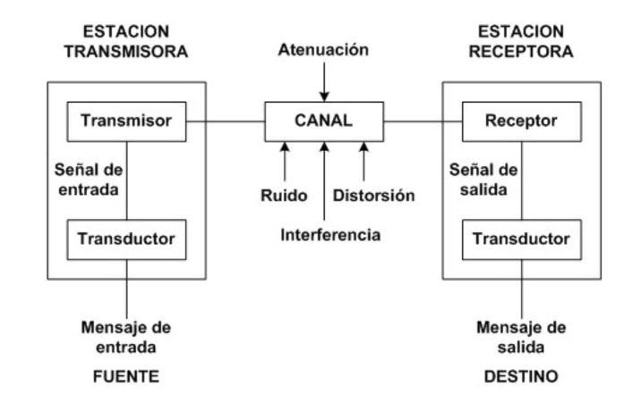{ width="800" }
  <figcaption>Elementos de un sistema de red: equipos extremos, medio e interconexión.</figcaption>
</figure>

### Componentes hardware

#### Nodos finales (DTE)

Los **nodos finales** o **DTE** (*Data Terminal Equipment*, equipo terminal de datos) **inician o terminan** la comunicación: estaciones de trabajo, servidores, impresoras de red, cámaras IP, etc. Son «los que quieren hablar».

#### Nodos intermedios (DCE)

Los **nodos intermedios** o **DCE** (*Data Circuit-terminating Equipment*, equipo de terminación del circuito de datos) participan en el camino entre extremos. No sustituyen al PC: ayudan a que el tráfico llegue.

| Dispositivo | Qué hace | Capa OSI habitual |
| --- | --- | --- |
| **Repetidor / hub** | Regenera o reparte la señal eléctrica | 1 (física) |
| **[Switch](#switch)** | Conecta equipos en la misma LAN; aprende MAC ↔ puerto | 2 (enlace) |
| **[Router](#router)** | Conecta **redes distintas**; elige camino (encaminamiento) | 3 (red) |
| **Firewall** | Filtra tráfico según políticas de seguridad | varias |
| **Punto de acceso (AP)** | Da acceso inalámbrico a la LAN cableada | 1–2 |

<figure markdown="span">
  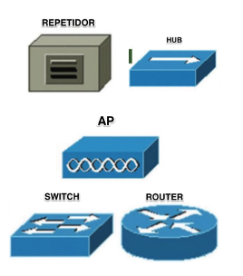{ width="400" }
  <figcaption>Nodos intermedios habituales en una LAN.</figcaption>
</figure>

!!! warning "Errores frecuentes"
    Confundir **switch** y **router** es el error más típico de examen. El switch une equipos de la **misma** red local. El router une **redes distintas** (por ejemplo, el aula con Internet) y trabaja con direcciones IP.

!!! note "Para la certificación CCNA"
    En CCNA ITN todavía preguntan la diferencia entre **hub** y **switch**. El hub (casi desaparecido) reparte la señal eléctrica a todos los puertos: todos los equipos comparten un único **dominio de colisión**. El switch crea un dominio de colisión **por puerto** (en full-dúplex, en la práctica no hay colisión en ese enlace). Hoy en taller usamos switches; el hub solo aparece como referencia histórica en el examen.

### Adaptador de red ([NIC](#nic))

La **NIC** (*Network Interface Card*, tarjeta de red) conecta el equipo al medio. Puede ir integrada en la placa o ser un módulo USB/PCIe. Se caracteriza por el tipo de interfaz (cobre, fibra, Wi‑Fi), el modo (**half-dúplex** o **full-dúplex**) y la velocidad (Mbps / Gbps). Cada NIC cableada tiene una dirección **MAC** de 48 bits que la identifica en la capa de enlace.

<figure markdown="span">
  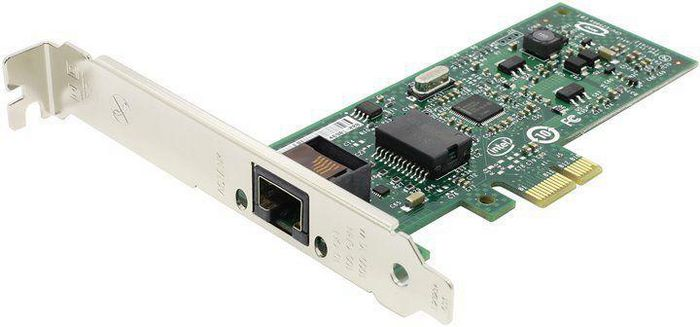{ width="600" }
  <figcaption>Adaptador de red (NIC) con interfaz Ethernet.</figcaption>
</figure>

### Medios de transmisión (visión general)

El **medio** es por donde viaja la señal. En LAN trabajamos sobre todo con medios **guiados** (par trenzado, fibra) y, para acceso, con **no guiados** (Wi‑Fi). El detalle de categorías, conectores y crimpado está en el **Tema 2**.

| Tipo | Ejemplos | Uso típico en LAN |
| --- | --- | --- |
| Guiados | Par trenzado (UTP/FTP), fibra óptica, coaxial | Cableado de edificio; backbone |
| No guiados | Wi‑Fi, radioenlaces | Acceso inalámbrico en aulas / oficinas |

### Componentes software

Además del hardware hace falta software: la **pila de protocolos** del sistema operativo, los **drivers** de la NIC y los servicios (DHCP, DNS, servidor web…). Sin ese software, el cable solo transporta señal sin sentido.

!!! tip "¿Qué es un protocolo?"
    Conjunto de reglas entre emisor y receptor que permiten transmitir datos de forma acordada. Ejemplo: el protocolo **IP** define el direccionamiento lógico.

---

## Clasificación de redes

### Según su extensión

Clasificar por **alcance geográfico** ayuda a situar dónde trabaja cada tecnología y qué dispositivos predominan. Una **[PAN](#pan)** (*Personal Area Network*) cubre el entorno personal, apenas unos metros: Bluetooth o NFC son ejemplos cotidianos. Una **[LAN](#lan)** (*Local Area Network*) es la red local de un aula, un piso o un edificio; si el acceso es inalámbrico hablamos de **WLAN**. Una **[MAN](#man)** (*Metropolitan Area Network*) une varias LAN en ámbito de ciudad o de un campus grande. Una **[WAN](#wan)** (*Wide Area Network*) conecta a gran distancia; Internet es el ejemplo más conocido.

<figure markdown="span">
  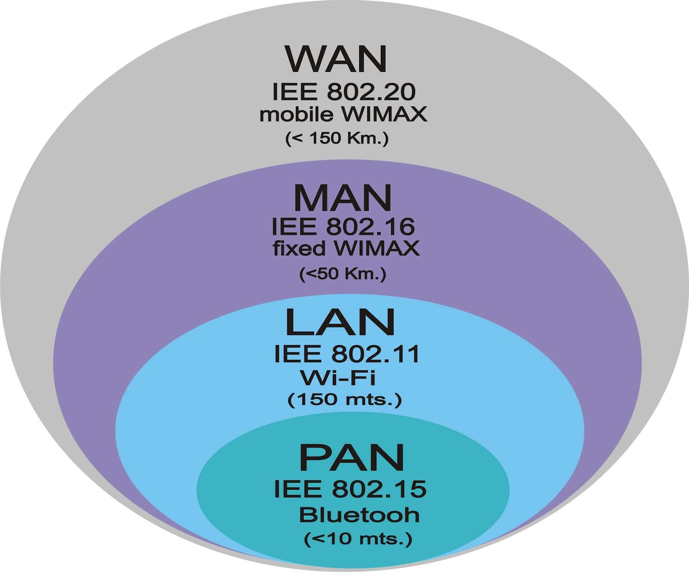{ width="600" }
  <figcaption>Tipos de redes según su extensión, de menor a mayor alcance.</figcaption>
</figure>

### Según su ámbito (titularidad)

Según **quién controla** la red:

- **Públicas**: el operador (ISP) ofrece conectividad a quien contrata.
- **Privadas**: pertenecen a una organización o particular.

Una **[VPN](#vpn)** (*Virtual Private Network*, red privada virtual) permite extender de forma segura una red privada sobre otra no controlada (por ejemplo, Internet): el tráfico viaja cifrado como si estuvieras en la LAN de la empresa.

<figure markdown="span">
  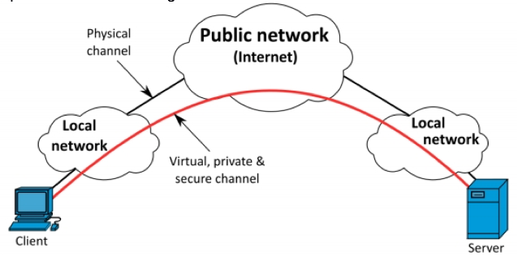{ width="800" }
  <figcaption>Idea de VPN: túnel seguro sobre una red pública.</figcaption>
</figure>

---

## Topologías

La **[topología](#topologia)** describe cómo se disponen y conectan los nodos: el «mapa» físico o lógico de la red.

### Cableadas

En LAN cableadas de hoy lo habitual es la **estrella** (y variantes en árbol o jerárquicas): cada puesto llega a un switch central. El **bus** clásico (un solo cable compartido) está en desuso en Ethernet moderno. El **anillo** aparece en contextos históricos o específicos.

<figure markdown="span">
  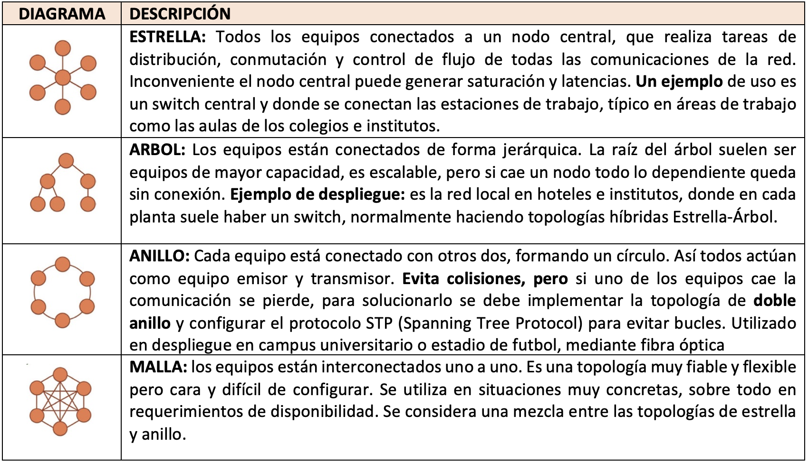{ width="900" }
  <figcaption>Topologías cableadas: bus, anillo, estrella y árbol.</figcaption>
</figure>

!!! warning "Errores frecuentes"
    Dibujar una estrella **sin** dispositivo central no es estrella: hace falta el switch (o hub). En examen, si te piden la topología de un aula con un armario y un switch, la respuesta es estrella (o estrella extendida / árbol si hay varios switches).

### Inalámbricas

En Wi‑Fi lo más frecuente es una **estrella inalámbrica**: los clientes se asocian a un **punto de acceso** que enlaza con la LAN cableada. También existen despliegues en **malla** (*mesh*) entre APs.

<figure markdown="span">
  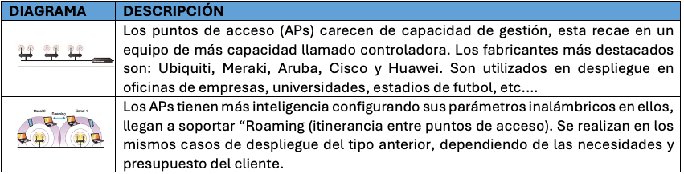{ width="900" }
  <figcaption>Topologías inalámbricas habituales basadas en puntos de acceso.</figcaption>
</figure>

---

## Transmisión y perturbaciones

**Transmitir** es enviar datos de un punto a otro por un medio. Una **perturbación** es cualquier interferencia o degradación que altera la señal y puede corromper los bits.

### Ideas que debes manejar

Antes de la tabla, tres ideas con calma. La señal puede ser **analógica** (valores continuos, como la voz en telefonía clásica) o **digital** (niveles discretos, como Ethernet). Los bits pueden ir en **serie** (uno tras otro) o en **paralelo** (varios a la vez). Y según el sentido del flujo hablamos de **símplex** (solo un sentido), **half-dúplex** (los dos sentidos, pero no a la vez) o **full-dúplex** (los dos sentidos a la vez).

| Criterio | Opciones | Ejemplo |
| --- | --- | --- |
| Naturaleza de la señal | Analógica / digital | Voz telefónica clásica vs Ethernet |
| Cómo viajan los bits | Serie / paralelo | USB o Ethernet (serie) vs buses antiguos |
| Dirección | Símplex / half-dúplex / full-dúplex | Emisora de TV; walkie-talkie; llamada telefónica |

<figure markdown="span">
  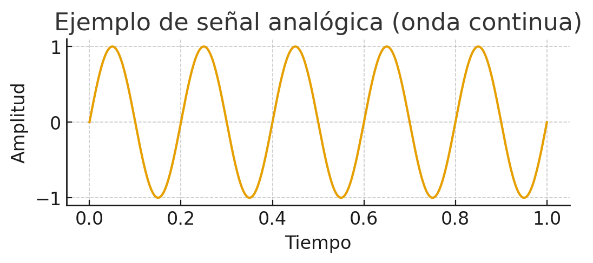{ width="360" }
  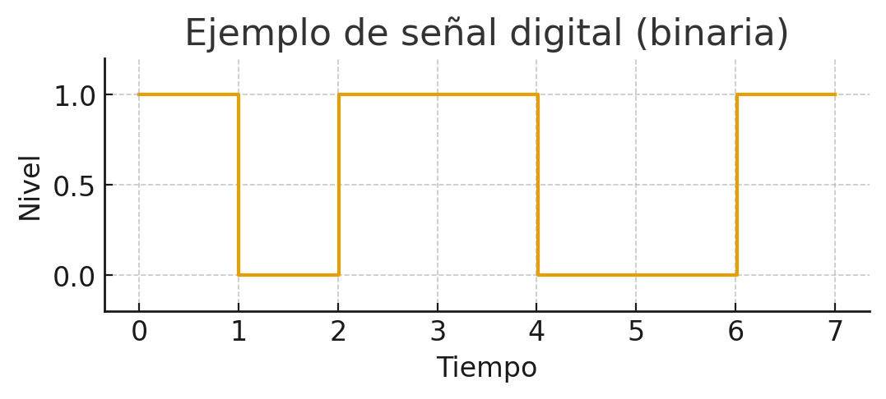{ width="360" }
  <figcaption>Señal analógica (izquierda) frente a señal digital (derecha).</figcaption>
</figure>

<figure markdown="span">
  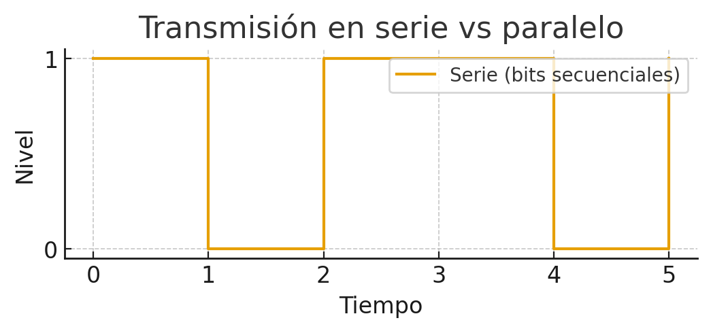{ width="360" }
  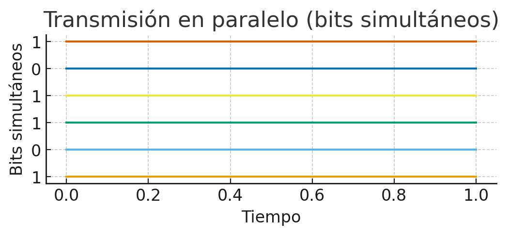{ width="360" }
  <figcaption>Transmisión en serie y en paralelo.</figcaption>
</figure>

<figure markdown="span">
  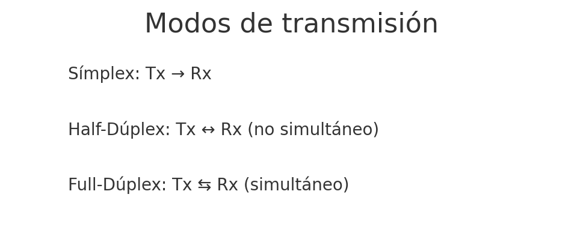{ width="640" }
  <figcaption>Símplex, half-dúplex y full-dúplex: sentido del flujo de datos.</figcaption>
</figure>

### Perturbaciones habituales

En cobre aparecen tres problemas clásicos. La **atenuación** es la pérdida de potencia con la distancia: a más metros, más débil llega la señal. El **ruido** son señales no deseadas (térmico, impulsivo, diafonía entre pares…). La **distorsión** deforma la forma de la onda y dificulta que el receptor lea bien los bits. En fibra la EMI eléctrica casi no afecta, pero sí importan curvas, suciedad en el conector y empalmes mal hechos.

!!! warning "Errores frecuentes"
    No digas que «el ruido es atenuación». Son cosas distintas: la atenuación debilita la señal útil; el ruido añade señal basura. En examen suelen pedir un ejemplo de cada una.

!!! note "Fuera de alcance en este tema"
    Técnicas de codificación (NRZ, Manchester…) y modulación detallada (AM/FM/PM) no se desarrollan aquí; si hace falta, se retomarán como ampliación o en laboratorio.

---

## Normalización

Al principio cada fabricante tenía su forma de cablear y de hablar en red. El resultado era la **incompatibilidad**: un equipo de una marca no encajaba con el de otra. La solución fue **estandarizar**: acordar normas comunes de cableado, tramas, direcciones y protocolos.

Un **estándar** es un documento técnico consensuado que define cómo debe hacerse algo para que productos distintos interoperen. En redes el color del par naranja lo marca la norma, no cada fabricante por su cuenta.

<figure markdown="span">
  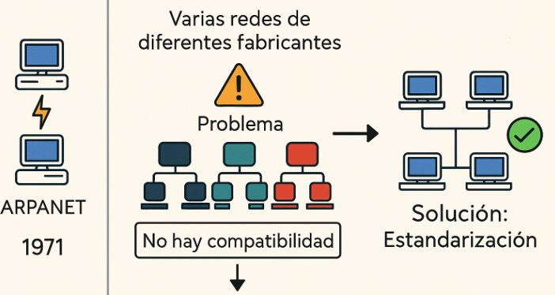{ width="700" }
  <figcaption>Sin normalización, cada fabricante habla un idioma distinto.</figcaption>
</figure>

### Organismos

Cuatro nombres salen una y otra vez. Conviene saber **quién es cada uno** y un ejemplo de lo que publica.

**[ISO](#iso)** (*International Organization for Standardization*, Organización Internacional de Normalización) publica normas internacionales de muchos campos. En redes, el **modelo OSI** (ISO/IEC 7498) es su referencia más citada en clase: siete capas para describir la comunicación.

**[IEEE](#ieee)** (*Institute of Electrical and Electronics Engineers*) publica estándares de redes locales y metropolitanas en la familia **802**. Ejemplos que usarás: **802.3** (Ethernet) y **802.11** (Wi‑Fi).

**[ITU](#itu)** (*International Telecommunication Union*, Unión Internacional de Telecomunicaciones) coordina a escala mundial aspectos de telecomunicaciones (radioespectro, recomendaciones de operadores, etc.). En SMR aparece sobre todo cuando hablamos de espectro y de servicios de telecomunicación.

**[IETF](#ietf)** (*Internet Engineering Task Force*) desarrolla los protocolos de Internet documentados en **RFC** (*Request for Comments*). TCP, IP, HTTP, DNS… nacen o se actualizan en ese entorno. Es el organismo «de Internet» frente al modelo de referencia de ISO.

<figure markdown="span">
  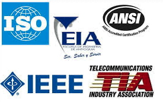{ width="700" }
  <figcaption>Organismos de normalización habituales en redes.</figcaption>
</figure>

!!! warning "Errores frecuentes"
    Mezclar papeles: **IEEE 802.3** es Ethernet, no «el modelo OSI». El modelo de siete capas es de **ISO**. Los protocolos de Internet (IP, TCP…) los documenta sobre todo la **IETF**.

---

## Arquitecturas por capas

Diseñar una red implica resolver a la vez el medio físico, el acceso al cable, el direccionamiento, el transporte fiable y las aplicaciones. Si todo fuera un solo bloque monolítico, cambiar un detalle rompería el resto. La solución práctica es dividir el problema en **capas**: cada una ofrece servicios a la superior y usa los de la inferior.

### Principios

Cada capa se apoya en los servicios de la de abajo. Las capas **homólogas** de dos equipos se entienden mediante **protocolos** (mismas reglas). Si mantienes los servicios que una capa ofrece hacia arriba, puedes cambiar el protocolo interno sin reescribir toda la pila. Eso es lo que permite que Ethernet evolucione de 100 Mbps a 1 Gbps sin cambiar HTTP.

### PDU y encapsulación

La **[PDU](#pdu)** (*Protocol Data Unit*, unidad de datos de protocolo) es el «paquete» que maneja una capa concreta. No es lo mismo un segmento TCP que una trama Ethernet: cada uno lleva la información que esa capa necesita.

Cuando una aplicación envía datos, la capa de transporte añade su cabecera (puertos, control…) y forma un **segmento** (TCP) o un **datagrama** (UDP). La capa de red añade la cabecera IP (direcciones de origen y destino) y forma el **paquete**. La capa de enlace añade cabecera (y a menudo cola con control de errores) y forma la **trama**. En el medio físico viajan **bits**. Ese proceso de ir envolviendo se llama **[encapsulación](#encapsulacion)**. En el receptor ocurre lo contrario: cada capa quita su cabecera y entrega el contenido hacia arriba (**desencapsulación**).

| Capa | Nombre habitual de la PDU |
| --- | --- |
| Aplicación | Datos |
| Transporte | Segmento (TCP) / datagrama (UDP) |
| Internet (red) | Paquete / datagrama IP |
| Acceso a la red | Trama |
| Física (dentro de acceso a la red) | Bits |

<figure markdown="span">
  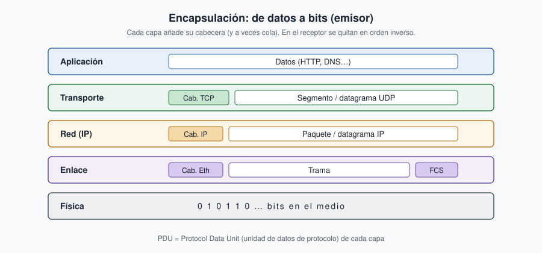{ width="800" }
  <figcaption>Encapsulación en el emisor: cada capa añade su cabecera; en el receptor se eliminan en orden inverso.</figcaption>
</figure>

<figure markdown="span">
  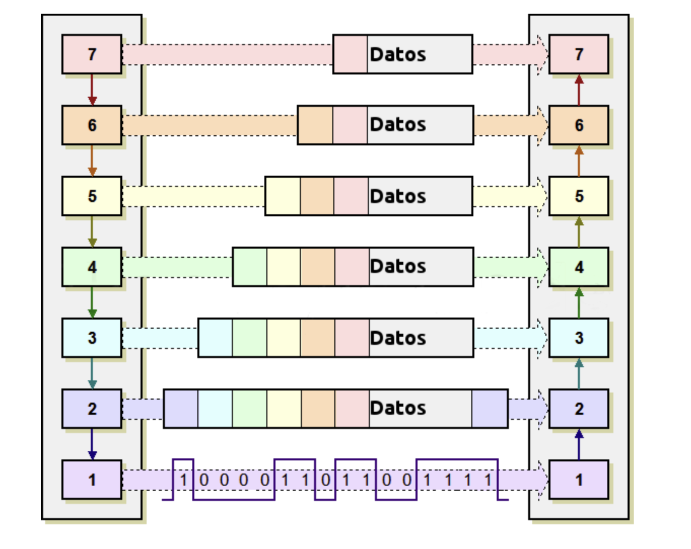{ width="600" }
  <figcaption>Comunicación basada en niveles: cada capa habla con su homóloga mediante un protocolo.</figcaption>
</figure>

!!! warning "Errores frecuentes"
    Decir «el paquete de la capa 2» suele ser incorrecto: en capa 2 hablamos de **trama**; el **paquete** es de capa 3 (IP). En capa 4, con TCP, hablamos de **segmento**.

---

## Modelo OSI y modelo TCP/IP

El **[modelo OSI](#osi)** (*Open Systems Interconnection*) divide la comunicación en **siete capas**. Es sobre todo un **modelo de referencia** para estudiar y comparar. El **[modelo TCP/IP](#tcpip)** tiene **cuatro capas** y describe la pila real de Internet. En clase usamos OSI para situar conceptos y TCP/IP para lo que realmente configuras y capturas.

### Capas del modelo OSI (de abajo arriba)

**Capa 1 — Física.** Define el medio, los conectores, los niveles eléctricos u ópticos y cómo se representan los bits. Aquí entran el cable UTP, la fibra, las señales y dispositivos como repetidores o hubs. Si el enlace está caído a nivel de cable, el problema empieza en esta capa.

**Capa 2 — Enlace de datos.** Organiza los bits en **tramas**, identifica equipos en la LAN con direcciones **MAC** y gestiona el acceso al medio. El **switch** es el dispositivo estrella de esta capa en Ethernet. También aparece el control de errores a nivel de trama (FCS).

**Capa 3 — Red.** Se encarga del **direccionamiento lógico** y del **encaminamiento** entre redes distintas. El protocolo clave es **IP**. El **router** decide por qué camino enviar el paquete. Sin esta capa, una LAN no saldría hacia otra red.

**Capa 4 — Transporte.** Ofrece comunicación **extremo a extremo** entre procesos. **TCP** aporta fiabilidad y control de flujo; **UDP** es más ligero y sin garantía de entrega. Aquí aparecen los **puertos** (por ejemplo, 80 para HTTP).

**Capa 5 — Sesión.** Gestiona el diálogo entre aplicaciones: establecer, mantener y cerrar la sesión. En la práctica diaria de SMR se ve menos como protocolo aislado; en TCP/IP sus funciones se diluyen en la capa de aplicación.

**Capa 6 — Presentación.** Se ocupa del formato de los datos: codificación de caracteres, compresión y cifrado a este nivel conceptual. Tampoco tiene un «protocolo único» que configures en el aula como si fuera IP.

**Capa 7 — Aplicación.** Ofrece servicios al usuario o a los programas: **HTTP/HTTPS**, **DNS**, **SMTP**, **DHCP**, FTP… Es la capa con la que «hablas» al abrir el navegador o al resolver un nombre.

### Modelo TCP/IP (4 capas)

1. **Acceso a la red** agrupa lo que en OSI son física + enlace (Ethernet, Wi‑Fi…).
2. **Internet** corresponde a la red OSI (IP, ICMP; ARP se estudia junto al direccionamiento).
3. **Transporte** (TCP, UDP).
4. **Aplicación** agrupa sesión + presentación + aplicación de OSI.

| Capa TCP/IP | Capas OSI | Función | Ejemplo |
| --- | --- | --- | --- |
| Aplicación | 5–7 | Servicios al usuario | HTTP, DNS, DHCP |
| Transporte | 4 | Comunicación extremo a extremo | TCP, UDP |
| Internet | 3 | Encaminamiento y direccionamiento | IP, ICMP |
| Acceso a la red | 1–2 | Medio físico y tramas | Ethernet, Wi‑Fi |

<figure markdown="span">
  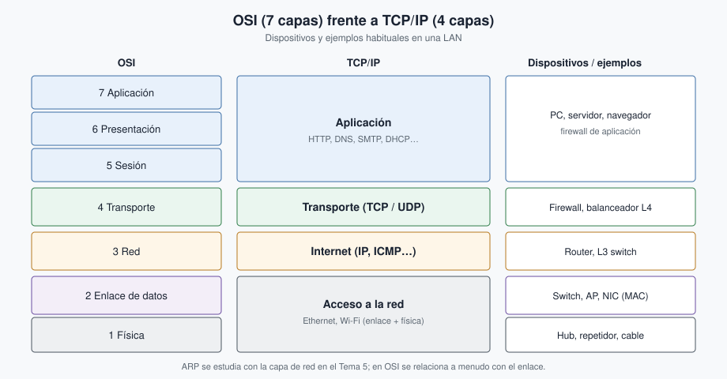{ width="820" }
  <figcaption>Equivalencia OSI–TCP/IP y dispositivos habituales en cada zona de la pila.</figcaption>
</figure>

<figure markdown="span">
  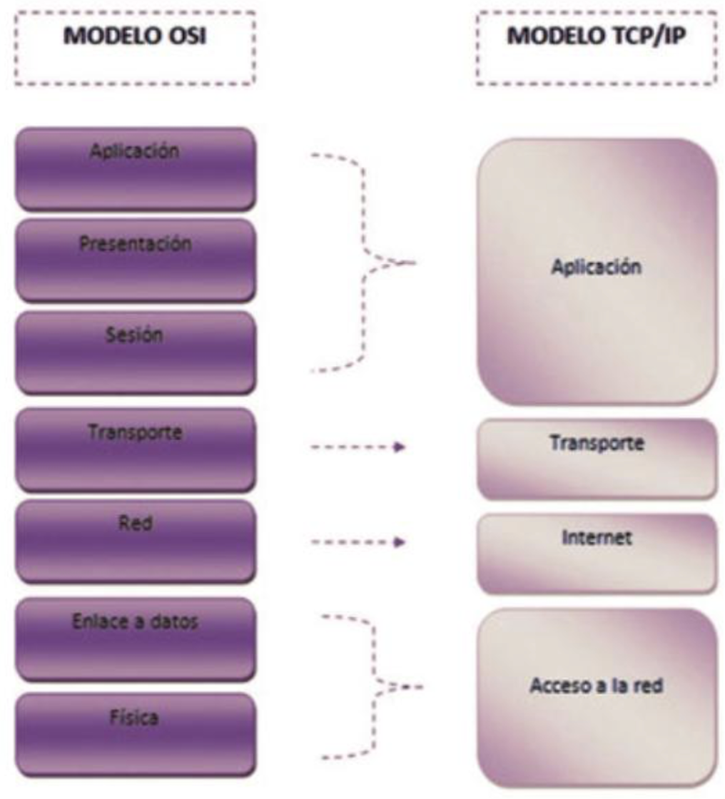{ width="500" }
  <figcaption>Otra vista de la equivalencia entre los dos modelos.</figcaption>
</figure>

!!! warning "Errores frecuentes"
    Decir que «OSI es lo que usa Internet» es falso: Internet usa **TCP/IP**. OSI sirve para explicar. Tampoco digas que el switch «trabaja en capa 3» en el caso general: el switch Ethernet habitual es de **capa 2** (hay switches L3, pero eso se verá más adelante).

---

## Uso del medio y esquemas LAN

### Difusión frente a conmutación

En un medio compartido clásico (bus, hub) el tráfico se **difunde** (*broadcast*): varios equipos pueden «oír» lo que otros envían y aumentan las colisiones. Con **conmutación**, el switch aprende en qué puerto está cada MAC y envía la trama solo hacia el destino (salvo broadcasts y desconocidos). Por eso en las LAN modernas casi todo pasa por switches y no por hubs.

!!! note "Para la certificación CCNA"
    Ethernet clásico en medio compartido (bus o hub, half-dúplex) usaba **CSMA/CD** (*Carrier Sense Multiple Access with Collision Detection*): el equipo escucha el medio, transmite y, si hay colisión, espera un tiempo aleatorio y reintenta. En las LAN conmutadas actuales en **full-dúplex** ese mecanismo queda en desuso: el enlace PC–switch no comparte el medio con otros. Wi‑Fi sigue usando una variante de acceso al medio (**CSMA/CA**, con prevención de colisiones) porque el aire se comparte.

<figure markdown="span">
  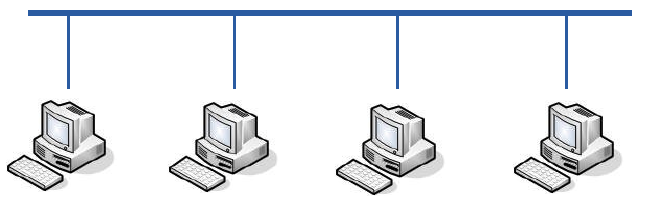{ width="700" }
  <figcaption>Idea de difusión: el medio se comparte y el tráfico puede llegar a todos.</figcaption>
</figure>

### Esquemas LAN

Una **LAN simple** suele ser un conjunto de PC y un switch, con un router hacia Internet. Cuando la organización crece, se separan **zonas** (administración, aulas, servidores) para ordenar el cableado y, más adelante, las VLAN. Una **[DMZ](#dmz)** es una zona intermedia para servicios publicados (web, correo): el tráfico de Internet llega ahí con reglas estrictas, sin entrar directamente a la red interna.

<figure markdown="span">
  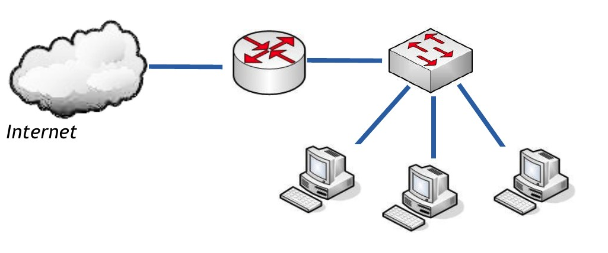{ width="700" }
  <figcaption>Esquema de LAN simple.</figcaption>
</figure>

<figure markdown="span">
  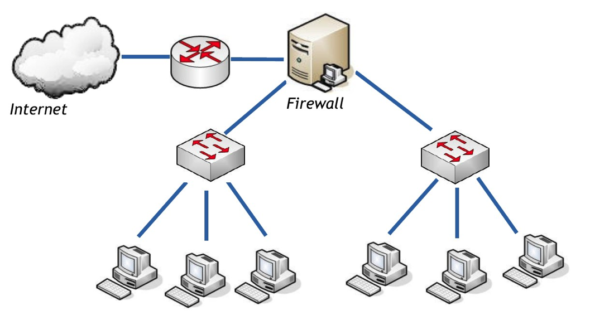{ width="700" }
  <figcaption>Esquema LAN con zonas.</figcaption>
</figure>

<figure markdown="span">
  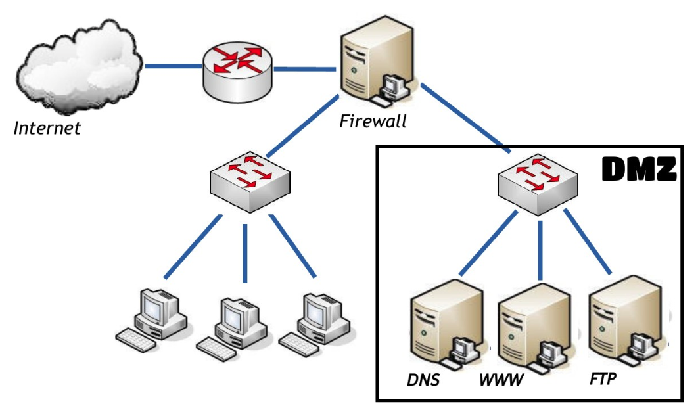{ width="700" }
  <figcaption>Esquema con DMZ para servicios expuestos.</figcaption>
</figure>

---

## Actividades

!!! tip "Formato de entrega"
    Las entregas en **Aules** son **obligatorias en Markdown** (`.md`). No se aceptan PDF.  
    Nombre del archivo: `AC1XX.md` o `PR1XX.md` (sustituye XX por el número). Respeta la fecha de vencimiento.  
    Escribiremos los `.md` con **Visual Studio Code**.

    !!! note "Cómo empezar"
        - Guía de Markdown: [tutorialmarkdown.com/guia](https://tutorialmarkdown.com/guia)
        - Documentación de Visual Studio Code: [code.visualstudio.com/docs](https://code.visualstudio.com/docs)

### PR101 — Mapa físico y lógico

* :simple-neutralinojs: **PR101**. (RA1 // CE1b, CE1c, CE1e, CE1f, CE1g, CE1h // **PR 0–10**). En grupo, diseñad el esquema de la empresa ficticia **TechSolutions**:

  - 3 departamentos (Administración, Ventas, Soporte), cada uno con 5 PCs y 1 impresora.
  - 1 servidor central.
  - Conexión a Internet mediante router.

  **Tareas:** elegir topología; dibujar el mapa en [Excalidraw](https://excalidraw.com/), [draw.io](https://app.diagrams.net/) o [Dia](https://wiki.gnome.org/Apps/Dia) (cualquiera de las tres); etiquetar medios (UTP, fibra, Wi‑Fi); justificar topología, medios y dispositivos; exposición breve (5 min).

  **Entrega:** el diagrama (export PNG/SVG o el archivo del editor, según se indique en Aules) **y** el `.md` de la práctica (`PR101.md`).

| Criterio | Descripción | Puntos |
| --- | --- | --- |
| Claridad del diagrama | Legible y organizado | 0–2 |
| Dispositivos | Todos los necesarios | 0–2 |
| Conexiones | Etiquetadas (UTP / fibra / Wi‑Fi) | 0–2 |
| Topología adecuada | Coherente con el escenario | 0–2 |
| Justificación técnica | Argumentación clara | 0–2 |
| **Total** | | **/10** |

### AC102 — Transmisión y perturbaciones

* :simple-readdotcv: **AC102**. (RA1 // CE1a, CE1c, CE1d // **AC 0–1**). Busca ejemplos reales de: serie/paralelo, símplex/half/full-dúplex, y al menos dos perturbaciones. Para cada uno: dónde aparece, qué efecto tiene y qué solución se aplica o propondrías.

### AC103 — Organismos de normalización

* :simple-readdotcv: **AC103**. (RA1 // CE1a, CE1c // **AC 0–1**). Tabla comparativa de organismos (ISO, IEEE, ITU, IETF…): función y algún estándar relevante.

### AC104 — OSI vs TCP/IP

* :simple-readdotcv: **AC104**. (RA1 // CE1a, CE1g // **AC 0–1**). Esquema comparativo OSI / TCP-IP: capas, equivalencia, función y un ejemplo de protocolo por capa TCP/IP.

### PR102 — Modelos en Packet Tracer { #pr102-modelos-en-packet-tracer }

* :simple-cisco: **PR102**. (RA1 // CE1a, CE1c // **Opcional · suma en el +1**). En **Packet Tracer**, observad la encapsulación de una petición web (HTTP / TCP / IP / Ethernet) y el papel de DNS (y ARP si aparece). Es voluntaria y va más allá de lo que vemos en este tema: puertos, DNS, ARP y TCP se ven a fondo en temas posteriores. Suma para el **+1** de la nota final solo si la defiendes en una **auditoría** oral cuando el profesor lo indique.

  **Antes:** instalad PT con la [guía inicial](../90-guias/packet-tracer.md).

  **Guion:** [PR102 — Modelos OSI/TCP](../90-guias/pr102-modelos-osi.md) (también en Aules). Usa la topología `.pkt` de Aules **o** monta la mini-LAN del guion.

  **Entrega:** `PR102.md` + capturas (simulación / PDU). Opcional: `.pkt`.

| Criterio | Descripción | Puntos |
| --- | --- | --- |
| Simulación y filtros | Modo simulación; HTTP (y DNS/TCP) visibles | 0–2 |
| Lectura OSI / TCP-IP | Tabla capa ↔ qué viste en la PDU | 0–3 |
| Preguntas de repaso | Puerto HTTP, DNS, intercambio en la respuesta | 0–3 |
| Claridad del `.md` | Capturas con leyenda; sin datos personales | 0–2 |
| **Total** | | **/10** |

La rúbrica valora la práctica; solo cuenta para el +1 si la defiendes en la auditoría.

### PR103 — Mi primera red en Packet Tracer { #pr103-mi-primera-red-en-packet-tracer }

* :simple-cisco: **PR103**. Mi primera red en Packet Tracer (RA1 // CE1c, CE1d, CE1f, CE1g // **PR 0–10**). Montas desde cero una LAN con un switch y cuatro PC, les das IP y compruebas la conectividad con ping y con el modo Simulación.

  **Antes:** [guía inicial de Packet Tracer](../90-guias/packet-tracer.md) (sesión iniciada).

  **Guion:** [PR103 — Mi primera red](../90-guias/pr103-primera-red.md) (también en Aules). No hay `.pkt` de partida: lo construyes tú siguiendo el vídeo.

  **Entrega:** `PR103.pkt` + `PR103.md` (capturas y respuestas).

| Criterio | Descripción | Puntos |
| --- | --- | --- |
| Topología y cableado | switch y 4 PC, cable correcto, enlaces en verde, nombres PC1–PC4 y SW1 | 2 |
| Direccionamiento | IP y máscara según la tabla, en Desktop > IP Configuration, sin puerta de enlace | 2 |
| Conectividad | ping correcto de PC1 al resto, con captura | 2 |
| Simulación | PDU ICMP de PC1 a PC4 que llega y vuelve, con captura de la Event List | 2 |
| Entrega | .pkt que abre bien y .md claro, respuestas correctas, sin datos personales | 2 |
| **Total** | | **/10** |

---

## Para el examen

Una LAN es la red local de un edificio o aula; el **switch** une equipos en esa LAN (capa 2) y el **router** une redes distintas (capa 3). Las topologías cableadas habituales son estrella o árbol. Transmitir implica señal, medio y sentido del flujo (símplex / half / full-dúplex); las perturbaciones típicas son atenuación, ruido y distorsión. La normalización evita incompatibilidades: ISO (modelo OSI), IEEE (802.3, 802.11), IETF (protocolos de Internet). La **encapsulación** añade cabeceras capa a capa (datos → segmento → paquete → trama → bits). OSI tiene 7 capas de referencia; TCP/IP tiene 4 y es el de Internet. En esquemas LAN, la DMZ aísla servicios publicados.

## Autocheck del tema

1. **V/F.** Un switch Ethernet típico conecta redes distintas usando direcciones IP.
2. Empareja: **PAN** · **LAN** · **WAN** con: (a) aula del instituto · (b) auriculares Bluetooth · (c) Internet.
3. En encapsulación, la PDU de la capa de enlace se llama…  
   a) segmento · b) paquete · c) trama · d) datagrama UDP
4. **V/F.** El modelo que usa Internet es OSI de 7 capas.
5. ¿Qué organismo publica el modelo OSI y cuál publica los RFC de Internet?
6. Elige la correcta: full-dúplex significa…  
   a) solo un sentido · b) dos sentidos, pero no a la vez · c) dos sentidos a la vez
7. Relaciona dispositivo y capa OSI habitual: **router** · **switch** · **hub** con capas **1**, **2** y **3**.
8. **V/F.** En una topología en estrella hace falta un nodo central (por ejemplo un switch).
9. ¿Qué es una DMZ en un esquema LAN?
10. Nombra tres perturbaciones habituales en transmisión por cobre.
11. **V/F.** La PDU de la capa de red es el segmento.
12. ¿Qué capas OSI se agrupan en la capa de aplicación de TCP/IP?

Soluciones

1. **Falso** — el switch típico trabaja en capa 2 (MAC) dentro de la misma LAN; quien une redes distintas es el router (capa 3).

2. **PAN** → (b); **LAN** → (a); **WAN** → (c).

3. **c) trama**.

4. **Falso** — Internet usa TCP/IP; OSI es el modelo de referencia.

5. **ISO** (modelo OSI) e **IETF** (RFC de Internet).

6. **c**.

7. **hub/repetidor** → 1; **switch** → 2; **router** → 3.

8. **Verdadero**.

9. Zona intermedia para servicios expuestos, con filtrado hacia la red interna.

10. Atenuación, ruido y distorsión (valen ejemplos concretos de cada una).

11. **Falso** — la PDU de la capa de red es el **paquete** (datagrama IP); el **segmento** es de la capa de transporte (TCP).

12. Las capas **5, 6 y 7** (sesión, presentación y aplicación).

---

## Vídeos recomendados

Pablo Hidalgo resume componentes de red y pilas de protocolos (CCNA v1.1, lección 1).

  <iframe src="https://www.youtube-nocookie.com/embed/zTR4NN-T8tc"
          style="position: absolute; top: 0; left: 0; width: 100%; height: 100%;"
          frameborder="0"
          allow="accelerometer; autoplay; clipboard-write; encrypted-media; gyroscope; picture-in-picture"
          allowfullscreen
          title="CCNA v1.1 Lección 1 — componentes de red y pilas de protocolos (Pablo Hidalgo)"></iframe>

Pablo Hidalgo explica TCP/IP, OSI, encapsulación y PDU (lección 2).

  <iframe src="https://www.youtube-nocookie.com/embed/7MSazHb1nE8"
          style="position: absolute; top: 0; left: 0; width: 100%; height: 100%;"
          frameborder="0"
          allow="accelerometer; autoplay; clipboard-write; encrypted-media; gyroscope; picture-in-picture"
          allowfullscreen
          title="CCNA v1.1 Lección 2 — TCP/IP, OSI, encapsulación y PDU (Pablo Hidalgo)"></iframe>

Alberto López explica el modelo OSI de forma sencilla.

  <iframe src="https://www.youtube-nocookie.com/embed/ODY4q4_3Acc"
          style="position: absolute; top: 0; left: 0; width: 100%; height: 100%;"
          frameborder="0"
          allow="accelerometer; autoplay; clipboard-write; encrypted-media; gyroscope; picture-in-picture"
          allowfullscreen
          title="El modelo OSI explicado de forma sencilla (Alberto López)"></iframe>

aulaClic resume tipos de redes LAN y WAN.

  <iframe src="https://www.youtube-nocookie.com/embed/ASXYvGV6sqE"
          style="position: absolute; top: 0; left: 0; width: 100%; height: 100%;"
          frameborder="0"
          allow="accelerometer; autoplay; clipboard-write; encrypted-media; gyroscope; picture-in-picture"
          allowfullscreen
          title="Tipos de redes LAN y WAN (aulaClic)"></iframe>

## Glosario

**LAN**{: #lan}
*Local Area Network*, red de área local: red de un aula, oficina o edificio. Suele usar Ethernet y/o Wi‑Fi.

**PAN**{: #pan}
*Personal Area Network*: red de alcance personal (pocos metros), por ejemplo Bluetooth.

**MAN**{: #man}
*Metropolitan Area Network*: red de ámbito metropolitano o de campus grande que une varias LAN.

**WAN**{: #wan}
*Wide Area Network*: red de gran alcance geográfico. Internet es el ejemplo más conocido.

**NIC**{: #nic}
*Network Interface Card*, tarjeta o adaptador de red. Conecta el equipo al medio y tiene dirección MAC en interfaces Ethernet.

**switch**{: #switch}
Dispositivo de interconexión de capa 2 que reenvía tramas según direcciones MAC aprendidas en cada puerto.

**router**{: #router}
Dispositivo de capa 3 que conecta redes distintas y encamina paquetes IP.

**topología**{: #topologia}
Disposición de los nodos y enlaces de una red (estrella, árbol, bus, anillo, malla…).

**VPN**{: #vpn}
*Virtual Private Network*: extensión segura de una red privada sobre otra no controlada, mediante cifrado.

**OSI**{: #osi}
*Open Systems Interconnection*: modelo de referencia de siete capas publicado por ISO.

**TCP/IP**{: #tcpip}
Modelo de cuatro capas usado en Internet (acceso a la red, Internet, transporte, aplicación).

**PDU**{: #pdu}
*Protocol Data Unit*: unidad de datos de una capa (segmento, paquete, trama…).

**encapsulación**{: #encapsulacion}
Proceso por el que cada capa añade su cabecera (y a veces cola) a los datos que recibe de la superior.

**DMZ**{: #dmz}
*Demilitarized Zone*: zona de red intermedia para servicios publicados, separada de la LAN interna.

**ISO**{: #iso}
Organización Internacional de Normalización; publica, entre otras, el modelo OSI.

**IEEE**{: #ieee}
Instituto de ingenieros eléctricos y electrónicos; familia de estándares 802 (Ethernet, Wi‑Fi…).

**ITU**{: #itu}
Unión Internacional de Telecomunicaciones; coordina aspectos globales de telecomunicaciones.

**IETF**{: #ietf}
*Internet Engineering Task Force*: desarrolla protocolos de Internet documentados en RFC.

---

## Referencias rápidas

- Sitio del módulo: [fjavier-hernandez.github.io/ral](https://fjavier-hernandez.github.io/ral/)
- Diagramas: [Excalidraw](https://excalidraw.com/), [draw.io (diagrams.net)](https://app.diagrams.net/), [Dia](https://wiki.gnome.org/Apps/Dia)
- Simulación: [Cisco Packet Tracer](https://www.netacad.com/es/cisco-packet-tracer)
- Entregas: [Visual Studio Code](https://code.visualstudio.com/docs) + [Markdown](https://tutorialmarkdown.com/guia)
- Normas: [Normas del taller](../00-normas/normas_taller.md)

*[RA]: Resultado de aprendizaje  
*[CE]: Criterio de evaluación  
*[AC]: Actividad de clase  
*[PR]: Práctica  
*[LAN]: Local Area Network  
*[OSI]: Open Systems Interconnection  
*[PDU]: Protocol Data Unit  
*[NIC]: Network Interface Card  
*[VPN]: Virtual Private Network  
*[DMZ]: Demilitarized Zone
