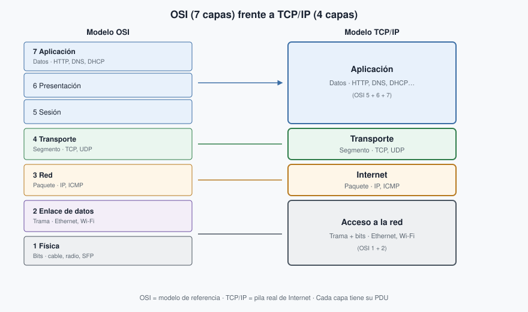
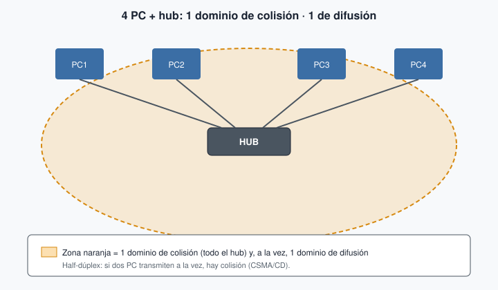
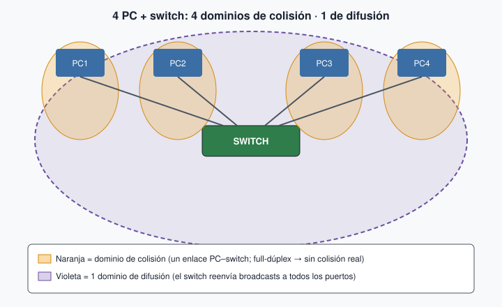
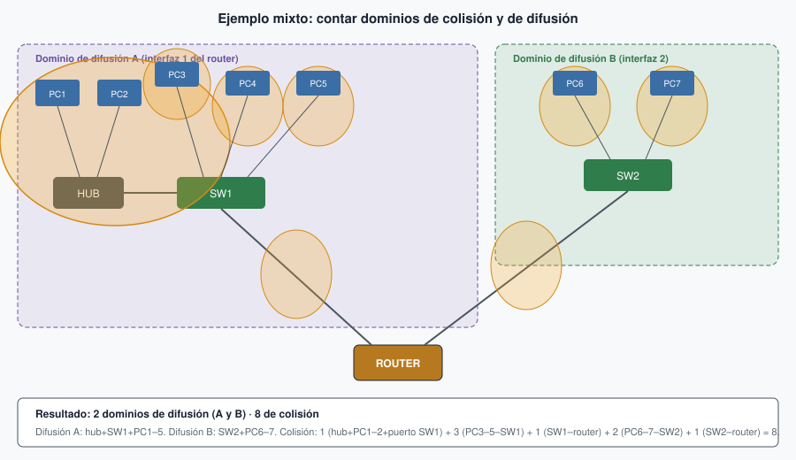
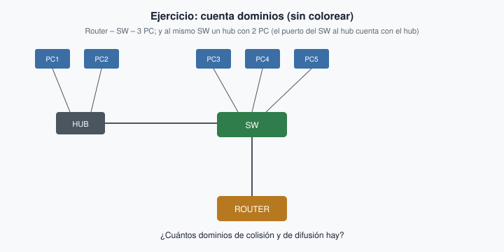

# Tema 1. Introducción. Arquitectura de redes

En este tema construimos el mapa que el resto del módulo da por sentado: qué es una **[LAN](#lan)** (*Local Area Network*, red de área local), qué **dispositivos** intervienen, **por qué** las comunicaciones se organizan en capas ([OSI](#osi) y [TCP/IP](#tcpip)) y cómo se cuentan los **dominios de colisión y de difusión**.

!!! tip "Primera clase"
    Empieza por el [cuestionario inicial](#cuestionario-inicial). No hace falta haber leído el tema entero: sirve para ver qué traes antes de estudiar. Entrégalo en Aules **antes** de mirar el Autocheck.

!!! tip "Cómo leerlo"
    Lee cada apartado completo: primero el párrafo (qué es y para qué sirve), luego la tabla o la figura, y al final los errores frecuentes. No estudies solo las tablas. Los términos marcados enlazan al [glosario](#glosario). Cuando acabes el tema, haz el [Autocheck](#autocheck-del-tema) sin mirar las soluciones.

## Propuesta didáctica

Trabajamos el **RA1** del módulo Redes de área local (0225):

> **RA1.** *Reconoce la estructura de redes locales cableadas analizando las características de entornos de aplicación y describiendo la funcionalidad de sus componentes.*

### Criterios de evaluación (RA1)

* **CE1a**: Se han descrito los principios de funcionamiento de las redes locales.
* **CE1b**: Se han identificado los distintos tipos de redes.
* **CE1c**: Se han descrito los elementos de la red local y su función.
* **CE1d**: Se han identificado y clasificado los medios de transmisión.
* **CE1e**: Se ha reconocido el mapa físico de la red local.
* **CE1f**: Se han utilizado aplicaciones para representar el mapa físico de la red local.
* **CE1g**: Se han reconocido las distintas topologías de red.
* **CE1h**: Se han identificado estructuras alternativas.

### Contenidos

* Sistemas en red: tipos, componentes y topologías.
* Clasificación por extensión (PAN, LAN, MAN, WAN) y por ámbito (pública / privada).
* Medios de transmisión (visión general) y perturbaciones habituales.
* Normalización: estándares y organismos.
* Arquitecturas por capas: modelo OSI y modelo TCP/IP; PDU y encapsulación.
* Uso del medio: dominios de colisión y de difusión.

### Programación de aula (orientativa, ~18–20 h)

| Sesiones | Contenidos | Actividades |
| --- | --- | --- |
| 1 | Presentación del módulo + normas del taller + cuestionario inicial | Cuestionario (1–7) |
| 2–3 | Componentes, tipos de redes, topologías | **PR101** (diagrama: Excalidraw / draw.io / Dia) |
| 4 | Transmisión básica y perturbaciones | AC102 |
| 5–7 | Normalización, OSI / TCP-IP, encapsulación | AC103, AC104 |
| 8–9 | Dominios de colisión y difusión; primera red en PT | **PR103**; PR102 (opcional) |

---

## Cuestionario inicial {: #cuestionario-inicial }

!!! question "Antes de empezar — responde con lo que sepas"
    1. ¿Qué tipos de redes conoces según su extensión?
    2. ¿Qué diferencia hay entre una red pública y una privada?
    3. ¿Qué función tiene un switch en una red local?
    4. ¿Qué ventajas ofrece la fibra óptica frente al par trenzado?
    5. ¿Qué es una topología en estrella? ¿Dónde se suele usar?
    6. ¿Qué relación existe entre los nodos finales e intermedios?
    7. ¿Qué diferencia hay entre transmisión serie y paralela?
    8. ¿Qué es un modelo de red y para qué sirve?
    9. ¿Cuáles son las principales diferencias entre el modelo OSI y el modelo TCP/IP?
    10. ¿Qué diferencias hay entre conmutación y difusión en el uso del medio?
    11. ¿Qué es una DMZ y para qué se utiliza en una red local?

Entrega tus respuestas en **Aules** como tarea del cuestionario inicial **antes** de mirar el [Autocheck](#autocheck-del-tema) del final del tema. Las soluciones no están aquí a propósito: primero entregas, después contrastas.

---

## Sistemas en red

Un **sistema de red** es el conjunto de equipos y medios de transmisión que permiten comunicar terminales, a menudo en puntos distintos. Cuando varios sistemas se unen, formamos las **redes de comunicaciones** que usas cada día: el aula, el centro, Internet.

**Para qué sirve esta idea.** Si no separas emisor, receptor, medio y reglas (protocolos), parece que «la red» es magia. En el taller y en el examen te pedirán nombrar cada pieza y decir qué hace.

**Ejemplo.** En el aula, tu PC (emisor) envía una petición web; el cable o el Wi‑Fi es el medio; el switch y el router del centro ayudan a llegar al servidor; el navegador y el sistema operativo aplican los protocolos.

<figure markdown="span">
  { width="800" }
  <figcaption>Elementos de un sistema de red: equipos extremos, medio e interconexión.</figcaption>
</figure>

### Componentes hardware

#### Nodos finales (DTE)

Los **nodos finales** o **DTE** (*Data Terminal Equipment*, equipo terminal de datos) **inician o terminan** la comunicación: estaciones de trabajo, servidores, impresoras de red, cámaras IP, etc. Son «los que quieren hablar». En casa, tu portátil y la Smart TV son nodos finales; en el instituto, cada PC del aula y el servidor de impresión también.

#### Nodos intermedios

Los **nodos intermedios** participan en el camino entre extremos: no sustituyen al PC; ayudan a que el tráfico llegue. Sin ellos, solo tendrías cables punto a punto entre dos equipos. En sentido estricto, **DCE** (*Data Circuit-terminating Equipment*) es el equipo que **termina el circuito** de datos (módem, CSU/DSU). En el CCNA y en clase usamos sobre todo «dispositivos intermediarios» (switch, router, AP…) para lo que va entre nodos finales.

| Dispositivo | Qué hace | Capa OSI habitual |
| --- | --- | --- |
| **Repetidor** | Regenera la señal y la reenvía; **no** divide el dominio de colisión | 1 (física) |
| **Hub** | Reparte la señal a todos los puertos (un solo dominio de colisión). Hoy solo se usa en laboratorio | 1 (física) |
| **[Switch](#switch)** | Conecta equipos en la misma LAN; aprende MAC ↔ puerto | 2 (enlace) |
| **[Router](#router)** | Conecta **redes distintas**; elige camino (encaminamiento) | 3 (red) |
| **Firewall** | Filtra tráfico según políticas de seguridad | varias |
| **Punto de acceso (AP)** | Amplía la red cableada con acceso Wi‑Fi; se alimenta por **PoE** o por la red eléctrica | 1–2 |

<figure markdown="span">
  { width="400" }
  <figcaption>Nodos intermedios habituales en una LAN.</figcaption>
</figure>

!!! warning "Errores frecuentes"
    Confundir **switch** y **router** es el error más típico de examen. El switch une equipos de la **misma** red local. El router une **redes distintas** (por ejemplo, el aula con Internet) y trabaja con direcciones IP. El hub casi no se usa hoy; lo estudiaremos al contar [dominios de colisión](#dominio-de-colision).

### Adaptador de red ([NIC](#nic)) {: #adaptador-de-red-nic }

La **NIC** (*Network Interface Card*, tarjeta de red) conecta el equipo al medio. Puede ir integrada en la placa o ser un módulo USB/PCIe. Trabaja en las **capas 1 y 2**: bits en el medio y tramas con dirección MAC. La mayoría de NIC cableadas en el aula son **Ethernet**. Se caracteriza por el tipo de interfaz (cobre, fibra, Wi‑Fi), el modo (**half-dúplex** o **full-dúplex**) y la velocidad (Mbps / Gbps).

Toda NIC (también la **Wi‑Fi**) tiene una dirección **MAC** de **48 bits**, escrita como **12 dígitos hexadecimales** (por ejemplo `00:1A:2B:3C:4D:5E`). Los primeros 24 bits son el **OUI** del fabricante (*Organizationally Unique Identifier*); el resto identifica la tarjeta concreta.

**Ejemplo de aula.** El PC del taller tiene NIC Ethernet a 1 Gbps en full-dúplex hacia el switch; el portátil usa la NIC Wi‑Fi hacia el AP del pasillo. Las dos tienen MAC; cambian el medio, no el papel: sacar y meter tramas del equipo.

<figure markdown="span">
  { width="600" }
  <figcaption>Adaptador de red (NIC) con interfaz Ethernet.</figcaption>
</figure>

### Medios de transmisión (visión general)

El **medio** es por donde viaja la señal. En LAN trabajamos sobre todo con medios **guiados** (par trenzado, fibra) y, para acceso, con **no guiados** (Wi‑Fi). El detalle de categorías, conectores y crimpado está en el **Tema 2**.

| Tipo | Ejemplos | Uso típico en LAN |
| --- | --- | --- |
| Guiados | Par trenzado (UTP/FTP), fibra óptica, coaxial | Cableado de edificio; backbone |
| No guiados | Wi‑Fi, radioenlaces | Acceso inalámbrico en aulas / oficinas |

### Componentes software

Además del hardware hace falta software: la **pila de protocolos** del sistema operativo, los **drivers** de la NIC y los servicios (DHCP, DNS, servidor web…). Sin ese software, el cable solo transporta señal sin sentido.

!!! tip "¿Qué es un protocolo?"
    Conjunto de reglas entre emisor y receptor que permiten transmitir datos de forma acordada. Ejemplo: el protocolo **IP** define el direccionamiento lógico.

---

## Clasificación de redes

### Según su extensión

Clasificar por **alcance geográfico** ayuda a situar dónde trabaja cada tecnología y qué dispositivos predominan. Una **[PAN](#pan)** (*Personal Area Network*) cubre el entorno personal, apenas unos metros: Bluetooth entre el móvil y los auriculares, o NFC al pagar con el teléfono. Una **[LAN](#lan)** (*Local Area Network*) es la red local de un aula, un piso o un edificio; si el acceso es inalámbrico hablamos de **WLAN**. En el instituto, la red del taller y la de Administración son LAN (o partes de la misma LAN segmentada). Una **[MAN](#man)** (*Metropolitan Area Network*) une varias LAN en ámbito de ciudad o de un campus grande: varios edificios del centro conectados por fibra del operador o del propio campus. Una **[WAN](#wan)** (*Wide Area Network*) conecta a gran distancia; Internet es el ejemplo más conocido, y también el enlace del instituto hacia el proveedor de Internet.

<figure markdown="span">
  { width="600" }
  <figcaption>Tipos de redes según su extensión, de menor a mayor alcance.</figcaption>
</figure>

!!! warning "Errores frecuentes"
    Llamar «WAN» a la Wi‑Fi del aula. Wi‑Fi en el aula es acceso a una **LAN/WLAN**, no una WAN. La WAN empieza cuando sales del edificio hacia redes lejanas (o Internet).

### Según su ámbito (titularidad)

Según **quién controla** la red: las **públicas** las ofrece un operador (ISP) a quien contrata; las **privadas** pertenecen a una organización o particular. El cableado del instituto es privado; la fibra del operador hacia Internet es un servicio público contratado.

Una **[VPN](#vpn)** (*Virtual Private Network*, red privada virtual) permite extender de forma segura una red privada sobre otra no controlada (por ejemplo, Internet): el tráfico viaja cifrado como si estuvieras en la LAN de la empresa. **Ejemplo:** un profesor se conecta desde casa a los recursos internos del centro mediante VPN.

<figure markdown="span">
  { width="800" }
  <figcaption>Idea de VPN: túnel seguro sobre una red pública.</figcaption>
</figure>

---

## Topologías

La **[topología](#topologia)** describe cómo se disponen y conectan los nodos: el «mapa» físico o lógico de la red. Elegir topología afecta al coste, a la tolerancia a fallos y a lo fácil que sea ampliar.

### Cableadas

**Estrella.** Todos los puestos llegan a un punto central (casi siempre un switch). **Ventaja:** si falla un cable, solo cae ese puesto. **Inconveniente:** si cae el switch central, cae el segmento entero. **Ejemplo real:** el aula de informática con un switch en el armario y un latiguillo a cada mesa.

**Árbol o estrella extendida.** Varios switches en cascada o jerarquía (armario de planta → armario principal). **Ventaja:** escala a un edificio. **Inconveniente:** hay que diseñar bien los uplinks. **Ejemplo:** varias aulas del instituto colgando de switches de planta que suben al rack del CPD.

**Bus (histórico).** Un solo cable compartido; en los extremos se colocan **terminadores** para evitar reflexiones de la señal. **Ventaja:** poco cable en su día. **Inconveniente:** una rotura afecta a muchos; muchas colisiones. **Hoy está en desuso** en Ethernet moderno.

**Anillo (histórico / contextos específicos).** Cada equipo tiene dos vecinos. **Ventaja:** a veces hay caminos alternativos. **Inconveniente:** más complejo de cablear en oficinas. En LAN Ethernet de aula casi no lo verás.

**Malla.** Cada nodo se conecta a varios (o a todos) los demás. En **malla completa** hay enlace entre cada par de nodos; en **malla parcial**, solo entre algunos. **Ventaja:** redundancia (si cae un enlace, hay camino alternativo). **Inconveniente:** más cable y más coste. En WAN y en redes críticas se usa la idea de malla; en el aula cableada lo habitual sigue siendo estrella o árbol.

<figure markdown="span">
  { width="900" }
  <figcaption>Topologías cableadas: bus, anillo, estrella y árbol (la malla se describe en el texto).</figcaption>
</figure>

!!! warning "Errores frecuentes"
    Dibujar una estrella **sin** dispositivo central no es estrella: hace falta el switch (o hub). En examen, si te piden la topología de un aula con un armario y un switch, la respuesta es estrella (o estrella extendida / árbol si hay varios switches).

### Inalámbricas

En Wi‑Fi lo más frecuente es una **estrella inalámbrica**: los clientes se asocian a un **punto de acceso** que enlaza con la LAN cableada. **Ventaja:** movilidad. **Inconveniente:** el aire se comparte e interfiere. También existen despliegues en **malla** (*mesh*) entre APs para cubrir zonas grandes.

<figure markdown="span">
  { width="900" }
  <figcaption>Topologías inalámbricas habituales basadas en puntos de acceso.</figcaption>
</figure>

---

## Transmisión y perturbaciones

**Transmitir** es enviar datos de un punto a otro por un medio. Una **perturbación** es cualquier interferencia o degradación que altera la señal y puede corromper los bits. En el Tema 2 verás cómo el cable y la categoría mitigan parte de estos problemas; aquí te quedas con el vocabulario.

### Ideas que debes manejar

La señal puede ser **analógica** (valores continuos, como la voz en telefonía clásica) o **digital** (niveles discretos, como Ethernet). Los bits pueden ir en **serie** (uno tras otro; Ethernet y USB) o en **paralelo** (varios a la vez; buses antiguos de placa). Según el sentido del flujo: **símplex** (solo un sentido, como una emisora de radio), **half-dúplex** (los dos sentidos, pero no a la vez: un walkie-talkie) o **full-dúplex** (los dos a la vez: una llamada telefónica o un enlace PC–switch moderno).

| Criterio | Opciones | Ejemplo |
| --- | --- | --- |
| Naturaleza de la señal | Analógica / digital | Voz telefónica clásica vs Ethernet |
| Cómo viajan los bits | Serie / paralelo | USB o Ethernet (serie) vs buses antiguos |
| Dirección | Símplex / half-dúplex / full-dúplex | Emisora de TV; walkie-talkie; llamada telefónica |

<figure markdown="span">
  { width="360" }
  { width="360" }
  <figcaption>Señal analógica (izquierda) frente a señal digital (derecha).</figcaption>
</figure>

<figure markdown="span">
  { width="360" }
  { width="360" }
  <figcaption>Transmisión en serie y en paralelo.</figcaption>
</figure>

<figure markdown="span">
  { width="640" }
  <figcaption>Símplex, half-dúplex y full-dúplex: sentido del flujo de datos.</figcaption>
</figure>

### Perturbaciones habituales

**Atenuación.** La señal pierde potencia con la distancia. **Ejemplo:** un latiguillo UTP de 3 m llega fuerte; un tendido mal hecho cerca del límite de 100 m puede fallar a 1 Gbps.

**Ruido.** Señales no deseadas (térmico, impulsivo…). **Ejemplo:** un motor del taller cerca de un cable sin apantallar induce picos que el receptor malinterpreta como bits.

**Diafonía (*crosstalk*).** Un par «habla» con el vecino dentro del mismo cable. Por eso el cable va **trenzado**: el trenzado reduce la diafonía. **Ejemplo:** categorías altas (Cat. 6a) mejoran el control de diafonía para 10 Gbps.

**Distorsión.** La forma de la onda se deforma y cuesta leer los bits. Suele aparecer combinada con atenuación y ruido en tendidos largos o de mala calidad.

!!! warning "Errores frecuentes"
    No digas que «el ruido es atenuación». Son cosas distintas: la atenuación debilita la señal útil; el ruido añade señal basura. En examen suelen pedir un ejemplo de cada una.

!!! note "Fuera de alcance en este tema"
    Técnicas de codificación (NRZ, Manchester…) y modulación detallada (AM/FM/PM) no se desarrollan aquí; si hace falta, se retomarán como ampliación o en laboratorio.

---

## Normalización

Al principio cada fabricante tenía su forma de cablear y de hablar en red. El resultado era la **incompatibilidad**. La solución fue **estandarizar**: acordar normas comunes de cableado, tramas, direcciones y protocolos.

Un **estándar** es un documento técnico consensuado que define cómo debe hacerse algo para que productos distintos interoperen. En redes el color del par naranja lo marca la norma, no cada fabricante por su cuenta. **Ejemplo:** un switch de una marca y un PC de otra se entienden porque ambos siguen Ethernet (IEEE 802.3) e IP (RFC de la IETF).

<figure markdown="span">
  { width="700" }
  <figcaption>Sin normalización, cada fabricante habla un idioma distinto.</figcaption>
</figure>

### Organismos

**[ISO](#iso)** (*International Organization for Standardization*) publica normas internacionales. En redes, el **modelo OSI** (ISO/IEC 7498) es su referencia más citada en clase: siete capas para describir la comunicación.

**[IEEE](#ieee)** (*Institute of Electrical and Electronics Engineers*) publica la familia **802**. Ejemplos: **802.3** (Ethernet) y **802.11** (Wi‑Fi). Cuando crimpas un RJ‑45 o configuras un AP, estás aplicando normas IEEE (y TIA/EIA en el orden de colores).

**[ITU](#itu)** (*International Telecommunication Union*) coordina a escala mundial aspectos de telecomunicaciones (radioespectro, recomendaciones de operadores…). En SMR aparece cuando hablamos de espectro y de servicios de telecomunicación.

**[IETF](#ietf)** (*Internet Engineering Task Force*) desarrolla los protocolos de Internet en documentos **RFC** (*Request for Comments*). TCP, IP, HTTP, DNS… nacen o se actualizan ahí. Es el organismo «de Internet» frente al modelo de referencia de ISO.

<figure markdown="span">
  { width="700" }
  <figcaption>Organismos de normalización habituales en redes.</figcaption>
</figure>

!!! warning "Errores frecuentes"
    Mezclar papeles: **IEEE 802.3** es Ethernet, no «el modelo OSI». El modelo de siete capas es de **ISO**. Los protocolos de Internet (IP, TCP…) los documenta sobre todo la **IETF**.

---

## Arquitecturas por capas

Diseñar una red implica resolver a la vez el medio físico, el acceso al cable, el direccionamiento, el transporte fiable y las aplicaciones. Si todo fuera un solo bloque monolítico, cambiar un detalle rompería el resto. La solución práctica es dividir el problema en **capas**: cada una ofrece servicios a la superior y usa los de la inferior.

### Principios

Cada capa se apoya en los servicios de la de abajo. Las capas **homólogas** de dos equipos se entienden mediante **protocolos**. Si mantienes los servicios que una capa ofrece hacia arriba, puedes cambiar el protocolo interno sin reescribir toda la pila. Eso permite que Ethernet pase de 100 Mbps a 1 Gbps sin cambiar HTTP.

### PDU y encapsulación

La **[PDU](#pdu)** (*Protocol Data Unit*, unidad de datos de protocolo) es el «paquete» que maneja una capa concreta. No es lo mismo un segmento TCP que una trama Ethernet.

**Ejemplo paso a paso: abrir una web.** Escribes `https://www.ejemplo.edu` en el navegador. La capa de **aplicación** genera los datos HTTP. La de **transporte** (TCP) añade puertos y forma un **segmento**. La de **red** (IP) añade direcciones IP y forma un **paquete**. La de **enlace** (Ethernet o Wi‑Fi) añade MAC origen/destino y forma una **trama**. En el medio viajan **bits**. En el servidor ocurre lo contrario (**desencapsulación**): se quitan cabeceras de abajo arriba hasta llegar a la aplicación web.

| Capa (emisor) | Qué añade | PDU resultante | Dirección o puerto |
| --- | --- | --- | --- |
| Aplicación | Datos de la app (p. ej. HTTP) | Datos | — |
| Transporte | Cabecera TCP o UDP | Segmento / datagrama | Puertos origen y destino |
| Red (IP) | Cabecera IP | Paquete | IP origen y destino |
| Enlace | Cabecera (y cola) Ethernet/Wi‑Fi | Trama | MAC origen y destino |
| Física | Codifica en señal | Bits | — (medio) |

**Camino inverso (receptor).** Física → bits; enlace → quita MAC y entrega el paquete; red → quita IP y entrega el segmento; transporte → quita puertos y entrega los datos a la aplicación.

<figure markdown="span">
  { width="800" }
  <figcaption>Encapsulación en el emisor: cada capa añade su cabecera; en el receptor se eliminan en orden inverso.</figcaption>
</figure>

<figure markdown="span">
  { width="600" }
  <figcaption>Comunicación basada en niveles: cada capa habla con su homóloga mediante un protocolo.</figcaption>
</figure>

!!! warning "Errores frecuentes"
    Decir «el paquete de la capa 2» suele ser incorrecto: en capa 2 hablamos de **trama**; el **paquete** es de capa 3 (IP). En capa 4, con TCP, hablamos de **segmento**.

---

## Modelo OSI y modelo TCP/IP

El **[modelo OSI](#osi)** (*Open Systems Interconnection*) divide la comunicación en **siete capas**. Es sobre todo un **modelo de referencia** para estudiar y comparar. El **[modelo TCP/IP](#tcpip)** tiene **cuatro capas** y describe la pila real de Internet. En clase usamos OSI para situar conceptos y TCP/IP para lo que realmente configuras y capturas.

### Capas del modelo OSI (de abajo arriba)

**Capa 1 — Física.** Define el medio, los conectores, los niveles eléctricos u ópticos y cómo se representan los bits. Dispositivos: repetidores, hubs, cables, SFP. PDU: bits. **Ejemplo:** el latiguillo UTP entre tu PC y el switch.

**Capa 2 — Enlace de datos.** Organiza los bits en **tramas**, identifica equipos en la LAN con direcciones **MAC** y gestiona el acceso al medio. Dispositivo estrella: **switch**. Protocolos: Ethernet, Wi‑Fi (parte de enlace). PDU: trama.

**Capa 3 — Red.** Direccionamiento lógico y **encaminamiento** entre redes. Protocolo clave: **IP**. Dispositivo: **router**. PDU: paquete.

**Capa 4 — Transporte.** Comunicación **extremo a extremo** entre procesos. Aparecen los **puertos** (80/443 en web). PDU: segmento (TCP) o datagrama (UDP).

- **TCP** es **fiable**: confirma la recepción, retransmite si falta algo y controla el flujo para no saturar al receptor. **Ejemplo:** descargar un PDF o cargar una página web (HTTP/HTTPS sobre TCP).
- **UDP** es **ligero**: no garantiza entrega ni orden; menos overhead. **Ejemplo:** una consulta DNS o un stream de vídeo donde preferimos no esperar retransmisiones.

**Capa 5 — Sesión.** Gestiona el diálogo entre aplicaciones (establecer, mantener, cerrar). En TCP/IP se diluye en la capa de aplicación.

**Capa 6 — Presentación.** Formato, compresión, cifrado a nivel conceptual. Tampoco tiene un único protocolo que configures en el aula como IP.

**Capa 7 — Aplicación.** Servicios al usuario: **HTTP/HTTPS**, **DNS**, **SMTP**, **DHCP**, FTP… Es la capa del navegador y del cliente de correo.

### Modelo TCP/IP (4 capas)

1. **Acceso a la red** ≈ física + enlace OSI (Ethernet, Wi‑Fi…).
2. **Internet** ≈ red OSI (IP, ICMP).
3. **Transporte** (TCP, UDP).
4. **Aplicación** ≈ sesión + presentación + aplicación OSI.

| Capa TCP/IP | Capas OSI | Función | Ejemplo |
| --- | --- | --- | --- |
| Aplicación | 5–7 | Servicios al usuario | HTTP, DNS, DHCP |
| Transporte | 4 | Comunicación extremo a extremo | TCP, UDP |
| Internet | 3 | Encaminamiento y direccionamiento | IP, ICMP |
| Acceso a la red | 1–2 | Medio físico y tramas | Ethernet, Wi‑Fi |

<figure markdown="span">
  { width="820" }
  <figcaption>Equivalencia OSI–TCP/IP: capas, PDU habitual y ejemplos de protocolo.</figcaption>
</figure>

!!! warning "Errores frecuentes"
    Decir que «OSI es lo que usa Internet» es falso: Internet usa **TCP/IP**. OSI sirve para explicar. Tampoco digas que el switch «trabaja en capa 3» en el caso general: el switch Ethernet habitual es de **capa 2**.

---

## Uso del medio: dominios de colisión y de difusión {: #dominios-colision-difusion }

### Difusión frente a conmutación

En un medio compartido clásico (bus o hub) varios equipos pueden interferirse al transmitir a la vez. Con **conmutación**, el switch aprende en qué puerto está cada MAC y envía la trama solo hacia el destino (salvo las difusiones y las direcciones aún desconocidas). Por eso en las LAN modernas casi todo pasa por switches y no por hubs.

<figure markdown="span">
  { width="700" }
  <figcaption>Idea de difusión: en un medio compartido el tráfico puede llegar a todos.</figcaption>
</figure>

### Dominio de colisión

Una **colisión** ocurre cuando dos equipos transmiten a la vez en el **mismo** medio compartido y las señales se pisan. El **[dominio de colisión](#dominio-de-colision)** es el conjunto de interfaces que comparten ese riesgo: si dos de ellas transmiten a la vez en half-dúplex, hay colisión.

El **hub** (capa 1) reparte la señal eléctrica a todos los puertos: **todo el hub es un solo dominio de colisión**. Trabaja en half-dúplex y usa **CSMA/CD** (*Carrier Sense Multiple Access with Collision Detection*): escuchar, transmitir y, si hay colisión, esperar un tiempo aleatorio y reintentar. Hoy el hub está en desuso, pero el examen CCNA aún lo pregunta.

Cada **puerto de un switch** (en full-dúplex) es un dominio de colisión **separado**. En la práctica, en full-dúplex PC–switch **no hay colisión** en ese enlace: cada uno tiene su canal de ida y de vuelta. Por eso decimos que el switch «rompe» o segmenta los dominios de colisión.

### Dominio de difusión

Una **difusión** (*broadcast*) es una trama dirigida a **todos** los equipos del segmento. En Ethernet la dirección MAC de difusión es **FF:FF:FF:FF:FF:FF**. Ejemplos que verás pronto: una petición **ARP** («¿quién tiene esta IP?») o un **DHCP Discover** («¿hay algún servidor DHCP?»).

El **[dominio de difusión](#dominio-de-difusion)** es el conjunto de interfaces que reciben esas tramas de broadcast. El **switch reenvía** las difusiones por todos sus puertos (menos el de entrada). El **router no las deja pasar** de una interfaz a otra: cada interfaz del router abre un dominio de difusión distinto. Por eso segmentar con routers (o más adelante con **VLAN**) reduce el «ruido» de broadcasts.

Un **AP Wi‑Fi**, para los clientes asociados a un mismo SSID en el mismo segmento, se comporta como un medio compartido: los clientes comparten el aire (acceso con **CSMA/CA**).

| Dispositivo | Capa habitual | Dominios de colisión | Dominios de difusión | Analogía breve |
| --- | --- | --- | --- | --- |
| **Hub** | 1 | 1 para todos los puertos (y el puerto del switch al que se conecte) | 1 (no corta broadcasts) | Megáfono en el pasillo: todos oyen a la vez |
| **Switch** | 2 | 1 por puerto (enlace), salvo el puerto unido a un hub | 1 para todo el switch (salvo VLAN) | Cartero que sabe en qué puerta vive cada MAC |
| **Router** | 3 | 1 por interfaz | 1 por interfaz (corta broadcasts) | Frontera entre barrios: el broadcast no cruza |
| **AP Wi‑Fi** | 1–2 | Medio compartido en el aire (por SSID/segmento) | Suele pertenecer al dominio de difusión de la LAN a la que está puenteado | Altavoz Wi‑Fi enchufado a la LAN cableada |

**Regla práctica para contar.** Dominios de **colisión**: cuenta cada enlace a un puerto de switch como un dominio **salvo** cuando ese puerto está unido a un **hub**: entonces el puerto del switch, el hub y todos los equipos del hub forman **un solo** dominio de colisión (no cuentes el enlace hub–switch aparte). Dominios de **difusión**: cuenta cada «isla» separada por un router (cada interfaz del router). Las **VLAN** también separan dominios de difusión; las verás con detalle más adelante.

!!! note "Para la certificación CCNA"
    En Ethernet full‑dúplex PC–switch **no se usa CSMA/CD**: cada sentido tiene su canal y no hay colisión en ese enlace. CSMA/CD pertenece al Ethernet clásico en half‑dúplex (hub/bus).

### Ejemplos resueltos

**a) Cuatro PC en un hub.** Todo el hub es un solo dominio de colisión y un solo dominio de difusión.

<figure markdown="span">
  { width="700" }
  <figcaption>Hub: 1 dominio de colisión y 1 de difusión.</figcaption>
</figure>

**b) Cuatro PC en un switch.** Hay **4** dominios de colisión (un enlace por PC) y **1** dominio de difusión (el switch no corta broadcasts).

<figure markdown="span">
  { width="700" }
  <figcaption>Switch: 4 dominios de colisión y 1 de difusión.</figcaption>
</figure>

**c) Topología mixta.** Un router con dos interfaces. A la interfaz 1: un switch (SW1) con tres PC y, colgando de SW1, un hub con dos PC. A la interfaz 2: un switch (SW2) con dos PC.

<figure markdown="span">
  { width="820" }
  <figcaption>Ejemplo mixto resuelto: 2 dominios de difusión y 8 de colisión.</figcaption>
</figure>

**Razonamiento.** Difusión: la interfaz 1 del router agrupa hub + SW1 + PC1–PC5 → dominio A; la interfaz 2 agrupa SW2 + PC6–PC7 → dominio B. Son **2** dominios de difusión. Colisión: (hub + PC1 + PC2 + puerto de SW1) = **1**; PC3–PC5 = **3**; SW1–router = **1**; PC6–PC7 = **2**; SW2–router = **1**. Total: **8** dominios de colisión.

**d) Hub, repetidor y switch.** Tres PC en un hub; entre el hub y un switch hay un **repetidor**; del switch salen dos PC más y un enlace al router (una sola interfaz). El repetidor regenera la señal pero **no** abre un dominio de colisión nuevo: hub + tres PC + repetidor + puerto del switch = **1** dominio de colisión. Los dos PC del switch son **2** más; el enlace switch–router es **1**. Colisión: **4**. Difusión: **1** (todo cuelga de la misma interfaz del router).

!!! warning "Errores frecuentes"
    Contar el enlace **hub–switch** como un dominio de colisión aparte (incorrecto: ese puerto del switch entra en el mismo dominio que el hub). Olvidar el enlace **switch–router**. Pensar que el **switch separa difusiones** (no: eso lo hace el router, o las VLAN). Contar el hub como «un dominio por puerto».

### Ejercicios propuestos

**Ejercicio 1.** Observa esta topología (sin colorear) y responde: ¿cuántos dominios de colisión y de difusión hay?

<figure markdown="span">
  { width="700" }
  <figcaption>Ejercicio 1: cuenta los dominios (solución en el Autocheck). Recuerda: hub + puerto del SW = un solo dominio de colisión.</figcaption>
</figure>

**Ejercicio 2.** Un router tiene tres interfaces. En cada una hay un switch con cuatro PC. ¿Cuántos dominios de difusión hay? ¿Y de colisión? (No hace falta dibujar: razona con la regla práctica.)

Las soluciones de los dos ejercicios están solo en el [Autocheck](#autocheck-del-tema), dentro del bloque de soluciones.

---

## Actividades

!!! tip "Formato de entrega"
    Las entregas en **Aules** son **obligatorias en Markdown** (`.md`). No se aceptan PDF.  
    Nombre del archivo: `AC1XX.md` o `PR1XX.md` (sustituye XX por el número). Respeta la fecha de vencimiento.  
    Escribiremos los `.md` con **Visual Studio Code**.

    !!! note "Cómo empezar"
        - Guía de Markdown: [tutorialmarkdown.com/guia](https://tutorialmarkdown.com/guia)
        - Documentación de Visual Studio Code: [code.visualstudio.com/docs](https://code.visualstudio.com/docs)

### PR101 — Mapa físico y lógico

* :simple-neutralinojs: **PR101**. (RA1 // CE1b, CE1c, CE1e, CE1f, CE1g, CE1h // **PR 0–10**). En grupo, diseñad el esquema de la empresa ficticia **TechSolutions**:

  - 3 departamentos (Administración, Ventas, Soporte), cada uno con 5 PCs y 1 impresora.
  - 1 servidor central.
  - Conexión a Internet mediante router.

  **Tareas:** elegir topología; dibujar el mapa en [Excalidraw](https://excalidraw.com/), [draw.io](https://app.diagrams.net/) o [Dia](https://wiki.gnome.org/Apps/Dia) (cualquiera de las tres); etiquetar medios (UTP, fibra, Wi‑Fi); justificar topología, medios y dispositivos; exposición breve (5 min).

  **Entrega:** el diagrama (export PNG/SVG o el archivo del editor, según se indique en Aules) **y** el `.md` de la práctica (`PR101.md`).

| Criterio | Descripción | Puntos |
| --- | --- | --- |
| Claridad del diagrama | Legible y organizado | 0–2 |
| Dispositivos | Todos los necesarios | 0–2 |
| Conexiones | Etiquetadas (UTP / fibra / Wi‑Fi) | 0–2 |
| Topología adecuada | Coherente con el escenario | 0–2 |
| Justificación técnica | Argumentación clara | 0–2 |
| **Total** | | **/10** |

### AC102 — Transmisión y perturbaciones

* :simple-readdotcv: **AC102**. (RA1 // CE1a, CE1c, CE1d // **AC 0–1**). Busca ejemplos reales de: serie/paralelo, símplex/half/full-dúplex, y al menos dos perturbaciones. Para cada uno: dónde aparece, qué efecto tiene y qué solución se aplica o propondrías.

### AC103 — Organismos de normalización

* :simple-readdotcv: **AC103**. (RA1 // CE1a, CE1c // **AC 0–1**). Tabla comparativa de organismos (ISO, IEEE, ITU, IETF…): función y algún estándar relevante.

### AC104 — OSI vs TCP/IP

* :simple-readdotcv: **AC104**. (RA1 // CE1a, CE1g // **AC 0–1**). Esquema comparativo OSI / TCP-IP: capas, equivalencia, función y un ejemplo de protocolo por capa TCP/IP.

### PR102 — Modelos en Packet Tracer { #pr102-modelos-en-packet-tracer }

* :simple-cisco: **PR102**. (RA1 // CE1a, CE1c // **Opcional · suma en el +1**). En **Packet Tracer**, observad la encapsulación de una petición web (HTTP / TCP / IP / Ethernet) y el papel de DNS (y ARP si aparece). Es voluntaria y va más allá de lo que vemos en este tema: puertos, DNS, ARP y TCP se ven a fondo en temas posteriores. Suma para el **+1** de la nota final solo si la defiendes en una **auditoría** oral cuando el profesor lo indique.

  **Antes:** instalad PT con la [guía inicial](../certificacion/packet-tracer.md).

  **Guion:** [PR102 — Modelos OSI/TCP](../certificacion/pr102-modelos-osi.md) (también en Aules). Usa la topología `.pkt` de Aules **o** monta la mini-LAN del guion.

  **Entrega:** `PR102.md` + capturas (simulación / PDU). Opcional: `.pkt`.

| Criterio | Descripción | Puntos |
| --- | --- | --- |
| Simulación y filtros | Modo simulación; HTTP (y DNS/TCP) visibles | 0–2 |
| Lectura OSI / TCP-IP | Tabla capa ↔ qué viste en la PDU | 0–3 |
| Preguntas de repaso | Puerto HTTP, DNS, intercambio en la respuesta | 0–3 |
| Claridad del `.md` | Capturas con leyenda; sin datos personales | 0–2 |
| **Total** | | **/10** |

La rúbrica valora la práctica; solo cuenta para el +1 si la defiendes en la auditoría.

### PR103 — Mi primera red en Packet Tracer { #pr103-mi-primera-red-en-packet-tracer }

* :simple-cisco: **PR103**. Mi primera red en Packet Tracer (RA1 // CE1c, CE1d, CE1f, CE1g // **Certificación · suma en el +1**). Montas desde cero una LAN con un switch y cuatro PC, les das IP y compruebas la conectividad con ping y con el modo Simulación.

  **Antes:** [guía inicial de Packet Tracer](../certificacion/packet-tracer.md) (sesión iniciada).

  **Guion:** [PR103 — Mi primera red](../certificacion/pr103-primera-red.md) (también en Aules). No hay `.pkt` de partida: lo construyes tú siguiendo el vídeo.

  **Entrega:** `PR103.pkt` + `PR103.md` (capturas y respuestas).

  Es trabajo para casa del apartado de Certificación: no puntúa en la nota de los RA y cuenta para la parte de prácticas del +1 (0,5 puntos) si la entregas y la defiendes en clase (auditoría oral breve o demo). La rúbrica sirve para revisarla cuando haga falta.

| Criterio | Descripción | Puntos |
| --- | --- | --- |
| Topología y cableado | switch y 4 PC, cable correcto, enlaces en verde, nombres PC1–PC4 y SW1 | 2 |
| Direccionamiento | IP y máscara según la tabla, en Desktop > IP Configuration, sin puerta de enlace | 2 |
| Conectividad | ping correcto de PC1 al resto, con captura | 2 |
| Simulación | PDU ICMP de PC1 a PC4 que llega y vuelve, con captura de la Event List | 2 |
| Entrega | .pkt que abre bien y .md claro, respuestas correctas, sin datos personales | 2 |
| **Total** | | **/10** |

---

## Para el examen

Una LAN es la red local de un aula o edificio. El **switch** (capa 2) une equipos en esa LAN y segmenta dominios de **colisión**; el **router** (capa 3) une redes distintas y corta dominios de **difusión**. Si un hub cuelga de un switch, el **puerto del switch entra en el mismo dominio de colisión que el hub**. Las topologías cableadas habituales son estrella o árbol (también bus con terminadores, anillo y malla). **TCP** es fiable; **UDP**, ligero. Normalización: ISO (OSI), IEEE (802), IETF (RFC). La **encapsulación** añade cabeceras (datos → segmento → paquete → trama → bits). OSI tiene 7 capas de referencia; TCP/IP tiene 4 y es el de Internet.

## Autocheck del tema

1. **V/F.** Un switch Ethernet típico conecta redes distintas usando direcciones IP.
2. Empareja: **PAN** · **LAN** · **WAN** con: (a) aula del instituto · (b) auriculares Bluetooth · (c) Internet.
3. En encapsulación, la PDU de la capa de enlace se llama…  
   a) segmento · b) paquete · c) trama · d) datagrama UDP
4. **V/F.** El modelo que usa Internet es OSI de 7 capas.
5. ¿Qué organismo publica el modelo OSI y cuál publica los RFC de Internet?
6. Elige la correcta: full-dúplex significa…  
   a) solo un sentido · b) dos sentidos, pero no a la vez · c) dos sentidos a la vez
7. Relaciona dispositivo y capa OSI habitual: **router** · **switch** · **hub** con capas **1**, **2** y **3**.
8. **V/F.** En una topología en estrella hace falta un nodo central (por ejemplo un switch).
9. Nombra tres perturbaciones habituales en transmisión por cobre.
10. **V/F.** La PDU de la capa de red es el segmento.
11. ¿Qué capas OSI se agrupan en la capa de aplicación de TCP/IP?
12. Cuatro PC en un hub: ¿cuántos dominios de colisión y de difusión?
13. Cuatro PC en un switch: ¿cuántos dominios de colisión y de difusión?
14. **Ejercicio 1 (figura).** Router–SW–3 PC y, al mismo SW, un hub con 2 PC. ¿Dominios de colisión y de difusión?
15. **Ejercicio 2.** Router con 3 interfaces; en cada una un switch con 4 PC. ¿Dominios de difusión y de colisión?

Soluciones

1. **Falso** — el switch típico trabaja en capa 2 dentro de la misma LAN; quien une redes distintas es el router.

2. **PAN** → (b); **LAN** → (a); **WAN** → (c).

3. **c) trama**.

4. **Falso** — Internet usa TCP/IP; OSI es el modelo de referencia.

5. **ISO** (modelo OSI) e **IETF** (RFC de Internet).

6. **c**.

7. **hub/repetidor** → 1; **switch** → 2; **router** → 3.

8. **Verdadero**.

9. Atenuación, ruido, diafonía o distorsión (valen ejemplos concretos).

10. **Falso** — la PDU de red es el **paquete**; el **segmento** es de transporte (TCP).

11. Las capas **5, 6 y 7**.

12. **1** de colisión y **1** de difusión.

13. **4** de colisión y **1** de difusión.

14. Difusión: **1** (el router solo usa una interfaz). Colisión: **1** (hub con 2 PC y el puerto del switch) + **3** (PC–SW) + **1** (SW–router) = **5**.

15. Difusión: **3** (una por interfaz del router). Colisión: 3 switches × 4 PC = **12**, más 3 enlaces switch–router = **15**.

---

## Vídeos recomendados

Pablo Hidalgo resume componentes de red y pilas de protocolos (CCNA v1.1, lección 1).

  <iframe src="https://www.youtube-nocookie.com/embed/zTR4NN-T8tc"
          style="position: absolute; top: 0; left: 0; width: 100%; height: 100%;"
          frameborder="0"
          allow="accelerometer; autoplay; clipboard-write; encrypted-media; gyroscope; picture-in-picture"
          allowfullscreen
          title="CCNA v1.1 Lección 1 — componentes de red y pilas de protocolos (Pablo Hidalgo)"></iframe>

Pablo Hidalgo explica TCP/IP, OSI, encapsulación y PDU (lección 2).

  <iframe src="https://www.youtube-nocookie.com/embed/7MSazHb1nE8"
          style="position: absolute; top: 0; left: 0; width: 100%; height: 100%;"
          frameborder="0"
          allow="accelerometer; autoplay; clipboard-write; encrypted-media; gyroscope; picture-in-picture"
          allowfullscreen
          title="CCNA v1.1 Lección 2 — TCP/IP, OSI, encapsulación y PDU (Pablo Hidalgo)"></iframe>

Alberto López explica el modelo OSI de forma sencilla.

  <iframe src="https://www.youtube-nocookie.com/embed/ODY4q4_3Acc"
          style="position: absolute; top: 0; left: 0; width: 100%; height: 100%;"
          frameborder="0"
          allow="accelerometer; autoplay; clipboard-write; encrypted-media; gyroscope; picture-in-picture"
          allowfullscreen
          title="El modelo OSI explicado de forma sencilla (Alberto López)"></iframe>

aulaClic resume tipos de redes LAN y WAN.

  <iframe src="https://www.youtube-nocookie.com/embed/ASXYvGV6sqE"
          style="position: absolute; top: 0; left: 0; width: 100%; height: 100%;"
          frameborder="0"
          allow="accelerometer; autoplay; clipboard-write; encrypted-media; gyroscope; picture-in-picture"
          allowfullscreen
          title="Tipos de redes LAN y WAN (aulaClic)"></iframe>

## Glosario

**LAN**{: #lan}
*Local Area Network*, red de área local: red de un aula, oficina o edificio. Suele usar Ethernet y/o Wi‑Fi.

**PAN**{: #pan}
*Personal Area Network*: red de alcance personal (pocos metros), por ejemplo Bluetooth.

**MAN**{: #man}
*Metropolitan Area Network*: red de ámbito metropolitano o de campus grande que une varias LAN.

**WAN**{: #wan}
*Wide Area Network*: red de gran alcance geográfico. Internet es el ejemplo más conocido.

**NIC**{: #nic}
*Network Interface Card*, tarjeta o adaptador de red. Conecta el equipo al medio y tiene dirección MAC en interfaces Ethernet.

**switch**{: #switch}
Dispositivo de interconexión de capa 2 que reenvía tramas según direcciones MAC aprendidas en cada puerto. Segmenta dominios de colisión; no corta broadcasts (salvo VLAN).

**router**{: #router}
Dispositivo de capa 3 que conecta redes distintas y encamina paquetes IP. Cada interfaz es un dominio de difusión distinto.

**topología**{: #topologia}
Disposición de los nodos y enlaces de una red (estrella, árbol, bus, anillo, malla…).

**VPN**{: #vpn}
*Virtual Private Network*: extensión segura de una red privada sobre otra no controlada, mediante cifrado.

**OSI**{: #osi}
*Open Systems Interconnection*: modelo de referencia de siete capas publicado por ISO.

**TCP/IP**{: #tcpip}
Modelo de cuatro capas usado en Internet (acceso a la red, Internet, transporte, aplicación).

**PDU**{: #pdu}
*Protocol Data Unit*: unidad de datos de una capa (segmento, paquete, trama…).

**encapsulación**{: #encapsulacion}
Proceso por el que cada capa añade su cabecera (y a veces cola) a los datos que recibe de la superior.

**dominio de colisión**{: #dominio-de-colision}
Conjunto de interfaces que comparten el medio de forma que dos transmisiones simultáneas en half-dúplex provocan colisión. Un hub = un dominio (incluye el puerto del switch al que se conecte); cada puerto de switch = un dominio, salvo ese caso.

**dominio de difusión**{: #dominio-de-difusion}
Conjunto de interfaces que reciben las tramas broadcast (MAC FF:FF:FF:FF:FF:FF). El switch las reenvía; el router las corta.

**broadcast**{: #broadcast}
Difusión: trama dirigida a todos los equipos del dominio (por ejemplo ARP o DHCP Discover).

**CSMA/CD**{: #csmacd}
*Carrier Sense Multiple Access with Collision Detection*: acceso al medio del Ethernet clásico en half-dúplex (hub/bus). En desuso en LAN full-dúplex conmutadas.

**DMZ**{: #dmz}
*Demilitarized Zone*: zona intermedia para servicios publicados (web, correo), con filtrado hacia la red interna. Se diseña con firewalls/routers; en este tema solo necesitas la idea.

**ISO**{: #iso}
Organización Internacional de Normalización; publica, entre otras, el modelo OSI.

**IEEE**{: #ieee}
Instituto de ingenieros eléctricos y electrónicos; familia de estándares 802 (Ethernet, Wi‑Fi…).

**ITU**{: #itu}
Unión Internacional de Telecomunicaciones; coordina aspectos globales de telecomunicaciones.

**IETF**{: #ietf}
*Internet Engineering Task Force*: desarrolla protocolos de Internet documentados en RFC.

---

## Relación con el resto del módulo

Este tema te deja el vocabulario de dispositivos, capas y dominios. En el **Tema 2** bajas a la capa física (UTP, fibra, Wi‑Fi, crimpado). En el **Tema 3** montas el cableado estructurado del edificio. A partir del **Tema 4** profundizas en el enlace (MAC, switching) y más adelante en IP, enrutamiento y VLAN, donde el dominio de difusión se controla también con VLAN. Packet Tracer (**PR103**, **PR102** opcional) sirve para ver encapsulación y primeras topologías sin cablear el rack.

---

## Referencias rápidas

- Sitio del módulo: [fjavier-hernandez.github.io/ral](https://fjavier-hernandez.github.io/ral/)
- Diagramas: [Excalidraw](https://excalidraw.com/), [draw.io (diagrams.net)](https://app.diagrams.net/), [Dia](https://wiki.gnome.org/Apps/Dia)
- Simulación: [Cisco Packet Tracer](https://www.netacad.com/es/cisco-packet-tracer)
- Entregas: [Visual Studio Code](https://code.visualstudio.com/docs) + [Markdown](https://tutorialmarkdown.com/guia)
- Normas: [Normas del taller](../00-normas/normas_taller.md)

*[RA]: Resultado de aprendizaje  
*[CE]: Criterio de evaluación  
*[AC]: Actividad de clase  
*[PR]: Práctica  
*[LAN]: Local Area Network  
*[OSI]: Open Systems Interconnection  
*[PDU]: Protocol Data Unit  
*[NIC]: Network Interface Card  
*[VPN]: Virtual Private Network  
*[CSMA/CD]: Carrier Sense Multiple Access with Collision Detection
