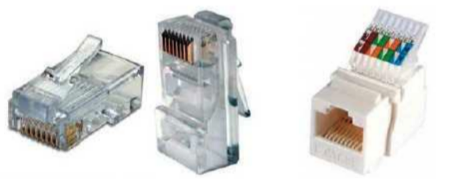
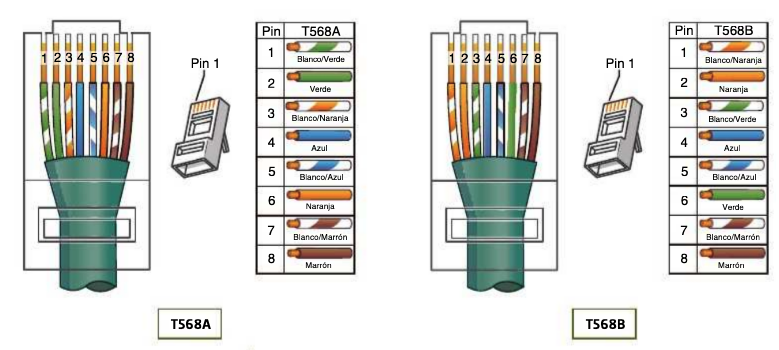
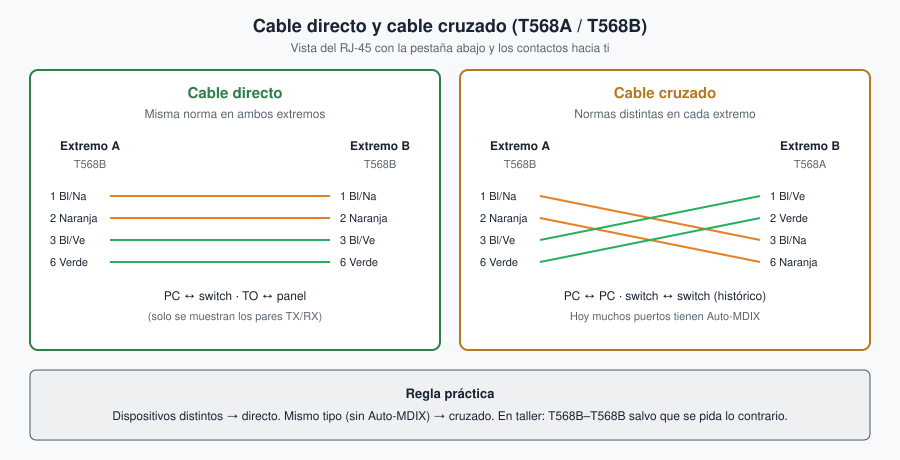
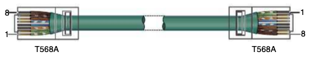
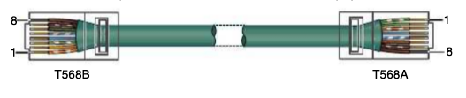
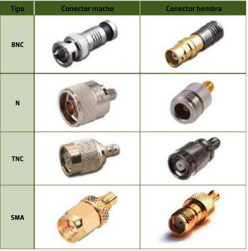
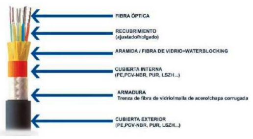
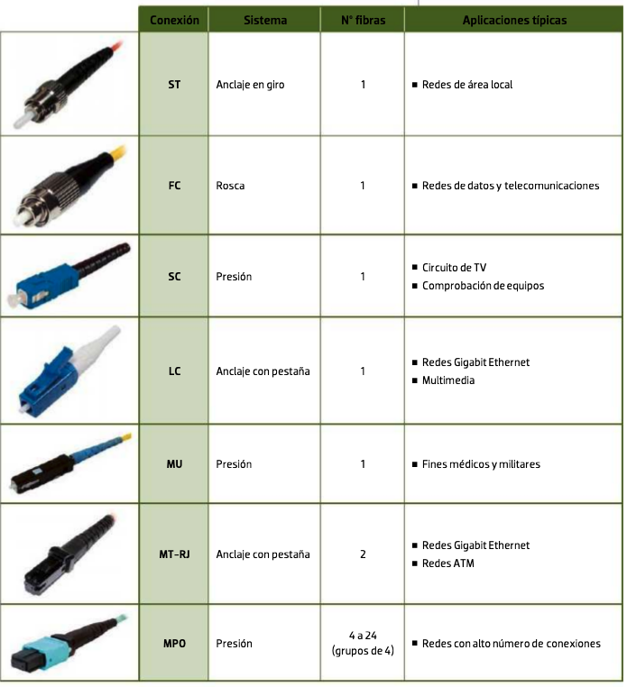
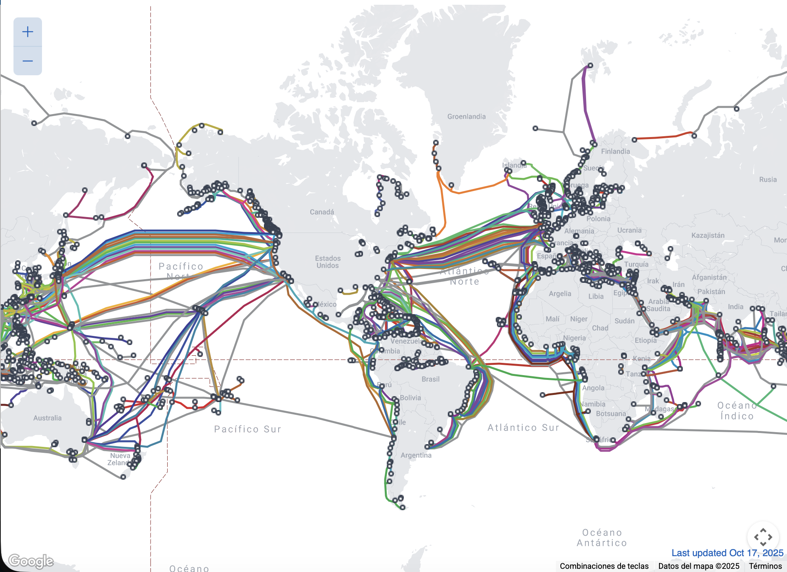
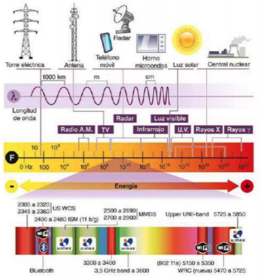

# Tema 2. Medios de transmisión y capa física

En este tema bajamos a la **capa física**: qué medio usamos, qué categoría de cable, cómo se termina un RJ‑45 y cuándo conviene cobre, fibra o radio. Es el tema que más se nota en el taller cuando crimpas un latiguillo o eliges el cable en Packet Tracer.

!!! tip "Primera clase"
    Empieza por el [cuestionario inicial](#cuestionario-inicial). Si ya lo entregaste en Aules, usa el [Autocheck](#autocheck-del-tema) del final para contrastar.

!!! tip "Cómo leerlo"
    Lee el párrafo de cada apartado **antes** de la tabla: qué es el concepto, para qué sirve y un ejemplo de aula o de casa. Practica de memoria el orden **T568B**: en el examen y en el crimpado no hay atajos. Los términos marcados enlazan al [glosario](#glosario). Cierra el tema con el [Autocheck](#autocheck-del-tema).

## Propuesta didáctica

Trabajamos los **RA2** y **RA3** del módulo Redes de área local (0225):

> **RA2.** *Despliega el cableado de una red local interpretando especificaciones y aplicando técnicas de montaje.*

> **RA3.** *Interconecta equipos en redes locales cableadas describiendo estándares de cableado y aplicando técnicas de montaje de conectores.*

### Criterios de evaluación (selección)

**RA2**

* **CE2a**: Se han reconocido los principios funcionales de las redes locales.
* **CE2b**: Se han identificado los distintos tipos de redes.
* **CE2c**: Se han diferenciado los medios de transmisión.
* **CE2d**: Se han reconocido los detalles del cableado de la instalación y su despliegue (categoría del cableado, espacios por los que discurre, soporte para las canalizaciones, entre otros).
* **CE2h**: Se han probado las líneas de comunicación entre las tomas de usuario y paneles de parcheo.
* **CE2j**: Se ha trabajado con la calidad y seguridad requeridas.

**RA3**

* **CE3c**: Se han montado conectores sobre cables (cobre y fibra) de red.
* **CE3f**: Se ha verificado la conectividad de la instalación.
* **CE3g**: Se ha trabajado con la calidad requerida.

### Contenidos

* Medios guiados: par trenzado (categorías y blindaje), coaxial y fibra óptica.
* Conectores RJ‑45; terminaciones **T568A** / **T568B**; cable directo y cruzado.
* Medios no guiados: espectro básico y Wi‑Fi (IEEE 802.11).
* Crimpado de latiguillo y prueba de continuidad.

### Programación de aula (orientativa, ~14–16 h)

| Sesiones | Contenidos | Actividades |
| --- | --- | --- |
| 1 | Presentación + cuestionario inicial | Cuestionario |
| 2–3 | Par trenzado: categorías, blindaje, RJ‑45 | **AC201** |
| 4 | Coaxial | AC202 |
| 5–6 | Fibra óptica (tipos, conectores) | AC203 |
| 7–8 | Medios no guiados y Wi‑Fi 802.11 | AC204 |
| 9–11 | Crimpado T568A/B + comprobador + etiquetado | **PR201** |
| 12–14 | Packet Tracer: capa física | **PR202** |
| 15–16 | Repaso / ampliación si hace falta | — |

---

## Cuestionario inicial {: #cuestionario-inicial }

!!! question "Antes de empezar — responde con lo que sepas"
    1. ¿Qué categorías de cable de par trenzado conoces y para qué se usan?
    2. ¿Cuándo conviene fibra óptica frente a cobre?
    3. ¿Qué diferencia hay entre medios guiados y no guiados?
    4. ¿Qué es el espectro electromagnético y por qué importa en redes?
    5. ¿Qué estándares IEEE 802.11 conoces (Wi‑Fi)?
    6. ¿Qué conectores se usan con par trenzado en Ethernet?
    7. ¿En qué se diferencian las terminaciones T568A y T568B?
    8. ¿Qué es un cable directo y un cable cruzado?

El cuestionario inicial ya está cerrado en Aules. Ahora puedes contrastar con el [Autocheck](#autocheck-del-tema) del final: las soluciones van plegadas al final de esa lista.

---

## Medios de transmisión

La información viaja como señal eléctrica, óptica o de radiofrecuencia. El **medio** es el enlace entre emisor y receptor: de su naturaleza dependen el alcance, la velocidad, el coste y las vulnerabilidades (interferencias, atenuación, seguridad física).

**Para qué sirve clasificar medios.** En un pliego o en un examen te pedirán elegir cobre, fibra o radio con un motivo: metros, EMI, presupuesto o movilidad.

**Ejemplo.** Del switch del aula al PC usas UTP Cat. 6; entre dos edificios del instituto, fibra; en la biblioteca, Wi‑Fi para portátiles.

### Medios guiados y no guiados

En un medio **guiado** la señal está confinada en un conductor: par trenzado, coaxial o fibra. En un medio **no guiado** se propaga por el espacio (radio, microondas, infrarrojos). En el aula usarás casi siempre UTP hacia el puesto y Wi‑Fi para portátiles; la fibra aparece en el backbone o entre edificios.

| Tipo | Idea | Ejemplos en LAN |
| --- | --- | --- |
| **Guiados** | La señal va por un conductor físico | UTP/FTP, coaxial, fibra |
| **No guiados** | Propagación por el aire (u otro medio sin cable) | Wi‑Fi, radioenlaces |

| Medio | Ventaja típica | Límite / cuidado | Uso en el instituto |
| --- | --- | --- | --- |
| **Cobre (UTP)** | Barato, fácil de crimpar | 100 m; EMI y diafonía | Puesto de trabajo ↔ switch |
| **Fibra** | Larga distancia, inmune a EMI | Coste y empalme/conectores | Entre edificios / backbone |
| **Inalámbrico** | Movilidad | Interferencias, cobertura | Portátiles, aulas abiertas |

---

## Par trenzado

El cable de **[par trenzado](#par-trenzado)** lleva **ocho hilos** agrupados en **cuatro pares**, con cubierta exterior (habitualmente PVC). El trenzado reduce la **diafonía**: cada par se enrolla para que las interferencias entre hilos se cancelen en parte. Sin trenzado, a más velocidad y más metros, el enlace falla antes.

Según la norma habitual, el **par 1** es azul y blanco‑azul, el **par 2** naranja y blanco‑naranja, el **par 3** verde y blanco‑verde, y el **par 4** marrón y blanco‑marrón. Esos colores son los que ordenas al crimpar el RJ‑45.

**Ejemplo real.** El latiguillo que va de tu mesa al panel del armario del aula es, casi seguro, UTP de cuatro pares; la categoría (5e, 6, 6a…) la marca el pliego o el material del taller.

### Categorías

La **categoría** del cable indica el rendimiento que el fabricante garantiza (ancho de banda y, con ello, velocidades Ethernet típicas a cierta distancia). No es un «adorno del plástico»: si pones Cat. 5e donde el pliego pide Cat. 6a, el enlace de 10 Gbps no estará asegurado a 100 m.

En obra nueva educativa u oficina lo habitual es **Cat. 6** o **Cat. 6a**. Cat. 3 y Cat. 5 están obsoletas. Cat. 8 se reserva a tramos cortos de centros de datos (25/40 Gbps).

| Categoría | Ancho de banda (aprox.) | Uso típico |
| --- | --- | --- |
| Cat. 5e | 100 MHz | Hasta 1 Gbps (instalaciones básicas) |
| Cat. 6 | 250 MHz | 1 Gbps a 100 m; 10 Gbps a distancias cortas |
| Cat. 6a | 500 MHz | 10 Gbps a 100 m |
| Cat. 8 | 2000 MHz | 25/40 Gbps a distancias cortas (centros de datos) |

**Ejemplo de elección.** Para un aula nueva con switches a 1 Gbps, Cat. 6 es una elección sólida y habitual. Si el centro prevé 10 Gbps hasta el puesto, mira Cat. 6a.

!!! note "Para la certificación CCNA"
    Nombres clásicos de Ethernet sobre cobre: **10BASE‑T** (10 Mbps), **100BASE‑TX** (100 Mbps) y **1000BASE‑T** (1 Gbps). En **100BASE‑TX** solo se usan los pines **1, 2, 3 y 6** del RJ‑45 (dos pares); en Gigabit se usan los cuatro pares.

### Perturbaciones en cobre

En el cableado horizontal Ethernet el límite habitual es **100 m** en total: unos **90 m** de **enlace permanente** (toma de usuario ↔ panel) más **10 m** repartidos en **latiguillos**. Si te pasas, la atenuación y el ruido ganan.

- **Atenuación:** la señal se debilita con la distancia y con empalmes mal hechos.
- **EMI / RFI:** interferencia electromagnética o de radio (motores, fluorescentes, walkie‑talkies cerca del cable).
- **Diafonía (NEXT):** un par «habla» al vecino dentro del mismo cable (*Near-End Crosstalk*). El **trenzado** y una **categoría** adecuada reducen ese acoplamiento.

Si en el taller el tester marca fallo a 120 m de cable enrollado, no es magia: has incumplido la distancia y empeorado la diafonía.

!!! warning "Errores frecuentes"
    Confundir **categoría** con **blindaje**. Cat. 6 describe el rendimiento; U/UTP o F/UTP describe si hay pantalla. Puedes tener Cat. 6 U/UTP o Cat. 6 F/UTP: son cosas distintas.

### Blindaje (apantallamiento)

El **blindaje** añade una o varias pantallas metálicas (foil o malla) para reducir la [EMI](#emi) (*Electromagnetic Interference*, interferencia electromagnética) en entornos ruidosos (talleres con maquinaria, proximidad a motores, etc.). En aulas normales suele bastar el cable **sin** pantalla.

| Tipo | Idea | Cuándo |
| --- | --- | --- |
| **U/UTP** | Sin pantalla (el «UTP» clásico) | Oficinas / aulas con poca EMI |
| **F/UTP** (a menudo llamado FTP) | Pantalla global de foil alrededor de los cuatro pares | Interferencias moderadas |
| **S/FTP** | Pantalla global + pares apantallados | Entornos con EMI alta |

Si hay pantalla, hay que cuidar la **puesta a tierra** del blindaje según la instalación. Un cable apantallado mal conectado a tierra puede empeorar el problema en lugar de mejorarlo.

!!! note "Nomenclatura en el día a día"
    En albaranes oirás UTP, FTP, STP… Quédate con la idea práctica: ¿hay pantalla o no? ¿Hay que aterrizar el conector metálico?

### Conector RJ‑45

En Ethernet sobre cobre usamos el conector **[RJ‑45](#rj-45)** (**8P8C**: ocho posiciones, ocho contactos). Puede ser no apantallado o con carcasa metálica si el cable lleva pantalla. La pestaña evita que se suelte; al crimpar, los contactos perforan el aislante de cada hilo.

<figure markdown="span">
  { width="500" }
  <figcaption>Conector RJ‑45 (8P8C) usado en Ethernet sobre par trenzado.</figcaption>
</figure>

### Terminaciones T568A y T568B

La norma **TIA/EIA‑568** define dos ordenaciones de colores en el conector: **T568A** y **T568B**. No son «dos cables distintos» de fábrica: son dos formas de colocar los mismos ocho hilos. Entre A y B solo se intercambian los pares **naranja** y **verde**; azul y marrón no cambian.

**Para qué sirve memorizarlo.** Si mezclas A y B en un latiguillo que debía ser directo, el comprobador marcará error y el enlace no subirá bien.

<figure markdown="span">
  { width="700" }
  <figcaption>Terminaciones T568A y T568B en el RJ‑45 (pestaña abajo, contactos hacia ti).</figcaption>
</figure>

| Pin | T568A | T568B |
| --- | --- | --- |
| 1 | Blanco/verde | Blanco/naranja |
| 2 | Verde | Naranja |
| 3 | Blanco/naranja | Blanco/verde |
| 4 | Azul | Azul |
| 5 | Blanco/azul | Blanco/azul |
| 6 | Naranja | Verde |
| 7 | Blanco/marrón | Blanco/marrón |
| 8 | Marrón | Marrón |

!!! tip "Truco"
    Entre T568A y T568B solo se intercambian los pares **naranja** y **verde**. El azul y el marrón no cambian.

!!! important "Qué usar en la práctica"
    En muchas instalaciones reales se usa **T568B** de extremo a extremo. Lo crítico: **misma norma en ambos extremos** del tramo horizontal (salvo que quieras un cable cruzado a propósito).

### Cable directo y cruzado

Un **cable directo** lleva la misma terminación en ambos extremos (T568B–T568B o T568A–T568A). Es el que usas casi siempre: PC ↔ switch, toma de usuario ↔ panel de parcheo, router ↔ switch.

Un **cable cruzado** combina T568A en un extremo y T568B en el otro. Históricamente unía equipos «iguales» (PC–PC, switch–switch) porque cruzaba los pares de transmisión y recepción. Hoy la mayoría de puertos Gigabit implementan **[Auto‑MDIX](#auto-mdix)** (*Automatic Medium-Dependent Interface Crossover*): el puerto detecta el cruce y acepta un cable directo. Aun así, en Packet Tracer y en exámenes te pueden pedir el cable que marca la tabla o la norma antigua.

<figure markdown="span">
  { width="800" }
  <figcaption>Cable directo (misma norma) frente a cruzado (T568B + T568A); se muestran los pares de TX/RX.</figcaption>
</figure>

<figure markdown="span">
  { width="640" }
  <figcaption>Cable directo: misma terminación en ambos extremos.</figcaption>
</figure>

<figure markdown="span">
  { width="640" }
  <figcaption>Cable cruzado: terminaciones distintas (T568A + T568B).</figcaption>
</figure>

!!! warning "Errores frecuentes"
    Pensar que «cruzado = más rápido» es falso. El tipo de cable no sube la velocidad: solo adapta TX/RX cuando hace falta. Otro error: mezclar A y B en un latiguillo «directo» sin querer; el tester marcará pares cruzados.

**Sin Auto‑MDIX** (tabla clásica de examen / Packet Tracer):

| Conexión | Cable |
| --- | --- |
| PC ↔ switch | Directo |
| Router ↔ switch | Directo |
| PC ↔ router (puerto Ethernet) | Cruzado |
| Switch ↔ switch | Cruzado |
| PC ↔ PC | Cruzado |

**Cable de consola.** En Packet Tracer (y en el rack) el cable de **consola** no es un latiguillo Ethernet de datos: une el PC al puerto de consola del router o switch para configurarlo por línea de comandos (en equipos Cisco clásicos, RJ‑45 en el dispositivo y DB‑9 o USB en el PC, según el adaptador).

---

## Cable coaxial

El **[coaxial](#coaxial)** tiene conductor central, dieléctrico, malla o pantalla y cubierta. Resiste bien la EMI y en ciertos escenarios atenúa menos que el UTP, pero en LAN Ethernet modernas está en desuso (topologías de bus 10BASE2/10BASE5).

**Dónde se sigue usando.** TV, antenas, HFC del operador de cable, radiofrecuencia de laboratorio. En el aula de redes lo verás más en ejemplos históricos o en el rack de TV del centro que en el puesto Ethernet.

<figure markdown="span">
  { width="700" }
  <figcaption>Conectores coaxiales habituales (BNC, N, TNC, SMA…).</figcaption>
</figure>

En Ethernet antiguo (10BASE2) se usaba **BNC** y **terminadores** en los extremos del bus. Tipos que aún verás citados:

| Tipo | Uso típico |
| --- | --- |
| RG‑58 | Ethernet antiguo 10BASE2 (obsoleto en LAN) |
| RG‑59 / RG‑6 | TV / vídeo / HFC |
| RG‑8 | Ethernet grueso histórico (10BASE5) |

---

## Fibra óptica

La **[fibra óptica](#fibra)** transporta **luz** por un núcleo de vidrio o plástico rodeado de un revestimiento (*cladding*) que mantiene la luz dentro por reflexión. El emisor (LED o láser) convierte la señal eléctrica en pulsos de luz; el receptor (fotodiodo) hace lo contrario. No hay corriente eléctrica en el núcleo: por eso la EMI de un motor o de una línea de fuerza apenas afecta al enlace.

**Ventajas:** gran ancho de banda, poca atenuación a larga distancia, inmunidad a la EMI y más dificultad para interceptar el medio sin dejar rastro. **Inconvenientes:** coste, herramientas de corte/empalme, limpieza de conectores y cuidado con el láser (no mirar al extremo activo). El UTP del puesto sigue ganando en precio y facilidad de crimpado.

<figure markdown="span">
  { width="600" }
  <figcaption>Estructura típica de un cable de fibra óptica (núcleo, cladding, recubrimientos).</figcaption>
</figure>

### Multimodo (MM) y monomodo (SM)

La diferencia clave es el **diámetro del núcleo** y, con él, cuántos modos (caminos) de luz viajan por dentro.

En fibra **[multimodo](#multimodo)** (MM) el núcleo es relativamente ancho (~50–62,5 μm). Varios modos de luz se propagan a la vez; el emisor suele ser LED o láser VCSEL. Sirve para campus, edificios y distancias cortas o medias.

En fibra **[monomodo](#monomodo)** (SM) el núcleo es muy fino (~9 μm). Idealmente viaja un solo modo; el emisor es láser. Permite **largas distancias** (kilómetros): backbone de operadores, enlaces entre sedes, cables submarinos.

| Tipo | Núcleo (orden) | Emisor típico | Uso |
| --- | --- | --- | --- |
| **Multimodo** | ~50–62,5 μm | LED / láser VCSEL | Campus, edificios, cortas–medias distancias |
| **Monomodo** | ~9 μm | Láser | Largas distancias, backbone, operadores |

Clases habituales: **OM1–OM4** (multimodo) y **OS1/OS2** (monomodo). A **10 Gbps**, de forma orientativa, **OM3** alcanza unos **300 m** y **OM4** unos **400 m**; para distancias mayores se pasa a monomodo (**OS2**).

| Clase | Tipo | Uso orientativo |
| --- | --- | --- |
| OM1 / OM2 | Multimodo (legado) | 1 Gbps en distancias cortas; evitar en obra nueva |
| OM3 | Multimodo | 10 Gbps hasta ~300 m |
| OM4 | Multimodo | 10 Gbps hasta ~400 m |
| OS1 / OS2 | Monomodo | Largas distancias y backbone |

**Ejemplo.** Entre el rack del aulario y el del edificio principal, a 150 m y 10 Gbps, OM3 o OM4 encajan; a varios kilómetros hacia otro centro, monomodo.

Estructuras de cable: **loose-tube** (exteriores / tendidos largos, a menudo con gel) y **tight-buffered** (interiores, más fácil de conectar).

!!! warning "Errores frecuentes"
    Mezclar MM y SM en el mismo enlace no funciona. Tampoco mires al láser de fibra: riesgo ocular. En taller, protectores de polvo en los conectores y limpieza antes de enchufar.

### Conectores

Los conectores más citados son ST, SC, LC y MPO. En racks modernos es muy frecuente el **LC** (compacto). El **SC** (cuadrado, push-pull) sigue viéndose en instalaciones anteriores. El **ST** (bayoneta) es más antiguo.

<figure markdown="span">
  { width="700" }
  <figcaption>Conectores de fibra óptica habituales en redes de datos.</figcaption>
</figure>

### Escala global (contexto)

La fibra submarina es la columna vertebral de Internet:

<figure markdown="span">
  { width="800" }
  <figcaption>Red mundial de cables submarinos de fibra óptica.</figcaption>
</figure>

[Submarine Cable Map](https://www.submarinecablemap.com)

---

## Medios no guiados y Wi‑Fi básico

Sin cable, la señal se propaga como onda electromagnética. El **espectro** se reparte en bandas para que servicios distintos no se interfieran. En España, la atribución oficial se recoge en el **CNAF**.

<figure markdown="span">
  { width="800" }
  <figcaption>Espectro electromagnético y bandas de interés en comunicaciones.</figcaption>
</figure>

**ISM** significa bandas de uso **industrial, científica y médica** (*Industrial, Scientific and Medical*): frecuencias donde conviven muchos dispositivos sin licencia exclusiva. Para Wi‑Fi te interesan sobre todo las ISM de **2,4 GHz** y **5 GHz**. La banda de **6 GHz** llega con **Wi‑Fi 6E** (y sigue en Wi‑Fi 7), no con el Wi‑Fi 6 «a secas».

Otros medios no guiados que debes situar:

| Tecnología | Idea | Alcance típico |
| --- | --- | --- |
| **Bluetooth** | IEEE **802.15** (WPAN, red de área personal) | Unos **10 m** (auriculares, teclado) |
| **NFC** | *Near Field Communication* | Pocos **cm** (pago con el móvil) |
| **Infrarrojos** | Necesitan **línea de visión directa** | Corto (mando del proyector del aula) |

**«Wi‑Fi»** es una **marca** de la **Wi‑Fi Alliance** que certifica productos conformes con **IEEE 802.11**. No significa «Wireless Fidelity» (eso es un mito de marketing); el estándar técnico es 802.11.

A **2,4 GHz** hay más alcance relativo (atraviesa mejor algunas paredes) y, a la vez, más interferencias: microondas, Bluetooth, redes de vecinos y pocos canales que no se solapen (en la práctica se usan sobre todo 1, 6 y 11). A **5 GHz** (y 6 GHz) suele haber más canal libre y más capacidad, con menos penetración en paredes: el portátil del fondo del aula a veces «prefiere» 2,4 GHz aunque sea más lento.

Los **canales** dividen la banda en franjas de frecuencia. Si dos puntos de acceso vecinos usan el mismo canal a alta potencia, compiten y baja el rendimiento. En un instituto conviene planificar canales y potencia para que las aulas no se pisen: no basta con «poner muchos AP»; hay que separarlos en frecuencia.

### IEEE 802.11

Cada generación de Wi‑Fi mejora velocidad, eficiencia o el uso del espectro. No hace falta memorizar todos los Mbps de marketing: sí conviene situar el nombre comercial, el estándar y las bandas.

| Generación | Estándar | Bandas | Idea |
| --- | --- | --- | --- |
| Wi‑Fi 4 | 802.11n | 2,4 / 5 GHz | MIMO; hasta cientos de Mbps |
| Wi‑Fi 5 | 802.11ac | 5 GHz | MU‑MIMO; orden de Gbps |
| Wi‑Fi 6 | 802.11ax | 2,4 / 5 GHz | Mejor eficiencia en entornos densos |
| Wi‑Fi 6E | 802.11ax (ext.) | 2,4 / 5 / **6 GHz** | Misma generación 6 con banda de 6 GHz |
| Wi‑Fi 7 | 802.11be | 2,4 / 5 / 6 GHz | Mayor capacidad en entornos exigentes |

El montaje y la configuración de puntos de acceso se profundiza en el **Tema 3**.

!!! note "Para la certificación CCNA"
    En ITN aún salen los estándares antiguos: **802.11a** (5 GHz, hasta 54 Mbps), **802.11b** (2,4 GHz, hasta 11 Mbps) y **802.11g** (2,4 GHz, hasta 54 Mbps). Hoy están en desuso frente a Wi‑Fi 4/5/6/6E/7, pero el examen puede pedir banda y velocidad aproximada. Wi‑Fi usa **CSMA/CA** (prevención de colisiones), no CSMA/CD.

!!! warning "Errores frecuentes"
    Decir «Wi‑Fi es capa 3» mezcla modelos: Wi‑Fi (802.11) trabaja en capas físicas y de enlace; las direcciones IP siguen siendo de capa 3. Otro clásico: pensar que 5 GHz «siempre es mejor» sin mirar cobertura: a veces el portátil del fondo del aula necesita 2,4 GHz.

---

## Crimpado de latiguillo

**Materiales y herramientas habituales:** cable UTP de la categoría indicada, dos conectores RJ‑45, pelacables, crimpadora RJ‑45, cutter y comprobador de cable (tester).

En taller fabricamos un **latiguillo** UTP con dos RJ‑45. El objetivo no es solo que «encaje»: tiene que pasar el comprobador y quedar etiquetado.

1. Cortar a medida y pelar la cubierta (sin dañar los pares; deja unos 2–3 cm de hilos).
2. Deshacer el trenzado lo mínimo necesario y ordenar colores según **T568B** (o la norma que indique el profesorado).
3. Cortar hilos a la misma longitud e insertarlos hasta el fondo del conector (el aislamiento de la cubierta debe entrar un poco en el conector).
4. **Crimpar** de un solo golpe con la herramienta adecuada; comprobar que los contactos han bajado.
5. Repetir en el otro extremo (**misma** terminación → cable directo).
6. **Probar** con comprobador de cable / continuidad (y, si hay, tester de cableado o certificación).
7. **Etiquetar** el latiguillo (código que indique el profesor).

!!! tip "Calidad y seguridad"
    Gafas si el taller lo exige; no pellizcar el cable; no dejar hilos fuera del conector; etiquetar el latiguillo. Un crimpado malo falla en producción aunque «parezca» enchufado.

!!! warning "Errores frecuentes"
    Pares invertidos o cruzados; funda que no entra en el conector; crimpar dos veces; olvidar el tester; no etiquetar. Si el comprobador falla, abre, identifica el error y rehace: no «repite a ciegas».

El detalle de paneles, tomas de usuario y canalizaciones se desarrolla en el **Tema 3**.

---

## Actividades

!!! tip "Formato de entrega"
    Las entregas en **Aules** son **obligatorias en Markdown** (`.md`). No se aceptan PDF.  
    Nombre del archivo: `AC2XX.md` o `PR2XX.md` (sustituye XX por el número). Respeta la fecha de vencimiento.  
    Escribiremos los `.md` con **Visual Studio Code**.

    !!! note "Cómo empezar"
        - Guía de Markdown: [tutorialmarkdown.com/guia](https://tutorialmarkdown.com/guia)
        - Documentación de Visual Studio Code: [code.visualstudio.com/docs](https://code.visualstudio.com/docs)

### AC201 — Categorías UTP

* :simple-readdotcv: **AC201**. (RA2 // CE2c, CE2d // **AC 0–1**). Elabora una tabla comparativa de categorías de par trenzado (al menos 5e, 6, 6a y 8): ancho de banda, velocidades típicas, distancia y usos. Indica cuál elegirías para un aula y por qué.

### AC202 — Coaxial

* :simple-readdotcv: **AC202**. (RA2 // CE2c // **AC 0–1**). Resume estructura del coaxial, tipos/aplicaciones (RG‑58, RG‑6…), conectores (BNC, etc.) y ventajas/desventajas frente a UTP en LAN actuales.

### AC203 — Fibra óptica

* :simple-readdotcv: **AC203**. (RA2 // CE2c // **AC 0–1**). Explica principio de funcionamiento, MM vs SM, clases OM/OS, conectores habituales, ventajas/desventajas y precauciones de manipulación.

### AC204 — Medios no guiados / Wi‑Fi

* :simple-readdotcv: **AC204**. (RA2 // CE2a, CE2b, CE2c // **AC 0–1**). Compara medios no guiados (radio, microondas, IR…) y resume estándares 802.11 (Wi‑Fi 4/5/6): bandas, idea de velocidad y un uso típico cada uno. Relaciónalo con tipos de red (WLAN / LAN mixta).

### PR201 — Crimpado UTP (T568A/B) + comprobador + etiquetado

| Campo | Valor |
| --- | --- |
| **Código** | **PR201** |
| **UP / tema** | T2 — Medios y capa física |
| **RA principal** | **RA3** (montaje de conectores y verificación). Apoyo: **RA2** (prueba de líneas), **RA6** (PRL/EPI) |
| **CE de cobertura** | CE3c, CE3f, CE3g · CE2h, CE2j · CE6b, CE6e |
| **Sesiones estimadas** | **2–3** |
| **Instrumento** | Checklist de taller + rúbrica 0–10 |

* :simple-neutralinojs: **PR201**. En taller, en pareja: fabricad un latiguillo **UTP directo** con terminación **T568B** en ambos extremos (el profesor puede pedir un extremo en **T568A** para contrastar el estándar). Probad con el **comprobador**, **etiquetad** el cable y documentad el proceso.

  **Enunciado (pasos):**

  1. Materiales: UTP de la categoría indicada, 2× RJ‑45, pelacables, crimpadora, cutter, comprobador, etiquetas.
  2. Pelar ~2–2,5 cm; ordenar pares según el esquema (T568B por defecto); cortar a la misma longitud; insertar hasta el tope (la funda entra en el conector).
  3. Crimpar de un solo golpe; repetir el otro extremo.
  4. Probar en el comprobador (continuidad / pares / polaridad). Si falla: abrir, identificar el error y rehacer.
  5. Etiquetar (código que indique el profesor, p. ej. `PR201-Gx-nn`).
  6. Entregar el **cable físico** + evidencias digitales.

  **Errores típicos a evitar / documentar si ocurren:** pares cruzados o invertidos; hilos fuera del conector; funda que no entra; crimpado doble o incompleto; no etiquetar; ignorar EPI (gafas si el taller lo exige).

  **Evidencia:** latiguillo OK al tester + foto de ambos extremos (colores visibles) + foto/captura del comprobador + checklist firmada + `PR201.md`.

  **Entrega:** `PR201.md` + evidencias según Aules.

| Criterio (rúbrica) | Descripción | Puntos |
| --- | --- | --- |
| Procedimiento | Pasos claros, ordenados y seguros | 0–2 |
| Terminación T568A/B | Colores correctos en ambos extremos | 0–2 |
| Prueba | Evidencia de continuidad / OK del tester | 0–2 |
| Calidad + etiquetado | Acabado, sin hilos fuera, etiqueta legible | 0–2 |
| Informe `.md` | Completo, con fotos y errores/correcciones | 0–2 |
| **Total** | | **/10** |

### PR202 — Packet Tracer: capa física { #pr202-packet-tracer-capa-fisica }

* :simple-cisco: **PR202**. (RA2 // CE2c, CE2d // RA3 // CE3f // **Certificación · suma en el +1**). En Packet Tracer identificas puertos y módulos, insertas los que faltan, cableas la topología según la tabla y compruebas la conectividad física.

  **Antes:** [guía inicial de Packet Tracer](../certificacion/packet-tracer.md) (sesión iniciada) y el fichero `PR202.pka` de Aules.

  **Guion:** [PR202 — Conectar la capa física](../certificacion/pr202-capa-fisica.md) (también en Aules).

  **Entrega:** `PR202.pka` + `PR202.md` (capturas y respuestas).

  Es trabajo para casa del apartado de Certificación: no puntúa en la nota de los RA y cuenta para el +1 si la entregas y la defiendes en clase (auditoría oral breve o demo). La rúbrica sirve para revisarla cuando haga falta.

| Criterio | Descripción | Puntos |
| --- | --- | --- |
| Identificación de puertos y módulos | Respuestas correctas sobre administración, LAN/WAN, ranuras y comandos `show` | 2 |
| Módulos insertados correctamente | Módulos adecuados en Este y Switch2, insertados con el equipo apagado | 2 |
| Cableado según la tabla | Todos los enlaces con el tipo de cable e interfaces indicados | 2 |
| Verificación | Comandos, navegador a `www.cisco.pka`, Check Results al 100 % | 2 |
| Entrega | `.pka` que abre bien y `.md` claro, respuestas correctas, sin datos personales | 2 |
| **Total** | | **/10** |

---

## Para el examen

El medio puede ser **guiado** (UTP, coaxial, fibra) o **no guiado** (Wi‑Fi, Bluetooth, NFC, IR…). En cobre: **100 m** (90 + 10), categoría, trenzado frente a atenuación/EMI/NEXT. Ethernet usa **RJ‑45** con **T568A** o **T568B**. Cable **directo** = misma norma; **cruzado** = A+B (sin Auto‑MDIX: ver tabla). **ISM** = industrial, científica y médica. «**Wi‑Fi**» es marca de la Wi‑Fi Alliance sobre **802.11**. Fibra **MM** / **SM** según distancia. En taller: crimpar, probar y etiquetar.

## Autocheck del tema

1. **V/F.** Cat. 6 y F/UTP significan lo mismo.
2. Empareja: **U/UTP** · **F/UTP** · **multimodo** · **monomodo** con: (a) sin pantalla · (b) pantalla global de foil · (c) núcleo ~9 μm · (d) núcleo ~50–62,5 μm.
3. En un cable directo T568B–T568B, el pin 1 es…  
   a) Blanco/verde · b) Blanco/naranja · c) Azul · d) Marrón
4. **V/F.** Un cable cruzado se obtiene poniendo T568A en un extremo y T568B en el otro.
5. ¿Qué conector usa Ethernet sobre par trenzado en el puesto de trabajo?
6. Elige la correcta: Auto‑MDIX…  
   a) sube la categoría del cable · b) permite que el puerto adapte TX/RX y acepte directo en muchos casos · c) solo existe en fibra
7. Relaciona: **Wi‑Fi 5** · **Wi‑Fi 6** · **802.3** con: (a) Ethernet · (b) 802.11ac · (c) 802.11ax
8. **V/F.** La fibra monomodo es la elección típica para el latiguillo del PC al switch del aula.
9. Nombra dos ventajas de la fibra frente al UTP.
10. ¿Qué pares se intercambian entre T568A y T568B?
11. **V/F.** A 2,4 GHz suele haber más interferencias de redes vecinas y otros dispositivos ISM que a 5 GHz.
12. En el crimpado, ¿qué compruebas antes de entregar el latiguillo?
13. **V/F.** La banda de 6 GHz forma parte del Wi‑Fi 6 «a secas» (sin 6E).
14. A 10 Gbps, ¿qué distancia orientativa tiene OM3 y cuál OM4?
15. ¿Por qué se trenzan los pares del cable UTP?

Soluciones

1. **Falso** — categoría ≠ blindaje.

2. **U/UTP** → (a); **F/UTP** → (b); **monomodo** → (c); **multimodo** → (d).

3. **b) Blanco/naranja**.

4. **Verdadero**.

5. **RJ‑45** (8P8C).

6. **b**.

7. **Wi‑Fi 5** → (b); **Wi‑Fi 6** → (c); **802.3** → (a).

8. **Falso** — al puesto suele ir UTP; la monomodo es para largas distancias / backbone.

9. Ejemplos: más ancho de banda / distancia, inmunidad a EMI, más difícil de interceptar.

10. Los pares **naranja** y **verde**.

11. **Verdadero**.

12. Continuidad / pares correctos en el **comprobador** (y etiquetado).

13. **Falso** — 6 GHz llega con **Wi‑Fi 6E** (y Wi‑Fi 7).

14. OM3 ~**300 m**; OM4 ~**400 m**.

15. Para reducir la **diafonía** (interferencia entre pares).

---

## Vídeos recomendados

Pablo Hidalgo explica cobre y UTP (CCNA v1.1, lección 3).

  <iframe src="https://www.youtube-nocookie.com/embed/WSwSjCiSpII"
          style="position: absolute; top: 0; left: 0; width: 100%; height: 100%;"
          frameborder="0"
          allow="accelerometer; autoplay; clipboard-write; encrypted-media; gyroscope; picture-in-picture"
          allowfullscreen
          title="CCNA v1.1 Lección 3 — cobre y UTP (Pablo Hidalgo)"></iframe>

Pablo Hidalgo explica la fibra óptica (lección 4).

  <iframe src="https://www.youtube-nocookie.com/embed/bP5fIGhhH0g"
          style="position: absolute; top: 0; left: 0; width: 100%; height: 100%;"
          frameborder="0"
          allow="accelerometer; autoplay; clipboard-write; encrypted-media; gyroscope; picture-in-picture"
          allowfullscreen
          title="CCNA v1.1 Lección 4 — fibra óptica (Pablo Hidalgo)"></iframe>

Joaquín Cantero muestra en práctica el cableado T568A y T568B.

  <iframe src="https://www.youtube-nocookie.com/embed/x7cJAv9Buhc"
          style="position: absolute; top: 0; left: 0; width: 100%; height: 100%;"
          frameborder="0"
          allow="accelerometer; autoplay; clipboard-write; encrypted-media; gyroscope; picture-in-picture"
          allowfullscreen
          title="Práctica de cableado T568A/T568B (Joaquín Cantero)"></iframe>

Contando Bits resume Wi‑Fi y el estándar 802.11.

  <iframe src="https://www.youtube-nocookie.com/embed/EQRgk2IyF_Q"
          style="position: absolute; top: 0; left: 0; width: 100%; height: 100%;"
          frameborder="0"
          allow="accelerometer; autoplay; clipboard-write; encrypted-media; gyroscope; picture-in-picture"
          allowfullscreen
          title="Wi-Fi y el estándar 802.11 (Contando Bits)"></iframe>

Alberto López explica cómo funciona el Wi‑Fi.

  <iframe src="https://www.youtube-nocookie.com/embed/KQmCgLdtp9U"
          style="position: absolute; top: 0; left: 0; width: 100%; height: 100%;"
          frameborder="0"
          allow="accelerometer; autoplay; clipboard-write; encrypted-media; gyroscope; picture-in-picture"
          allowfullscreen
          title="Cómo funciona el Wi-Fi (Alberto López)"></iframe>

## Glosario

**par trenzado**{: #par-trenzado}
Cable de cuatro pares de hilos de cobre trenzados. Base del cableado Ethernet en el puesto de trabajo (UTP y variantes apantalladas).

**RJ-45**{: #rj-45}
Conector 8P8C usado en Ethernet sobre par trenzado.

**T568A / T568B**
Dos ordenaciones de colores del RJ‑45 según TIA/EIA‑568. Entre ellas solo cambian los pares naranja y verde.

**Auto-MDIX**{: #auto-mdix}
*Automatic Medium-Dependent Interface Crossover*: el puerto detecta si hace falta cruzar TX/RX y acepta cable directo en muchos equipos modernos.

**EMI**{: #emi}
*Electromagnetic Interference*, interferencia electromagnética: ruido eléctrico que puede degradar la señal en cobre.

**coaxial**{: #coaxial}
Cable con conductor central, dieléctrico y malla. Histórico en Ethernet de bus; vigente en TV/RF.

**fibra**{: #fibra}
Medio óptico que transporta luz. Gran ancho de banda e inmunidad a EMI.

**multimodo**{: #multimodo}
Fibra de núcleo relativamente ancho (~50–62,5 μm) para distancias cortas/medias en edificios y campus.

**monomodo**{: #monomodo}
Fibra de núcleo fino (~9 μm) para largas distancias y backbones.

**UTP**
*Unshielded Twisted Pair*: par trenzado sin pantalla (U/UTP en nomenclatura ISO).

**diafonía**{: #diafonia}
Interferencia entre pares cercanos dentro del cable; el trenzado la reduce.

---

## Relación con el resto del módulo

El **Tema 1** te dio dispositivos, capas y dominios. Aquí materializas la capa física. En el **Tema 3** montas el cableado estructurado (paneles, TO, armarios, fibra en edificio). Más adelante, el enlace y la IP asumen que el medio físico ya está bien elegido y terminado. Las prácticas **PR201** (crimpado) y **PR202** (Packet Tracer de capa física) son la evidencia de este tema.

---

## Referencias rápidas

- Sitio del módulo: [fjavier-hernandez.github.io/ral](https://fjavier-hernandez.github.io/ral/)
- Mapa de fibra submarina: [submarinecablemap.com](https://www.submarinecablemap.com)
- Simulación: [Cisco Packet Tracer](https://www.netacad.com/es/cisco-packet-tracer)
- Entregas: [Visual Studio Code](https://code.visualstudio.com/docs) + [Markdown](https://tutorialmarkdown.com/guia)
- Normas: [Normas del taller](../00-normas/normas_taller.md)

*[RA]: Resultado de aprendizaje  
*[CE]: Criterio de evaluación  
*[AC]: Actividad de clase  
*[PR]: Práctica  
*[UTP]: Unshielded Twisted Pair  
*[EMI]: Interferencia electromagnética  
*[LAN]: Local Area Network  
*[WAN]: Wide Area Network  
*[CCNA]: Cisco Certified Network Associate  
*[Auto-MDIX]: Automatic Medium-Dependent Interface Crossover  
*[DCE]: Data Circuit-terminating Equipment  
*[RJ-45]: Registered Jack 45 (8P8C)
