# Tema 3. Cableado estructurado y componentes

En este tema organizamos el cableado del **edificio**: desde la toma del puesto hasta el **[rack](#rack)**, pasando por paneles, canalizaciones y la electrónica (switch, router, [punto de acceso](#ap)…). El medio del Tema 2 (categoría, conector, crimpado) solo funciona como red si forma parte de un sistema que se pueda ampliar, etiquetar y mantener.

!!! tip "Primera clase"
    Empieza por el [cuestionario inicial](#cuestionario-inicial). No hace falta haber leído el tema entero: sirve para ver qué traes antes de estudiar. Entrégalo en Aules **antes** de mirar el Autocheck.

!!! tip "Cómo leerlo"
    Lee cada apartado completo: primero el párrafo (qué es, para qué sirve y un ejemplo), después la tabla o la figura, y al final los errores frecuentes. No estudies solo las tablas. Los términos marcados enlazan al [glosario](#glosario). Cuando acabes el tema, haz el [Autocheck](#autocheck-del-tema).

## Propuesta didáctica

Trabajamos los **RA2**, **RA3** y **RA4** del módulo Redes de área local (0225):

> **RA2.** *Despliega el cableado de una red local interpretando especificaciones y aplicando técnicas de montaje.*

> **RA3.** *Interconecta equipos en redes locales cableadas describiendo estándares de cableado y aplicando técnicas de montaje de conectores.*

> **RA4.** *Instala equipos en red, describiendo sus prestaciones y aplicando técnicas de montaje.*

### Criterios de evaluación (selección)

**RA2**

* **CE2c**: Se han diferenciado los medios de transmisión.
* **CE2d** **(clave)**: Se han reconocido los detalles del cableado de la instalación y su despliegue (categoría del cableado, espacios por los que discurre, soporte para las canalizaciones, entre otros).
* **CE2e**: Se han seleccionado y montado las canalizaciones y tubos.
* **CE2f** **(clave)**: Se han montado los armarios de comunicaciones y sus accesorios.
* **CE2g** **(clave)**: Se han montado y conexionado las tomas de usuario y paneles de parcheo.
* **CE2i**: Se han etiquetado los cables y tomas de usuario.
* **CE2j**: Se ha trabajado con la calidad y seguridad requeridas.

**RA3**

* **CE3a** **(clave)**: Se ha interpretado el plan de montaje lógico de la red.
* **CE3b**: Se han montado los adaptadores de red en los equipos.
* **CE3c** **(clave)**: Se han montado conectores sobre cables (cobre y fibra) de red.
* **CE3d**: Se han montado los equipos de conmutación en los armarios de comunicaciones.
* **CE3e**: Se han conectado los equipos de conmutación a los paneles de parcheo.
* **CE3f** **(clave)**: Se ha verificado la conectividad de la instalación.
* **CE3g**: Se ha trabajado con la calidad requerida.

**RA4**

* **CE4a**: Se han identificado las características funcionales de las redes inalámbricas.
* **CE4b**: Se han identificado los modos de funcionamiento de las redes inalámbricas.
* **CE4c**: Se han instalado adaptadores y puntos de acceso inalámbrico.
* **CE4d** **(clave)**: Se han configurado los modos de funcionamiento y los parámetros básicos.
* **CE4e**: Se ha comprobado la conectividad entre diversos dispositivos y adaptadores inalámbricos.
* **CE4f**: Se ha instalado el software correspondiente.
* **CE4i** **(clave)**: Se han aplicado mecanismos básicos de seguridad.

!!! note "VLAN"
    Las **VLAN** (CE4j) se desarrollan en el **Tema 6**. Aquí solo las mencionamos como capacidad de muchos switches gestionables.

### Contenidos

* Montaje físico del adaptador de red (PCIe o USB) e instalación del driver, ligado a PR305. La NIC como concepto está en el Tema 1.
* Armario o rack de 19″ y unidades **U**; paneles de parcheo; toma de usuario o TO (roseta) y latiguillos.
* Canalizaciones, bandejas, guías y pasahilos; etiquetado (TIA‑606).
* Electrónica: hub, switch, router, gateway, punto de acceso; PoE.
* WLAN de aula: modos del AP, SSID, canal, WPA2/WPA3.
* Visión ISO/TIA: horizontal, backbone, distancias; idea de tierra (TIA‑607).
* Empalme por **fusión** de fibra (fusionadora, protectores, comprobación básica, PRL).

### Programación de aula (orientativa)

| Sesiones | Contenidos | Actividades |
| --- | --- | --- |
| 1 | Presentación + cuestionario inicial | Cuestionario |
| 2 | Montaje del adaptador (PCIe/USB) y driver | **AC301** |
| 3–4 | Rack, panel, TO, guiado | AC302, AC304 |
| 5–7 | Electrónica de red y AP (teoría) | AC303 |
| 8–9 | Normas ISO/TIA, distancias, etiquetado | — |
| 10–11 | Propuesta electrónica (centro educativo) | **AC305** |
| 12–13 | **Taller:** panel, tomas, armario y switch | **PR301** |
| 14–15 | **Taller:** fusión de fibra | **PR304** |
| 16–18 | **Taller:** WLAN real | **PR305** |
| 19–20 | Proyecto aulario (grupo) | **PR302** |
| Casa | Certificación: WLAN / Packet Tracer | **PR303** |

---

## Cuestionario inicial {: #cuestionario-inicial }

!!! question "Antes de empezar — responde con lo que sepas"
    1. ¿Qué es un adaptador de red (NIC) y qué características tiene?
    2. ¿Qué elementos hay dentro de un armario de comunicaciones?
    3. ¿Para qué sirve un panel de parcheo?
    4. ¿Qué diferencia hay entre un hub y un switch?
    5. ¿Qué hace un router en una red?
    6. ¿Cómo funciona un punto de acceso Wi‑Fi?
    7. ¿Qué tipos de tomas de usuario conoces?
    8. ¿Qué es PoE y para qué se usa?
    9. ¿Qué distancia máxima suele tener el cableado horizontal?

Entrega tus respuestas en **Aules** como tarea del cuestionario inicial **antes** de mirar el [Autocheck](#autocheck-del-tema) del final del tema. Las soluciones no están aquí a propósito: primero entregas, después contrastas.

---

## ¿Qué es el cableado estructurado?

El **cableado estructurado** es el sistema de telecomunicaciones del edificio: voz, datos y, en muchos casos, otros servicios (vídeo, alarmas) comparten un mismo diseño, según normas como **ANSI/TIA/EIA‑568/569** e **ISO/IEC 11801**. No se trata de un latiguillo suelto entre el PC y el switch de mesa, sino del conjunto de tomas, tendidos, paneles y armarios que recorre el edificio.

La infraestructura que se instala hoy (paneles de parcheo, tomas de usuario o TO (roseta) y bandejas) debe seguir sirviendo cuando, dentro de unos años, se cambie el switch. Por eso el diseño se apoya en tres ideas clave para el taller y el examen:

- **Flexibilidad.** Se puede reorganizar un puesto cambiando latiguillos, sin rehacer el tendido horizontal.
- **Evolución.** Se sustituye la electrónica (switch, router, AP) sin retirar el cableado pasivo.
- **Centralización.** Los servicios se concentran en distribuidores: racks o salas de telecomunicaciones (TR).

**Ejemplo de aula.** El PC de la mesa llega a la toma de la canaleta; desde ahí un UTP sube al armario del fondo. En el panel debe aparecer la misma etiqueta que en la toma, y un latiguillo corto une ese puerto del panel con el switch. Si las etiquetas no coinciden, para localizar un fallo hay que ir probando cable a cable, en lugar de seguir la documentación.

<figure markdown="span">
  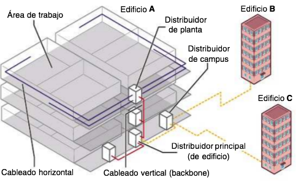{ width="800" }
  <figcaption>Arquitectura típica: áreas de trabajo, horizontal, backbone y distribuidores.</figcaption>
</figure>

El mismo recorrido, visto como un tramo que se puede montar en el taller, va del puesto a la TO, sube por el horizontal hasta el panel del rack de planta (**[FD](#fd)**) y, dentro del armario, un latiguillo une el panel con el switch. El router o gateway de ese rack sale hacia el backbone (edificio **[BD](#bd)** y campus **[CD](#cd)**). Si cambias el switch, el tendido pasivo (TO, canaleta, panel) se queda.

<figure markdown="span">
  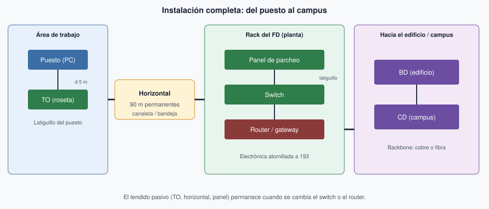{ width="860" }
  <figcaption>Del puesto al campus: TO, horizontal, rack del FD (panel, switch y router) y backbone hacia BD y CD.</figcaption>
</figure>

!!! warning "Errores frecuentes"
    Llamar «cableado estructurado» al latiguillo del PC al switch de mesa. El latiguillo es un tramo; el sistema es TO, tendido horizontal, panel, rack y backbone.

---

## Montaje del adaptador de red

La **[NIC](#nic)** (*Network Interface Card*, tarjeta o adaptador de red), la dirección MAC y el dúplex ya se explicaron en el [Tema 1, apartado Adaptador de red](../01-introduccion-arquitectura/tema1.md#adaptador-de-red-nic). En este tema nos centramos en su montaje.

En este tema lo que importa es el **montaje físico** y el **software del adaptador**, porque ambos entran en el taller. Una NIC puede ir integrada en la placa, instalarse en una ranura **PCIe** o conectarse por **USB** (incluido un dongle Wi‑Fi). Tras el montaje hay que instalar el **driver** y comprobar que el sistema operativo ve la interfaz. Eso cubre **CE3b** (montar el adaptador en el equipo) y **CE4f** (instalar el software), y se practica en **PR305**.

**Ejemplo de aula.** En el taller, si montáis una NIC PCIe, se apaga el PC, se descarga la electricidad estática y se encaja la tarjeta hasta el fondo. En Windows o Linux no basta con que «esté puesta»: tiene que aparecer en el administrador de dispositivos o en `ip link` / `ipconfig`. Si no hay enlace, se mira primero el latiguillo y el puerto del switch, no se reinstala el driver a ciegas.

!!! warning "Errores frecuentes"
    Confundir la velocidad de la NIC con la del switch: el enlace baja al mínimo común. Pensar que montar la tarjeta sin driver ya deja el equipo en red.

---

## Armario de distribución ([rack](#rack))

El **rack** concentra el cableado de una zona: paneles de parcheo, switches, unidades de alimentación (PDU o SAI), ventilación y accesorios de ordenación. La puerta transparente permite ver los LED sin abrir el armario; el techo y los laterales suelen ser desmontables para unir armarios o pasar mazos. Sin ese punto central, cada aula sería un ovillo de cables independiente y no habría forma razonable de mantener el edificio.

<figure markdown="span">
  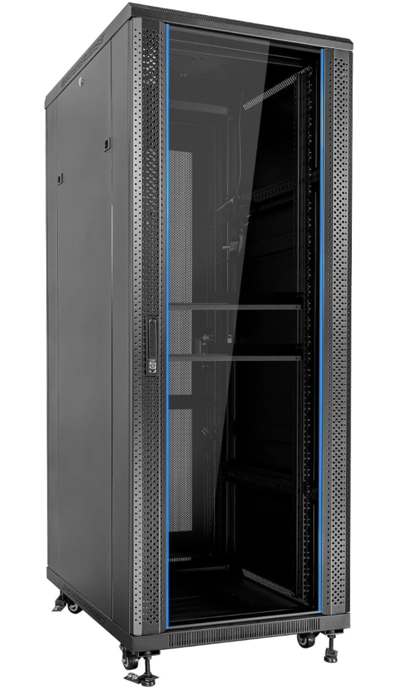{ width="400" }
  <figcaption>Vista frontal de un armario de distribución.</figcaption>
</figure>

### Estándar 19″ y unidad U

El interior tiene bastidores de **19 pulgadas**: cualquier equipo **rackeable** encaja en esa anchura. La altura se mide en **unidades U** (aproximadamente 4,45 cm). Un panel de 24 puertos suele ocupar **1 U**; un switch, 1 U o 2 U. Planificar las U libres evita llenar el armario el primer día y no poder añadir un segundo switch o un pasahilos.

Por tamaño, lo habitual es:

- menos de **12 U**, redes pequeñas, a menudo de pared;
- **12–25 U**, planta o edificio pequeño;
- más de **24 U**, armarios de suelo, con ventilación y filtrado.

**Ejemplo.** Si el armario didáctico tiene 12 U y el panel ya ocupa 1 U, el switch se atornilla a los bastidores. Si solo se apoya sobre el panel, sin atornillar, se desplaza en cuanto se tensa un latiguillo.

!!! warning "Errores frecuentes"
    Estimar las U a ojo y dejar el switch en el canto del armario. Lo rackeable se atornilla a los bastidores.

---

## Panel de parcheo

El **[panel de parcheo](#panel-de-parcheo)** (*patch panel*) organiza las líneas que llegan al armario. Cada toma del panel se corresponde —y se **etiqueta**— con una TO del área de trabajo. De ese modo, cambiar un puesto es cambiar un latiguillo en el frontal, no abrir la canaleta.

Lo habitual son **24** o **48** puertos RJ‑45 en 1–2 U. También hay cajones de **fibra**. En la parte trasera, las regletas IDC usan el mismo código de colores que al crimpar el RJ‑45.

**Ejemplo.** El puerto 12 del panel corresponde a la mesa 12, y el latiguillo 12 va al puerto 12 del switch. Si las etiquetas se cruzan, un ping fallido ya no se puede diagnosticar con método.

<figure markdown="span">
  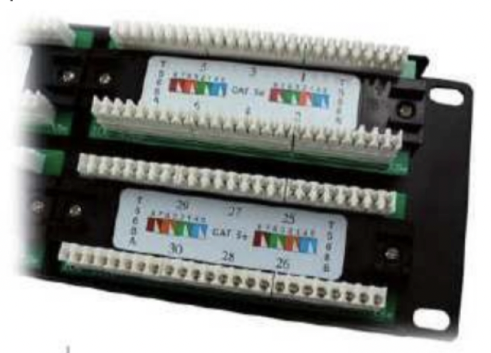{ width="500" }
  <figcaption>Detalle trasero: numeración y código de colores.</figcaption>
</figure>

---

## Tomas de usuario, latiguillos y guiado

### Toma de usuario o TO (roseta)

La **toma de usuario** o **[TO](#to)** (*Telecommunications Outlet*), también llamada **roseta**, es el punto de conexión del puesto: una o más hembras RJ‑45 (datos, voz y, si hay previsión, reserva). A partir de aquí, en el tema se usa **TO**. Tipos habituales:

- **superficie** (canaleta), frecuente en aulas reformadas;
- **empotrable**, en obra nueva;
- **suelo técnico**, en salas de informática o CPD.

La norma recomienda **tres tomas** por puesto (voz, datos y reserva) y un área de trabajo tipo de unos **10 m²**. El latiguillo entre el equipo y la TO no debe superar **5 m** y ha de ser de la misma categoría que el tendido permanente. Si el latiguillo es más largo o de categoría inferior, el canal deja de cumplir la certificación aunque el UTP de la pared sea correcto.

### Latiguillos

Los **latiguillos** son cables cortos con RJ‑45 en ambos extremos. Hay dos usos que no se mezclan: el del puesto (equipo ↔ TO) y el de parcheo (panel ↔ switch). Las longitudes comerciales habituales son 0,5 m, 1 m y 2 m. A partir de Cat. 6, muchos pliegos piden latiguillos **certificados de fábrica**. El de **PR201** sirve para practicar el crimpado; no siempre vale como material de obra.

### Soportes de guiado

El tendido horizontal no se deja suelto: va por un soporte que lo protege, respeta el radio de curvatura y permite ampliar. Canaletas y tubos recorren paredes y suelos; las bandejas llevan mazos por techo o suelo técnico; las guías ordenan el interior del rack; el **pasahilos** (1 U) peina los latiguillos del frontal para que no tapen los LED del switch.

| Elemento | Función |
| --- | --- |
| **Canalizaciones** | Tubos / canaletas por paredes y suelos |
| **Bandejas** | Mazos en techo o suelo técnico |
| **Guías de cable** | Orden en el rack |
| **Pasahilos** | 1 U para peinar latiguillos |

**Ejemplo.** En el armario del taller, sin pasahilos los latiguillos cubren los LED del switch y no se ve qué puerto está caído.

<figure markdown="span">
  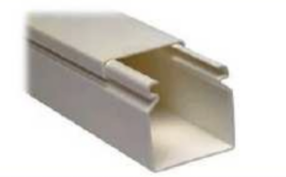{ width="400" }
  <figcaption>Canalizaciones para cableado de red.</figcaption>
</figure>

<figure markdown="span">
  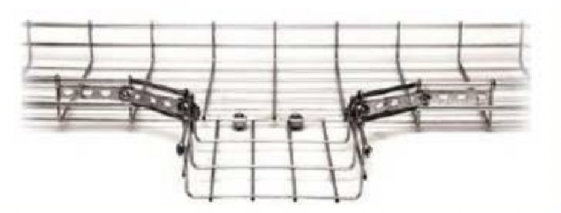{ width="400" }
  <figcaption>Bandejas de guiado (horizontal / vertical).</figcaption>
</figure>

<figure markdown="span">
  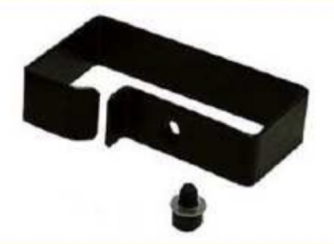{ width="400" }
  <figcaption>Guías en el rack.</figcaption>
</figure>

<figure markdown="span">
  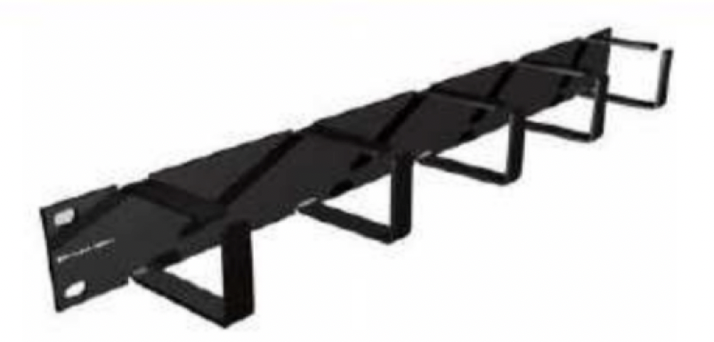{ width="400" }
  <figcaption>Pasahilos (1 U).</figcaption>
</figure>

!!! tip "Etiquetado"
    Sin una correspondencia clara entre TO, panel y puerto del switch, cualquier avería o cambio de puesto obliga a rastrear los cables uno a uno. Es criterio de calidad (**CE2i**). La familia **TIA‑606** trata precisamente la administración y el etiquetado.

---

## Electrónica de red {: #electronica-de-red }

La **electrónica de red** es el conjunto de equipos que regeneran, concentran, conmutan o encaminan el tráfico. Suele ir en el rack; el punto de acceso, en techo o pared, con alimentación por PoE o por la red eléctrica.

El **repetidor** solo regenera la señal (capa 1) y **no** divide el dominio de colisión. El **hub** reparte la señal a todos los puertos; hoy se usa en laboratorio. El **switch** reenvía por dirección MAC. El **router** une redes distintas. El **gateway** es la puerta hacia otra red o protocolo y a menudo incluye filtrado. El **AP** extiende la LAN por Wi‑Fi.

La tabla siguiente resume la capa y la función de cada equipo.

| Dispositivo | Capa OSI | Idea clave |
| --- | --- | --- |
| **Repetidor** | 1 | Regenera la señal; no divide colisión |
| **Hub** | 1 | Replica a todos los puertos (laboratorio) |
| **Switch** | 2 | Reenvía por MAC; reduce colisiones |
| **Router** | 3 | Une redes distintas (IP) |
| **Gateway** | varias | Frontera / traducción / seguridad |
| **AP** | 1–2 | Extiende la LAN por Wi‑Fi |

<figure markdown="span">
  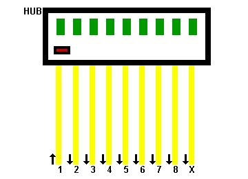{ width="480" }
  <figcaption>Hub Ethernet (uso residual / laboratorio).</figcaption>
</figure>

### Switch (lo habitual en LAN)

El **switch** es el equipo que concentra la LAN de un aula o de una planta: cada puesto llega a un puerto y el tráfico se reenvía según la dirección **MAC** de destino, no según la IP. Frente al **hub** de la [tabla de dispositivos](#electronica-de-red), que replica la trama a todos los puertos y deja un solo dominio de colisión, el switch abre un dominio de colisión por puerto y trabaja en **full‑dúplex**. Esa diferencia ya se contó en el [Tema 1, dominios de colisión y de difusión](../01-introduccion-arquitectura/tema1.md#dominios-colision-difusion): en un enlace PC–switch moderno no hay colisión porque cada sentido tiene su canal. El hub queda para el laboratorio; en el armario del taller lo que se monta es el switch (**CE3d**, **PR301**).

Al arrancar, la tabla MAC (también llamada **CAM**, *Content Addressable Memory*) está vacía. Cuando un PC envía una trama, el switch anota «esta MAC se ve en este puerto». Si ya conoce el puerto del destino, **reenvía** solo por ahí. Si no lo conoce, **inunda**: copia la trama a todos los puertos menos al de entrada, igual que hace con las tramas de **difusión** (broadcast, por ejemplo `FF:FF:FF:FF:FF:FF`). Por eso el switch **no** corta el dominio de difusión: eso lo hace el router (o, más adelante, las VLAN).

<figure markdown="span">
  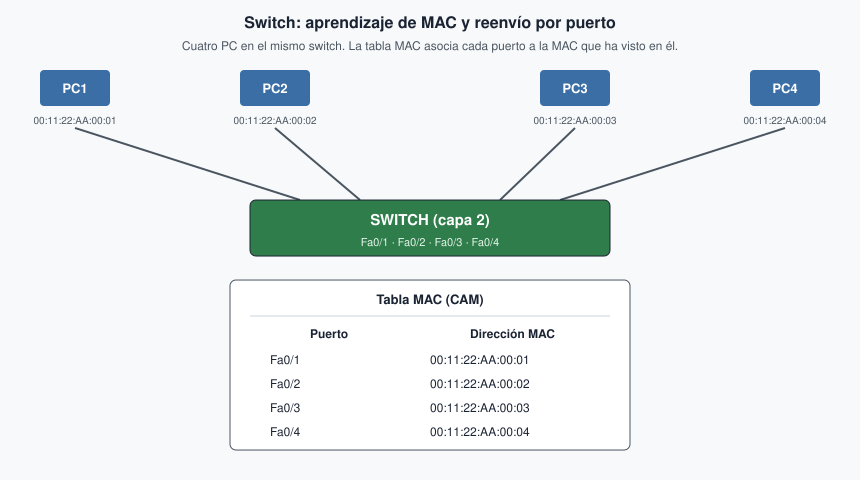{ width="780" }
  <figcaption>Aprendizaje de MAC: cada puerto queda asociado a la dirección que el switch ha visto en él. Las MAC del dibujo son de laboratorio.</figcaption>
</figure>

Los puertos habituales en cobre son **RJ‑45** a 10/100/1000 Mb/s (a veces multi‑gig). Para el backbone o para unirse a otro armario se usan módulos **SFP** o **SFP+** (fibra, o cobre en algunos transceptores). El puerto de **consola** sirve para configurar el equipo por cable serie o USB, sin pasar por la red. Un switch **no gestionable** no pide configuración: se enchufa y conmuta. Uno **gestionable** permite VLAN, QoS o SNMP; las **VLAN** se estudian en el [Tema 6](../06-enrutamiento-subnetting-vlans/tema6.md), aquí solo interesa saber que el modelo del rack puede tenerlas. Por forma hay switches de **escritorio** (pocos puertos, para un aula pequeña) y de **rack 1 U** (24 o 48 puertos, atornillados a los bastidores de 19″). **[PoE](#poe)** (*Power over Ethernet*) alimenta AP, cámaras IP y teléfonos por el mismo UTP, de modo que al techo llega un solo cable.

**Ejemplo del taller.** El switch del armario didáctico se atornilla a 1 U, se etiqueta y se une al panel con latiguillos cortos. Un puerto (o un SFP, si el equipo lo tiene) hace de **uplink** hacia el router o hacia el switch de edificio: por ahí sale el aula. Si ese uplink está caído, pinguean entre sí los PC del tramo y no sale nada hacia otras redes.

<figure markdown="span">
  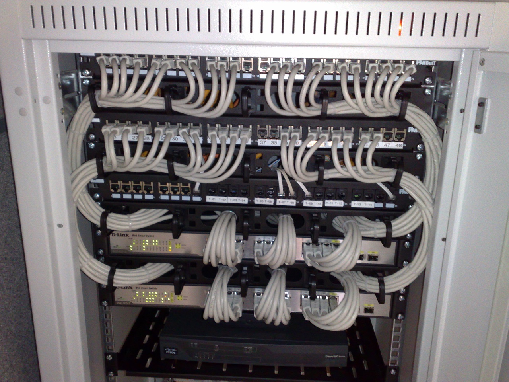{ width="640" }
  <figcaption>Switches Gigabit rackeables y paneles de parcheo en un armario de 19″. Foto: <a href="https://commons.wikimedia.org/wiki/File:19-inch_rackmount_Ethernet_switches_and_patch_panels.jpg">Dsimic</a>, <a href="https://creativecommons.org/licenses/by-sa/4.0/deed.es">CC BY-SA 4.0</a>, Wikimedia Commons.</figcaption>
</figure>

### Router y gateway

El **router** une **redes distintas**. El switch reenvía por MAC dentro de la misma LAN; el router mira la **dirección IP** de destino y consulta su **tabla de rutas** para elegir la interfaz de salida. En el PC, esa salida se llama **puerta de enlace** (*default gateway*): es la IP LAN del router. Sin ella, el equipo habla con los vecinos de su red y no con Internet.

Las interfaces que hay que reconocer en el taller son tres. La **LAN** mira hacia el switch del aula (por ejemplo `192.168.10.1/24` en un ejemplo de laboratorio). La **WAN** mira hacia el proveedor. La **consola** sirve para entrar al equipo aunque la red esté caída. En el borde del edificio el mismo aparato suele hacer **NAT** (los PC salen con una dirección pública compartida) y, a veces, **DHCP** (reparte IP, máscara y puerta de enlace). El **gateway** es esa puerta hacia otra red o protocolo; un **cortafuegos** añade filtrado (qué entra y qué sale). Pueden ser el mismo chasis o dos equipos en cascada: primero se encamina, después se filtra, o al revés según el diseño.

<figure markdown="span">
  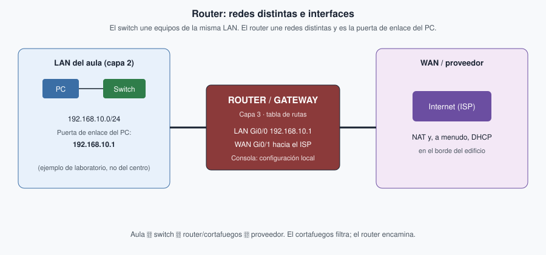{ width="820" }
  <figcaption>Aula → switch → router/gateway → proveedor. LAN, WAN y consola; NAT y DHCP en el borde. Direcciones de ejemplo, no del centro.</figcaption>
</figure>

<figure markdown="span">
  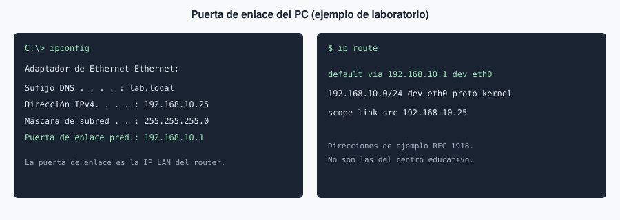{ width="820" }
  <figcaption>La puerta de enlace del PC (192.168.10.1 en el ejemplo) es la IP LAN del router. Captura genérica, sin datos del centro.</figcaption>
</figure>

**Ejemplo.** El tráfico de un aula sube al switch del rack, de ahí al router o cortafuegos del edificio y, por último, al proveedor. Si el switch está bien y el router no tiene ruta por defecto, el ping entre mesas funciona y el ping a un servidor de Internet no.

### Punto de acceso ([AP](#ap))

El **AP** (*Access Point*) enlaza clientes Wi‑Fi con la red cableada. Los hay de interior y de exterior; muchos se alimentan por PoE. Para el examen y para **PR305** hay que distinguir modos (**CE4b**), no solo «poner Wi‑Fi».

| Modo | Qué hace |
| --- | --- |
| **AP (infraestructura)** | Los clientes se asocian a él; él puentea hacia el switch |
| **Repetidor** | Recibe un Wi‑Fi y lo vuelve a emitir (se reduce el caudal útil) |
| **Cliente / estación** | El AP se comporta como una NIC Wi‑Fi hacia otro AP |
| **Bridge** | Une dos redes cableadas por un enlace Wi‑Fi |

Los parámetros básicos (**CE4d**) son el **SSID** (nombre de la red), el **canal** y la banda (2,4 GHz o 5 GHz) y la potencia. En seguridad (**CE4i**) se usa **WPA2** o **WPA3** con una clave no trivial. WEP y las redes abiertas no se usan en el taller salvo que se pida expresamente para una prueba.

<figure markdown="span">
  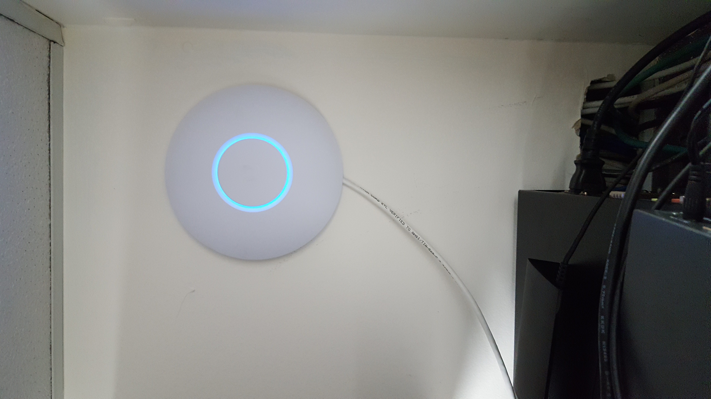{ width="480" }
  <figcaption>Punto de acceso para interiores.</figcaption>
</figure>

!!! note "Para la certificación CCNA"
    En campus grandes el AP ligero lo gestiona un **WLC** (*Wireless LAN Controller*) con CAPWAP. En el taller usamos AP **autónomos**, cada uno con su propia configuración web. El CCNA pregunta las dos ideas; en el examen del módulo cuenta el AP que se monta en **PR305**.

!!! warning "Errores frecuentes"
    Confundir **switch** y **router**. Poner el AP en el mismo canal que el aula contigua (interferencia). Configurar WPA2 con una clave trivial y dar por resuelta la seguridad.

---

## Normas y distancias

Las normas no son un adorno del temario: fijan distancias, espacios y cómo se etiqueta para que otra persona pueda mantener la instalación. La familia útil es **TIA‑568** (cableado), **569** (espacios y canalizaciones), **606** (etiquetado) y **607** (tierra), con equivalente **ISO/IEC 11801**. TIA‑570 se cita en vivienda y TIA‑942 en centros de datos; no hace falta memorizarlas.

### Bloques funcionales

La norma divide la instalación en cuatro bloques, del puesto de trabajo hacia fuera:

1. **Área de trabajo:** puestos, TO y latiguillo corto (hasta 5 m).
2. **Horizontal:** TO ↔ panel del **[FD](#fd)** (distribuidor de planta).
3. **Backbone (vertical):** planta ↔ **[BD](#bd)** (distribuidor de edificio), a menudo en fibra.
4. **Campus:** edificios ↔ **[CD](#cd)**, normalmente en fibra.

En el horizontal puede haber un **punto de consolidación** (a no menos de 15 m del FD) cuando las mesas se reorganizan con frecuencia.

### Distancias orientativas (cobre)

El canal Ethernet de cobre son **100 m**: **90 m** de enlace permanente (TO ↔ panel) más unos **10 m** de latiguillos (hasta 5 m en cada extremo). Superar esa cifra no es «un poco más de cable»: deja de cumplirse la certificación y el enlace suele degradarse.

| Tramo | Límite habitual |
| --- | --- |
| Horizontal (TO ↔ panel) | **90 m** de cable permanente |
| Latiguillos (ambos extremos) | hasta ~5 m + ~5 m → **100 m** de canal |
| Equipo ↔ TO | latiguillo corto (p. ej. ≤ 5 m) |

<figure markdown="span">
  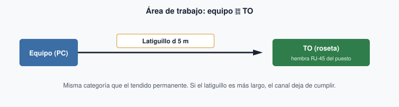{ width="760" }
  <figcaption>Área de trabajo: el latiguillo entre el equipo y la TO no supera 5 m y es de la misma categoría que el tendido permanente.</figcaption>
</figure>

<figure markdown="span">
  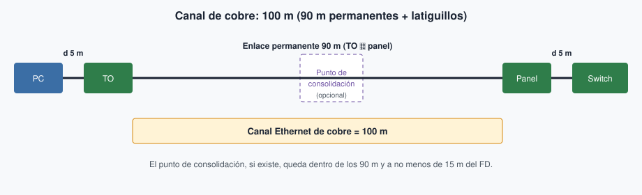{ width="820" }
  <figcaption>Canal Ethernet de cobre = 100 m: hasta 5 m + 90 m de enlace permanente (TO ↔ panel) + hasta 5 m. El punto de consolidación es opcional.</figcaption>
</figure>

<figure markdown="span">
  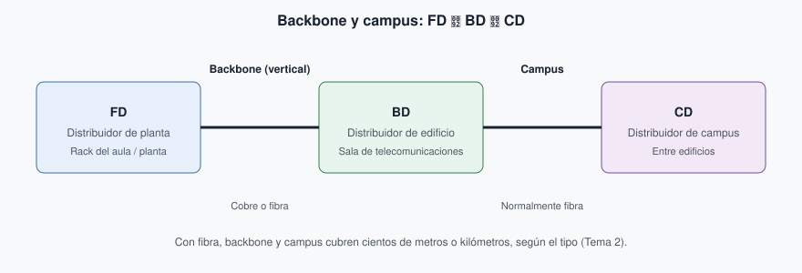{ width="800" }
  <figcaption>Backbone y campus: FD (planta) → BD (edificio) → CD (campus). El cobre cubre tramos cortos; la fibra, distancias mayores.</figcaption>
</figure>

Con **fibra**, backbone y campus cubren cientos de metros o kilómetros según el tipo, como se vio en el Tema 2.

### Tierra (visión breve)

**TIA‑607** pide una tierra de telecomunicaciones: barra principal en el BD, barras en cada sala y conductores a cada rack (verde o verde‑amarillo). Esa tierra no es un adorno del armario: protege a las **personas** si un equipo tiene un fallo de aislamiento, da un camino a las **descargas** (estática o sobretensión) y reduce el **ruido** eléctrico que acopla a los pares de datos. En el taller no se deja el armario sin conexión a tierra si el puesto la tiene, ni se improvisan puentes con el cable de datos: el UTP no es conductor de protección.

<figure markdown="span">
  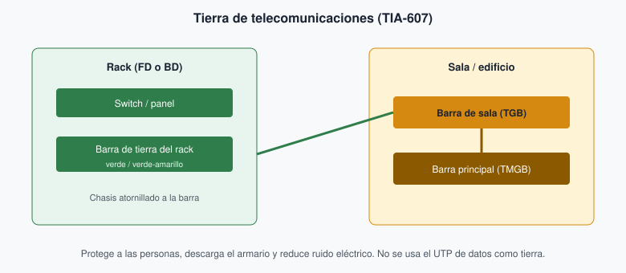{ width="720" }
  <figcaption>Tierra de telecomunicaciones: el chasis del rack se une a la barra de sala y, desde ahí, a la barra principal del edificio (TIA‑607).</figcaption>
</figure>

!!! warning "Errores frecuentes"
    Tender 110 m de UTP «porque Cat. 6 aguanta». La norma del canal son 100 m; a partir de ahí fallan la certificación y, a menudo, el enlace. Otro error: 90 m de horizontal **más** un latiguillo de 15 m.

---

## Redes FTTH/GPON

La **fibra hasta el hogar** (**[FTTH](#ftth)**, *Fiber To The Home*) lleva la fibra óptica hasta el domicilio del abonado. Sustituye al coaxial de la acometida y a la red híbrida de fibra y coaxial (**HFC**, *Hybrid Fiber-Coaxial*), en la que la fibra acaba en un nodo de calle y el último tramo sigue siendo coaxial, con amplificadores que hay que alimentar y ajustar. El medio de una FTTH es la fibra monomodo del [Tema 2](../02-medios-capa-fisica/tema2.md#multimodo-mm-y-monomodo-sm): un solo modo de luz y distancias de kilómetros.

La planta exterior no lleva equipos activos. Los divisores solo parten la luz, así que no necesitan alimentación eléctrica ni ajustes de nivel. Al eliminar el cobre y esa alimentación desaparece una fuente habitual de averías del coaxial. El alcance también cambia: la UIT-T G.984.2 contempla hasta **20 km** de fibra entre la central y el abonado. La distancia que de verdad se alcanza depende de las pérdidas; el ejemplo 2 hace esa cuenta. Con coaxial, de forma orientativa, el tramo útil se queda en unos **2 km** en el mejor de los casos. La fibra admite más velocidad: en GPON, la bajada de referencia es de **2,5 Gbit/s** y la subida de **1,25 Gbit/s**, compartidas por los abonados de un mismo árbol. La evolución **XGS-PON** (*10-Gigabit-capable Symmetric Passive Optical Network*, UIT-T G.9807.1) llega a **10 Gbit/s** en los dos sentidos y conserva la misma planta pasiva.

Esa arquitectura se llama **[GPON](#gpon)** (*Gigabit-capable Passive Optical Network*, red óptica pasiva con capacidad de gigabit) y está descrita en la UIT-T G.984. De la central a la casa intervienen cuatro piezas:

1. La **[OLT](#olt)** (*Optical Line Terminal*, terminal de línea óptica) está en la central. Genera la señal de bajada, recibe la de subida y asigna el turno de cada abonado.
2. La **red de distribución óptica** es el conjunto de fibras y cajas que hay entre la OLT y el domicilio. En las **cajas de distribución** y en las **cajas terminales** o finales se colocan los **[divisores ópticos](#divisor-optico)** pasivos, con relaciones **1:8**, **1:16**, **1:32** o **1:64**. El reparto puede hacerse en un solo divisor o en dos escalones, uno en cada caja.
3. La **acometida** es el último tramo de fibra, desde la caja final hasta el domicilio.
4. La **[ONT](#ont)** (*Optical Network Terminal*, terminal de red óptica) está en casa del abonado. La norma llama ONU (*Optical Network Unit*, unidad de red óptica) al equipo de usuario en general; en FTTH ese equipo es la ONT, y de ella salen **internet**, **telefonía** y **televisión**.

Los dos sentidos viajan por **una sola fibra**, separados por longitud de onda (multiplexación **WDM**, *Wavelength Division Multiplexing*). La bajada va a **1490 nm**, la subida a **1310 nm** y, cuando la red superpone vídeo de radiofrecuencia (RF), ese canal va a **1550 nm** junto con la bajada. Si la televisión va por IP, la longitud de 1550 nm puede no usarse. La bajada es de **difusión**: el divisor copia la misma luz hacia todas las ONT y cada una se queda con sus datos. La subida usa acceso múltiple por división en el tiempo (**TDMA**, *Time Division Multiple Access*): la OLT concede un turno a cada ONT para que no emitan a la vez sobre la fibra que comparten.

### Ejemplo 1. Recorrido de la señal

La OLT inyecta la bajada a 1490 nm en la fibra que sale de la central. En la caja de distribución, el divisor pasivo reparte esa luz entre varias fibras. Una de ellas llega a la caja final del edificio o de la calle, y desde ahí la acometida entra en el domicilio hasta la ONT. La ONT convierte la luz en internet, telefonía y televisión. A la vuelta, la ONT transmite a 1310 nm solo durante su turno; el mismo divisor junta las subidas y las devuelve a la OLT. El resto de salidas del divisor llevan la misma bajada a otros abonados.

<figure markdown="span">
  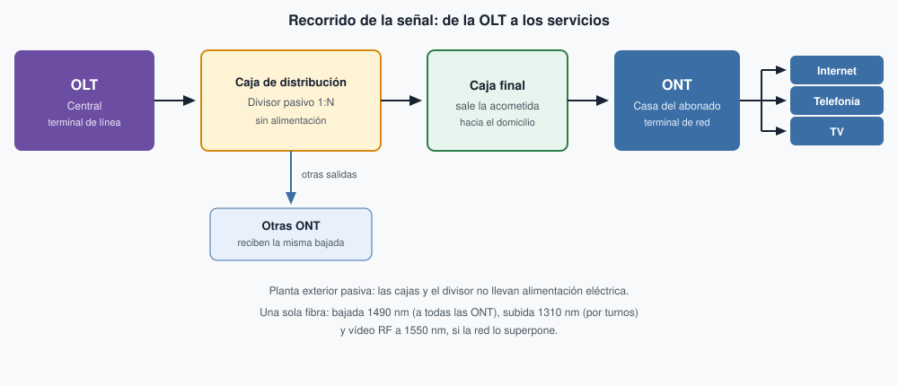{ width="900" }
  <figcaption>Ejemplo de recorrido. Una sola fibra lleva la bajada (1490 nm), la subida (1310 nm) y, si se usa, el vídeo RF (1550 nm). El divisor no se alimenta y copia la bajada hacia cada abonado.</figcaption>
</figure>

### Ejemplo 2. Cálculo sencillo de pérdidas

Casi todo el margen se lo queda el divisor. En este ejemplo, la fibra, las fusiones y los conectores se cuentan con cifras **orientativas de proyecto**; el intervalo de la clase B+ sí lo fija la norma. Un divisor **1:32** se toma a **17 dB**, valor típico de catálogo: solo repartir la luz entre 32 salidas ya ronda los 15 dB, y el divisor real añade un poco más. La fibra de planta se toma a **0,35 dB/km** a **1310 nm**, por debajo del máximo de **0,4 dB/km** que la UIT-T G.652 asigna a la fibra monomodo de cable en esa longitud. Cada fusión bien hecha se cuenta a **0,1 dB** y cada conector a **0,5 dB**.

Se calcula la **subida**, a 1310 nm, porque ahí la fibra atenúa más que a 1490 nm. El enlace del ejemplo tiene **8 km**, un solo divisor 1:32, **cuatro fusiones** y **cuatro conectores**:

| Concepto | Cálculo | Pérdida |
| --- | --- | --- |
| Divisor óptico 1:32 | valor típico | 17 dB |
| Fibra de planta, 8 km a 1310 nm | 8 × 0,35 dB/km | 2,8 dB |
| 4 fusiones bien hechas | 4 × 0,1 dB | 0,4 dB |
| 4 conectores | 4 × 0,5 dB | 2,0 dB |
| **Total** | | **22,2 dB** |

La clase **B+** admite entre **13 dB** y **28 dB** de pérdida, tanto a 1490 nm como a 1310 nm (UIT-T G.984.2, anexo A, tabla A.2). Por debajo de 13 dB llega demasiada potencia y el receptor puede saturarse; por encima de 28 dB la señal ya no basta. El total de 22,2 dB entra en ese intervalo: el enlace funciona. Hasta el máximo quedan **5,8 dB** de margen (28 − 22,2).

Ese margen es el que se trabaja en el [empalme por fusión](#empalme-por-fusion-vision-de-taller). Si las cuatro fusiones quedaran en 1 dB en lugar de 0,1 dB, aportarían 4 dB en vez de 0,4 dB y el total pasaría a **25,8 dB**. El enlace seguiría dentro, pero el margen bajaría a 2,2 dB. Unos empalmes defectuosos de más sacan el enlace de los 28 dB y la ONT deja de recibir nivel suficiente.

!!! warning "Errores frecuentes"
    Invertir bajada y subida: a 1490 nm la señal llega a todas las ONT; a 1310 nm cada ONT espera su turno. Tratar el divisor como un amplificador de coaxial: no se alimenta y no se ajusta. Sumar dos divisores cuando el reparto del ejemplo es uno solo. Dar por buena una fusión deficiente porque aún se mide algo de luz: cada décima de más sale del margen de 28 dB.

---

## Empalme por fusión (visión de taller)

En fibra, el **empalme por fusión** une dos núcleos fundiéndolos con un arco eléctrico controlado (**fusionadora**). No es un crimpado de RJ‑45: un corte sucio o una fibra sucia deja el enlace inservible. En el taller se trabaja, por este orden, la preparación (pelado, limpieza, corte con **cleaver**), la fusión, el protector termorretráctil y una comprobación básica (continuidad o potencia, según el equipo).

<figure markdown="span">
  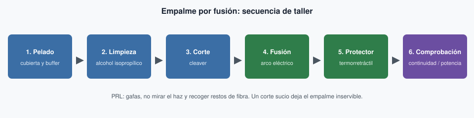{ width="860" }
  <figcaption>Secuencia de fusión en taller: pelado → limpieza → corte (cleaver) → fusión → protector → comprobación.</figcaption>
</figure>

<figure markdown="span">
  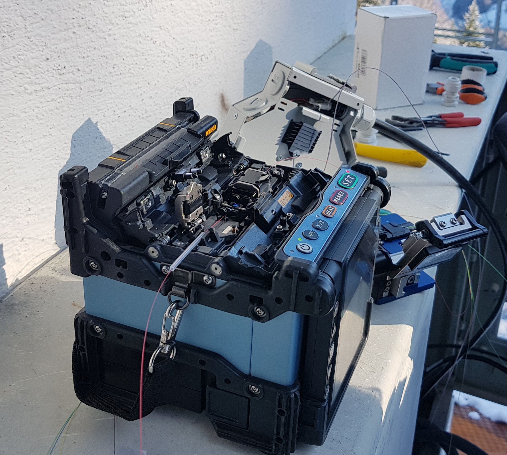{ width="520" }
  <figcaption>Fusionadora (Fujikura 70S) en un empalme de campo. Foto: <a href="https://commons.wikimedia.org/wiki/File:Fujikura-Fusion_Splicer_70S-01aASD.jpg">Asurnipal</a>, <a href="https://creativecommons.org/licenses/by-sa/4.0/deed.es">CC BY-SA 4.0</a>, Wikimedia Commons.</figcaption>
</figure>

<figure markdown="span">
  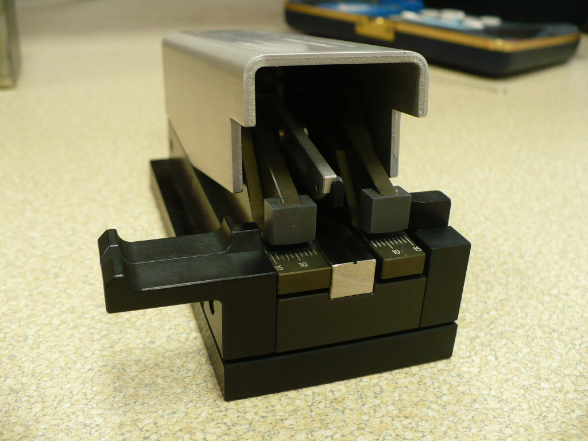{ width="480" }
  <figcaption>Cleaver: corte preciso de la fibra antes de fusionar. Foto: <a href="https://commons.wikimedia.org/wiki/File:Obcinarka_do_swiatlowodow_pg_eti_2007.jpg">Vmario</a>, dominio público, Wikimedia Commons.</figcaption>
</figure>

En **PRL** hacen falta gafas, no mirar el haz y recoger los restos de fibra en un recipiente específico: pinchan y apenas se ven.

La práctica evaluable es **PR304**. El crimpado de cobre (conectores RJ‑45) ya se hizo en **PR201** (CE3c); aquí el mismo criterio se aplica a la fibra.

---

## Actividades

!!! tip "Formato de entrega"
    Las entregas en **Aules** son **obligatorias en Markdown** (`.md`). No se aceptan PDF.  
    Nombre del archivo: `AC3XX.md` o `PR3XX.md` (sustituye XX por el número). Respeta la fecha de vencimiento.  
    Escribiremos los `.md` con **Visual Studio Code**.

    !!! note "Cómo empezar"
        - Guía de Markdown: [tutorialmarkdown.com/guia](https://tutorialmarkdown.com/guia)
        - Documentación de Visual Studio Code: [code.visualstudio.com/docs](https://code.visualstudio.com/docs)

### AC301 — NIC comparativa

* :simple-readdotcv: **AC301**. (RA3 // CE3b // RA4 // CE4a // **AC 0–1**). Tabla comparativa de NIC (cableada / USB / Wi‑Fi): velocidades, dúplex, interfaz y uso típico. Incluye qué es la MAC.

### AC302 — Armario / rack

* :simple-readdotcv: **AC302**. (RA2 // CE2f // **AC 0–1**). Documenta estructura del rack 19″, unidades U, elementos internos (panel, electrónica, PDU, guías) y tipos según tamaño.

### AC303 — Electrónica y capas OSI

* :simple-readdotcv: **AC303**. (RA3 // CE3d // RA4 // CE4a, CE4b // **AC 0–1**). Tabla: hub, switch, router, gateway y AP — capa OSI, función, escenario de uso y una limitación de cada uno.

### AC304 — Tomas, latiguillos y guiado

* :simple-readdotcv: **AC304**. (RA2 // CE2d, CE2e, CE2g, CE2i // **AC 0–1**). Tipos de TO, uso de latiguillos, canalizaciones/bandejas/guías/pasahilos y buenas prácticas de etiquetado.

### AC305 — Propuesta electrónica (centro educativo)

* :simple-readdotcv: **AC305**. (RA3 // CE3a, CE3d // RA4 // CE4c // **AC 0–1**). Propón la electrónica para un centro con **dos edificios**: switches de armario, router de salida, gateway/firewall y AP interiores/exteriores. Diagrama en [Excalidraw](https://excalidraw.com/), [draw.io](https://app.diagrams.net/) o [Dia](https://wiki.gnome.org/Apps/Dia) + breve justificación en el `.md`.

### PR301 — Taller: panel, tomas, armario y switch

| Campo | Valor |
| --- | --- |
| **Código** | **PR301** |
| **UP / tema** | T3 — Cableado estructurado |
| **RA principal** | **RA2** (despliegue) + **RA3** (interconexión). Apoyo **RA4** |
| **CE de cobertura** | CE2d, CE2f, CE2g, CE2i, CE2j · CE3a, CE3d, CE3e, CE3f |
| **Sesiones estimadas** | **2** |
| **Instrumento** | Checklist de montaje + rúbrica 0–10 |

* :simple-neutralinojs: **PR301**. En el **aula-taller** (no solo simulación): montad y conexionad un tramo didáctico de cableado estructurado.

  **Enunciado (qué hace el alumno):**

  1. Preparar el **armario / rack** didáctico (orden, U libres, guiado, seguridad).
  2. Montar o completar **panel de parcheo** y, si el puesto lo permite, **toma de usuario (TO)** o equivalente didáctico.
  3. Instalar el **switch** en el armario (fijación, alimentación, etiquetado del equipo).
  4. Conexionar **panel ↔ switch** con latiguillos; etiquetar puertos según el plan del profesor.
  5. Verificar **conectividad** básica (enlace / ping entre dos puestos del tramo).
  6. Documentar el montaje (fotos + esquema de puertos).

  **Evidencia:** fotos del rack (antes/después), etiquetado visible, checklist de montaje, prueba de conectividad, `PR301.md`.

  **Entrega:** `PR301.md` + evidencias en Aules.

| Criterio (rúbrica) | Descripción | Puntos |
| --- | --- | --- |
| Rack / panel / TO | Montaje ordenado y conforme al plan | 0–3 |
| Switch + conexionado | Equipo fijado y enlazado a paneles | 0–3 |
| Verificación | Conectividad demostrada | 0–2 |
| Informe `.md` | Fotos, etiquetado, incidencias | 0–2 |
| **Total** | | **/10** |

### PR304 — Taller: fusión de fibra / fusionadoras

| Campo | Valor |
| --- | --- |
| **Código** | **PR304** |
| **UP / tema** | T3 — Cableado estructurado |
| **RA principal** | **RA3** (empalmes en fibra). Apoyo **RA2** y **RA6** |
| **CE de cobertura** | CE3c, CE3f, CE3g · CE2c, CE2j · CE6b, CE6e |
| **Sesiones estimadas** | **2** |
| **Instrumento** | Checklist de fusión + rúbrica 0–10 |

* :simple-neutralinojs: **PR304**. En taller, bajo supervisión: realizad un **empalme por fusión** (o la secuencia completa de preparación + fusión + protector que permita el material del centro).

  **Enunciado (pasos):**

  1. EPI y normas: gafas; no mirar fuentes ópticas; recoger restos de fibra.
  2. Preparar fibras (pelado, limpieza, corte con cleaver).
  3. Ejecutar la fusión en la **fusionadora**; anotar la atenuación estimada si el equipo la muestra.
  4. Colocar el **protector** termorretráctil y asentar el empalme.
  5. Comprobación básica según el equipo disponible (continuidad / potencia / OK de la fusionadora).
  6. Documentar errores típicos (corte malo, suciedad, protector mal colocado) y cómo se corrigieron.

  **Evidencia:** foto del puesto/fusionadora, captura o lectura de resultado, checklist PRL, `PR304.md`.

  **Entrega:** `PR304.md` + evidencias en Aules.

| Criterio (rúbrica) | Descripción | Puntos |
| --- | --- | --- |
| PRL / EPI | Normas aplicadas y documentadas | 0–2 |
| Preparación y corte | Cleaver / limpieza correctos | 0–2 |
| Fusión + protector | Empalme válido / protector asentado | 0–3 |
| Comprobación + informe | Evidencia de OK + `.md` | 0–3 |
| **Total** | | **/10** |

### PR305 — Taller: WLAN real

| Campo | Valor |
| --- | --- |
| **Código** | **PR305** |
| **UP / tema** | T3 — Cableado estructurado |
| **RA principal** | **RA4**. Apoyo **RA3** (CE3b) |
| **CE de cobertura** | CE4a, CE4b, CE4c, CE4d, CE4e, CE4f, CE4i · CE3b |
| **Sesiones estimadas** | **3** |
| **Instrumento** | Checklist de montaje + rúbrica 0–10 |

* :simple-neutralinojs: **PR305**. En el aula-taller, por grupos: montáis una **NIC** (PCIe o USB Wi‑Fi) con su driver, instaláis un **AP** o router Wi‑Fi del centro y dejáis una WLAN usable.

  **Enunciado (pasos):**

  1. EPI y, si montáis PCIe, apagad el PC y descargad electricidad estática.
  2. Instalar la NIC o el adaptador USB y el **driver** hasta que el sistema vea la interfaz (CE3b, CE4f).
  3. Cablear el AP al switch del puesto; alimentar por **PoE** o por el adaptador de corriente.
  4. Entrar a la configuración (web o app que indique el profesor).
  5. Configurar **modo** (AP; repetidor o cliente si se pide), **SSID**, **canal**/banda y **WPA2 o WPA3** con la clave del puesto. Si el equipo lo tiene, red de invitados (CE4a–d, CE4i).
  6. Asociar portátil o móvil y comprobar **ping** o navegación (CE4e).
  7. Anotar canal e interferencias (analizador o lista de redes vecinas).
  8. Foto del montaje y captura de estado (SSID, canal, seguridad, IP).

  **Evidencia:** fotos, capturas de config y de conectividad, `PR305.md`.

  **Entrega:** `PR305.md` + evidencias en Aules.

  **No sustituye** PR301 ni PR304. No se hace en Packet Tracer.

| Criterio (rúbrica) | Descripción | Puntos |
| --- | --- | --- |
| Montaje NIC + driver | Adaptador instalado y reconocido | 0–2 |
| AP instalado y alimentado | Cableado / PoE correctos | 0–2 |
| Parámetros y seguridad | Modo, SSID, canal, WPA2/WPA3 | 0–3 |
| Conectividad | Cliente asociado y ping o web | 0–2 |
| Informe `.md` | Capturas, canal e incidencias | 0–1 |
| **Total** | | **/10** |

### PR303 — Pasa a certificación: trabajo para casa { #pr303-pasa-a-certificacion-trabajo-para-casa }

| Campo | Valor |
| --- | --- |
| **Código** | **PR303** |
| **UP / tema** | T3 — Cableado estructurado |
| **Dónde** | **Casa** (certificación / +1). No ocupa sesiones de este tema |
| **Instrumento** | Checklist; se corrige solo si hace falta |

* :simple-cisco: **PR303**. Práctica de **Packet Tracer** de WLAN (AP, SSID, canal, seguridad básica). Guion: [PR303 — WLAN en Packet Tracer](../certificacion/pr303-wlan-packet-tracer.md). Entrega `PR303.pkt` y `PR303.md` cuando lo pida el profesor. **No puntúa** en la nota de los RA (entra en el +1 de certificación). **No sustituye** a **PR305**.

### PR302 — Proyecto aulario

| Campo | Valor |
| --- | --- |
| **Código** | **PR302** |
| **UP / tema** | T3 — Cableado estructurado |
| **RA principal** | **RA2**. Apoyo **RA3** |
| **CE de cobertura** | CE2d, CE2e, CE2f, CE2g, CE2i, CE2j · CE3a |
| **Sesiones estimadas** | **1–2** |
| **Instrumento** | Rúbrica de diseño 0–10 |

* :simple-neutralinojs: **PR302**. En grupo, diseñad el cableado del **aulario** (dos plantas, aulas, Wi‑Fi, enlace al edificio principal vía campus). El diseño debe ser coherente con el **taller** (PR301, PR304, PR305): rack, paneles, fusión/medios, electrónica y WLAN.

  - Plano funcional: zonas, FD/BD/CD, horizontal y backbone.
  - Diagrama en Excalidraw / draw.io / Dia.
  - Justificación de medios (cobre/fibra), canalizaciones y electrónica básica.
  - Idea de etiquetado y crecimiento (reserva de puertos/cables).

  **Evidencia / entrega:** `PR302.md` + diagrama (PNG/SVG o archivo del editor, según Aules). Exposición breve (~5 min) si se indica en clase.

| Criterio (rúbrica) | Descripción | Puntos |
| --- | --- | --- |
| Análisis del escenario | Necesidades y condicionantes claros | 0–2 |
| Diseño del cableado | Elementos funcionales y normativa coherentes | 0–2 |
| Justificación técnica | Medios, canalizaciones y equipos argumentados | 0–2 |
| Etiquetado y mantenimiento | Identificación y plan básico de ampliación | 0–2 |
| Documentación `.md` + diagrama | Claridad y completitud | 0–2 |
| **Total** | | **/10** |

---

## Para el examen

El cableado estructurado es el sistema del edificio (TO, horizontal de 90 m, panel, rack, backbone), no el latiguillo suelto. La **NIC** (Tema 1) se **monta** aquí (PCIe o USB) y lleva **driver**. El **rack** es de 19″ y la altura se mide en **U**. El **panel** empareja cada TO con un puerto etiquetado; de ahí un latiguillo al **switch**. El **hub** queda para laboratorio; el **switch**, para la LAN; el **router** o **gateway**, para otras redes; el **AP**, para Wi‑Fi con SSID, canal y **WPA2/WPA3**, a menudo con **PoE**. En fusión de fibra: cleaver, fusionadora, protector y PRL. En FTTH/GPON la OLT de la central llega a la ONT por divisores pasivos, con bajada a 1490 nm, subida a 1310 nm y vídeo RF a 1550 nm si se usa, y la pérdida del enlace tiene que caber en la clase B+ (13–28 dB). CE clave de este tema: **CE2d, CE2f, CE2g, CE3a, CE3c, CE3f, CE4d, CE4i**.

## Autocheck del tema

Hazlo **después** de entregar el cuestionario inicial en Aules.

1. **V/F.** El latiguillo del PC al switch de mesa ya es, por sí solo, un sistema de cableado estructurado.
2. Empareja: **TO** · **FD** · **CD** con: (a) toma del puesto · (b) enlace entre edificios · (c) distribuidor de planta.
3. El enlace permanente de cobre (TO ↔ panel) suele limitarse a…  
   a) 10 m · b) 55 m · c) 90 m · d) 300 m
4. **V/F.** Una NIC Wi‑Fi no tiene dirección MAC.
5. Relaciona: **hub** · **switch** · **router** con capas **1**, **2** y **3**.
6. Elige la correcta: PoE…  
   a) sube la categoría del UTP · b) alimenta equipos por el mismo par trenzado · c) solo existe en fibra
7. Nombra dos modos de funcionamiento de un AP.
8. **V/F.** WEP es la seguridad recomendada hoy en el taller.
9. ¿Qué distancia máxima se recomienda para el latiguillo equipo ↔ TO?
10. El estándar que habla de etiquetado y administración del cableado es…  
    a) TIA‑568 · b) TIA‑606 · c) IEEE 802.11 · d) RFC 1918
11. **V/F.** El repetidor divide el dominio de colisión.
12. En la fusión de fibra, ¿para qué sirve el cleaver?
13. **V/F.** El montaje de una NIC PCIe o USB cubre, entre otros, el criterio de instalar el adaptador en el equipo.
14. Un canal Ethernet de cobre de 100 m se reparte, de forma habitual, en…
15. ¿Qué compruebas en PR305 después de configurar SSID, canal y WPA2/WPA3?
16. Empareja: **OLT** · **ONT** · **divisor óptico** con: (a) equipo en el domicilio, con internet, telefonía y TV · (b) equipo en la central · (c) reparte la luz y no se alimenta.
17. Un enlace GPON suma 17 dB de un divisor 1:32, 2,8 dB de fibra, 0,4 dB de fusiones y 2,0 dB de conectores. ¿Cabe en el máximo de 28 dB de la clase B+? ¿Qué margen queda?

!!! info "Soluciones"
    Las soluciones se publicarán aquí cuando cierre el cuestionario inicial en Aules.

---

## Vídeos recomendados

Pablo Hidalgo explica cómo trabaja un switch Ethernet de capa 2 (CCNA v1.1, lección 6): tabla MAC, unicast y broadcast.

  <iframe src="https://www.youtube-nocookie.com/embed/vYKwD7OF6xY"
          style="position: absolute; top: 0; left: 0; width: 100%; height: 100%;"
          frameborder="0"
          allow="accelerometer; autoplay; clipboard-write; encrypted-media; gyroscope; picture-in-picture"
          allowfullscreen
          title="CCNA v1.1 Lección 6 — switches Ethernet de capa 2 (Pablo Hidalgo)"></iframe>

Las lecciones 34–38 de la misma playlist ([CCNA Completo v1.1](https://www.youtube.com/playlist?list=PLxnG_9vdV6-gEWV15pq89XK_W3G8vP5_0)) tratan WLAN (transmisión, estándares, WLC, WPA2/WPA3) y requieren membresía. El cobre y la fibra (lecciones 3 y 4) están en el Tema 2.

## Glosario

**NIC**{: #nic}
*Network Interface Card*: adaptador de red. Concepto y MAC en el Tema 1; en este tema, montaje (PCIe/USB) y driver.

**rack**{: #rack}
Armario de comunicaciones con bastidores de 19 pulgadas; la altura se mide en unidades U.

**panel de parcheo**{: #panel-de-parcheo}
Panel (habitualmente RJ‑45) que concentra el cableado horizontal y se etiqueta TO a TO.

**TO**{: #to}
Toma de usuario o TO (*Telecommunications Outlet*), también llamada **roseta**: punto de conexión del puesto (superficie, empotrable o de suelo).

**FD**{: #fd}
*Floor Distributor*: distribuidor de planta.

**BD**{: #bd}
*Building Distributor*: distribuidor de edificio.

**CD**{: #cd}
*Campus Distributor*: distribuidor de campus (entre edificios).

**AP**{: #ap}
*Access Point*: punto de acceso Wi‑Fi que puentea clientes inalámbricos hacia la LAN cableada.

**PoE**{: #poe}
*Power over Ethernet*: alimentación eléctrica por el mismo UTP (AP, cámaras, teléfonos).

**SSID**{: #ssid}
Nombre de la red Wi‑Fi que anuncia el AP.

**WPA2 / WPA3**{: #wpa}
Mecanismos de seguridad Wi‑Fi actuales (clave o 802.1X). WEP está obsoleto.

**FTTH**{: #ftth}
*Fiber To The Home*, fibra hasta el hogar: la fibra óptica llega al domicilio del abonado y termina en la ONT.

**GPON**{: #gpon}
*Gigabit-capable Passive Optical Network*, red óptica pasiva con capacidad de gigabit (UIT-T G.984): una OLT reparte la fibra entre varias ONT mediante divisores sin alimentación.

**OLT**{: #olt}
*Optical Line Terminal*, terminal de línea óptica: equipo de la central. Origina la bajada y asigna los turnos de subida.

**ONT**{: #ont}
*Optical Network Terminal*, terminal de red óptica: equipo en casa del abonado. Entrega internet, telefonía y televisión.

**divisor óptico**{: #divisor-optico}
Repartidor pasivo (*splitter*): parte la potencia de una fibra entre varias salidas (1:8, 1:16, 1:32, 1:64…). No se alimenta y concentra la mayor parte de la pérdida del enlace.

---

## Relación con el resto del módulo

El **Tema 1** dio dispositivos, capas y la NIC; el **Tema 2**, el medio (UTP, fibra, Wi‑Fi, crimpado). Aquí se monta el **edificio**: rack, panel, TO y WLAN real (**PR305**). El **Tema 4** profundiza en la trama y en el switch; el **Tema 6**, en VLAN sobre switch físico (**PR604**). La certificación (**PR303** y el resto de Packet Tracer) se hace en casa.

---

## Referencias rápidas

- Sitio del módulo: [fjavier-hernandez.github.io/ral](https://fjavier-hernandez.github.io/ral/)
- Diagramas: [Excalidraw](https://excalidraw.com/), [draw.io (diagrams.net)](https://app.diagrams.net/), [Dia](https://wiki.gnome.org/Apps/Dia)
- Simulación: [Cisco Packet Tracer](https://www.netacad.com/es/cisco-packet-tracer)
- Entregas: [Visual Studio Code](https://code.visualstudio.com/docs) + [Markdown](https://tutorialmarkdown.com/guia)
- Normas: [Normas del taller](../00-normas/normas_taller.md)
- Playlist CCNA (Pablo Hidalgo): [CCNA Completo v1.1](https://www.youtube.com/playlist?list=PLxnG_9vdV6-gEWV15pq89XK_W3G8vP5_0)

*[RA]: Resultado de aprendizaje
*[CE]: Criterio de evaluación
*[AC]: Actividad de clase
*[PR]: Práctica
*[NIC]: Network Interface Card
*[TO]: Telecommunications Outlet
*[PoE]: Power over Ethernet
*[FD]: Floor Distributor
*[BD]: Building Distributor
*[CD]: Campus Distributor
*[AP]: Access Point
*[SSID]: Service Set Identifier
