# Tema 3. Cableado estructurado y componentes

En este tema organizamos el cableado del **edificio**: desde la toma del puesto hasta el **[rack](#rack)**, pasando por paneles, canalizaciones y la electrónica (switch, router, [punto de acceso](#ap)…). El medio del Tema 2 (categoría, conector, crimpado) solo funciona como red si forma parte de un sistema que se pueda ampliar, etiquetar y mantener.

!!! tip "Primera clase"
    Empieza por el [cuestionario inicial](#cuestionario-inicial). No hace falta haber leído el tema entero: sirve para ver qué traes antes de estudiar. Entrégalo en Aules **antes** de mirar el Autocheck.

!!! tip "Cómo leerlo"
    Lee cada apartado completo: primero el párrafo (qué es, para qué sirve y un ejemplo), después la tabla o la figura, y al final los errores frecuentes. No estudies solo las tablas. Los términos marcados enlazan al [glosario](#glosario). Cuando acabes el tema, haz el [Autocheck](#autocheck-del-tema).

## Propuesta didáctica

Trabajamos los **RA2**, **RA3** y **RA4** del módulo Redes de área local (0225):

> **RA2.** *Despliega el cableado de una red local interpretando especificaciones y aplicando técnicas de montaje.*

> **RA3.** *Interconecta equipos en redes locales cableadas describiendo estándares de cableado y aplicando técnicas de montaje de conectores.*

> **RA4.** *Instala equipos en red, describiendo sus prestaciones y aplicando técnicas de montaje.*

### Criterios de evaluación (selección)

**RA2**

* **CE2c**: Se han diferenciado los medios de transmisión.
* **CE2d** **(clave)**: Se han reconocido los detalles del cableado de la instalación y su despliegue (categoría del cableado, espacios por los que discurre, soporte para las canalizaciones, entre otros).
* **CE2e**: Se han seleccionado y montado las canalizaciones y tubos.
* **CE2f** **(clave)**: Se han montado los armarios de comunicaciones y sus accesorios.
* **CE2g** **(clave)**: Se han montado y conexionado las tomas de usuario y paneles de parcheo.
* **CE2i**: Se han etiquetado los cables y tomas de usuario.
* **CE2j**: Se ha trabajado con la calidad y seguridad requeridas.

**RA3**

* **CE3a** **(clave)**: Se ha interpretado el plan de montaje lógico de la red.
* **CE3b**: Se han montado los adaptadores de red en los equipos.
* **CE3c** **(clave)**: Se han montado conectores sobre cables (cobre y fibra) de red.
* **CE3d**: Se han montado los equipos de conmutación en los armarios de comunicaciones.
* **CE3e**: Se han conectado los equipos de conmutación a los paneles de parcheo.
* **CE3f** **(clave)**: Se ha verificado la conectividad de la instalación.
* **CE3g**: Se ha trabajado con la calidad requerida.

**RA4**

* **CE4a**: Se han identificado las características funcionales de las redes inalámbricas.
* **CE4b**: Se han identificado los modos de funcionamiento de las redes inalámbricas.
* **CE4c**: Se han instalado adaptadores y puntos de acceso inalámbrico.
* **CE4d** **(clave)**: Se han configurado los modos de funcionamiento y los parámetros básicos.
* **CE4e**: Se ha comprobado la conectividad entre diversos dispositivos y adaptadores inalámbricos.
* **CE4f**: Se ha instalado el software correspondiente.
* **CE4i** **(clave)**: Se han aplicado mecanismos básicos de seguridad.

!!! note "VLAN"
    Las **VLAN** (CE4j) se desarrollan en el **Tema 6**. Aquí solo las mencionamos como capacidad de muchos switches gestionables.

### Contenidos

* Montaje físico del adaptador de red (PCIe o USB) e instalación del driver, ligado a PR301. La NIC como concepto está en el Tema 1.
* Armario o rack de 19″ y unidades **U**; paneles de parcheo; toma de usuario o TO (roseta) y latiguillos.
* Canalizaciones, bandejas, guías y pasahilos; etiquetado (TIA‑606).
* Electrónica: hub, switch, router, gateway, punto de acceso; PoE.
* WLAN de aula: modos del AP, SSID, canal, WPA2/WPA3.
* Visión ISO/TIA: horizontal, backbone, distancias; idea de tierra (TIA‑607).
* Fibra en el cableado estructurado: vertical (FD–BD) en multimodo OM3/OM4 y campus (BD–CD) en monomodo OS2; terminación en ODF y balance de pérdidas.
* Empalme por **fusión** de fibra (fusionadora, protectores, comprobación básica, PRL).

### Programación de aula (orientativa)

| Sesiones | Contenidos | Actividades |
| --- | --- | --- |
| 1 | Presentación + cuestionario inicial | Cuestionario |
| 2 | Montaje del adaptador (PCIe/USB) y driver | **AC301** |
| 3–4 | Rack, panel, TO, guiado | AC302, AC304 |
| 5–7 | Electrónica de red y AP (teoría) | AC303 |
| 8–9 | Normas ISO/TIA, distancias, etiquetado | — |
| 10–11 | Propuesta electrónica (centro educativo) | **AC305** |
| 12–14 | **Taller:** NIC y WLAN real | **PR301** |
| 15–16 | **Taller:** panel, tomas, armario y switch | **PR302** |
| 17–18 | **Taller:** fusión de fibra | **PR303** |
| 19–20 | Diseño de cableado estructurado en diagrama | **PR304** |
| 21–22 | Proyecto aulario sur (grupo) | **PR305** |
| Casa | Certificación: WLAN en Packet Tracer | [guion](../certificacion/pr303-wlan-packet-tracer.md) |

---

## Cuestionario inicial {: #cuestionario-inicial }

!!! question "Antes de empezar — responde con lo que sepas"
    1. ¿Qué es un adaptador de red (NIC) y qué características tiene?
    2. ¿Qué elementos hay dentro de un armario de comunicaciones?
    3. ¿Para qué sirve un panel de parcheo?
    4. ¿Qué diferencia hay entre un hub y un switch?
    5. ¿Qué hace un router en una red?
    6. ¿Cómo funciona un punto de acceso Wi‑Fi?
    7. ¿Qué tipos de tomas de usuario conoces?
    8. ¿Qué es PoE y para qué se usa?
    9. ¿Qué distancia máxima suele tener el cableado horizontal?

Entrega tus respuestas en **Aules** como tarea del cuestionario inicial **antes** de mirar el [Autocheck](#autocheck-del-tema) del final del tema. Las soluciones no están aquí a propósito: primero entregas, después contrastas.

---

## ¿Qué es el cableado estructurado?

El **cableado estructurado** es el sistema de telecomunicaciones del edificio: voz, datos y, en muchos casos, otros servicios (vídeo, alarmas) comparten un mismo diseño, según normas como **ANSI/TIA/EIA‑568/569** e **ISO/IEC 11801**. No se trata de un latiguillo suelto entre el PC y el switch de mesa, sino del conjunto de tomas, tendidos, paneles y armarios que recorre el edificio.

La infraestructura que se instala hoy (paneles de parcheo, tomas de usuario o TO (roseta) y bandejas) debe seguir sirviendo cuando, dentro de unos años, se cambie el switch. Por eso el diseño se apoya en tres ideas clave para el taller y el examen:

- **Flexibilidad.** Se puede reorganizar un puesto cambiando latiguillos, sin rehacer el tendido horizontal.
- **Evolución.** Se sustituye la electrónica (switch, router, AP) sin retirar el cableado pasivo.
- **Centralización.** Los servicios se concentran en distribuidores: racks o salas de telecomunicaciones (TR).

**Ejemplo de aula.** El PC de la mesa llega a la toma de la canaleta; desde ahí un UTP sube al armario del fondo. En el panel debe aparecer la misma etiqueta que en la toma, y un latiguillo corto une ese puerto del panel con el switch. Si las etiquetas no coinciden, para localizar un fallo hay que ir probando cable a cable, en lugar de seguir la documentación.

<figure markdown="span">
  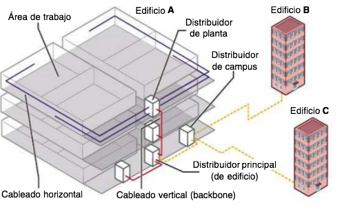{ width="800" }
  <figcaption>Arquitectura típica: áreas de trabajo, horizontal, backbone y distribuidores.</figcaption>
</figure>

El mismo recorrido, visto como un tramo que se puede montar en el taller, va del puesto a la TO, sube por el horizontal hasta el panel del rack de planta (**[FD](#fd)**) y, dentro del armario, un latiguillo une el panel con el switch. El router o gateway de ese rack sale hacia el backbone (edificio **[BD](#bd)** y campus **[CD](#cd)**). Si cambias el switch, el tendido pasivo (TO, canaleta, panel) se queda.

<figure markdown="span">
  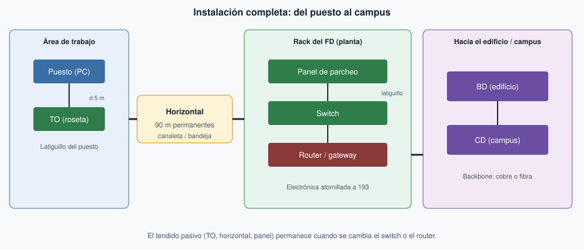{ width="860" }
  <figcaption>Del puesto al campus: TO, horizontal, rack del FD (panel, switch y router) y backbone hacia BD y CD.</figcaption>
</figure>

!!! warning "Errores frecuentes"
    Llamar «cableado estructurado» al latiguillo del PC al switch de mesa. El latiguillo es un tramo; el sistema es TO, tendido horizontal, panel, rack y backbone.

---

## Montaje del adaptador de red

La **[NIC](#nic)** (*Network Interface Card*, tarjeta o adaptador de red), la dirección MAC y el dúplex ya se explicaron en el [Tema 1, apartado Adaptador de red](../01-introduccion-arquitectura/tema1.md#adaptador-de-red-nic). En este tema nos centramos en su montaje.

En este tema lo que importa es el **montaje físico** y el **software del adaptador**, porque ambos entran en el taller. Una NIC puede ir integrada en la placa, instalarse en una ranura **PCIe** o conectarse por **USB** (incluido un dongle Wi‑Fi). Tras el montaje hay que instalar el **driver** y comprobar que el sistema operativo ve la interfaz. Eso cubre **CE3b** (montar el adaptador en el equipo) y **CE4f** (instalar el software), y se practica en **[PR301](#pr301-taller-nic-y-wlan-real)**.

**Ejemplo de aula.** En el taller, si montáis una NIC PCIe, se apaga el PC, se descarga la electricidad estática y se encaja la tarjeta hasta el fondo. En Windows o Linux no basta con que «esté puesta»: tiene que aparecer en el administrador de dispositivos o en `ip link` / `ipconfig`. Si no hay enlace, se mira primero el latiguillo y el puerto del switch, no se reinstala el driver a ciegas.

!!! warning "Errores frecuentes"
    Confundir la velocidad de la NIC con la del switch: el enlace baja al mínimo común. Pensar que montar la tarjeta sin driver ya deja el equipo en red.

---

## Armario de distribución ([rack](#rack))

El **rack** concentra el cableado de una zona: paneles de parcheo, switches, unidades de alimentación (PDU o SAI), ventilación y accesorios de ordenación. La puerta transparente permite ver los LED sin abrir el armario; el techo y los laterales suelen ser desmontables para unir armarios o pasar mazos. Sin ese punto central, cada aula sería un ovillo de cables independiente y no habría forma razonable de mantener el edificio.

<figure markdown="span">
  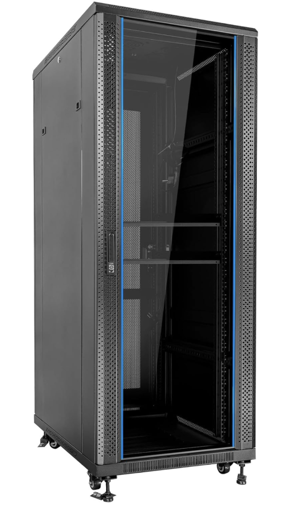{ width="400" }
  <figcaption>Vista frontal de un armario de distribución.</figcaption>
</figure>

### Estándar 19″ y unidad U

El interior tiene bastidores de **19 pulgadas**: cualquier equipo **rackeable** encaja en esa anchura. La altura se mide en **unidades U** (aproximadamente 4,45 cm). Un panel de 24 puertos suele ocupar **1 U**; un switch, 1 U o 2 U. Planificar las U libres evita llenar el armario el primer día y no poder añadir un segundo switch o un pasahilos.

Por tamaño, lo habitual es:

- menos de **12 U**, redes pequeñas, a menudo de pared;
- **12–25 U**, planta o edificio pequeño;
- más de **24 U**, armarios de suelo, con ventilación y filtrado.

**Ejemplo.** Si el armario didáctico tiene 12 U y el panel ya ocupa 1 U, el switch se atornilla a los bastidores. Si solo se apoya sobre el panel, sin atornillar, se desplaza en cuanto se tensa un latiguillo.

!!! warning "Errores frecuentes"
    Estimar las U a ojo y dejar el switch en el canto del armario. Lo rackeable se atornilla a los bastidores.

---

## Panel de parcheo

El **[panel de parcheo](#panel-de-parcheo)** (*patch panel*) organiza las líneas que llegan al armario. Cada toma del panel se corresponde —y se **etiqueta**— con una TO del área de trabajo. De ese modo, cambiar un puesto es cambiar un latiguillo en el frontal, no abrir la canaleta.

Lo habitual son **24** o **48** puertos RJ‑45 en 1–2 U. También hay cajones de **fibra**. En la parte trasera, las regletas IDC usan el mismo código de colores que al crimpar el RJ‑45.

**Ejemplo.** El puerto 12 del panel corresponde a la mesa 12, y el latiguillo 12 va al puerto 12 del switch. Si las etiquetas se cruzan, un ping fallido ya no se puede diagnosticar con método.

<figure markdown="span">
  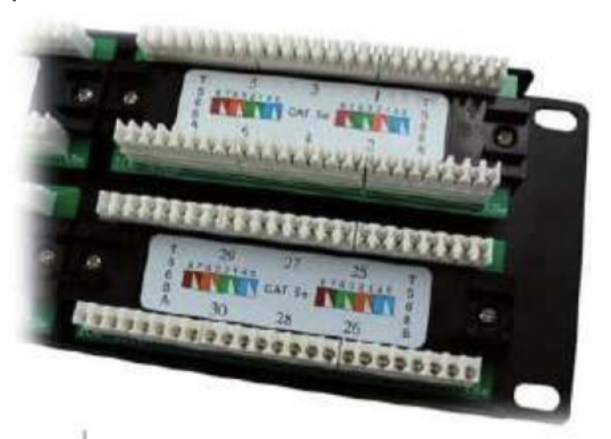{ width="500" }
  <figcaption>Detalle trasero: numeración y código de colores.</figcaption>
</figure>

---

## Tomas de usuario, latiguillos y guiado

### Toma de usuario o TO (roseta)

La **toma de usuario** o **[TO](#to)** (*Telecommunications Outlet*), también llamada **roseta**, es el punto de conexión del puesto: una o más hembras RJ‑45 (datos, voz y, si hay previsión, reserva). A partir de aquí, en el tema se usa **TO**. Tipos habituales:

- **superficie** (canaleta), frecuente en aulas reformadas;
- **empotrable**, en obra nueva;
- **suelo técnico**, en salas de informática o CPD.

La norma recomienda **tres tomas** por puesto (voz, datos y reserva) y un área de trabajo tipo de unos **10 m²**. El latiguillo entre el equipo y la TO no debe superar **5 m** y ha de ser de la misma categoría que el tendido permanente. Si el latiguillo es más largo o de categoría inferior, el canal deja de cumplir la certificación aunque el UTP de la pared sea correcto.

### Latiguillos

Los **latiguillos** son cables cortos con RJ‑45 en ambos extremos. Hay dos usos que no se mezclan: el del puesto (equipo ↔ TO) y el de parcheo (panel ↔ switch). Las longitudes comerciales habituales son 0,5 m, 1 m y 2 m. A partir de Cat. 6, muchos pliegos piden latiguillos **certificados de fábrica**. El de **PR201** sirve para practicar el crimpado; no siempre vale como material de obra.

### Soportes de guiado

El tendido horizontal no se deja suelto: va por un soporte que lo protege, respeta el radio de curvatura y permite ampliar. Canaletas y tubos recorren paredes y suelos; las bandejas llevan mazos por techo o suelo técnico; las guías ordenan el interior del rack; el **pasahilos** (1 U) peina los latiguillos del frontal para que no tapen los LED del switch.

| Elemento | Función |
| --- | --- |
| **Canalizaciones** | Tubos / canaletas por paredes y suelos |
| **Bandejas** | Mazos en techo o suelo técnico |
| **Guías de cable** | Orden en el rack |
| **Pasahilos** | 1 U para peinar latiguillos |

**Ejemplo.** En el armario del taller, sin pasahilos los latiguillos cubren los LED del switch y no se ve qué puerto está caído.

<figure markdown="span">
  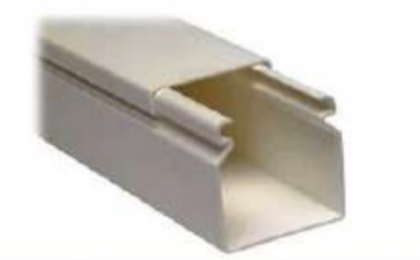{ width="400" }
  <figcaption>Canalizaciones para cableado de red.</figcaption>
</figure>

<figure markdown="span">
  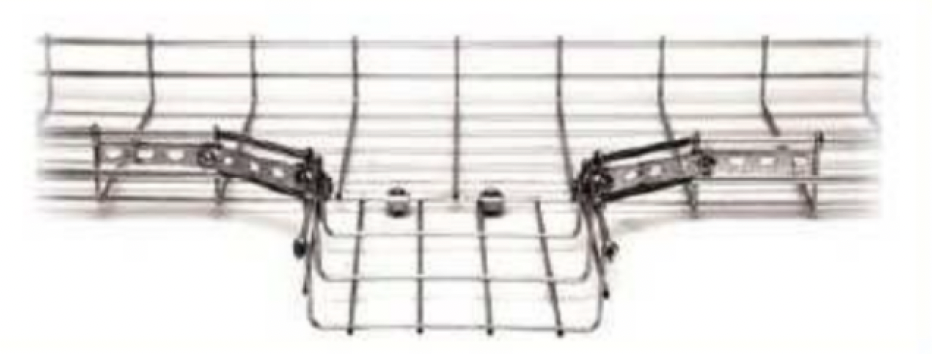{ width="400" }
  <figcaption>Bandejas de guiado (horizontal / vertical).</figcaption>
</figure>

<figure markdown="span">
  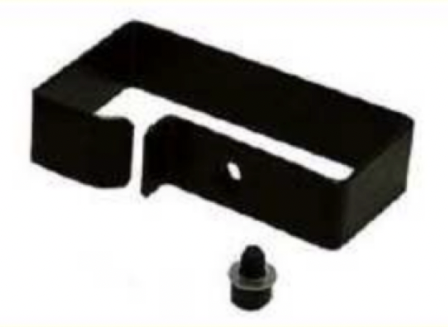{ width="400" }
  <figcaption>Guías en el rack.</figcaption>
</figure>

<figure markdown="span">
  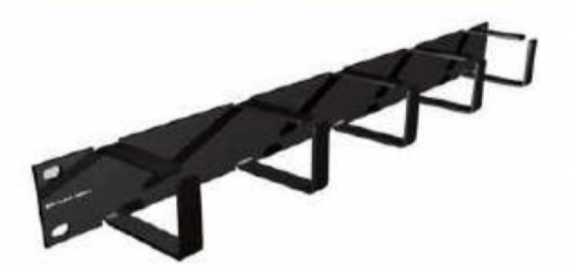{ width="400" }
  <figcaption>Pasahilos (1 U).</figcaption>
</figure>

!!! tip "Etiquetado"
    Sin una correspondencia clara entre TO, panel y puerto del switch, cualquier avería o cambio de puesto obliga a rastrear los cables uno a uno. Es criterio de calidad (**CE2i**). La familia **TIA‑606** trata precisamente la administración y el etiquetado.

---

## Electrónica de red {: #electronica-de-red }

La **electrónica de red** es el conjunto de equipos que regeneran, concentran, conmutan o encaminan el tráfico. Suele ir en el rack; el punto de acceso, en techo o pared, con alimentación por PoE o por la red eléctrica.

El **repetidor** solo regenera la señal (capa 1) y **no** divide el dominio de colisión. El **hub** reparte la señal a todos los puertos; hoy se usa en laboratorio. El **switch** reenvía por dirección MAC. El **router** une redes distintas. El **gateway** es la puerta hacia otra red o protocolo y a menudo incluye filtrado. El **AP** extiende la LAN por Wi‑Fi.

La tabla siguiente resume la capa y la función de cada equipo.

| Dispositivo | Capa OSI | Idea clave |
| --- | --- | --- |
| **Repetidor** | 1 | Regenera la señal; no divide colisión |
| **Hub** | 1 | Replica a todos los puertos (laboratorio) |
| **Switch** | 2 | Reenvía por MAC; reduce colisiones |
| **Router** | 3 | Une redes distintas (IP) |
| **Gateway** | varias | Frontera / traducción / seguridad |
| **AP** | 1–2 | Extiende la LAN por Wi‑Fi |

<figure markdown="span">
  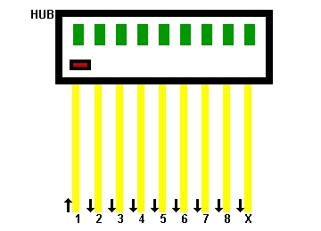{ width="480" }
  <figcaption>Hub Ethernet (uso residual / laboratorio).</figcaption>
</figure>

### Switch (lo habitual en LAN)

El **switch** es el equipo que concentra la LAN de un aula o de una planta: cada puesto llega a un puerto y el tráfico se reenvía según la dirección **MAC** de destino, no según la IP. Frente al **hub** de la [tabla de dispositivos](#electronica-de-red), que replica la trama a todos los puertos y deja un solo dominio de colisión, el switch abre un dominio de colisión por puerto y trabaja en **full‑dúplex**. Esa diferencia ya se contó en el [Tema 1, dominios de colisión y de difusión](../01-introduccion-arquitectura/tema1.md#dominios-colision-difusion): en un enlace PC–switch moderno no hay colisión porque cada sentido tiene su canal. El hub queda para el laboratorio; en el armario del taller lo que se monta es el switch (**CE3d**, **[PR302](#pr302-taller-panel-tomas-armario-y-switch)**).

Al arrancar, la tabla MAC (también llamada **CAM**, *Content Addressable Memory*) está vacía. Cuando un PC envía una trama, el switch anota «esta MAC se ve en este puerto». Si ya conoce el puerto del destino, **reenvía** solo por ahí. Si no lo conoce, **inunda**: copia la trama a todos los puertos menos al de entrada, igual que hace con las tramas de **difusión** (broadcast, por ejemplo `FF:FF:FF:FF:FF:FF`). Por eso el switch **no** corta el dominio de difusión: eso lo hace el router (o, más adelante, las VLAN).

<figure markdown="span">
  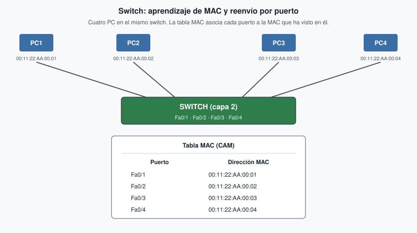{ width="780" }
  <figcaption>Aprendizaje de MAC: cada puerto queda asociado a la dirección que el switch ha visto en él. Las MAC del dibujo son de laboratorio.</figcaption>
</figure>

Los puertos habituales en cobre son **RJ‑45** a 10/100/1000 Mb/s (a veces multi‑gig). Para el backbone o para unirse a otro armario se usan módulos **SFP** o **SFP+** (fibra, o cobre en algunos transceptores). El puerto de **consola** sirve para configurar el equipo por cable serie o USB, sin pasar por la red. Un switch **no gestionable** no pide configuración: se enchufa y conmuta. Uno **gestionable** permite VLAN, QoS o SNMP; las **VLAN** se estudian en el [Tema 6](../06-enrutamiento-subnetting-vlans/tema6.md), aquí solo interesa saber que el modelo del rack puede tenerlas. Por forma hay switches de **escritorio** (pocos puertos, para un aula pequeña) y de **rack 1 U** (24 o 48 puertos, atornillados a los bastidores de 19″). **[PoE](#poe)** (*Power over Ethernet*) alimenta AP, cámaras IP y teléfonos por el mismo UTP, de modo que al techo llega un solo cable.

**Ejemplo del taller.** El switch del armario didáctico se atornilla a 1 U, se etiqueta y se une al panel con latiguillos cortos. Un puerto (o un SFP, si el equipo lo tiene) hace de **uplink** hacia el router o hacia el switch de edificio: por ahí sale el aula. Si ese uplink está caído, pinguean entre sí los PC del tramo y no sale nada hacia otras redes.

<figure markdown="span">
  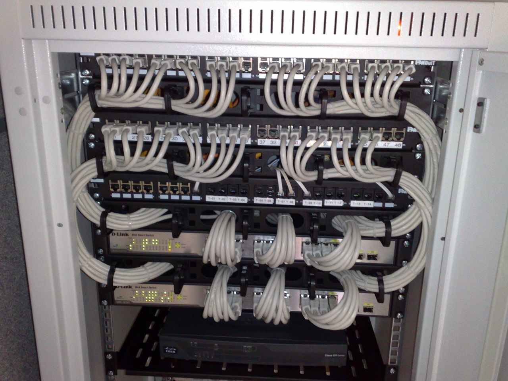{ width="640" }
  <figcaption>Switches Gigabit rackeables y paneles de parcheo en un armario de 19″. Foto: <a href="https://commons.wikimedia.org/wiki/File:19-inch_rackmount_Ethernet_switches_and_patch_panels.jpg">Dsimic</a>, <a href="https://creativecommons.org/licenses/by-sa/4.0/deed.es">CC BY-SA 4.0</a>, Wikimedia Commons.</figcaption>
</figure>

### Router y gateway

El **router** une **redes distintas**. El switch reenvía por MAC dentro de la misma LAN; el router mira la **dirección IP** de destino y consulta su **tabla de rutas** para elegir la interfaz de salida. En el PC, esa salida se llama **puerta de enlace** (*default gateway*): es la IP LAN del router. Sin ella, el equipo habla con los vecinos de su red y no con Internet.

Las interfaces que hay que reconocer en el taller son tres. La **LAN** mira hacia el switch del aula (por ejemplo `192.168.10.1/24` en un ejemplo de laboratorio). La **WAN** mira hacia el proveedor. La **consola** sirve para entrar al equipo aunque la red esté caída. En el borde del edificio el mismo aparato suele hacer **NAT** (los PC salen con una dirección pública compartida) y, a veces, **DHCP** (reparte IP, máscara y puerta de enlace). El **gateway** es esa puerta hacia otra red o protocolo; un **cortafuegos** añade filtrado (qué entra y qué sale). Pueden ser el mismo chasis o dos equipos en cascada: primero se encamina, después se filtra, o al revés según el diseño.

<figure markdown="span">
  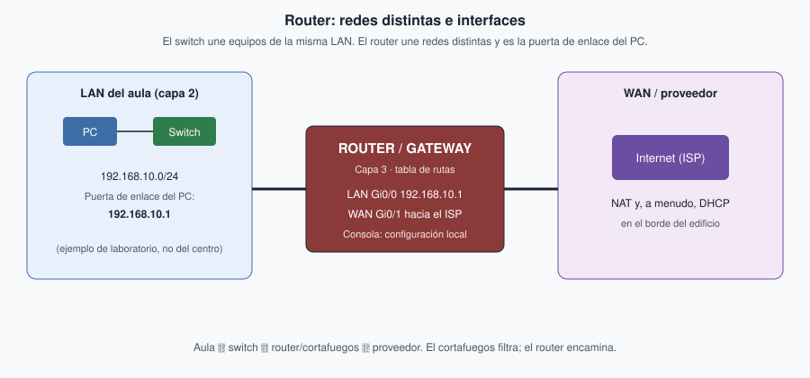{ width="820" }
  <figcaption>Aula → switch → router/gateway → proveedor. LAN, WAN y consola; NAT y DHCP en el borde. Direcciones de ejemplo, no del centro.</figcaption>
</figure>

<figure markdown="span">
  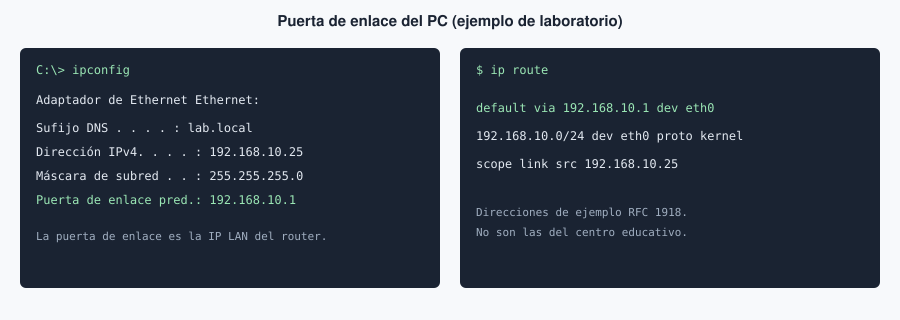{ width="820" }
  <figcaption>La puerta de enlace del PC (192.168.10.1 en el ejemplo) es la IP LAN del router. Captura genérica, sin datos del centro.</figcaption>
</figure>

**Ejemplo.** El tráfico de un aula sube al switch del rack, de ahí al router o cortafuegos del edificio y, por último, al proveedor. Si el switch está bien y el router no tiene ruta por defecto, el ping entre mesas funciona y el ping a un servidor de Internet no.

### Punto de acceso ([AP](#ap))

El **AP** (*Access Point*) enlaza clientes Wi‑Fi con la red cableada. Los hay de interior y de exterior; muchos se alimentan por PoE. Para el examen y para **[PR301](#pr301-taller-nic-y-wlan-real)** hay que distinguir modos (**CE4b**), no solo «poner Wi‑Fi».

| Modo | Qué hace |
| --- | --- |
| **AP (infraestructura)** | Los clientes se asocian a él; él puentea hacia el switch |
| **Repetidor** | Recibe un Wi‑Fi y lo vuelve a emitir (se reduce el caudal útil) |
| **Cliente / estación** | El AP se comporta como una NIC Wi‑Fi hacia otro AP |
| **Bridge** | Une dos redes cableadas por un enlace Wi‑Fi |

Los parámetros básicos (**CE4d**) son el **SSID** (nombre de la red), el **canal** y la banda (2,4 GHz o 5 GHz) y la potencia. En seguridad (**CE4i**) se usa **WPA2** o **WPA3** con una clave no trivial. WEP y las redes abiertas no se usan en el taller salvo que se pida expresamente para una prueba.

<figure markdown="span">
  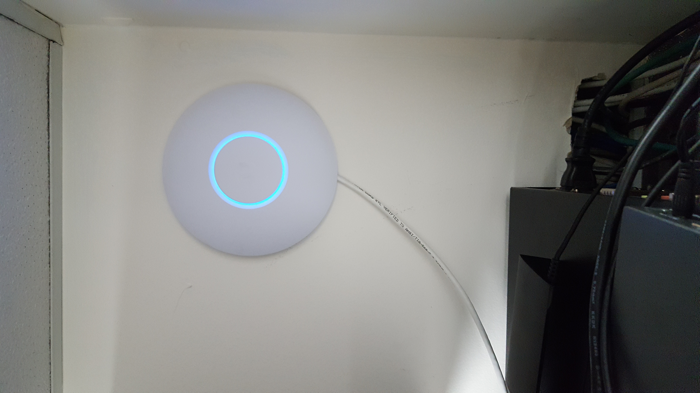{ width="480" }
  <figcaption>Punto de acceso para interiores.</figcaption>
</figure>

!!! note "Para la certificación CCNA"
    En campus grandes el AP ligero lo gestiona un **WLC** (*Wireless LAN Controller*) con CAPWAP. En el taller usamos AP **autónomos**, cada uno con su propia configuración web. El CCNA pregunta las dos ideas; en el examen del módulo cuenta el AP que se monta en **[PR301](#pr301-taller-nic-y-wlan-real)**.

!!! warning "Errores frecuentes"
    Confundir **switch** y **router**. Poner el AP en el mismo canal que el aula contigua (interferencia). Configurar WPA2 con una clave trivial y dar por resuelta la seguridad.

---

## Normas y distancias

Las normas no son un adorno del temario: fijan distancias, espacios y cómo se etiqueta para que otra persona pueda mantener la instalación. La familia útil es **TIA‑568** (cableado), **569** (espacios y canalizaciones), **606** (etiquetado) y **607** (tierra), con equivalente **ISO/IEC 11801**. TIA‑570 se cita en vivienda y TIA‑942 en centros de datos; no hace falta memorizarlas.

### Bloques funcionales

La norma divide la instalación en cuatro bloques, del puesto de trabajo hacia fuera:

1. **Área de trabajo:** puestos, TO y latiguillo corto (hasta 5 m).
2. **Horizontal:** TO ↔ panel del **[FD](#fd)** (distribuidor de planta).
3. **Backbone (vertical):** planta ↔ **[BD](#bd)** (distribuidor de edificio), a menudo en fibra.
4. **Campus:** edificios ↔ **[CD](#cd)**, normalmente en fibra.

En el horizontal puede haber un **punto de consolidación** (a no menos de 15 m del FD) cuando las mesas se reorganizan con frecuencia.

### Distancias orientativas (cobre)

El canal Ethernet de cobre son **100 m**: **90 m** de enlace permanente (TO ↔ panel) más unos **10 m** de latiguillos (hasta 5 m en cada extremo). Superar esa cifra no es «un poco más de cable»: deja de cumplirse la certificación y el enlace suele degradarse.

| Tramo | Límite habitual |
| --- | --- |
| Horizontal (TO ↔ panel) | **90 m** de cable permanente |
| Latiguillos (ambos extremos) | hasta ~5 m + ~5 m → **100 m** de canal |
| Equipo ↔ TO | latiguillo corto (p. ej. ≤ 5 m) |

<figure markdown="span">
  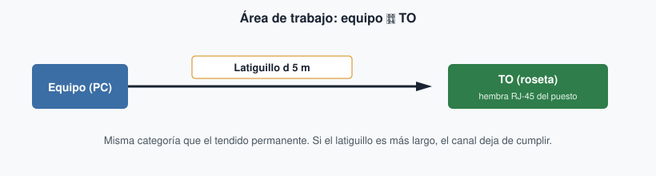{ width="760" }
  <figcaption>Área de trabajo: el latiguillo entre el equipo y la TO no supera 5 m y es de la misma categoría que el tendido permanente.</figcaption>
</figure>

<figure markdown="span">
  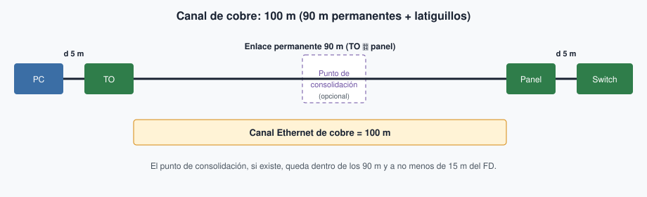{ width="820" }
  <figcaption>Canal Ethernet de cobre = 100 m: hasta 5 m + 90 m de enlace permanente (TO ↔ panel) + hasta 5 m. El punto de consolidación es opcional.</figcaption>
</figure>

<figure markdown="span">
  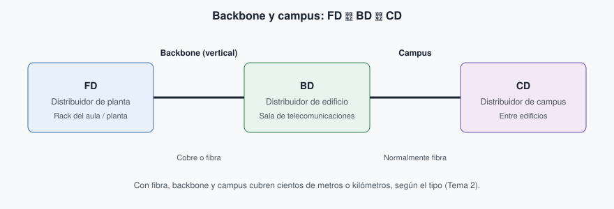{ width="800" }
  <figcaption>Backbone y campus: FD (planta) → BD (edificio) → CD (campus). El cobre cubre tramos cortos; la fibra, distancias mayores.</figcaption>
</figure>

Con **fibra**, backbone y campus cubren cientos de metros o kilómetros según el tipo, como se vio en el Tema 2. Qué tramo lleva cada clase y cómo se calcula la pérdida del enlace está en [Fibra en el cableado estructurado](#fibra-en-el-cableado-estructurado).

### Tierra (visión breve)

**TIA‑607** pide una tierra de telecomunicaciones: barra principal en el BD, barras en cada sala y conductores a cada rack (verde o verde‑amarillo). Esa tierra no es un adorno del armario: protege a las **personas** si un equipo tiene un fallo de aislamiento, da un camino a las **descargas** (estática o sobretensión) y reduce el **ruido** eléctrico que acopla a los pares de datos. En el taller no se deja el armario sin conexión a tierra si el puesto la tiene, ni se improvisan puentes con el cable de datos: el UTP no es conductor de protección.

<figure markdown="span">
  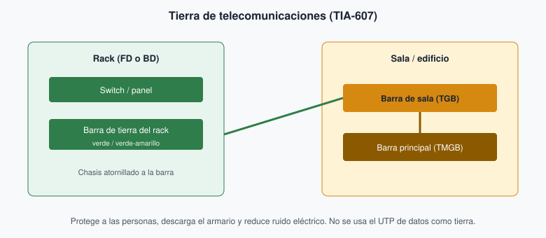{ width="720" }
  <figcaption>Tierra de telecomunicaciones: el chasis del rack se une a la barra de sala y, desde ahí, a la barra principal del edificio (TIA‑607).</figcaption>
</figure>

!!! warning "Errores frecuentes"
    Tender 110 m de UTP «porque Cat. 6 aguanta». La norma del canal son 100 m; a partir de ahí fallan la certificación y, a menudo, el enlace. Otro error: 90 m de horizontal **más** un latiguillo de 15 m.

---

## Fibra en el cableado estructurado {: #fibra-en-el-cableado-estructurado }

En el cableado estructurado el puesto sigue en cobre, y la fibra se reserva para los tramos en los que el cobre se queda corto por la distancia. Cada subsistema lleva el medio que corresponde a su longitud:

- **Área de trabajo y horizontal:** par trenzado, desde el equipo hasta el panel del distribuidor de planta (**[FD](#fd)**, *Floor Distributor*), con **90 m** de enlace permanente de la toma de usuario o **[TO](#to)** al panel y un latiguillo de **5 m** como máximo, como se vio en [Normas y distancias](#normas-y-distancias).
- **Vertical:** entre el FD y el distribuidor de edificio (**[BD](#bd)**, *Building Distributor*), en fibra **multimodo** de clase **[OM3](#om3-om4)** u **OM4** (*optical multimode*; el número indica la clase).
- **Campus:** entre el BD y el distribuidor de campus (**[CD](#cd)**, *Campus Distributor*), en fibra **monomodo** de clase **[OS2](#os2)** (*optical singlemode*).

A 10 Gbit/s, el OM3 alcanza unos 300 m, el OM4 unos 400 m y el OS2 del orden de kilómetros. El núcleo, el emisor y el porqué de esas cifras están en el [Tema 2, multimodo y monomodo](../02-medios-capa-fisica/tema2.md#multimodo-mm-y-monomodo-sm); aquí interesa elegir la clase de cada tramo y saber cómo termina en el rack.

<figure markdown="span">
  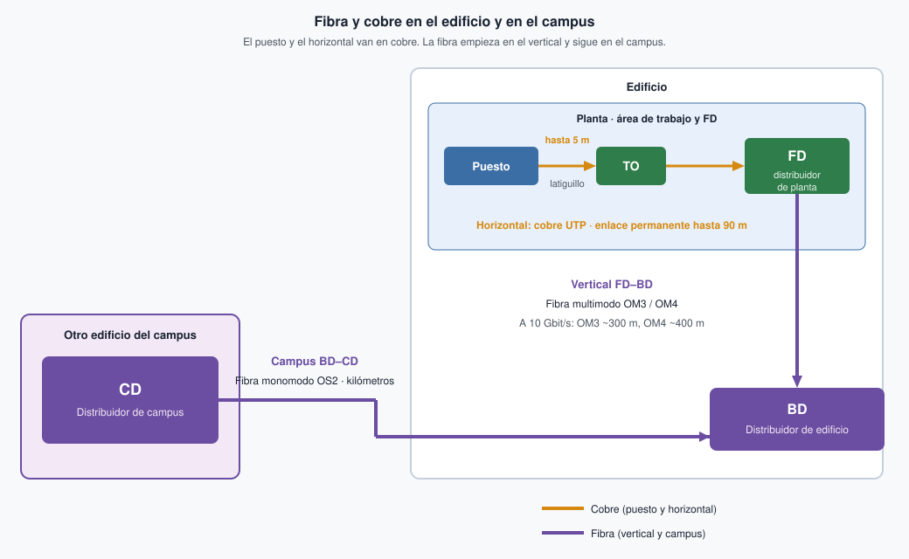{ width="900" }
  <figcaption>El latiguillo (hasta 5 m) y el horizontal (hasta 90 m de enlace permanente) van en cobre. El vertical FD–BD va en multimodo OM3 u OM4. El campus BD–CD va en monomodo OS2 y se mide en kilómetros. Las distancias de la fibra son orientativas, a 10 Gbit/s.</figcaption>
</figure>

**Ejemplo.** En un instituto, el aula llega al FD de la planta por cable de pares. De ese armario al BD del edificio baja un troncal multimodo OM3 u OM4, que cubre de sobra la altura del inmueble. Si el otro edificio queda más lejos de lo que alcanza el multimodo, el troncal del BD al CD es monomodo OS2.

!!! warning "Errores frecuentes"
    - Tender fibra en el horizontal del puesto: el horizontal sigue en cobre y conserva el límite de 90 m.
    - Dejar el vertical de un edificio en cobre porque la categoría «aguanta», o alargarlo con latiguillos de cobre.

### Terminación en el rack

El cable troncal no se enchufa directamente al switch, sino que pasa por varios elementos dentro del armario, siempre en el mismo orden:

1. **Bandeja de empalmes:** el troncal entra en el armario, se fija y cada fibra se funde con un **[pigtail](#pigtail)** (rabillo), un tramo corto de fibra con conector de fábrica en un extremo y fibra desnuda en el otro.
2. **[ODF](#odf)** (*Optical Distribution Frame*, distribuidor óptico): el conector del pigtail se enchufa en un adaptador de este panel o casete, que a menudo va en la misma bandeja y deja los conectores a la vista.
3. **Latiguillo de fibra:** conectorizado en los dos extremos y de la misma clase que el troncal, une el ODF con el puerto óptico del switch.
4. **Módulo [SFP](#sfp) o SFP+** (*Small Form-factor Pluggable*): el transceptor enchufable que se inserta en una ranura del switch y convierte la luz en señal eléctrica y al revés.

Los conectores habituales son el **[LC](#lc)** (*Lucent Connector*) y el **[SC](#sc)** (*Subscriber Connector*), y los dos se enchufan a presión, sin girarlos como el antiguo ST. En el backbone se usa el LC dúplex, porque es pequeño, permite más puertos en el ODF y es el conector de los módulos SFP. El SC, de cuerpo cuadrado, aparece en instalaciones anteriores, y el SC/APC es el propio de la red FTTH. No se mezcla multimodo con monomodo, ni un conector LC con un adaptador SC.

El módulo SFP tiene que coincidir con la clase de fibra y con la distancia del enlace. Un SFP de corto alcance para multimodo no sirve en un troncal monomodo de varios kilómetros, que necesita un módulo de largo alcance, por ejemplo **LR** (*Long Reach*). Si el módulo y el cable no encajan, el puerto no enlaza aunque el ODF esté bien etiquetado.

<figure markdown="span">
  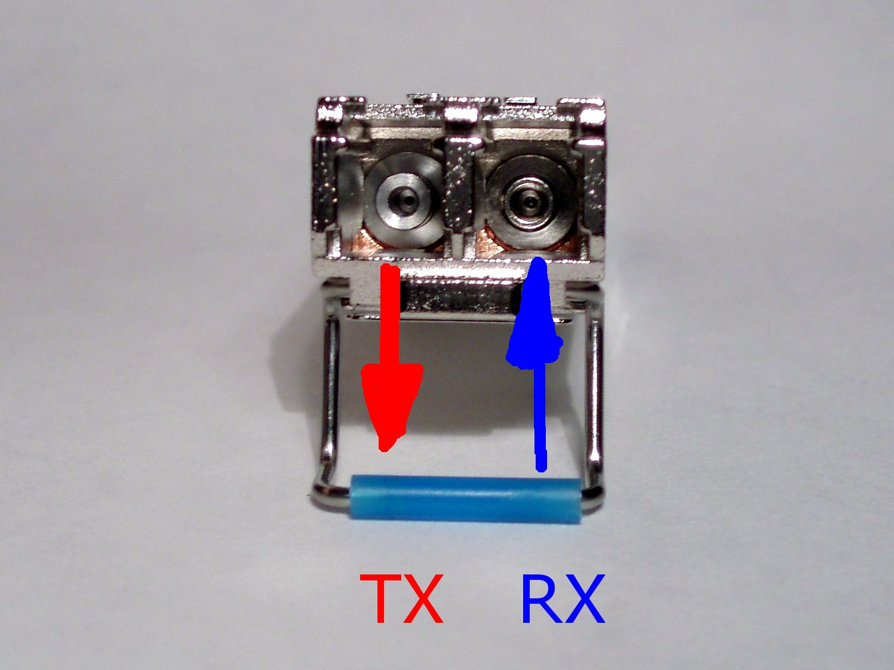{ width="520" }
  <figcaption>Módulo SFP: la fibra entra por el transceptor enchufable del switch. Las flechas marcan RX (recepción) y TX (transmisión). Foto: <a href="https://commons.wikimedia.org/wiki/File:SFP-front.jpg">Adamantios</a> / trabajo derivado <a href="https://commons.wikimedia.org/wiki/File:SFP-front-RX-TX.jpg">MichaelFrey</a>, <a href="https://creativecommons.org/licenses/by-sa/2.5/deed.es">CC BY-SA 2.5</a>, Wikimedia Commons.</figcaption>
</figure>

<figure markdown="span">
  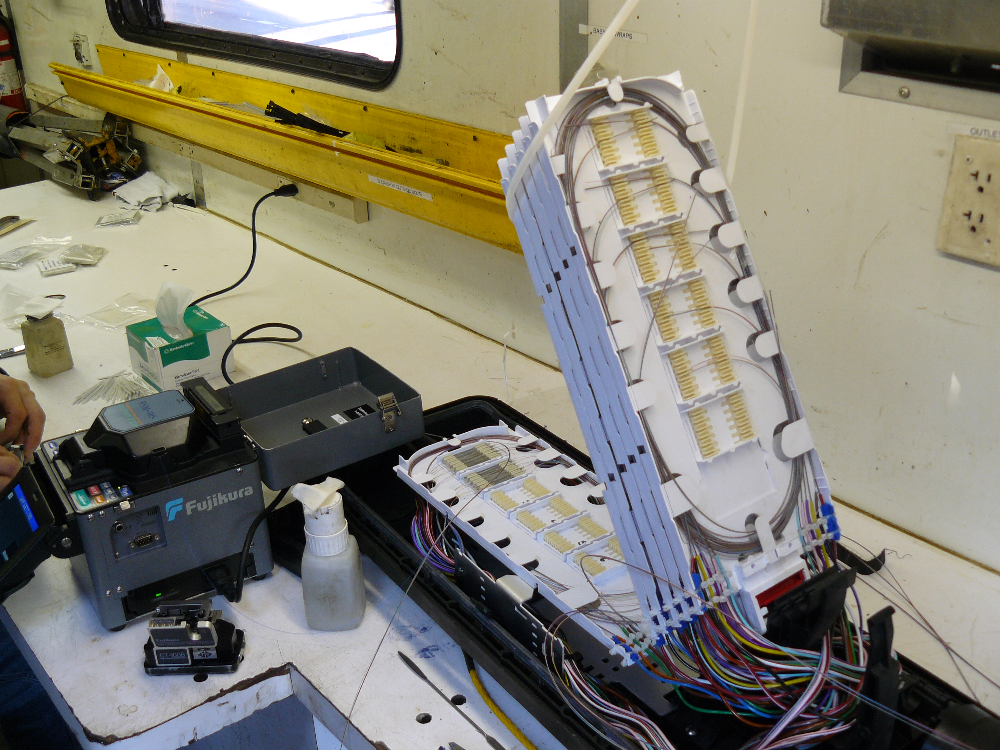{ width="640" }
  <figcaption>Bandeja de empalmes en una caja de fibra abierta: aquí se asientan los protectores tras la fusión. Foto: <a href="https://commons.wikimedia.org/wiki/File:Fiber_Splice.jpg">Dhaluza</a>, <a href="https://creativecommons.org/licenses/by/3.0/deed.es">CC BY 3.0</a>, Wikimedia Commons.</figcaption>
</figure>

<figure markdown="span">
  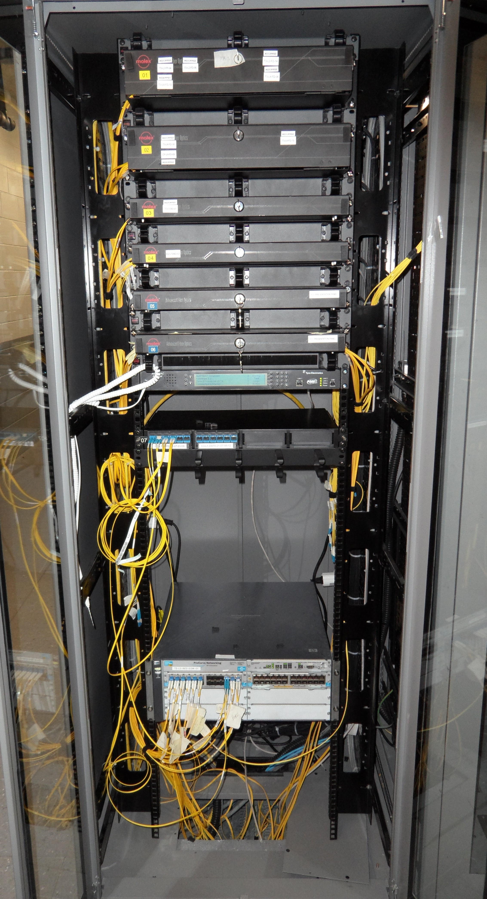{ width="360" }
  <figcaption>ODF en rack: el frontal concentra los adaptadores donde se enchufan los latiguillos hacia el switch. Foto: <a href="https://commons.wikimedia.org/wiki/File:Fiber-Panel-Rack.jpg">Lijorijo</a>, <a href="https://creativecommons.org/licenses/by-sa/3.0/deed.es">CC BY-SA 3.0</a>, Wikimedia Commons.</figcaption>
</figure>

<figure markdown="span">
  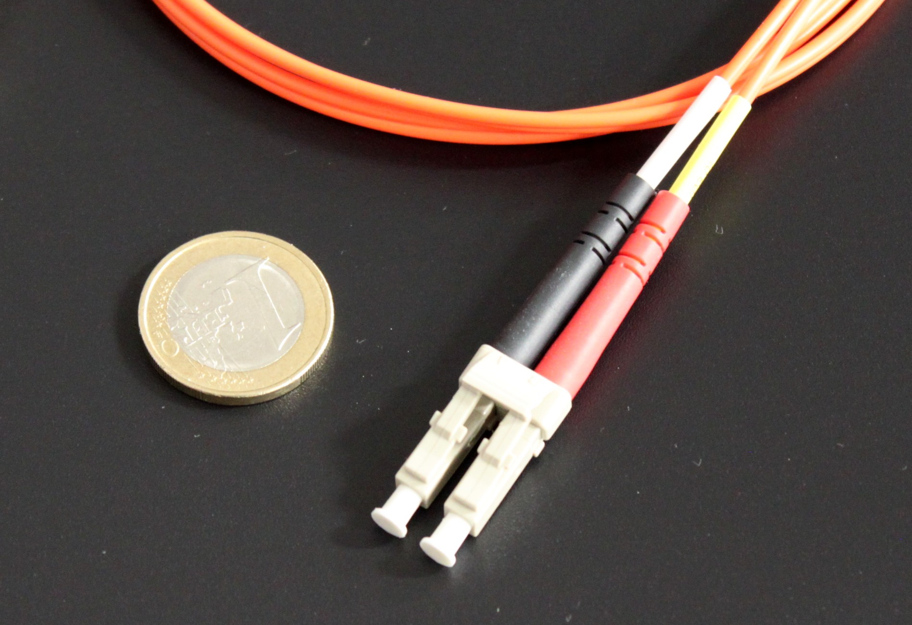{ width="480" }
  <figcaption>Latiguillo con conector LC dúplex: dos fibras en un solo cuerpo, una para cada sentido. Foto: <a href="https://commons.wikimedia.org/wiki/File:LC_Duplex_-_1.JPG">Christophe.Finot</a>, <a href="https://creativecommons.org/licenses/by-sa/3.0/deed.es">CC BY-SA 3.0</a>, Wikimedia Commons.</figcaption>
</figure>

La fusión del pigtail es la operación que se explica en [Empalme por fusión](#empalme-por-fusion-vision-de-taller). Una fusión deficiente no se aprecia al mirar el frontal del rack, sino en el balance de pérdidas.

### Identificar la fibra

Antes de fusionar o de enchufar un latiguillo hay que reconocer qué fibra se tiene entre las manos. Hay tres cosas que mirar:

- **Color de la cubierta:** el monomodo **OS2** suele ser amarillo; el multimodo **OM3**, aguamarina, y el **OM4**, violeta o, en muchos lotes, también aguamarina. El color no sustituye a la etiqueta del fabricante, pero evita mezclar un troncal monomodo con un latiguillo multimodo.
- **Pulido del conector:** el **[UPC](#upc-apc)** (*Ultra Physical Contact*) lleva casquillo azul y la cara del núcleo perpendicular al eje; el **APC** (*Angled Physical Contact*) lleva casquillo verde y la cara biselada, por lo que refleja menos luz hacia el emisor. Un UPC no se mezcla con un APC, porque el contacto queda mal y la pérdida sube.
- **Polaridad del dúplex:** el latiguillo dúplex lleva dos fibras, una por sentido, y la transmisión (**TX**) de un extremo tiene que entrar en la recepción (**RX**) del otro.

<figure markdown="span">
  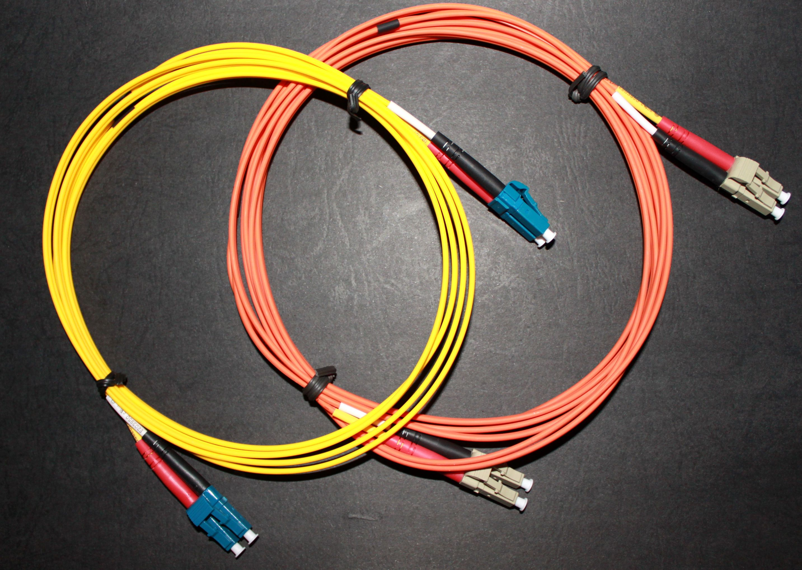{ width="640" }
  <figcaption>Cubiertas habituales: amarillo en monomodo y aguamarina en multimodo, con conectores LC. Foto: <a href="https://commons.wikimedia.org/wiki/File:Cordons_monomode-multimode_LC.JPG">Christophe.Finot</a>, <a href="https://creativecommons.org/licenses/by-sa/3.0/deed.es">CC BY-SA 3.0</a>, Wikimedia Commons.</figcaption>
</figure>

Si se cruza mal el dúplex, el indicador de enlace no aparece aunque la fusión y el ODF estén correctos. Es el fallo típico de «no hay enlace» justo después de parchear, y se arregla invirtiendo las dos fibras en un extremo.

### Balance de pérdidas de un enlace de backbone

El **[balance de pérdidas](#balance-de-perdidas)** suma, en **decibelios (dB)**, todo lo que atenúa la luz en un sentido del enlace y compara el resultado con el máximo que admite el equipo. Si la suma se pasa, el enlace puede no funcionar aunque el indicador se encienda, o funcionar un tiempo y caer cuando se añade otro empalme.

En el ejemplo, un backbone de campus de **8 km** de monomodo a **1310 nm** une dos racks sin repartir la luz. Las cifras son orientativas de proyecto:

- **Fibra:** 0,35 dB/km.
- **Fusión bien hecha:** 0,1 dB cada una. En cada rack hay dos, la del pigtail en la bandeja y otra en la caja de empalme del tendido, así que son cuatro en total.
- **Conector:** 0,5 dB por cada pareja enchufada. En cada rack hay dos, el del latiguillo en el equipo y el del latiguillo en el ODF, así que son cuatro en total.

| Concepto | Cálculo | Pérdida |
| --- | --- | --- |
| Fibra, 8 km a 1310 nm | 8 × 0,35 dB/km | 2,8 dB |
| 4 fusiones bien hechas | 4 × 0,1 dB | 0,4 dB |
| 4 conectores | 4 × 0,5 dB | 2,0 dB |
| **Total** | | **5,2 dB** |

El máximo se calcula para un enlace Ethernet de 10 Gbit/s sobre monomodo con alcance de unos 10 km (**10GBASE-LR**), con 0,4 dB/km de fibra y 2 dB para conectores y empalmes: 10 × 0,4 + 2 = **6,0 dB**. En el taller prevalece la hoja del transceptor si indica otra cifra. Como 5,2 dB caben en 6,0 dB, el enlace cumple con un margen de **0,8 dB**.

Ese margen es el que se juega en el [empalme por fusión](#empalme-por-fusion-vision-de-taller). Si las cuatro fusiones quedaran en 1 dB en lugar de 0,1 dB, aportarían 4,0 dB y el total subiría a **8,8 dB**, muy por encima del máximo. Una fusión de 1 dB no es una desviación menor: en este caso deja el troncal fuera de servicio aunque el cobre de la planta esté perfecto.

<figure markdown="span">
  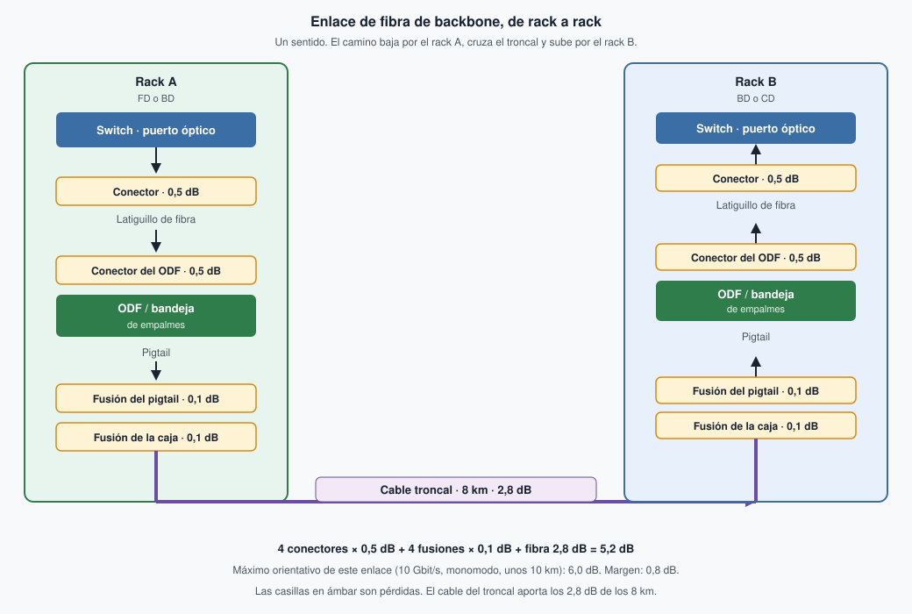{ width="900" }
  <figcaption>Un sentido del enlace, del rack A al rack B. Cada conector resta 0,5 dB y cada fusión 0,1 dB; el troncal de 8 km aporta 2,8 dB. La suma es 5,2 dB, y el máximo orientativo de este ejemplo es 6,0 dB. El sentido contrario repite las mismas pérdidas.</figcaption>
</figure>

!!! warning "Errores frecuentes"
    - Contar solo los kilómetros y olvidar conectores y fusiones: aquí los conectores (2,0 dB) pesan casi tanto como los 8 km de cable (2,8 dB).
    - Dar por cerrada una fusión de 1 dB porque la fusionadora ha terminado el ciclo: si la estimación se dispara, el empalme se repite.
    - Mezclar en el mismo troncal un latiguillo multimodo con un cable monomodo.

### FTTH/GPON en lo esencial

La **fibra hasta el hogar** (**[FTTH](#ftth)**, *Fiber To The Home*) lleva la fibra óptica hasta el domicilio del abonado. La arquitectura más extendida es **[GPON](#gpon)** (*Gigabit-capable Passive Optical Network*), que es pasiva porque entre la central y la casa no hay equipos alimentados, solo fibra y divisores. Sus elementos son estos:

- **[OLT](#olt)** (*Optical Line Terminal*): está en la central, genera la bajada y asigna el turno de subida de cada abonado.
- **[Divisores ópticos](#divisor-optico):** parten la luz sin alimentación eléctrica, en relaciones de **1:8**, **1:16**, **1:32** o **1:64**.
- **Roseta óptica:** es la toma de fibra en casa del abonado.
- **[ONT](#ont)** (*Optical Network Terminal*): en casa del abonado, entrega internet y telefonía.
- **Receptor óptico de televisión:** recibe la televisión, que puede llegar aparte por una longitud de onda propia de **1550 nm**.

En el taller de RAL, con Cableworld, se trabaja con una instalación de este tipo, montada en el rack de fibra junto al del taller general.

<figure markdown="span">
  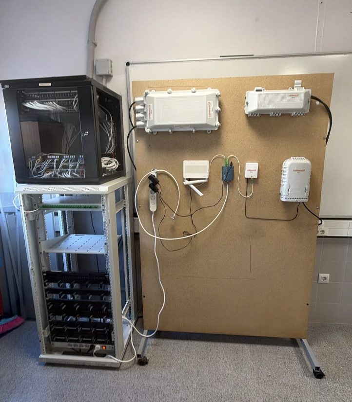{ width="720" }
  <figcaption>El rack de abajo es el de la fibra; el de arriba, el del taller general. En el panel se ven las cajas de empalme, la caja de distribución, la roseta óptica y el router. Crédito: Taller de RAL, IES Macià Abela, con Cableworld.</figcaption>
</figure>

Los dos sentidos van por una sola fibra: la bajada a **1490 nm** y la subida a **1310 nm**. La clase **B+** admite entre **13 dB** y **28 dB** de pérdida en el enlace, porque por debajo satura el receptor y por encima la señal no basta. Esa pérdida la mide el instalador con un medidor de potencia; no se comprueba con la fusionadora ni con el VFL.

El conector habitual en FTTH/GPON es el **[SC](#sc)/APC**, con casquillo verde, tanto en el repartidor óptico como en la roseta y en los equipos del abonado. El pulido en ángulo reduce la luz que vuelve reflejada hacia el emisor, algo importante en una red pasiva compartida por muchos abonados. El **[LC](#lc)** dúplex queda para el ODF y el módulo SFP del backbone del edificio.

<figure markdown="span">
  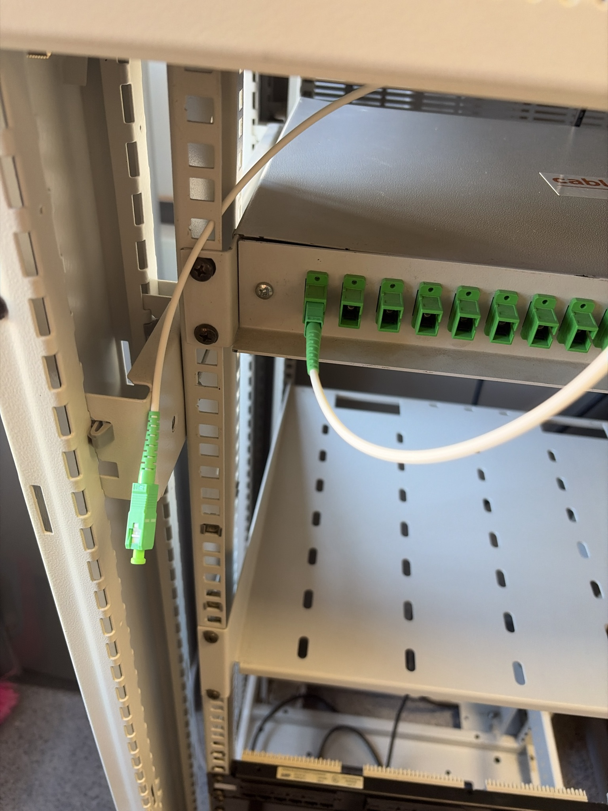{ width="640" }
  <figcaption>Repartidor óptico del rack de fibra, con adaptadores SC/APC verdes. Crédito: Taller de RAL, IES Macià Abela, con Cableworld.</figcaption>
</figure>

<figure markdown="span">
  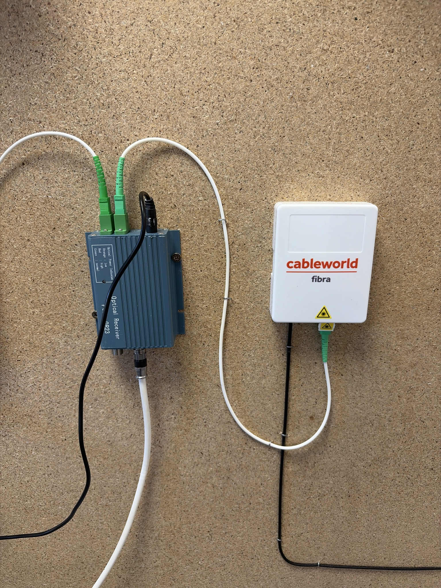{ width="640" }
  <figcaption>Roseta óptica y receptor óptico de televisión («Optical Receiver»), unidos con latiguillos SC/APC. Crédito: Taller de RAL, IES Macià Abela, con Cableworld.</figcaption>
</figure>

---

## Empalme por fusión (visión de taller)

En fibra, el **empalme por fusión** une dos núcleos fundiéndolos con un arco eléctrico controlado (**fusionadora**). No es un crimpado de RJ‑45: un corte sucio o una fibra sucia deja el enlace inservible. La secuencia del taller es la que sigue; cada paso se hace completo antes de pasar al siguiente.

<figure markdown="span">
  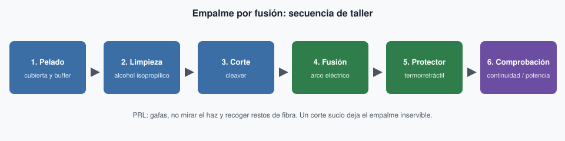{ width="860" }
  <figcaption>Secuencia de fusión en taller: pelado → limpieza → corte (cleaver) → fusión → protector → comprobación.</figcaption>
</figure>

<figure markdown="span">
  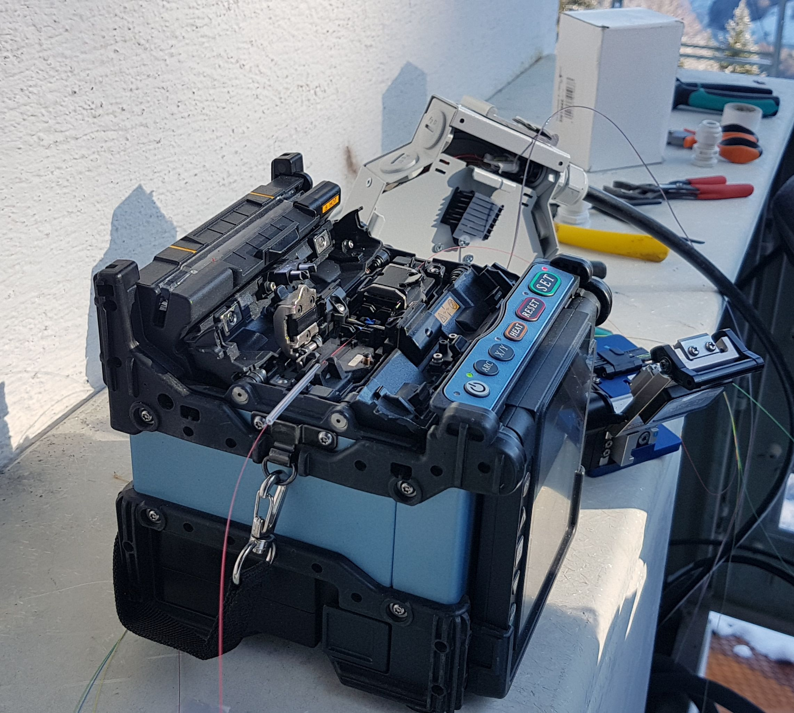{ width="520" }
  <figcaption>Fusionadora (Fujikura 70S) en un empalme de campo. Foto: <a href="https://commons.wikimedia.org/wiki/File:Fujikura-Fusion_Splicer_70S-01aASD.jpg">Asurnipal</a>, <a href="https://creativecommons.org/licenses/by-sa/4.0/deed.es">CC BY-SA 4.0</a>, Wikimedia Commons.</figcaption>
</figure>

<figure markdown="span">
  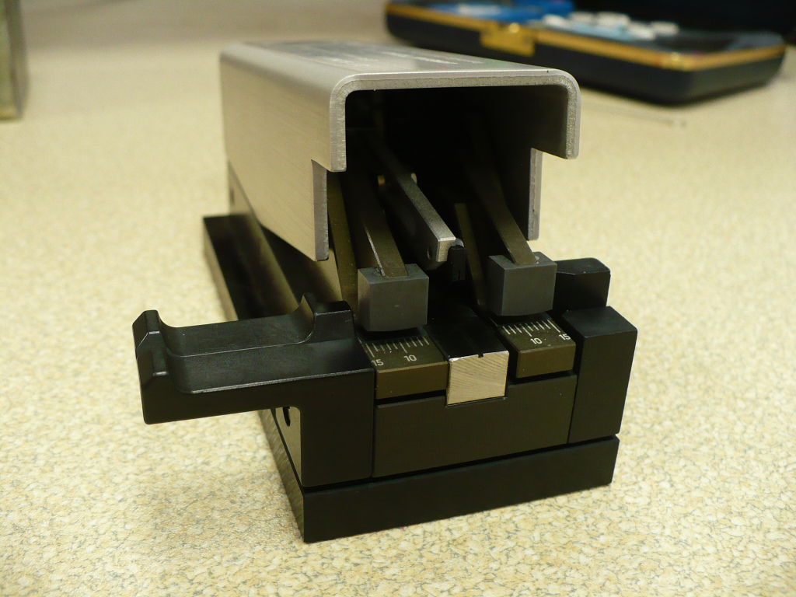{ width="480" }
  <figcaption>Cleaver: corte preciso de la fibra antes de fusionar. Foto: <a href="https://commons.wikimedia.org/wiki/File:Obcinarka_do_swiatlowodow_pg_eti_2007.jpg">Vmario</a>, dominio público, Wikimedia Commons.</figcaption>
</figure>

1. Se introduce el **protector** termorretráctil en una de las fibras **antes** de pelar. Si se fusiona primero, ya no se puede pasar el tubo por el empalme.
2. Se quita el recubrimiento de la fibra con la **peladora**, en la longitud que indique el fabricante de la fusionadora, sin rayar el revestimiento primario.
3. Se limpia el tramo pelado con **alcohol isopropílico** y toallitas sin pelusa, hasta que no quede polvo ni grasa.
4. Se corta con el **cleaver**: la cara del núcleo tiene que quedar limpia y perpendicular. Un corte irregular arruina la fusión aunque la limpieza haya sido correcta.
5. Se coloca cada fibra en la fusionadora. El equipo alinea los núcleos, dispara el arco y muestra una **pérdida estimada** en decibelios. Si esa estimación supera unos **0,1 dB**, se corta el empalme y se vuelve a fusionar: esas décimas son las que entran en el [balance de pérdidas](#balance-de-perdidas).
6. Se hace la **prueba de tracción** que permita la máquina, para comprobar que el empalme no se abre al tensar con suavidad.
7. Se desliza el protector hasta cubrir la zona fusionada y se contrae en el **horno** de la fusionadora.
8. Se coloca el empalme en la **bandeja** respetando el radio de curvatura: un lazo demasiado cerrado atenúa o rompe la fibra.

### PRL en el puesto de fusión

- Se usan **gafas** de seguridad mientras se pela, se corta y se manipulan restos de fibra.
- El alcohol isopropílico es **inflamable**: no se usa cerca del arco de la fusionadora ni de focos de calor.
- En el puesto **no se come ni se bebe**: un resto de fibra en la mano o en la mesa puede acabar en la boca.
- Los restos de fibra se recogen en un **recipiente específico** y se fijan con cinta adhesiva; no se tiran a la papelera sueltos, porque pinchan y apenas se ven.
- **No se mira nunca** un conector conectado ni el haz del láser localizador: la luz de la fibra puede dañar la vista aunque no se perciba como un destello fuerte.

### Comprobación en el taller

En el taller de RAL la comprobación habitual son dos. La **pérdida estimada** que muestra la fusionadora tras cada arco indica si el empalme es aceptable o hay que repetirlo. El **láser localizador visual** (**[VFL](#vfl)**, *Visual Fault Locator*) inyecta luz visible en un extremo para ver si llega al otro y para localizar cortes o curvaturas fuertes. Existen además el medidor de potencia y el **OTDR** (*Optical Time Domain Reflectometer*, reflectómetro óptico en el dominio del tiempo), que en este taller no se usan de forma rutinaria.

La práctica evaluable es **[PR303](#pr303-taller-fusion-de-fibra)**. El crimpado de cobre (conectores RJ‑45) ya se hizo en **PR201** (CE3c); aquí el mismo criterio se aplica a la fibra.

---

## Actividades

!!! tip "Formato de entrega"
    Las entregas en **Aules** son **obligatorias en Markdown** (`.md`). No se aceptan PDF.  
    Nombre del archivo: `AC3XX.md` o `PR3XX.md` (sustituye XX por el número). Respeta la fecha de vencimiento.  
    Escribiremos los `.md` con **Visual Studio Code**.

    !!! note "Cómo empezar"
        - Guía de Markdown: [tutorialmarkdown.com/guia](https://tutorialmarkdown.com/guia)
        - Documentación de Visual Studio Code: [code.visualstudio.com/docs](https://code.visualstudio.com/docs)

### AC301 — NIC comparativa

* :simple-readdotcv: **AC301**. (RA3 // CE3b // RA4 // CE4a // **AC 0–1**). Tabla comparativa de NIC (cableada / USB / Wi‑Fi): velocidades, dúplex, interfaz y uso típico. Incluye qué es la MAC.

### AC302 — Armario / rack

* :simple-readdotcv: **AC302**. (RA2 // CE2f // **AC 0–1**). Documenta estructura del rack 19″, unidades U, elementos internos (panel, electrónica, PDU, guías) y tipos según tamaño.

### AC303 — Electrónica y capas OSI

* :simple-readdotcv: **AC303**. (RA3 // CE3d // RA4 // CE4a, CE4b // **AC 0–1**). Tabla: hub, switch, router, gateway y AP — capa OSI, función, escenario de uso y una limitación de cada uno.

### AC304 — Tomas, latiguillos y guiado

* :simple-readdotcv: **AC304**. (RA2 // CE2d, CE2e, CE2g, CE2i // **AC 0–1**). Tipos de TO, uso de latiguillos, canalizaciones/bandejas/guías/pasahilos y buenas prácticas de etiquetado.

### AC305 — Propuesta electrónica (centro educativo)

* :simple-readdotcv: **AC305**. (RA3 // CE3a, CE3d // RA4 // CE4c // **AC 0–1**). Propón la electrónica para un centro con **dos edificios**: switches de armario, router de salida, gateway/firewall y AP interiores/exteriores. Diagrama en [Excalidraw](https://excalidraw.com/), [draw.io](https://app.diagrams.net/) o [Dia](https://wiki.gnome.org/Apps/Dia) + breve justificación en el `.md`.

### PR301 — Taller: NIC y WLAN real { #pr301-taller-nic-y-wlan-real }

| Campo | Valor |
| --- | --- |
| **Código** | **PR301** |
| **UP / tema** | T3 — Cableado estructurado |
| **RA principal** | **RA4**. Apoyo **RA3** (CE3b) |
| **CE de cobertura** | CE4a, CE4b, CE4c, CE4d, CE4e, CE4f, CE4i · CE3b |
| **Sesiones estimadas** | **3** |
| **Instrumento** | Checklist de montaje + rúbrica 0–10 |

* :simple-neutralinojs: **PR301**. En el aula-taller, por grupos: montáis una **NIC** (PCIe o USB Wi‑Fi) con su driver, instaláis un **AP** o router Wi‑Fi del centro y dejáis una WLAN usable.

  **Enunciado (pasos):**

  Seguid la [guía paso a paso de la PR301](../taller/pr301-guia-wlan.md), que incluye los enlaces de descarga de drivers y herramientas.

  1. Con el equipo apagado y desenchufado, descargad la electricidad estática tocando una parte metálica sin pintar del chasis.
  2. Extraer la NIC que ya trae el equipo (o conectar el adaptador USB), identificarla, volver a montarla y comprobar el **driver** hasta que el sistema vea la interfaz (CE3b, CE4f).
  3. Cablear el AP al switch del puesto; alimentar por **PoE** o por el adaptador de corriente.
  4. Entrar a la configuración (web o app que indique el profesor).
  5. Configurar **modo** (AP; repetidor o cliente si se pide), **SSID**, **canal**/banda y **WPA2 o WPA3** con la clave del puesto. Si el equipo lo tiene, red de invitados (CE4a–d, CE4i).
  6. Asociar portátil o móvil y comprobar **ping** o navegación (CE4e).
  7. Anotar canal e interferencias (analizador o lista de redes vecinas).
  8. Foto del montaje y captura de estado (SSID, canal, seguridad, IP).

  **Evidencia:** fotos, capturas de config y de conectividad, `PR301.md`.

  **Entrega:** `PR301.md` + evidencias en Aules.

  **No sustituye** a PR302 ni a PR303. No se hace en Packet Tracer.

| Criterio (rúbrica) | Descripción | Puntos |
| --- | --- | --- |
| Montaje NIC + driver | Tarjeta extraída, identificada, montada de nuevo y reconocida | 0–2 |
| AP instalado y alimentado | Cableado / PoE correctos | 0–2 |
| Parámetros y seguridad | Modo, SSID, canal, WPA2/WPA3 | 0–3 |
| Conectividad | Cliente asociado y ping o web | 0–2 |
| Informe `.md` | Capturas, canal e incidencias | 0–1 |
| **Total** | | **/10** |

### PR302 — Taller: panel, tomas, armario y switch { #pr302-taller-panel-tomas-armario-y-switch }

| Campo | Valor |
| --- | --- |
| **Código** | **PR302** |
| **UP / tema** | T3 — Cableado estructurado |
| **RA principal** | **RA2** (despliegue) + **RA3** (interconexión). Apoyo **RA4** |
| **CE de cobertura** | CE2d, CE2f, CE2g, CE2i, CE2j · CE3a, CE3d, CE3e, CE3f |
| **Sesiones estimadas** | **2** |
| **Instrumento** | Checklist de montaje + rúbrica 0–10 |

* :simple-neutralinojs: **PR302**. En el **aula-taller** (no solo simulación): montad y conexionad un tramo didáctico de cableado estructurado.

  **Enunciado (qué hace el alumno):**

  1. Preparar el **armario / rack** didáctico (orden, U libres, guiado, seguridad).
  2. Montar o completar **panel de parcheo** y, si el puesto lo permite, **toma de usuario (TO)** o equivalente didáctico.
  3. Instalar el **switch** en el armario (fijación, alimentación, etiquetado del equipo).
  4. Conexionar **panel ↔ switch** con latiguillos; etiquetar puertos según el plan del profesor.
  5. Verificar **conectividad** básica (enlace / ping entre dos puestos del tramo).
  6. Documentar el montaje (fotos + esquema de puertos).

  **Evidencia:** fotos del rack (antes/después), etiquetado visible, checklist de montaje, prueba de conectividad, `PR302.md`.

  **Entrega:** `PR302.md` + evidencias en Aules.

| Criterio (rúbrica) | Descripción | Puntos |
| --- | --- | --- |
| Rack / panel / TO | Montaje ordenado y conforme al plan | 0–3 |
| Switch + conexionado | Equipo fijado y enlazado a paneles | 0–3 |
| Verificación | Conectividad demostrada | 0–2 |
| Informe `.md` | Fotos, etiquetado, incidencias | 0–2 |
| **Total** | | **/10** |

### PR303 — Taller: fusión de fibra { #pr303-taller-fusion-de-fibra }

| Campo | Valor |
| --- | --- |
| **Código** | **PR303** |
| **UP / tema** | T3 — Cableado estructurado |
| **RA principal** | **RA3** (empalmes en fibra). Apoyo **RA2** y **RA6** |
| **CE de cobertura** | CE3c, CE3f, CE3g · CE2c, CE2j · CE6b, CE6e |
| **Sesiones estimadas** | **2** |
| **Instrumento** | Checklist de fusión + rúbrica 0–10 |

* :simple-neutralinojs: **PR303**. En taller, bajo supervisión: realizad un **empalme por fusión** (o la secuencia completa de preparación + fusión + protector que permita el material del centro). Anotad la pérdida estimada de cada fusión, elaborad un mini balance con esos valores y rellenad la checklist de PRL. La comprobación se hace con la fusionadora y el **VFL**.

  **Enunciado (pasos):**

  1. Completar la checklist de PRL del apartado [Empalme por fusión](#empalme-por-fusion-vision-de-taller) antes de empezar.
  2. Introducir el protector, pelar, limpiar con alcohol isopropílico y cortar con el cleaver.
  3. Ejecutar la fusión; anotar la **pérdida estimada** que muestra la fusionadora. Si supera unos 0,1 dB, repetir el empalme.
  4. Hacer la prueba de tracción, contraer el protector en el horno y asentar el empalme en la bandeja respetando el radio de curvatura.
  5. Comprobar con el **VFL** que la luz llega al otro extremo.
  6. Redactar un **mini balance** con las pérdidas estimadas de las fusiones hechas y relacionarlo con el margen del enlace.
  7. Documentar errores típicos (corte malo, suciedad, protector mal colocado, polaridad del latiguillo) y cómo se corrigieron.

  **Evidencia:** foto del puesto/fusionadora, lectura de la pérdida estimada, evidencia del VFL, checklist PRL cumplimentada, mini balance y `PR303.md`.

  **Entrega:** `PR303.md` + evidencias en Aules.

| Criterio (rúbrica) | Descripción | Puntos |
| --- | --- | --- |
| PRL / EPI | Checklist aplicada y documentada | 0–2 |
| Preparación y corte | Cleaver / limpieza correctos | 0–2 |
| Fusión + protector | Empalme válido / protector asentado | 0–2 |
| Comprobación y balance | Pérdida estimada, VFL y mini balance | 0–2 |
| Informe `.md` | Evidencias, errores y correcciones | 0–2 |
| **Total** | | **/10** |

### PR304 — Diseño de cableado estructurado en diagrama { #pr304-diseno-cableado-estructurado }

| Campo | Valor |
| --- | --- |
| **Código** | **PR304** |
| **Agrupamiento** | **Individual** |
| **UP / tema** | T3 — Cableado estructurado |
| **RA principal** | **RA2**. Apoyo **RA3** |
| **CE de cobertura** | CE2d, CE2e, CE2f, CE2g, CE2i |
| **Sesiones estimadas** | **1–2** |
| **Instrumento** | Rúbrica de diseño 0–10 |

* :simple-neutralinojs: **PR304**. Trabajo **individual**. Diseñad el cableado estructurado de una oficina bancaria de una sola planta, de **16 m × 9,5 m** y **3,7 m** de altura libre. El plano de partida no trae tomas, ni cuarto de telecomunicaciones, ni canalizaciones: hay que completar el diseño. No se publica una solución.

<figure markdown="span">
  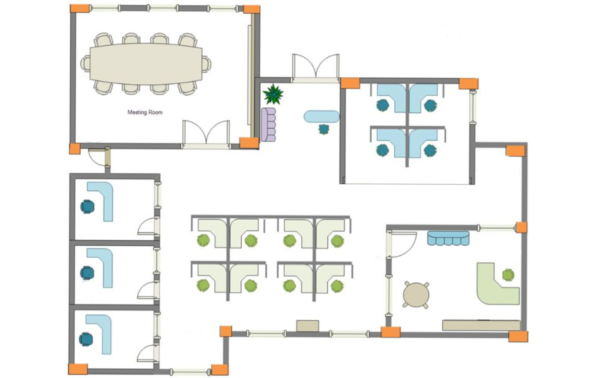{ width="720" }
  <figcaption>Plano de partida de la PR304. La sala de reuniones viene rotulada; el resto de los locales se reconoce por el mobiliario. Sobre este dibujo se codifican las salas, se sitúan las tomas, se elige el cuarto de telecomunicaciones y se traza el horizontal.</figcaption>
</figure>

**Enunciado:**

El dibujo se hace en [draw.io (diagrams.net)](https://app.diagrams.net/), [Excalidraw](https://excalidraw.com/) o [Dia](https://wiki.gnome.org/Apps/Dia). Si usáis Excalidraw y no lo habéis abierto antes, la [guía de Excalidraw](https://github.com/fjavier-hernandez/ral/blob/main/archivo/2526/docs/guia_excalidraw.md) del material de curso resume la interfaz. El plano de esta página puede servir de base: calcadlo o redibujadlo en la herramienta.

1. Codificad todas las salas del plano con un criterio que se pueda mantener en el resto del diseño (por ejemplo, un código de planta y de local). Situad las tomas de usuario. Cada puesto de trabajo lleva **dos tomas de datos**. El punto de acceso lleva **su propia toma**, distinta de las de los puestos.
2. Elegid el cuarto de telecomunicaciones, que es el local donde irá el rack, y justificad la elección por escrito. Tienen que cumplirse a la vez tres condiciones: el enlace permanente, desde la TO hasta el panel, no supera **90 m**; el latiguillo de usuario no supera **5 m**; y el local tiene ventilación suficiente para el armario: hace falta rejilla o renovación de aire, no un local cerrado sin ninguna de las dos. Explicad por qué el sitio elegido las cumple y por qué descartáis al menos otro local.
3. Trazad el cableado horizontal **dos veces**: primero por canaleta de superficie y después por techo técnico. Comparad los dos trazados: longitud, cruces, facilidad para ampliar y qué supone la altura de 3,7 m en cada uno. El diseño que entreguéis adopta uno de los dos. El informe indica cuál y por qué.
4. Haced una tabla de metros **por toma**, sobre el trazado elegido. Medid el recorrido del cable, no la línea recta, y añadid un **25 %** de margen (los metros con margen son los medidos multiplicados por 1,25). La tabla incluye, como mínimo, el código de la toma, la sala, los metros medidos y los metros con margen.
5. Dibujad el frontal del rack con los paneles de parcheo, el switch y los pasahilos. Indicad las unidades U de cada elemento y la suma, y dejad U libres.
6. Etiquetad de forma coherente cada TO y el puerto del panel que le corresponde: el mismo código en los dos extremos. El criterio se ve en el diagrama y se explica en el informe.
7. Cerrad con un inventario y un presupuesto **solo de material**: cable, canalización o techo según el trazado elegido, tomas, paneles, latiguillos, switch, pasahilos y etiquetas. Cada línea lleva una referencia de catálogo o de fabricante. No incluyáis mano de obra ni datos personales.

**Evidencia / entrega:** `PR304.md` y el diagrama (PNG, SVG o el fichero del editor), en Aules.

**No sustituye** al montaje de taller de PR302 ni a la fusión de PR303.

| Criterio (rúbrica) | Descripción | Puntos |
| --- | --- | --- |
| Codificación y tomas | Salas codificadas; dos tomas de datos por puesto y toma propia del AP | 0–2 |
| Cuarto de telecomunicaciones | Elección justificada con los 90 m, los 5 m y la ventilación | 0–2 |
| Horizontal y metros | Canaleta y techo técnico comparados; tabla por toma con el 25 % | 0–2 |
| Rack y etiquetado | Paneles, switch, pasahilos y suma de U; la misma etiqueta en la TO y en el panel | 0–2 |
| Inventario y entrega | Presupuesto solo de material, con referencias; `.md` y diagrama | 0–2 |
| **Total** | | **/10** |

### PR305 — Proyecto aulario sur del IES { #pr305-proyecto-aulario-sur }

| Campo | Valor |
| --- | --- |
| **Código** | **PR305** |
| **UP / tema** | T3 — Cableado estructurado |
| **RA principal** | **RA2**. Apoyo **RA3** |
| **CE de cobertura** | CE2d, CE2e, CE2f, CE2g, CE2i, CE2j · CE3a |
| **Sesiones estimadas** | **1–2** |
| **Instrumento** | Rúbrica de diseño 0–10 |

* :simple-neutralinojs: **PR305**. En grupo, diseñad el cableado del **aulario sur** del instituto: dos plantas, aulas, Wi‑Fi y enlace al edificio principal por el subsistema de campus. El diseño debe ser coherente con lo trabajado en el tema (PR301, PR302, PR303 y PR304): rack, paneles, fibra, electrónica y WLAN.

  1. Dibujad un plano funcional con las zonas, los distribuidores FD, BD y CD, el horizontal y el backbone.
  2. Haced el diagrama en [Excalidraw](https://excalidraw.com/), [draw.io](https://app.diagrams.net/) o [Dia](https://wiki.gnome.org/Apps/Dia). La [guía de Excalidraw](https://github.com/fjavier-hernandez/ral/blob/main/archivo/2526/docs/guia_excalidraw.md) sirve si aún no habéis usado la herramienta.
  3. Justificad los medios (cobre en el horizontal, fibra en vertical y campus), las canalizaciones y la electrónica básica.
  4. Definid el etiquetado y dejad prevista una reserva de puertos y de cables para crecer.

  **Evidencia / entrega:** `PR305.md` + diagrama (PNG/SVG o archivo del editor, según Aules). Exposición breve (~5 min) si se indica en clase.

| Criterio (rúbrica) | Descripción | Puntos |
| --- | --- | --- |
| Análisis del escenario | Necesidades y condicionantes claros | 0–2 |
| Diseño del cableado | Elementos funcionales y normativa coherentes | 0–2 |
| Justificación técnica | Medios, canalizaciones y equipos argumentados | 0–2 |
| Etiquetado y mantenimiento | Identificación y plan básico de ampliación | 0–2 |
| Documentación `.md` + diagrama | Claridad y completitud | 0–2 |
| **Total** | | **/10** |

### Certificación: WLAN en Packet Tracer {: #certificacion-wlan-packet-tracer }

La práctica de WLAN en Packet Tracer (punto de acceso, SSID, canal y seguridad básica) no forma parte de las prácticas numeradas de este tema. El guion está en el [apartado de certificación](../certificacion/pr303-wlan-packet-tracer.md). Se hace en casa, cuenta para el +1 y no puntúa en la nota de los RA. No sustituye al taller de NIC y WLAN (**[PR301](#pr301-taller-nic-y-wlan-real)**).

---

## Para el examen

El cableado estructurado es el sistema del edificio (TO, horizontal de 90 m, panel, rack, backbone), no el latiguillo suelto. La **NIC** (Tema 1) se **monta** aquí (PCIe o USB) y lleva **driver**. El **rack** es de 19″ y la altura se mide en **U**. El **panel** empareja cada TO con un puerto etiquetado; de ahí un latiguillo al **switch**. El **hub** queda para laboratorio; el **switch**, para la LAN; el **router** o **gateway**, para otras redes; el **AP**, para Wi‑Fi con SSID, canal y **WPA2/WPA3**, a menudo con **PoE**.

En la fibra del edificio, el horizontal sigue en cobre; el vertical FD–BD va en multimodo OM3/OM4 y el campus BD–CD en monomodo OS2. En el rack el troncal termina en la bandeja de empalmes y en el ODF, con pigtail y latiguillo **LC** hasta un módulo **SFP** o SFP+ adecuado a la fibra y a la distancia; el **SC/APC** es el propio de la red FTTH. Hay que reconocer la cubierta (OS2 amarilla, OM3/OM4 aguamarina o violeta), el pulido **UPC** (azul) frente a **APC** (verde) y la polaridad TX→RX del latiguillo dúplex.

En fusión: protector antes de pelar, limpieza, cleaver, arco, tracción, horno y bandeja; se repite si la pérdida estimada supera unos 0,1 dB. En el taller se comprueba con la fusionadora y el **VFL**. En FTTH/GPON, la OLT está en la central, la ONT en casa entrega internet y telefonía, la televisión puede llegar a 1550 nm a un receptor óptico aparte, los divisores son pasivos y el conector habitual es **SC/APC** (casquillo verde), frente al **LC** dúplex del backbone. La clase B+ (13–28 dB) es una referencia del enlace real medida con medidor de potencia.

CE clave de este tema: **CE2d, CE2f, CE2g, CE3a, CE3c, CE3f, CE4d, CE4i**.

## Autocheck del tema

Hazlo **después** de entregar el cuestionario inicial en Aules.

1. **V/F.** El latiguillo del PC al switch de mesa ya es, por sí solo, un sistema de cableado estructurado.
2. Empareja: **TO** · **FD** · **CD** con: (a) toma del puesto · (b) enlace entre edificios · (c) distribuidor de planta.
3. El enlace permanente de cobre (TO ↔ panel) suele limitarse a…  
   a) 10 m · b) 55 m · c) 90 m · d) 300 m
4. **V/F.** Una NIC Wi‑Fi no tiene dirección MAC.
5. Relaciona: **hub** · **switch** · **router** con capas **1**, **2** y **3**.
6. Elige la correcta: PoE…  
   a) sube la categoría del UTP · b) alimenta equipos por el mismo par trenzado · c) solo existe en fibra
7. Nombra dos modos de funcionamiento de un AP.
8. **V/F.** WEP es la seguridad recomendada hoy en el taller.
9. ¿Qué distancia máxima se recomienda para el latiguillo equipo ↔ TO?
10. El estándar que habla de etiquetado y administración del cableado es…  
    a) TIA‑568 · b) TIA‑606 · c) IEEE 802.11 · d) RFC 1918
11. **V/F.** El repetidor divide el dominio de colisión.
12. En la fusión de fibra, ¿para qué sirve el cleaver?
13. **V/F.** El montaje de una NIC PCIe o USB cubre, entre otros, el criterio de instalar el adaptador en el equipo.
14. Un canal Ethernet de cobre de 100 m se reparte, de forma habitual, en…
15. ¿Qué compruebas en PR301 después de configurar SSID, canal y WPA2/WPA3?
16. ¿Qué subsistema del cableado estructurado se tiende en cobre y cuáles en fibra? Nombra la clase habitual del vertical y la del campus.
17. Un enlace de backbone suma 2,8 dB de fibra, 0,4 dB de fusiones y 2,0 dB de conectores. Si el máximo orientativo es 6,0 dB, ¿qué margen queda? Si las cuatro fusiones pasaran de 0,1 dB a 1 dB, ¿el total seguiría por debajo de 6,0 dB?
18. ¿Para qué sirve el módulo SFP en el switch y qué tiene que coincidir con el cable?
19. **V/F.** Un conector UPC azul se puede enchufar en un adaptador APC verde sin problema.
20. En el taller de fusión, ¿qué dos comprobaciones se hacen de forma habitual?
21. En GPON, ¿dónde está la OLT, dónde la ONT y qué entrega la ONT?
22. ¿Qué conector se usa de forma habitual en FTTH/GPON y por qué el pulido es APC?

!!! info "Soluciones"
    Las soluciones se publicarán aquí cuando cierre el cuestionario inicial en Aules.

---

## Vídeos recomendados

Pablo Hidalgo explica cómo trabaja un switch Ethernet de capa 2 (CCNA v1.1, lección 6): tabla MAC, unicast y broadcast.

  <iframe src="https://www.youtube-nocookie.com/embed/vYKwD7OF6xY"
          style="position: absolute; top: 0; left: 0; width: 100%; height: 100%;"
          frameborder="0"
          allow="accelerometer; autoplay; clipboard-write; encrypted-media; gyroscope; picture-in-picture"
          allowfullscreen
          title="CCNA v1.1 Lección 6 — switches Ethernet de capa 2 (Pablo Hidalgo)"></iframe>

Las lecciones 34–38 de la misma playlist ([CCNA Completo v1.1](https://www.youtube.com/playlist?list=PLxnG_9vdV6-gEWV15pq89XK_W3G8vP5_0)) tratan WLAN (transmisión, estándares, WLC, WPA2/WPA3) y requieren membresía. El cobre y la fibra (lecciones 3 y 4) están en el Tema 2.

## Glosario

**NIC**{: #nic}
*Network Interface Card*: adaptador de red. Concepto y MAC en el Tema 1; en este tema, montaje (PCIe/USB) y driver.

**rack**{: #rack}
Armario de comunicaciones con bastidores de 19 pulgadas; la altura se mide en unidades U.

**panel de parcheo**{: #panel-de-parcheo}
Panel (habitualmente RJ‑45) que concentra el cableado horizontal y se etiqueta TO a TO.

**TO**{: #to}
Toma de usuario o TO (*Telecommunications Outlet*), también llamada **roseta**: punto de conexión del puesto (superficie, empotrable o de suelo).

**FD**{: #fd}
*Floor Distributor*: distribuidor de planta.

**BD**{: #bd}
*Building Distributor*: distribuidor de edificio.

**CD**{: #cd}
*Campus Distributor*: distribuidor de campus (entre edificios).

**AP**{: #ap}
*Access Point*: punto de acceso Wi‑Fi que puentea clientes inalámbricos hacia la LAN cableada.

**PoE**{: #poe}
*Power over Ethernet*: alimentación eléctrica por el mismo UTP (AP, cámaras, teléfonos).

**SSID**{: #ssid}
Nombre de la red Wi‑Fi que anuncia el AP.

**WPA2 / WPA3**{: #wpa}
Mecanismos de seguridad Wi‑Fi actuales (clave o 802.1X). WEP está obsoleto.

**ODF**{: #odf}
*Optical Distribution Frame*, distribuidor óptico: panel o casete del rack donde terminan los conectores de la fibra. Suele ir con la bandeja de empalmes.

**pigtail**{: #pigtail}
Rabillo: tramo corto de fibra con conector de fábrica en un extremo y fibra desnuda en el otro, que se fusiona al cable troncal.

**LC**{: #lc}
*Lucent Connector*, conector Lucent: conector óptico pequeño, habitual en paneles y en los módulos de fibra de los racks actuales.

**SC**{: #sc}
*Subscriber Connector*, conector de abonado: conector óptico de cuerpo cuadrado y enganche a presión. En FTTH/GPON el habitual es el **SC/APC** (casquillo verde); el LC dúplex queda para el ODF y el SFP del backbone.

**OM3 / OM4**{: #om3-om4}
Clases de fibra multimodo (*optical multimode*) para el backbone vertical del edificio. Distancias y núcleo en el [Tema 2](../02-medios-capa-fisica/tema2.md#multimodo-mm-y-monomodo-sm).

**OS2**{: #os2}
Clase de fibra monomodo (*optical singlemode*) para el enlace de campus. Detalle en el [Tema 2](../02-medios-capa-fisica/tema2.md#multimodo-mm-y-monomodo-sm).

**balance de pérdidas**{: #balance-de-perdidas}
Suma, en decibelios, de la atenuación de la fibra, las fusiones y los conectores de un enlace, comparada con el máximo que admite el equipo.

**SFP**{: #sfp}
*Small Form-factor Pluggable*: transceptor óptico (o de cobre) enchufable en el switch. El modelo debe coincidir con la clase de fibra y con la distancia del enlace (por ejemplo, LR en monomodo de largo alcance).

**UPC / APC**{: #upc-apc}
Tipos de pulido del conector óptico. UPC (*Ultra Physical Contact*) suele ir en casquillo azul; APC (*Angled Physical Contact*), en verde y con la cara en ángulo, para reducir la luz reflejada hacia el emisor. No se mezclan entre sí. En GPON se usa APC; en el backbone del edificio, el LC suele ir con UPC.

**VFL**{: #vfl}
*Visual Fault Locator*, láser localizador visual: inyecta luz visible para comprobar si llega al otro extremo y para localizar cortes o curvaturas fuertes.

**FTTH**{: #ftth}
*Fiber To The Home*, fibra hasta el hogar: la fibra óptica llega al domicilio del abonado y termina en la ONT.

**GPON**{: #gpon}
*Gigabit-capable Passive Optical Network*, red óptica pasiva con capacidad de gigabit: una OLT reparte la fibra entre varias ONT mediante divisores sin alimentación.

**OLT**{: #olt}
*Optical Line Terminal*, terminal de línea óptica: equipo de la central. Origina la bajada y asigna los turnos de subida.

**ONT**{: #ont}
*Optical Network Terminal*, terminal de red óptica: equipo en casa del abonado. Entrega internet, telefonía y televisión.

**divisor óptico**{: #divisor-optico}
Repartidor pasivo (*splitter*): parte la potencia de una fibra entre varias salidas (1:8, 1:16, 1:32, 1:64…). No se alimenta y concentra buena parte de la pérdida del enlace GPON.

---

## Relación con el resto del módulo

El **Tema 1** dio dispositivos, capas y la NIC; el **Tema 2**, el medio (UTP, fibra, Wi‑Fi, crimpado). Aquí se monta el **edificio**: rack, panel, TO, fibra de backbone y WLAN real (**[PR301](#pr301-taller-nic-y-wlan-real)**). El **Tema 4** profundiza en la trama y en el switch; el **Tema 6**, en VLAN sobre switch físico (**PR604**). La práctica de Packet Tracer de WLAN y el resto de la certificación se hacen en casa.

---

## Referencias rápidas

- Sitio del módulo: [fjavier-hernandez.github.io/ral](https://fjavier-hernandez.github.io/ral/)
- Diagramas: [Excalidraw](https://excalidraw.com/), [draw.io (diagrams.net)](https://app.diagrams.net/), [Dia](https://wiki.gnome.org/Apps/Dia)
- Simulación: [Cisco Packet Tracer](https://www.netacad.com/es/cisco-packet-tracer)
- Entregas: [Visual Studio Code](https://code.visualstudio.com/docs) + [Markdown](https://tutorialmarkdown.com/guia)
- Normas: [Normas del taller](../00-normas/normas_taller.md)
- Playlist CCNA (Pablo Hidalgo): [CCNA Completo v1.1](https://www.youtube.com/playlist?list=PLxnG_9vdV6-gEWV15pq89XK_W3G8vP5_0)

*[RA]: Resultado de aprendizaje
*[CE]: Criterio de evaluación
*[AC]: Actividad de clase
*[PR]: Práctica
*[NIC]: Network Interface Card
*[TO]: Telecommunications Outlet
*[PoE]: Power over Ethernet
*[FD]: Floor Distributor
*[BD]: Building Distributor
*[CD]: Campus Distributor
*[ODF]: Optical Distribution Frame
*[LC]: Lucent Connector
*[SC]: Subscriber Connector
*[AP]: Access Point
*[SSID]: Service Set Identifier
