# Tema 4. Capa de enlace

En el Tema 3 dejamos montado el armario: tomas, panel, latiguillos y un switch con todos sus pilotos encendidos. Que el piloto esté verde solo dice que la capa física funciona, es decir, que hay señal en el cable. Lo que pasa después, cuando el PC tiene algo que enviar, es cosa de la **capa de enlace de datos** (capa 2): empaqueta los bits en **tramas**, les pone una dirección **MAC** de origen y de destino, comprueba que no lleguen dañadas y decide cuándo se puede transmitir. El switch es el equipo que vive en esta capa, así que entender la trama es entender qué hace el switch con cada una.

En el taller esto se nota enseguida. Un PC con el cable bien crimpado puede no comunicarse porque las tramas llegan con errores y el switch las descarta. Un cable de más entre dos switches, que parece inofensivo, puede tumbar el aula entera en segundos por un bucle. Al acabar el tema sabrás explicar las dos situaciones y cómo se evitan.

!!! tip "Cómo leerlo"
    Lee cada apartado completo: primero el párrafo (qué es, para qué sirve y un ejemplo), después la tabla o la figura, y al final los errores frecuentes. No estudies solo las tablas. Los términos marcados enlazan al [glosario](#glosario). Cuando acabes el tema, haz el [Autocheck](#autocheck-del-tema).

## Clases y tareas {: #clases-y-tareas }

En este tema vamos viendo los contenidos por sesiones. Aquí tienes, para cada clase, qué trabajamos en el aula y qué tienes que entregar después en Aules.

### Clase 1 {: #clase-1 }

Hoy empezamos el Tema 4. En esta clase vemos la primera mitad, la que necesitas para entender qué hace el switch del armario con cada trama que le llega.

**Qué vemos en clase**

1. El [cuestionario inicial](#cuestionario-inicial), para ver qué sabes antes de empezar.
2. [Qué hace la capa de enlace](#que-hace-la-capa-de-enlace) y por qué la trama solo viaja entre vecinos.
3. Las [subcapas LLC y MAC](#subcapas-llc-y-mac).
4. [La trama Ethernet](#la-trama-ethernet), campo a campo, y la [detección de errores con CRC](#crc).
5. Las [direcciones MAC](#direcciones-mac): cómo se leen y cómo encuentras la de tu equipo.
6. [El switch por dentro](#el-switch-por-dentro): aprender, filtrar, reenviar e inundar, con el ejemplo paso a paso.

**Qué tienes que entregar**

Todas las entregas van en **Aules**, en formato `.md`, dentro del plazo que marque cada tarea.

| Tarea | Qué haces | Enlace |
| --- | --- | --- |
| **Cuestionario inicial** | Respondes con lo que sepas, antes de mirar el Autocheck | [Cuestionario](#cuestionario-inicial) |
| **AC401** | Lees una trama real campo a campo y analizas la MAC de tu propia NIC | [AC401 — Leer una trama y una MAC](#ac401-leer-una-trama-y-una-mac) |
| **AC403** | Sigues un switch trama a trama y rellenas su tabla MAC | [AC403 — El switch paso a paso](#ac403-el-switch-paso-a-paso) |

!!! tip "Antes de la próxima clase"
    Repasa el diagrama de decisión del switch y el ejemplo paso a paso: la AC403 sale sola si lo tienes claro. En la próxima clase seguimos con el acceso al medio (CSMA/CD y CSMA/CA) y el dúplex.

## Propuesta didáctica

Trabajamos los **RA1** y **RA4** del módulo Redes de área local (0225):

> **RA1.** *Reconoce la estructura de redes locales cableadas analizando las características de entornos de aplicación y describiendo la funcionalidad de sus componentes.*

> **RA4.** *Instala equipos en red, describiendo sus prestaciones y aplicando técnicas de montaje.*

### Criterios de evaluación (selección)

**RA1**

* **CE1a** **(clave)**: Se han descrito los principios de funcionamiento de las redes locales.
* **CE1c**: Se han descrito los elementos de la red local y su función.

**RA4**

* **CE4g** **(clave)**: Se han identificado los protocolos.
* **CE4h**: Se han configurado los parámetros básicos.

!!! note "VLAN"
    Las **VLAN** (CE4j) se desarrollan en el **Tema 6**. Aquí solo aparecen como el campo opcional de 4 bytes de la trama y como la forma de dividir un switch en varios dominios de difusión.

### Contenidos

* Funciones de la capa de enlace y alcance de la trama: de un equipo a su vecino, salto a salto.
* Subcapas **LLC** (IEEE 802.2) y **MAC** (IEEE 802.3 y 802.11).
* Trama Ethernet: campos, tamaño mínimo y máximo; detección de errores con **CRC** y el campo **FCS**.
* Direcciones MAC: estructura, OUI, unicast, multicast y broadcast; cómo ver la tuya.
* Acceso al medio compartido: particionado, turnos y contienda; **CSMA/CD** y **CSMA/CA**; half y full dúplex.
* El switch por dentro: aprender, filtrar, reenviar e inundar; métodos de conmutación; dominios de colisión y de difusión.
* Bucles de capa 2: **STP** y RSTP. Agregación de enlaces con **EtherChannel** (visión breve).

### Programación de aula (orientativa)

| Sesiones | Contenidos | Actividades |
| --- | --- | --- |
| 1 | Presentación, cuestionario inicial, capa de enlace, LLC/MAC, trama y CRC | Cuestionario |
| 2 | Direcciones MAC y funcionamiento del switch | **AC401**, **AC403** |
| 3–4 | Acceso al medio: CSMA/CD, CSMA/CA y dúplex | AC402 |
| 5–6 | Métodos de conmutación; dominios de colisión y de difusión | **PR401** |
| 7–8 | Bucles, STP y EtherChannel | AC404 |
| 9–10 | Packet Tracer: tabla MAC y STP (se termina en casa) | **PR402** |
| 11 | Repaso y Autocheck | — |

---

## Cuestionario inicial {: #cuestionario-inicial }

!!! question "Antes de empezar — responde con lo que sepas"
    1. ¿Qué función cumple la capa de enlace en el modelo OSI?
    2. ¿Qué es una trama y en qué se diferencia de un paquete?
    3. ¿Qué es una dirección MAC? ¿Sabrías encontrar la de tu ordenador?
    4. ¿Qué crees que hace un switch cuando recibe una trama para un equipo que todavía no conoce?
    5. ¿Qué diferencia hay entre un hub y un switch?
    6. ¿Por qué hoy casi no hay colisiones en una red cableada?
    7. ¿Cómo sabe el receptor que una trama ha llegado dañada?
    8. ¿Qué pasaría si conectas dos switches entre sí con dos cables a la vez?
    9. ¿Qué es una VLAN? (solo la idea; el detalle va en el Tema 6)

Entrega tus respuestas en **Aules** como tarea del cuestionario inicial **antes** de mirar el [Autocheck](#autocheck-del-tema) del final del tema. Las soluciones no están aquí a propósito: primero entregas, después contrastas.

---

## Qué hace la capa de enlace {: #que-hace-la-capa-de-enlace }

La capa física, que vimos en el Tema 2, solo sabe mover bits: unos y ceros convertidos en señal eléctrica, luz o radio. La **capa de enlace de datos** organiza esos bits para que tengan sentido. Agrupa los datos que le pasa la capa de red en bloques llamados **[tramas](#trama)**, les añade una cabecera con la dirección de quien envía y de quien recibe, y les pone al final un código para comprobar que han llegado bien. Si el medio lo comparten varios equipos, además decide quién puede transmitir en cada momento.

Hay una idea que conviene fijar desde el principio: **la trama solo viaja entre dos equipos vecinos**, es decir, conectados al mismo enlace. Cuando tu PC envía algo a un servidor de Internet, el paquete IP va de extremo a extremo sin cambiar sus direcciones, pero la trama que lo transporta se rehace en cada router. El switch, en cambio, no fabrica tramas nuevas: las reenvía tal como llegan, porque trabaja dentro de la misma LAN. Por eso decimos que la capa 2 se ocupa del **salto** y la capa 3 del **camino completo**.

<figure markdown="span">
  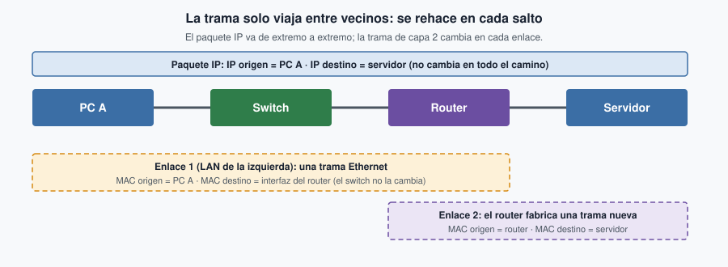{ width="820" }
  <figcaption>El paquete IP mantiene sus direcciones; la trama cambia en cada salto que da a través de un router.</figcaption>
</figure>

Las funciones que se atribuyen a la capa de enlace son estas:

- **Entramado.** Delimitar dónde empieza y dónde acaba cada trama, para que el receptor no confunda los datos de una con los de la siguiente.
- **Direccionamiento físico.** Identificar con la dirección MAC qué tarjeta envía y cuál debe recoger la trama.
- **Detección de errores.** Calcular un código de control que permita descartar las tramas dañadas por ruido o interferencias.
- **Control de acceso al medio.** Ordenar quién transmite cuando varios equipos comparten el mismo medio.
- **Control de flujo.** Evitar que un emisor rápido desborde a un receptor más lento (en Ethernet, mediante tramas de pausa en full dúplex).

**Ejemplo de aula.** Cuando haces `ping` del PC del taller al router del aula, la petición sale de tu NIC dentro de una trama cuya MAC de destino es la del router. El switch del armario lee esa MAC, mira por qué puerto tiene que salir y la reenvía sin tocarla. Si luego el router la manda a Internet, la trama que sale por su otra interfaz ya es otra, con otras MAC.

!!! warning "Errores frecuentes"
    Pensar que la dirección MAC de destino es la del equipo final aunque esté en otra red. Si el destino está fuera de tu LAN, la MAC de destino es la del router (tu puerta de enlace). Confundir trama y paquete: la trama es la PDU de la capa 2 y el paquete, la de la capa 3, que viaja dentro de ella.

---

## Subcapas LLC y MAC {: #subcapas-llc-y-mac }

En las redes locales, el IEEE (*Institute of Electrical and Electronics Engineers*) divide la capa de enlace en dos subcapas. La idea es separar lo que es común a cualquier tecnología de lo que depende del medio concreto.

La **subcapa [LLC](#llc)** (*Logical Link Control*, control de enlace lógico) es la de arriba y está recogida en la norma **IEEE 802.2**. Ofrece a la capa de red una interfaz única, de modo que el protocolo IP no necesita saber si debajo hay un cable Ethernet o una red Wi‑Fi. Indica qué protocolo de red va dentro de la trama y, en la práctica, la implementa el *driver* de la tarjeta, es decir, el software.

La **subcapa [MAC](#mac)** (*Media Access Control*, control de acceso al medio) es la de abajo, la más cercana a la capa física. Construye la trama con las direcciones y el código de errores, decide cuándo se puede transmitir y desempaqueta las tramas que llegan. Está grabada en el hardware de la propia NIC, y cada tecnología tiene la suya: **IEEE 802.3** para Ethernet cableado e **IEEE 802.11** para Wi‑Fi. Cada estándar fija a la vez su subcapa MAC y su capa física, por eso hablamos de 802.3u (Fast Ethernet, 100 Mb/s) o de 802.3ab (Gigabit sobre cobre) como si fueran «tipos de cable».

<figure markdown="span">
  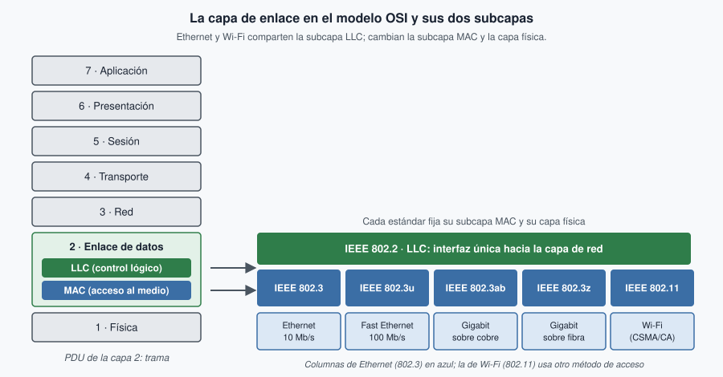{ width="820" }
  <figcaption>LLC es común (802.2); la subcapa MAC y la capa física cambian según el estándar.</figcaption>
</figure>

**Ejemplo de aula.** Tu portátil tiene dos NIC, la de cable y la Wi‑Fi. Cada una tiene su propia subcapa MAC y su propia dirección, pero el sistema operativo las trata igual: les asigna una IP y envía paquetes por la que esté conectada. Eso es posible porque por encima de las dos está la misma LLC.

!!! warning "Errores frecuentes"
    Confundir la **subcapa MAC** con la **dirección MAC**. La subcapa es una parte de la capa 2 (con sus funciones); la dirección es el identificador de 48 bits que usa esa subcapa.

---

## La trama Ethernet {: #la-trama-ethernet }

La trama Ethernet es el «sobre» en el que viajan los datos por la LAN. Su formato lo fija el estándar IEEE 802.3, y lo que circula hoy en casi todas las redes es la variante **Ethernet II**, que usa el campo de tipo para indicar qué protocolo va dentro. Conocer los campos y su tamaño es imprescindible para leer una captura de tráfico y para entender por qué el switch puede decidir tan deprisa.

<figure markdown="span">
  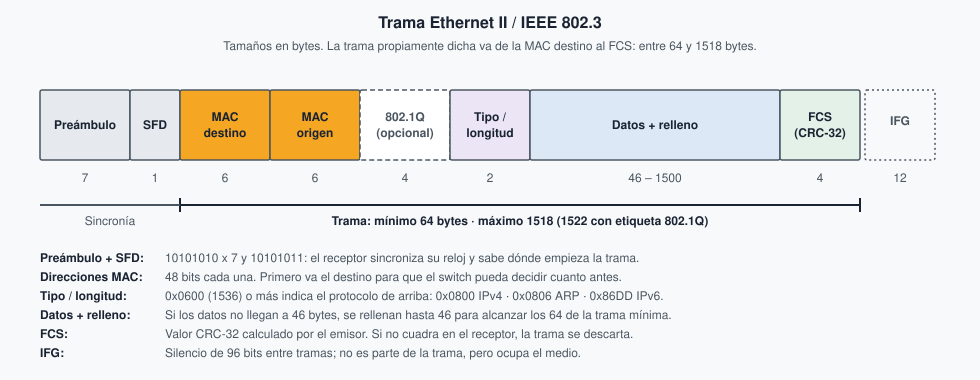{ width="900" }
  <figcaption>Trama Ethernet: de 64 a 1518 bytes contando desde la MAC destino hasta el FCS.</figcaption>
</figure>

La tabla siguiente resume cada campo, su tamaño y para qué sirve.

| Campo | Tamaño | Para qué sirve |
| --- | --- | --- |
| **Preámbulo** | 7 bytes | Patrón `10101010` repetido para que el receptor sincronice su reloj con el emisor |
| **SFD** (*Start Frame Delimiter*) | 1 byte | Patrón `10101011`: marca que empieza la trama propiamente dicha |
| **MAC destino** | 6 bytes | A quién va dirigida. Va la primera para que el switch decida cuanto antes |
| **MAC origen** | 6 bytes | Quién la envía. El switch la usa para aprender en qué puerto está cada equipo |
| **Etiqueta 802.1Q** | 4 bytes (opcional) | Número de VLAN y prioridad. Solo aparece en enlaces troncales (Tema 6) |
| **Tipo / longitud** | 2 bytes | Si vale 0x0600 (1536) o más, indica el protocolo de dentro: `0x0800` IPv4, `0x0806` ARP, `0x86DD` IPv6 |
| **Datos + relleno** | 46–1500 bytes | El paquete de la capa de red. Si no llega a 46 bytes, se rellena con ceros |
| **FCS** (*Frame Check Sequence*) | 4 bytes | Código **CRC‑32** para detectar errores |

El preámbulo y el SFD los genera la NIC y no se cuentan como parte de la trama; por eso una captura de Wireshark empieza directamente por la MAC de destino. Entre una trama y la siguiente, además, el emisor guarda un silencio obligatorio llamado **IFG** (*Inter-Frame Gap*), de 96 bits (12 bytes), aunque el medio esté libre.

La trama tiene un **tamaño mínimo de 64 bytes** (de la MAC destino al FCS). Ese mínimo viene del Ethernet clásico de medio compartido: la trama tenía que durar lo suficiente como para que, si chocaba con otra en el punto más lejano del cable, el emisor todavía estuviera transmitiendo y se enterase de la colisión. Lo verás con más detalle en [CSMA/CD](#csma-cd). El **máximo es de 1518 bytes**, con 1500 de datos como mucho; ese límite de datos se llama **MTU** (*Maximum Transmission Unit*, unidad máxima de transmisión) y es el que verás en la configuración de cualquier interfaz. Con la etiqueta de VLAN, la trama puede llegar a 1522 bytes. Algunos equipos de centro de datos admiten **tramas gigantes** (*jumbo frames*) de hasta unos 9000 bytes, pero no es estándar y todos los equipos del camino tienen que admitirlas.

**Ejemplo de aula.** Una petición ARP («¿quién tiene la IP 192.168.10.1?») ocupa solo 28 bytes. Como el campo de datos tiene que tener al menos 46, la NIC añade 18 bytes de relleno. Cuando la veas en Wireshark, esos ceros del final no son un error: son el relleno.

!!! warning "Errores frecuentes"
    Decir que la trama mínima es de 46 bytes (46 es el mínimo del campo de datos; la trama mínima es de 64). Sumar el preámbulo al tamaño de la trama. Pensar que el tipo `0x0800` es una dirección: es el código que dice que dentro va IPv4.

### Detección de errores: CRC y FCS {: #crc }

Por el camino, un pico de ruido o una interferencia puede cambiar un bit de la trama. Para detectarlo, el emisor aplica a toda la trama un cálculo matemático llamado **[CRC](#crc-glosario)** (*Cyclic Redundancy Check*, comprobación de redundancia cíclica) y coloca el resultado, de 32 bits, en el campo **FCS** del final. El receptor repite el mismo cálculo con lo que ha recibido. Si su resultado coincide con el FCS, la trama es correcta; si no coincide, la trama está dañada y se descarta.

<figure markdown="span">
  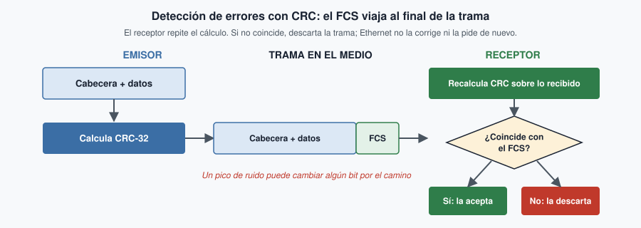{ width="820" }
  <figcaption>El CRC detecta el error; la trama dañada se descarta sin avisar al emisor.</figcaption>
</figure>

El CRC‑32 se calcula en el hardware de la NIC, es muy rápido y detecta prácticamente todos los errores que provoca el ruido, incluidas ráfagas de varios bits seguidos, con solo 4 bytes de más. Su límite es que **detecta pero no corrige**. Ethernet tampoco pide que se vuelva a enviar la trama: simplemente la tira. Si los datos eran importantes, será un protocolo de una capa superior, como TCP en la capa de transporte (Tema 7), el que note que falta algo y lo pida de nuevo.

**Ejemplo de aula.** En los switches gestionables hay un contador de errores CRC por puerto. Si en un puerto ese contador no para de subir, lo primero que se revisa es el latiguillo y la toma de ese puesto: un crimpado defectuoso o un cable aplastado por la silla producen justo este síntoma.

!!! note "Para la certificación CCNA"
    En un switch Cisco, los errores de CRC se ven con `show interfaces` en la línea *input errors, CRC*. Muchos errores CRC en un puerto apuntan a la capa física (cable, conector o interferencias) o a un desajuste de dúplex.

### Segmentación y agrupación

La capa de enlace también ajusta el tamaño de lo que transporta. Si los datos que llegan de arriba son más grandes de lo que admite la trama, hay que **segmentarlos** en varias tramas; además, si una se daña, solo se repite ese trozo y no el bloque entero. Si llegan muchos mensajes muy pequeños, a veces conviene **agruparlos** en una sola trama para no gastar una cabecera completa en cada uno. En Ethernet, la MTU de 1500 bytes es la que manda: lo normal es que sea la capa de red o la de transporte la que entregue los datos ya troceados a ese tamaño, de modo que cada trama lleve como mucho 1500 bytes de datos.

---

## Direcciones MAC {: #direcciones-mac }

La **dirección MAC** identifica cada interfaz de red dentro de la LAN. Ya la viste en el [Tema 1, adaptador de red](../01-introduccion-arquitectura/tema1.md#adaptador-de-red-nic): son **48 bits** escritos como **12 dígitos hexadecimales**. Aquí vamos a leerla por dentro, porque de sus bits depende que una trama vaya a un solo equipo, a un grupo o a todos.

Los tres primeros bytes forman el **[OUI](#oui)** (*Organizationally Unique Identifier*, identificador único de organización), que el IEEE asigna a cada fabricante. Por ejemplo, `00:00:0C` es un OUI de Cisco. Los tres últimos bytes los asigna el fabricante a cada tarjeta, de forma que, en principio, no hay dos interfaces con la misma MAC en el mundo. Según el sistema, la verás escrita con dos puntos (`00:00:0C:12:34:56`), con guiones (`00-00-0C-12-34-56`, en Windows) o en grupos de cuatro (`0000.0c12.3456`, en los equipos Cisco). Las tres formas son la misma dirección.

<figure markdown="span">
  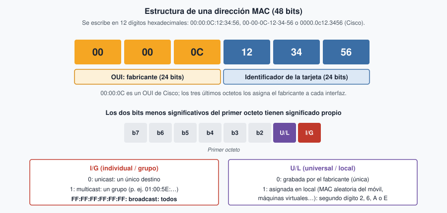{ width="820" }
  <figcaption>OUI, identificador de tarjeta y los dos bits especiales del primer octeto.</figcaption>
</figure>

Dos bits del primer byte tienen un significado especial. El bit **I/G** (individual o grupo) es el menos significativo: si vale 0, la dirección es **unicast** y va a una sola interfaz; si vale 1, es **multicast** y va a un grupo de equipos. Un truco rápido es mirar el segundo dígito hexadecimal: si es impar, la dirección es de grupo. El bit **U/L** (universal o local) es el siguiente: si vale 0, la dirección es la que grabó el fabricante; si vale 1, se ha asignado en local, como hacen las máquinas virtuales o los móviles cuando usan una **MAC aleatoria** para que no se les pueda seguir de una red Wi‑Fi a otra. En ese caso, el segundo dígito es 2, 6, A o E.

Hay una dirección especial que conviene saberse de memoria: **`FF:FF:FF:FF:FF:FF`** es la dirección de **difusión** (*broadcast*). Una trama con ese destino la recogen todos los equipos del dominio de difusión, y es la que usan, por ejemplo, ARP para preguntar por una IP o DHCP para buscar un servidor (Tema 5).

| Tipo | Destino | Ejemplo |
| --- | --- | --- |
| **Unicast** | Una sola interfaz | `00:00:0C:12:34:56` |
| **Multicast** | Un grupo de interfaces | `01:00:5E:00:00:FB` (multicast IPv4) |
| **Broadcast** | Todas las del dominio de difusión | `FF:FF:FF:FF:FF:FF` |

Para ver la MAC de tu equipo tienes varias opciones. En Windows, `ipconfig /all` la muestra como «Dirección física» de cada adaptador, y `getmac /v` las lista todas. En Linux, `ip link` la da en la línea `link/ether`. En macOS, `ifconfig en0` la muestra en la línea `ether`.

**Ejemplo de aula.** Si en el PC del taller ejecutas `ipconfig /all`, verás una MAC para el adaptador Ethernet y otra distinta para el Wi‑Fi, si lo tiene. Si buscas sus tres primeros bytes en el registro público de OUI del IEEE, sabrás qué fabricante hizo la tarjeta, aunque el PC sea de otra marca.

!!! warning "Errores frecuentes"
    Creer que la MAC no se puede cambiar: el fabricante la graba, pero el sistema operativo puede usar otra. Pensar que el switch tiene una MAC por cada equipo conectado: el switch **aprende** las MAC de los demás, no las inventa. Confundir multicast con broadcast: el multicast va a un grupo; el broadcast, a todos.

---

## Acceso al medio compartido {: #acceso-al-medio }

Cuando varios equipos comparten el mismo medio, como un cable coaxial de los antiguos, un hub o el aire de una red Wi‑Fi, si dos transmiten a la vez sus señales se mezclan y ninguna se entiende. Eso es una **colisión**. Los métodos de **control de acceso al medio** son las reglas que evitan o resuelven ese problema, y se agrupan en tres familias.

<figure markdown="span">
  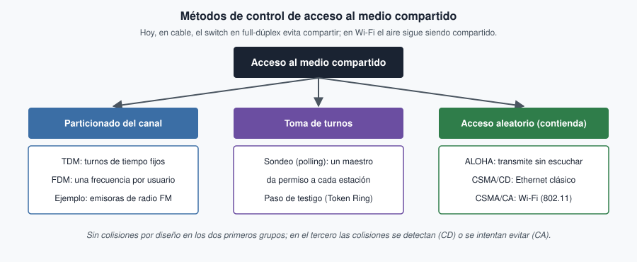{ width="820" }
  <figcaption>Tres maneras de compartir un medio: repartirlo, turnarse o competir por él.</figcaption>
</figure>

En el **particionado del canal**, el medio se reparte de forma fija. Con **TDM** (*Time Division Multiplexing*, multiplexación por división de tiempo) cada usuario tiene sus turnos de tiempo, como en la telefonía tradicional; con **FDM** (*Frequency Division Multiplexing*, multiplexación por división de frecuencia) cada uno tiene su frecuencia, como las emisoras de FM. No hay colisiones, pero si un usuario no tiene nada que enviar, su parte se desperdicia.

En la **toma de turnos**, los equipos esperan su momento. Con el **sondeo** (*polling*), un nodo maestro va dando permiso a cada estación. Con el **paso de testigo** (*token passing*) circula entre los equipos una trama especial, el testigo, y solo transmite quien lo tiene; así funcionaba la antigua red **Token Ring** en anillo.

En el **acceso aleatorio** o por contienda, cada equipo transmite cuando lo necesita y se asume que habrá colisiones de vez en cuando. El método pionero fue **ALOHA**, que ni siquiera escuchaba antes de transmitir. De esa idea salieron los dos métodos que importan hoy: **CSMA/CD** en el Ethernet clásico y **CSMA/CA** en Wi‑Fi.

### CSMA/CD en el Ethernet clásico {: #csma-cd }

**[CSMA/CD](#csma-cd-glosario)** (*Carrier Sense Multiple Access with Collision Detection*, acceso múltiple con detección de portadora y detección de colisiones) es el método del Ethernet de medio compartido. Su nombre ya resume las reglas: escuchar antes de hablar (*carrier sense*), aceptar que varios comparten el medio (*multiple access*) y darse cuenta del choque mientras se transmite (*collision detection*).

<figure markdown="span">
  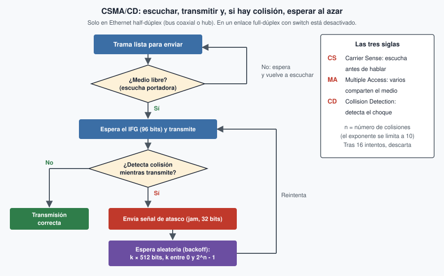{ width="820" }
  <figcaption>CSMA/CD solo se usa en half dúplex; en full dúplex está desactivado.</figcaption>
</figure>

El funcionamiento es este. El equipo escucha el medio; si está ocupado, espera. Cuando queda libre, guarda el IFG y transmite. Si mientras transmite detecta una colisión, deja de enviar datos y lanza una **señal de atasco** (*jam*) de 32 bits para que todos se enteren. Después espera un tiempo aleatorio, llamado **retroceso** (*backoff*), y vuelve a intentarlo. Ese tiempo es un número entero de **tiempos de ranura** de 512 bits, elegido al azar entre 0 y 2ⁿ − 1, donde *n* es el número de colisiones que lleva esa trama (con un tope de 10 en el exponente). Así, cuantas más colisiones, más amplio es el abanico y menos probable que los dos equipos vuelvan a elegir el mismo momento. Si una trama acumula 16 intentos fallidos, se descarta.

Aquí se entiende el tamaño mínimo de trama. El tiempo de ranura de 512 bits son exactamente 64 bytes: una trama de al menos ese tamaño tarda lo suficiente en transmitirse como para que, si choca con otra en el extremo más lejano del segmento, la colisión llegue al emisor antes de que haya terminado. Si una colisión aparece después de los primeros 64 bytes, se llama **colisión tardía** y casi siempre indica un problema: un cable demasiado largo o un desajuste de dúplex.

### CSMA/CA en Wi‑Fi

En una red inalámbrica, la tarjeta no puede escuchar mientras transmite, porque su propia señal tapa cualquier otra, y además dos equipos pueden no oírse entre sí aunque los dos oigan al punto de acceso. Por eso Wi‑Fi (IEEE 802.11) usa **CSMA/CA** (*Collision Avoidance*, con prevención de colisiones): en lugar de detectar el choque, intenta evitarlo. Antes de transmitir, el equipo escucha y espera un tiempo aleatorio aunque el medio parezca libre, y cada trama recibida correctamente se confirma con un **acuse de recibo** (ACK). Si el ACK no llega, el emisor supone que hubo colisión y repite.

### Half dúplex y full dúplex: por qué casi no hay colisiones

En **half dúplex** un equipo puede enviar o recibir, pero no las dos cosas a la vez; es el modo del hub y del cable coaxial, y ahí CSMA/CD es imprescindible. En **full dúplex** cada sentido tiene su propio par de hilos, de modo que el PC y el puerto del switch pueden transmitir a la vez sin pisarse. En un enlace full dúplex **no puede haber colisiones**, y por eso CSMA/CD está desactivado. Hoy prácticamente todos los enlaces PC–switch y switch–switch son full dúplex, y por eso CSMA/CD es sobre todo historia… y pregunta de examen.

**Ejemplo de aula.** Si un extremo del enlace está configurado a mano en full dúplex y el otro se ha quedado en half dúplex, el enlace funciona, pero va mal: el lado half dúplex detecta colisiones, sobre todo tardías, y los contadores de errores suben. Es el **desajuste de dúplex** (*duplex mismatch*), y se arregla dejando los dos extremos en autonegociación.

!!! warning "Errores frecuentes"
    Decir que el switch «usa CSMA/CD» en sus puertos: en full dúplex no se usa. Pensar que CSMA/CA elimina las colisiones: las hace menos probables, pero no las elimina. Creer que el retroceso es un tiempo fijo: es aleatorio, y por eso funciona.

---

## El switch por dentro {: #el-switch-por-dentro }

En el Tema 3 montaste el switch en el rack; ahora vamos a ver cómo decide. El **[switch](#switch)** es un equipo de capa 2 que reenvía cada trama según su **MAC de destino**, y para eso mantiene una **tabla de direcciones MAC**, también llamada tabla **CAM** (*Content Addressable Memory*), que relaciona cada MAC con el puerto por el que se llega a ella.

### Aprender, filtrar, reenviar e inundar

El switch empieza con la tabla vacía y la rellena solo, mirando el tráfico. Con cada trama que recibe hace dos cosas, siempre en el mismo orden. Primero **aprende**: lee la MAC de **origen** y anota que ese equipo está detrás del puerto por el que ha entrado la trama (si ya lo tenía, refresca la entrada). Después **decide** con la MAC de **destino**:

- Si el destino es broadcast o multicast, **inunda**: copia la trama por todos los puertos menos por el de entrada.
- Si el destino es unicast pero no está en la tabla, también **inunda**. Es una inundación por desconocimiento: cuando el destino conteste, el switch aprenderá dónde está.
- Si el destino está en la tabla y es otro puerto, **reenvía** la trama solo por ese puerto.
- Si el destino está en la tabla y es el mismo puerto por el que ha entrado, **filtra**: la descarta, porque el destino ya la ha recibido por su lado (pasa, por ejemplo, cuando detrás de ese puerto hay un hub con varios equipos).

<figure markdown="span">
  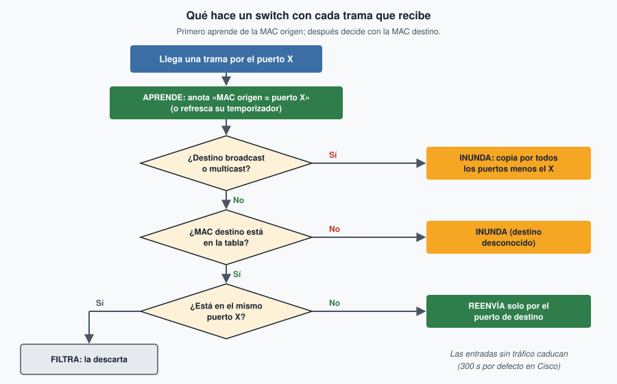{ width="820" }
  <figcaption>Primero aprende con el origen; después decide con el destino.</figcaption>
</figure>

Las entradas de la tabla no son eternas. Si de una MAC no llega tráfico durante un tiempo, el **tiempo de envejecimiento** (*aging time*), que en los switches Cisco es de 300 segundos por defecto, la entrada se borra. Así, si cambias un PC de puesto, el switch se adapta solo en cuanto ese PC vuelve a transmitir.

<figure markdown="span">
  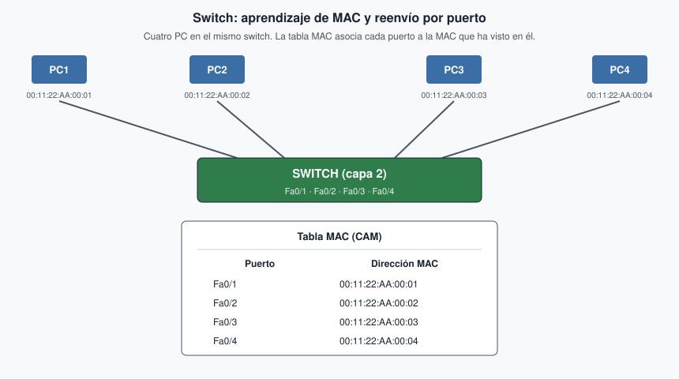{ width="780" }
  <figcaption>Tabla MAC ya aprendida: cada puerto asociado a la dirección que el switch ha visto en él. Las MAC son de laboratorio.</figcaption>
</figure>

**Ejemplo paso a paso.** Tomemos el switch de la figura, con PC1 en Fa0/1, PC2 en Fa0/2, PC3 en Fa0/3 y PC4 en Fa0/4, recién encendido y con la tabla vacía.

| Paso | Trama | Qué aprende | Qué hace con la trama |
| --- | --- | --- | --- |
| 1 | PC1 → PC3 | PC1 está en Fa0/1 | No conoce a PC3: inunda por Fa0/2, Fa0/3 y Fa0/4 |
| 2 | PC3 → PC1 | PC3 está en Fa0/3 | Conoce a PC1: reenvía solo por Fa0/1 |
| 3 | PC2 → `FF:FF:FF:FF:FF:FF` | PC2 está en Fa0/2 | Broadcast: inunda por Fa0/1, Fa0/3 y Fa0/4 |
| 4 | PC1 → PC2 | Refresca PC1 en Fa0/1 | Conoce a PC2: reenvía solo por Fa0/2 |

Fíjate en que PC4 todavía no aparece en la tabla, aunque ha recibido tres tramas: el switch aprende de lo que un equipo **envía**, no de lo que recibe.

!!! note "Para la certificación CCNA"
    La tabla se consulta con `show mac address-table` y se vacía con `clear mac address-table dynamic`. Las entradas que aprende el switch aparecen como `DYNAMIC`. Lo practicarás en la [PR402](#pr402-packet-tracer-tabla-mac-y-stp).

### Métodos de conmutación

No todos los switches esperan lo mismo antes de reenviar una trama. Con **almacenamiento y reenvío** (*store-and-forward*), el switch recibe la trama entera, comprueba el FCS y solo la reenvía si es correcta; añade algo de retardo, pero no propaga basura, y es lo habitual en los switches actuales. Con **corte** (*cut-through*), el switch empieza a reenviar en cuanto ha leído la MAC de destino; es el más rápido, pero puede propagar tramas dañadas, porque cuando llega el FCS la trama ya ha salido. El método **libre de fragmentos** (*fragment-free*) es un término medio: espera a los primeros 64 bytes, que es donde aparecen los restos de una colisión, y luego reenvía.

<figure markdown="span">
  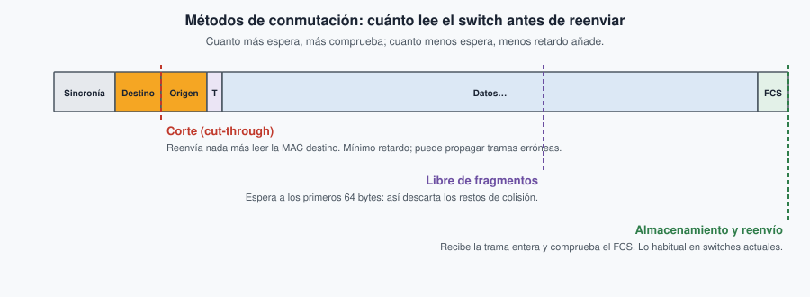{ width="820" }
  <figcaption>Cuanto más lee el switch antes de reenviar, más comprueba y más retardo añade.</figcaption>
</figure>

### Dominios de colisión y de difusión

Los dominios ya los contaste en el [Tema 1](../01-introduccion-arquitectura/tema1.md#dominios-colision-difusion); ahora puedes explicar por qué salen así. Un **[dominio de colisión](#dominio-de-colision)** es el conjunto de interfaces que pueden chocar entre sí: el hub repite la señal por todos sus puertos y forma uno solo, mientras que el switch, que reenvía tramas completas por un puerto concreto, abre un dominio por puerto (y en full dúplex ni siquiera hay colisiones). Un **[dominio de difusión](#dominio-de-difusion)** es el conjunto de interfaces a las que llega una trama de broadcast: como el switch inunda los broadcast por todos sus puertos, todos sus equipos están en el mismo dominio. Solo el router, que no reenvía broadcast de una interfaz a otra, o las VLAN del Tema 6, lo dividen.

| Equipo | Capa | Dominios de colisión | Dominios de difusión |
| --- | --- | --- | --- |
| **Hub** | 1 | Uno para todos sus puertos | No los divide |
| **Switch** | 2 | Uno por puerto | No los divide (salvo VLAN) |
| **Router** | 3 | Uno por interfaz | Uno por interfaz |

!!! warning "Errores frecuentes"
    Decir que el switch aprende de la MAC de destino: aprende de la de **origen**. Pensar que «inundar» es un fallo: es el comportamiento normal con destinos desconocidos y con broadcast. Creer que el switch separa los dominios de difusión: eso lo hacen el router o las VLAN.

---

## Bucles de capa 2 y STP {: #stp }

En una red real se ponen enlaces redundantes entre switches para que, si un cable o un switch falla, la red siga funcionando. El problema es que, en capa 2, un camino redundante es un **bucle**, y la trama Ethernet no tiene ningún campo que caduque: a diferencia del paquete IP, no lleva un contador de saltos. Sin protección, un bucle provoca tres desastres a la vez.

- **Tormenta de difusión.** Un solo broadcast se inunda por todos los puertos, vuelve por el otro camino, se vuelve a inundar y se multiplica sin fin hasta saturar los enlaces y la CPU de los equipos.
- **Inestabilidad de la tabla MAC.** El switch ve la misma MAC de origen entrar por dos puertos distintos y cambia la entrada constantemente.
- **Tramas duplicadas.** El destino recibe varias copias de la misma trama.

**[STP](#stp-glosario)** (*Spanning Tree Protocol*, protocolo de árbol de expansión, IEEE 802.1D) resuelve el problema dejando los cables conectados pero **bloqueando lógicamente** los puertos justos para que solo quede un camino activo entre cada par de switches. Si un enlace activo cae, STP desbloquea uno de los que estaban en espera.

<figure markdown="span">
  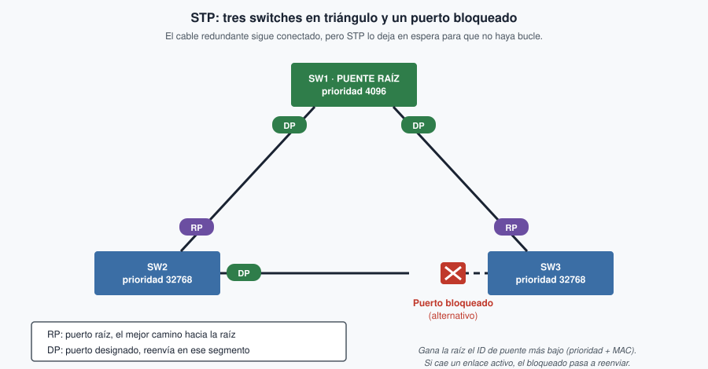{ width="820" }
  <figcaption>El enlace SW2–SW3 sigue conectado, pero un puerto queda bloqueado y rompe el bucle.</figcaption>
</figure>

Para decidir qué bloquear, los switches intercambian mensajes llamados **BPDU** (*Bridge Protocol Data Unit*) y siguen tres pasos:

1. **Eligen el puente raíz.** Cada switch tiene un **ID de puente** formado por una prioridad (32768 por defecto) y su MAC. Gana el ID más bajo: primero se mira la prioridad y, si empatan, la MAC más baja. Por eso conviene bajar a mano la prioridad del switch central para que sea él la raíz y no el más antiguo del armario.
2. **Cada switch elige su puerto raíz** (RP, *root port*): el que tiene el camino de menor coste hasta la raíz. El coste depende de la velocidad del enlace: cuanto más rápido, menor.
3. **En cada segmento se elige un puerto designado** (DP, *designated port*), el que reenvía hacia ese segmento. Todos los puertos de la raíz son designados. Los puertos que no son ni raíz ni designados se **bloquean**.

En el STP clásico, un puerto pasa por los estados de **bloqueo**, **escucha**, **aprendizaje** y **reenvío**, y desde que algo cambia hasta que la red vuelve a converger pueden pasar entre 30 y 50 segundos. Por eso, cuando conectas un PC a un switch con STP, el piloto se queda un rato en ámbar antes de ponerse verde. **RSTP** (*Rapid STP*, IEEE 802.1w) hace lo mismo pero converge en pocos segundos, y es lo que usan por defecto los switches actuales.

**Ejemplo de aula.** Si alguien conecta en el aula un latiguillo con los dos extremos en el mismo switch no gestionable, sin STP, la red se cae en segundos: todos los pilotos parpadean a la vez y nadie navega. Con un switch gestionable con STP activado, ese puerto se bloquea y la red sigue funcionando.

!!! note "Para la certificación CCNA"
    `show spanning-tree` muestra quién es la raíz, el rol de cada puerto (*Root*, *Desg*, *Altn*) y su estado. La prioridad se cambia con `spanning-tree vlan 1 priority 4096` y debe ser múltiplo de 4096.

!!! warning "Errores frecuentes"
    Pensar que STP desconecta físicamente el cable: lo bloquea de forma lógica y el piloto puede seguir encendido. Decir que gana la raíz el switch con la MAC más alta o el más moderno: gana el ID de puente más bajo. Desactivar STP «para que el piloto se ponga verde antes».

---

## EtherChannel (visión breve) {: #etherchannel }

A veces un solo enlace entre dos switches se queda corto. Si pones dos cables, STP bloquea uno y no ganas nada. **EtherChannel**, o agregación de enlaces, une varios enlaces físicos (hasta ocho activos) en un único **enlace lógico**. STP lo ve como uno solo y no bloquea ninguno, el tráfico se reparte entre los cables y, si uno falla, los demás siguen funcionando. Se negocia con **LACP** (*Link Aggregation Control Protocol*, estándar IEEE 802.3ad) o con **PAgP** (*Port Aggregation Protocol*, propietario de Cisco), y se usa entre switches o entre un switch y un servidor con varias tarjetas. Todos los puertos del grupo tienen que tener la misma velocidad y el mismo dúplex.

---

## Actividades

!!! tip "Formato de entrega"
    Las entregas en **Aules** son **obligatorias en Markdown** (`.md`). No se aceptan PDF.  
    Nombre del archivo: `AC4XX.md` o `PR4XX.md` (sustituye XX por el número). Respeta la fecha de vencimiento.  
    Escribiremos los `.md` con **Visual Studio Code**.

    !!! note "Cómo empezar"
        - Guía de Markdown: [tutorialmarkdown.com/guia](https://tutorialmarkdown.com/guia)
        - Documentación de Visual Studio Code: [code.visualstudio.com/docs](https://code.visualstudio.com/docs)

### AC401 — Leer una trama y una MAC {: #ac401-leer-una-trama-y-una-mac }

* :simple-readdotcv: **AC401**. (RA1 // CE1a, CE1c // **AC 0–1**). Analiza esta trama, copiada de una captura tal como la muestra Wireshark (sin preámbulo ni FCS), y después tu propia NIC.

    ```text
    ff ff ff ff ff ff 02 5e 10 aa 3c 01 08 06 00 01
    08 00 06 04 00 01 02 5e 10 aa 3c 01 c0 a8 0a 15
    00 00 00 00 00 00 c0 a8 0a 01 00 00 00 00 00 00
    00 00 00 00 00 00 00 00 00 00 00 00
    ```

    1. Separa los campos de la cabecera Ethernet: MAC destino, MAC origen y tipo. ¿Qué protocolo va dentro?
    2. Clasifica la MAC de destino (unicast, multicast o broadcast) y la de origen (universal o local). Justifica cada respuesta con los bits del primer byte.
    3. Cuenta los bytes del campo de datos. ¿Por qué hay ceros al final?
    4. Con `ipconfig /all` (Windows) o `ip link` (Linux), localiza la MAC de tu adaptador cableado y la del Wi‑Fi, si lo tiene. Escribe **solo los tres primeros bytes** (sustituye el resto por `XX`), busca el fabricante en el [registro público de OUI del IEEE](https://regauth.standards.ieee.org/standards-ra-web/pub/view.html) y di si es universal o local.

### AC402 — Acceso al medio y dúplex {: #ac402-acceso-al-medio-y-duplex }

* :simple-readdotcv: **AC402**. (RA1 // CE1a // **AC 0–1**). Explica, con tus palabras y un ejemplo del aula para cada caso:

    1. Qué tienen en común y en qué se diferencian CSMA/CD y CSMA/CA, y por qué Wi‑Fi no puede usar CSMA/CD.
    2. Por qué en un enlace full dúplex PC–switch no hay colisiones.
    3. Qué relación hay entre el tiempo de ranura de 512 bits y la trama mínima de 64 bytes.
    4. Qué síntomas da un desajuste de dúplex y cómo lo comprobarías.

### AC403 — El switch paso a paso {: #ac403-el-switch-paso-a-paso }

* :simple-readdotcv: **AC403**. (RA1 // CE1a, CE1c // **AC 0–1**). Un switch de cuatro puertos acaba de arrancar con la tabla vacía. En Fa0/1 está PC-A (`0A:00:00:00:00:0A`), en Fa0/2 PC-B (`0A:00:00:00:00:0B`) y en Fa0/3 PC-C (`0A:00:00:00:00:0C`). En Fa0/4 hay un hub con PC-D (`0A:00:00:00:00:0D`) y PC-E (`0A:00:00:00:00:0E`). Se envían, en este orden, estas tramas:

    1. PC-A → PC-B
    2. PC-B → PC-A
    3. PC-C → `FF:FF:FF:FF:FF:FF`
    4. PC-D → PC-E
    5. PC-A → PC-E
    6. PC-E → PC-A
    7. PC-D → PC-E

    Para cada trama, haz una tabla con tres columnas: qué entrada aprende o refresca el switch, qué hace con la trama (inundar, reenviar o filtrar) y por qué puertos sale. Al final, escribe la tabla MAC completa y responde: ¿qué equipos reciben físicamente la trama 4?

### AC404 — Bucles, STP y EtherChannel {: #ac404-bucles-stp-y-etherchannel }

* :simple-readdotcv: **AC404**. (RA1 // CE1a // RA4 // CE4g // **AC 0–1**). Tres switches en triángulo: SW-A con prioridad 32768 y MAC `0000.0c00.000a`, SW-B con prioridad 32768 y MAC `0000.0c00.0005`, y SW-C con prioridad 28672 y MAC `0000.0c00.00ff`.

    1. ¿Cuál será el puente raíz? Justifica la comparación.
    2. Describe qué ocurriría en esa red si STP estuviera desactivado y un PC enviara un broadcast.
    3. ¿Qué diferencia hay entre STP y RSTP y por qué importa en un aula?
    4. Si quieres duplicar el ancho de banda entre SW-A y SW-B, ¿por qué no basta con poner un segundo cable y qué configurarías?

### PR401 — Dominios y conmutación en una topología {: #pr401-dominios-y-conmutacion }

| Campo | Valor |
| --- | --- |
| **Código** | **PR401** |
| **UP / tema** | T4 — Capa de enlace |
| **RA principal** | **RA1** |
| **CE de cobertura** | CE1a, CE1c |
| **Sesiones estimadas** | **2** |
| **Instrumento** | Rúbrica 0–10 |

<figure markdown="span">
  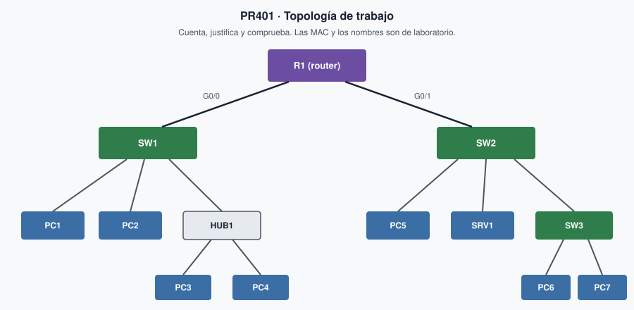{ width="820" }
  <figcaption>Topología de la PR401. Todos los enlaces con switch trabajan en full dúplex salvo el del hub.</figcaption>
</figure>

* :simple-readdotcv: **PR401**. Individual. Trabaja sobre esta topología y entrega `PR401.md` con las respuestas razonadas. No basta con el número: tienes que explicar por qué.

  **Enunciado:**

  1. Cuenta los **dominios de colisión** y los **dominios de difusión**. Márcalos sobre el diagrama (puedes redibujarlo en [Excalidraw](https://excalidraw.com/) o [draw.io](https://app.diagrams.net/)) y justifica el conteo.
  2. PC1 envía un broadcast. ¿Qué equipos lo reciben? ¿Llega a PC5? ¿Por qué?
  3. PC3 envía una trama unicast a PC4. ¿Qué equipos la reciben físicamente? ¿Qué hace SW1 con ella si ya conoce a PC4?
  4. Con todas las tablas vacías, PC6 envía una trama a SRV1 y SRV1 responde. Escribe qué entradas aprenden SW3 y SW2 con cada trama y por qué puertos sale cada una.
  5. ¿En qué enlace de esta red podría haber colisiones hoy? Propón un cambio de equipo que las elimine y di cuántos dominios de colisión habría después.

| Criterio (rúbrica) | Descripción | Puntos |
| --- | --- | --- |
| Conteo de dominios | Colisión y difusión correctos y marcados | 0–3 |
| Broadcast y unicast | Preguntas 2 y 3 razonadas | 0–2 |
| Aprendizaje de tablas | Pregunta 4: entradas y puertos correctos | 0–3 |
| Mejora propuesta | Pregunta 5 justificada | 0–1 |
| Claridad del `.md` | Orden, diagrama y redacción | 0–1 |
| **Total** | | **/10** |

### PR402 — Packet Tracer: tabla MAC y STP {: #pr402-packet-tracer-tabla-mac-y-stp }

| Campo | Valor |
| --- | --- |
| **Código** | **PR402** |
| **UP / tema** | T4 — Capa de enlace |
| **RA principal** | **RA4**. Apoyo **RA1** |
| **CE de cobertura** | CE4h · CE1a, CE1c |
| **Sesiones estimadas** | **2** en clase; se termina en casa |
| **Instrumento** | Rúbrica 0–10 |

* :simple-cisco: **PR402**. Individual, en [Cisco Packet Tracer](https://www.netacad.com/es/cisco-packet-tracer). Vas a ver con tus propios ojos cómo aprende un switch y cómo STP rompe un bucle.

  **Enunciado (pasos):**

  1. Coloca tres switches 2960 (SW1, SW2 y SW3) y únelos en triángulo con cables directos entre puertos GigabitEthernet. Conecta dos PC a cada switch.
  2. Asigna a los seis PC una IP de la red `192.168.40.0/24` (de `.11` a `.16`) con máscara `255.255.255.0`. Espera a que todos los pilotos pasen de ámbar a verde y anota cuánto tardan.
  3. En la CLI de SW1, ejecuta `show mac address-table`. Haz `ping` desde un PC de SW1 a uno de SW3 y repite el comando. Explica las entradas nuevas y por qué puerto aparece cada MAC.
  4. Ejecuta `clear mac address-table dynamic`, pasa al **modo Simulación**, filtra solo ARP e ICMP y repite el `ping`. Captura el momento en que la primera trama se inunda y el momento en que la respuesta ya va solo por un puerto.
  5. Ejecuta `show spanning-tree` en los tres switches. Indica cuál es el puente raíz, el rol de cada puerto y cuál está bloqueado. Comprueba que coincide con lo que predice la regla del ID de puente más bajo.
  6. Haz que SW2 sea la raíz con `spanning-tree vlan 1 priority 4096` y comprueba qué puerto se bloquea ahora.
  7. Apaga con `shutdown` uno de los enlaces activos y observa cómo el puerto bloqueado pasa a reenviar. Comprueba con `ping` que la red sigue funcionando.

  **Entrega:** `PR402.md` con las capturas y la explicación de cada paso, más el archivo `.pkt`.

| Criterio (rúbrica) | Descripción | Puntos |
| --- | --- | --- |
| Topología y direccionamiento | Triángulo y PC configurados y con conectividad | 0–2 |
| Tabla MAC | Pasos 3 y 4 explicados con capturas | 0–3 |
| STP | Raíz, roles y puerto bloqueado justificados | 0–3 |
| Cambio de raíz y reconvergencia | Pasos 6 y 7 con capturas | 0–1 |
| Informe `.md` | Orden, capturas legibles y redacción | 0–1 |
| **Total** | | **/10** |

---

## Para el examen

La capa de enlace trabaja **salto a salto**: la trama va de un equipo a su vecino y se rehace en cada router, mientras el paquete IP mantiene sus direcciones. Se divide en **LLC** (802.2, común) y **MAC** (802.3 en cable, 802.11 en Wi‑Fi). La trama Ethernet lleva preámbulo y SFD (8 bytes, no cuentan), **MAC destino** y **MAC origen** (6 + 6), tipo (2; `0x0800` IPv4, `0x0806` ARP), datos de **46 a 1500** bytes y **FCS** de 4 bytes con **CRC‑32**; mide entre **64 y 1518** bytes. El CRC **detecta** errores y la trama dañada se descarta; no se corrige.

La MAC tiene **48 bits**: **OUI** del fabricante (3 bytes) y tarjeta (3 bytes). El bit I/G distingue **unicast** de **multicast**, el bit U/L distingue universal de local, y `FF:FF:FF:FF:FF:FF` es **broadcast**. **CSMA/CD** escucha, transmite, detecta la colisión, envía atasco y espera un tiempo aleatorio; solo se usa en **half dúplex**. Wi‑Fi usa **CSMA/CA** con ACK. En **full dúplex** no hay colisiones.

El switch **aprende** de la MAC de **origen** y decide con la de **destino**: reenvía si la conoce, **inunda** si es broadcast o desconocida y **filtra** si está en el mismo puerto. Un dominio de colisión por puerto y uno de difusión para todo el switch (salvo VLAN). **STP** elige el puente raíz por el ID más bajo (prioridad + MAC) y bloquea puertos para evitar bucles; **RSTP** converge más rápido. **EtherChannel** agrupa enlaces en uno lógico.

CE clave de este tema: **CE1a, CE4g**.

## Autocheck del tema

Hazlo **después** de entregar el cuestionario inicial en Aules.

1. **V/F.** La trama Ethernet conserva sus direcciones MAC desde el PC hasta un servidor de Internet.
2. ¿Qué subcapa es común a Ethernet y a Wi‑Fi y en qué norma se recoge?
3. Ordena los campos de la trama Ethernet: FCS · MAC origen · preámbulo · tipo · MAC destino · datos · SFD.
4. La trama Ethernet mínima mide…  
   a) 46 bytes · b) 64 bytes · c) 72 bytes · d) 1518 bytes
5. **V/F.** Si el receptor detecta un error con el CRC, corrige los bits dañados.
6. ¿Qué protocolo va dentro de una trama con tipo `0x0806`?
7. Clasifica estas MAC en unicast, multicast o broadcast: `00:00:0C:12:34:56` · `01:00:5E:00:00:FB` · `FF:FF:FF:FF:FF:FF`.
8. ¿Qué indica que el segundo dígito hexadecimal de una MAC sea 2, 6, A o E?
9. ¿Qué comando usarías en Windows para ver la MAC de tus adaptadores?
10. Empareja: **TDM** · **paso de testigo** · **CSMA/CD** con: (a) contienda · (b) particionado del canal · (c) toma de turnos.
11. **V/F.** En un enlace full dúplex PC–switch se usa CSMA/CD.
12. ¿Por qué Wi‑Fi usa CSMA/CA y no CSMA/CD?
13. ¿De qué dirección aprende el switch, de la de origen o de la de destino?
14. Un switch recibe una trama unicast para una MAC que no está en su tabla. ¿Qué hace?
15. ¿Qué método de conmutación comprueba el FCS antes de reenviar?
16. **V/F.** Un switch de 24 puertos sin VLAN tiene 24 dominios de difusión.
17. Nombra los tres problemas que provoca un bucle de capa 2 sin STP.
18. Dos switches tienen prioridad 32768; uno tiene la MAC `0000.0c00.0001` y el otro `0000.0c00.0002`. ¿Cuál será la raíz?
19. ¿Qué hace STP con el cable redundante: lo desconecta o lo bloquea?
20. ¿Qué ventaja tiene EtherChannel frente a poner dos cables sueltos entre dos switches?

!!! info "Soluciones"
    Las soluciones se publicarán aquí cuando cierre el cuestionario inicial en Aules.

---

## Vídeos recomendados

Pablo Hidalgo explica cómo trabaja un switch Ethernet de capa 2 (CCNA v1.1, lección 6): tabla MAC, unicast y broadcast. Si ya lo viste en el Tema 3, vuelve a verlo ahora con la trama y el diagrama de decisión delante.

<div style="position: relative; padding-bottom: 56.25%; height: 0; overflow: hidden;">
  <iframe src="https://www.youtube-nocookie.com/embed/vYKwD7OF6xY"
          style="position: absolute; top: 0; left: 0; width: 100%; height: 100%;"
          frameborder="0"
          allow="accelerometer; autoplay; clipboard-write; encrypted-media; gyroscope; picture-in-picture"
          allowfullscreen
          title="CCNA v1.1 Lección 6 — switches Ethernet de capa 2 (Pablo Hidalgo)"></iframe>
</div>

El resto de lecciones de la misma playlist ([CCNA Completo v1.1](https://www.youtube.com/playlist?list=PLxnG_9vdV6-gEWV15pq89XK_W3G8vP5_0)) amplían Ethernet, STP y EtherChannel.

## Glosario

**trama**{: #trama}
PDU de la capa de enlace: cabecera con direcciones MAC, datos y FCS. Solo viaja entre equipos vecinos.

**LLC**{: #llc}
*Logical Link Control*, control de enlace lógico (IEEE 802.2). Subcapa superior de la capa 2, común a todas las tecnologías de LAN.

**MAC**{: #mac}
*Media Access Control*, control de acceso al medio. Subcapa inferior de la capa 2 (802.3, 802.11) y, por extensión, la dirección de 48 bits que identifica cada interfaz.

**OUI**{: #oui}
*Organizationally Unique Identifier*: los tres primeros bytes de la MAC, asignados por el IEEE a cada fabricante.

**FCS**{: #fcs}
*Frame Check Sequence*: últimos 4 bytes de la trama, con el resultado del CRC.

**CRC**{: #crc-glosario}
*Cyclic Redundancy Check*, comprobación de redundancia cíclica. Cálculo que permite detectar errores en la trama; no los corrige.

**MTU**{: #mtu}
*Maximum Transmission Unit*: tamaño máximo de datos de una trama; 1500 bytes en Ethernet.

**broadcast**{: #broadcast}
Difusión: trama dirigida a todos los equipos del dominio de difusión. MAC `FF:FF:FF:FF:FF:FF`.

**CSMA/CD**{: #csma-cd-glosario}
*Carrier Sense Multiple Access with Collision Detection*: método de acceso del Ethernet half dúplex. Escucha, transmite, detecta colisiones y reintenta tras un tiempo aleatorio.

**CSMA/CA**{: #csma-ca}
*Carrier Sense Multiple Access with Collision Avoidance*: método de acceso de Wi‑Fi. Intenta evitar las colisiones y confirma cada trama con un ACK.

**switch**{: #switch}
Conmutador de capa 2: aprende MAC de origen y reenvía cada trama por el puerto del destino.

**tabla MAC**{: #tabla-mac}
Tabla del switch (CAM) que relaciona cada MAC con un puerto. Sus entradas caducan si no hay tráfico.

**dominio de colisión**{: #dominio-de-colision}
Conjunto de interfaces que pueden colisionar entre sí. El switch crea uno por puerto.

**dominio de difusión**{: #dominio-de-difusion}
Conjunto de interfaces a las que llega un broadcast. Lo dividen el router y las VLAN.

**STP**{: #stp-glosario}
*Spanning Tree Protocol* (IEEE 802.1D): protocolo que bloquea puertos para eliminar bucles de capa 2. Su versión rápida es RSTP (802.1w).

**BPDU**{: #bpdu}
*Bridge Protocol Data Unit*: mensaje que intercambian los switches para calcular el árbol de STP.

**EtherChannel**{: #etherchannel-glosario}
Agregación de varios enlaces físicos en uno lógico. Se negocia con LACP (estándar) o PAgP (Cisco).

---

## Relación con el resto del módulo

El **Tema 1** presentó la MAC, el switch y los dominios; el **Tema 2**, el medio y el dúplex; el **Tema 3** montó el switch en el rack. Aquí has visto qué hace ese switch con cada trama. El **Tema 5** sube a la capa de red: IP, máscaras y **ARP**, el protocolo que traduce una IP en la MAC que va en la trama. El **Tema 6** divide el switch con **VLAN** usando la etiqueta 802.1Q que has visto en la trama.

---

## Referencias rápidas

- Sitio del módulo: [fjavier-hernandez.github.io/ral](https://fjavier-hernandez.github.io/ral/)
- Diagramas: [Excalidraw](https://excalidraw.com/), [draw.io (diagrams.net)](https://app.diagrams.net/), [Dia](https://wiki.gnome.org/Apps/Dia)
- Simulación: [Cisco Packet Tracer](https://www.netacad.com/es/cisco-packet-tracer)
- Registro de OUI: [IEEE Registration Authority](https://regauth.standards.ieee.org/standards-ra-web/pub/view.html)
- Entregas: [Visual Studio Code](https://code.visualstudio.com/docs) + [Markdown](https://tutorialmarkdown.com/guia)
- Normas: [Normas del taller](../00-normas/normas_taller.md)
- Playlist CCNA (Pablo Hidalgo): [CCNA Completo v1.1](https://www.youtube.com/playlist?list=PLxnG_9vdV6-gEWV15pq89XK_W3G8vP5_0)

*[RA]: Resultado de aprendizaje
*[CE]: Criterio de evaluación
*[AC]: Actividad de clase
*[PR]: Práctica
*[NIC]: Network Interface Card
*[LLC]: Logical Link Control
*[MAC]: Media Access Control
*[SFD]: Start Frame Delimiter
*[FCS]: Frame Check Sequence
*[CRC]: Cyclic Redundancy Check
*[OUI]: Organizationally Unique Identifier
*[MTU]: Maximum Transmission Unit
*[IFG]: Inter-Frame Gap
*[CAM]: Content Addressable Memory
*[STP]: Spanning Tree Protocol
*[RSTP]: Rapid Spanning Tree Protocol
*[BPDU]: Bridge Protocol Data Unit
*[LACP]: Link Aggregation Control Protocol
*[PAgP]: Port Aggregation Protocol
*[TDM]: Time Division Multiplexing
*[FDM]: Frequency Division Multiplexing
