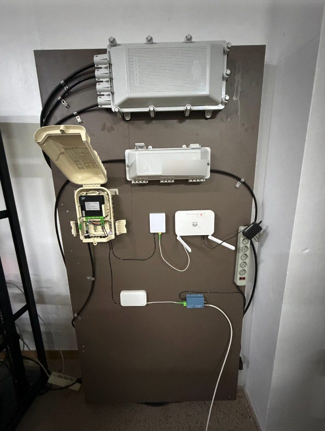
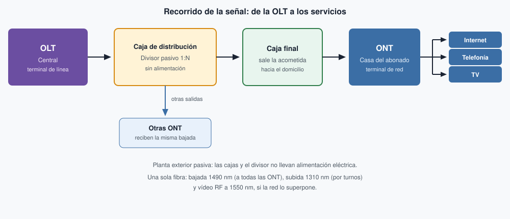

# Redes FTTH/GPON (reserva)

Este apartado salió del [Tema 3](../03-cableado-estructurado/tema3.md). No se imparte, no está en la navegación y la build lo excluye. Se conserva aquí, con los dos ejemplos, las figuras y el aviso de errores, por si más adelante vuelve a hacer falta. Las imágenes siguen en `docs/img/` (`t3-gpon-panel-taller.jpg` y `t3-gpon-recorrido.svg`).

## Redes FTTH/GPON

La **fibra hasta el hogar** (**[FTTH](#ftth)**, *Fiber To The Home*) lleva la fibra óptica hasta el domicilio del abonado. Sustituye al coaxial de la acometida y a la red híbrida de fibra y coaxial (**HFC**, *Hybrid Fiber-Coaxial*), en la que la fibra acaba en un nodo de calle y el último tramo sigue siendo coaxial, con amplificadores que hay que alimentar y ajustar. El medio de una FTTH es la fibra monomodo del [Tema 2](../02-medios-capa-fisica/tema2.md#multimodo-mm-y-monomodo-sm): un solo modo de luz y distancias de kilómetros.

La planta exterior no lleva equipos activos. Los divisores solo parten la luz, así que no necesitan alimentación eléctrica ni ajustes de nivel. Al eliminar el cobre y esa alimentación desaparece una fuente habitual de averías del coaxial. El alcance también cambia: la UIT-T G.984.2 contempla hasta **20 km** de fibra entre la central y el abonado. La distancia que de verdad se alcanza depende de las pérdidas; el ejemplo 2 hace esa cuenta. Con coaxial, de forma orientativa, el tramo útil se queda en unos **2 km** en el mejor de los casos. La fibra admite más velocidad: en GPON, la bajada de referencia es de **2,5 Gbit/s** y la subida de **1,25 Gbit/s**, compartidas por los abonados de un mismo árbol. La evolución **XGS-PON** (*10-Gigabit-capable Symmetric Passive Optical Network*, UIT-T G.9807.1) llega a **10 Gbit/s** en los dos sentidos y conserva la misma planta pasiva.

Esa arquitectura se llama **[GPON](#gpon)** (*Gigabit-capable Passive Optical Network*, red óptica pasiva con capacidad de gigabit) y está descrita en la UIT-T G.984. De la central a la casa intervienen cuatro piezas:

1. La **[OLT](#olt)** (*Optical Line Terminal*, terminal de línea óptica) está en la central. Genera la señal de bajada, recibe la de subida y asigna el turno de cada abonado.
2. La **red de distribución óptica** es el conjunto de fibras y cajas que hay entre la OLT y el domicilio. En las **cajas de distribución** y en las **cajas terminales** o finales se colocan los **[divisores ópticos](#divisor-optico)** pasivos, con relaciones **1:8**, **1:16**, **1:32** o **1:64**. El reparto puede hacerse en un solo divisor o en dos escalones, uno en cada caja.
3. La **acometida** es el último tramo de fibra, desde la caja final hasta el domicilio.
4. La **[ONT](#ont)** (*Optical Network Terminal*, terminal de red óptica) está en casa del abonado. La norma llama ONU (*Optical Network Unit*, unidad de red óptica) al equipo de usuario en general; en FTTH ese equipo es la ONT, y de ella salen **internet**, **telefonía** y **televisión**.

En el taller hay un panel con estas piezas montadas, que se trabajará en la sesión práctica.

<figure markdown="span">
  { width="500" }
  <figcaption>Panel de prácticas FTTH del taller. Arriba, las cajas de planta exterior; a la izquierda, la caja terminal abierta con el divisor; en el centro, la roseta óptica y el equipo de usuario. Foto: Departamento de Informática.</figcaption>
</figure>

Los dos sentidos viajan por **una sola fibra**, separados por longitud de onda (multiplexación **WDM**, *Wavelength Division Multiplexing*). La bajada va a **1490 nm**, la subida a **1310 nm** y, cuando la red superpone vídeo de radiofrecuencia (RF), ese canal va a **1550 nm** junto con la bajada. Si la televisión va por IP, la longitud de 1550 nm puede no usarse. La bajada es de **difusión**: el divisor copia la misma luz hacia todas las ONT y cada una se queda con sus datos. La subida usa acceso múltiple por división en el tiempo (**TDMA**, *Time Division Multiple Access*): la OLT concede un turno a cada ONT para que no emitan a la vez sobre la fibra que comparten.

### Ejemplo 1. Recorrido de la señal

La OLT inyecta la bajada a 1490 nm en la fibra que sale de la central. En la caja de distribución, el divisor pasivo reparte esa luz entre varias fibras. Una de ellas llega a la caja final del edificio o de la calle, y desde ahí la acometida entra en el domicilio hasta la ONT. La ONT convierte la luz en internet, telefonía y televisión. A la vuelta, la ONT transmite a 1310 nm solo durante su turno; el mismo divisor junta las subidas y las devuelve a la OLT. El resto de salidas del divisor llevan la misma bajada a otros abonados.

<figure markdown="span">
  { width="900" }
  <figcaption>Ejemplo de recorrido. Una sola fibra lleva la bajada (1490 nm), la subida (1310 nm) y, si se usa, el vídeo RF (1550 nm). El divisor no se alimenta y copia la bajada hacia cada abonado.</figcaption>
</figure>

### Ejemplo 2. Cálculo sencillo de pérdidas

Casi todo el margen se lo queda el divisor. En este ejemplo, la fibra, las fusiones y los conectores se cuentan con cifras **orientativas de proyecto**; el intervalo de la clase B+ sí lo fija la norma. Un divisor **1:32** se toma a **17 dB**, valor típico de catálogo: solo repartir la luz entre 32 salidas ya ronda los 15 dB, y el divisor real añade un poco más. La fibra de planta se toma a **0,35 dB/km** a **1310 nm**, por debajo del máximo de **0,4 dB/km** que la UIT-T G.652 asigna a la fibra monomodo de cable en esa longitud. Cada fusión bien hecha se cuenta a **0,1 dB** y cada conector a **0,5 dB**.

Se calcula la **subida**, a 1310 nm, porque ahí la fibra atenúa más que a 1490 nm. El enlace del ejemplo tiene **8 km**, un solo divisor 1:32, **cuatro fusiones** y **cuatro conectores**:

| Concepto | Cálculo | Pérdida |
| --- | --- | --- |
| Divisor óptico 1:32 | valor típico | 17 dB |
| Fibra de planta, 8 km a 1310 nm | 8 × 0,35 dB/km | 2,8 dB |
| 4 fusiones bien hechas | 4 × 0,1 dB | 0,4 dB |
| 4 conectores | 4 × 0,5 dB | 2,0 dB |
| **Total** | | **22,2 dB** |

La clase **B+** admite entre **13 dB** y **28 dB** de pérdida, tanto a 1490 nm como a 1310 nm (UIT-T G.984.2, anexo A, tabla A.2). Por debajo de 13 dB llega demasiada potencia y el receptor puede saturarse; por encima de 28 dB la señal ya no basta. El total de 22,2 dB entra en ese intervalo: el enlace funciona. Hasta el máximo quedan **5,8 dB** de margen (28 − 22,2).

Ese margen es el que se trabaja en el [empalme por fusión](../03-cableado-estructurado/tema3.md#empalme-por-fusion-vision-de-taller). Si las cuatro fusiones quedaran en 1 dB en lugar de 0,1 dB, aportarían 4 dB en vez de 0,4 dB y el total pasaría a **25,8 dB**. El enlace seguiría dentro, pero el margen bajaría a 2,2 dB. Unos empalmes defectuosos de más sacan el enlace de los 28 dB y la ONT deja de recibir nivel suficiente.

!!! warning "Errores frecuentes"
    Invertir bajada y subida: a 1490 nm la señal llega a todas las ONT; a 1310 nm cada ONT espera su turno. Tratar el divisor como un amplificador de coaxial: no se alimenta y no se ajusta. Sumar dos divisores cuando el reparto del ejemplo es uno solo. Dar por buena una fusión deficiente porque aún se mide algo de luz: cada décima de más sale del margen de 28 dB.

---

## Glosario de este apartado

**FTTH**{: #ftth}
*Fiber To The Home*, fibra hasta el hogar: la fibra óptica llega al domicilio del abonado y termina en la ONT.

**GPON**{: #gpon}
*Gigabit-capable Passive Optical Network*, red óptica pasiva con capacidad de gigabit (UIT-T G.984): una OLT reparte la fibra entre varias ONT mediante divisores sin alimentación.

**OLT**{: #olt}
*Optical Line Terminal*, terminal de línea óptica: equipo de la central. Origina la bajada y asigna los turnos de subida.

**ONT**{: #ont}
*Optical Network Terminal*, terminal de red óptica: equipo en casa del abonado. Entrega internet, telefonía y televisión.

**divisor óptico**{: #divisor-optico}
Repartidor pasivo (*splitter*): parte la potencia de una fibra entre varias salidas (1:8, 1:16, 1:32, 1:64…). No se alimenta y concentra la mayor parte de la pérdida del enlace.
